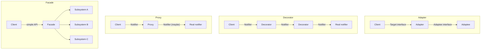

## The deciding question

All four patterns put an object in front of another object. They differ in **why**:

| Pattern | The wrapper exists to… | Interface towards the client | Wraps |
|---|---|---|---|
| **Adapter** | *translate* an incompatible interface | **Different** from the wrapped object's | One object |
| **Decorator** | *add* behaviour while keeping the interface | **Same** as the wrapped object's | One object (stackable) |
| **Proxy** | *control access* to the real object | **Same** as the real object's | One object |
| **Facade** | *simplify* a complex subsystem | **New**, simpler interface | Many objects |

> [!KEY] Ask two questions
> 1. Does the client see the **same interface** as the wrapped object? If not, it is an Adapter or a Facade.
> 2. Is the purpose to **add behaviour** (Decorator), **control access** (Proxy), **translate** (Adapter) or **simplify** (Facade)?

## Side by side in Java

These sketches all use one scenario — sending notifications — so that only the pattern changes. They are illustrative; the [Adapter article](/design-patterns/structural/adapter) has a complete, tested example.

```java
interface Notifier {
    void send(String to, String message);
}
```

**Adapter** — make a vendor SDK with a different interface look like `Notifier`:

```java
final class SmsVendorAdapter implements Notifier {
    private final SmsVendorClient client;              // incompatible API
    public void send(String to, String message) {
        client.dispatch(new SmsRequest(normalisePhone(to), message.getBytes(UTF_8)));
    }
}
```

**Decorator** — same interface, extra behaviour, can be stacked:

```java
final class RetryingNotifier implements Notifier {
    private final Notifier inner;
    public void send(String to, String message) {
        for (int attempt = 1; ; attempt++) {
            try { inner.send(to, message); return; }
            catch (TransientException e) { if (attempt == 3) throw e; }
        }
    }
}
// Stacking: new LoggingNotifier(new RetryingNotifier(new SmsVendorAdapter(client)))
```

**Proxy** — same interface, controls *whether and when* the real object is used:

```java
final class RateLimitedNotifierProxy implements Notifier {
    private final Notifier real;
    private final RateLimiter limiter;
    public void send(String to, String message) {
        if (!limiter.tryAcquire(to)) throw new TooManyNotificationsException(to);
        real.send(to, message);
    }
}
```

**Facade** — one simple entry point over several collaborators:

```java
final class CustomerCommunications {
    private final Notifier sms;
    private final EmailService email;
    private final PreferenceStore preferences;
    private final TemplateEngine templates;

    public void orderShipped(Customer customer, Order order) {
        String text = templates.render("order-shipped", order);
        if (preferences.wantsSms(customer.id())) sms.send(customer.phone(), text);
        email.send(customer.email(), "Your order has shipped", text);
    }
}
```



## Decorator versus Proxy — the subtle pair

Decorator and Proxy have identical class diagrams. The differences are in intent and in who controls the wrapped object:

| | Decorator | Proxy |
|---|---|---|
| Purpose | Add responsibilities | Control access: lazy creation, security, remoting, caching, transactions |
| Who creates the wrapped object | Usually the client, which composes decorators explicitly | Often the proxy itself, or a framework, invisibly to the client |
| Stacking | Common and expected | Possible, but not the point |
| Typical examples | `BufferedInputStream`, `Collections.synchronizedList` | Spring AOP proxies for `@Transactional`, Hibernate lazy-loading proxies, `java.lang.reflect.Proxy` |

Some wrappers are legitimately described as either. A caching wrapper can be seen as a decorator (it adds caching) or a proxy (it controls access to an expensive object). Explaining *why* you would call it one or the other is the point.

## Real-world examples

| Pattern | JDK or Spring example |
|---|---|
| Adapter | `InputStreamReader`, `Arrays.asList`, Spring MVC `HandlerAdapter` |
| Decorator | `BufferedReader`, `Collections.unmodifiableList`, `GZIPOutputStream` |
| Proxy | Spring `@Transactional` and `@Cacheable` proxies, JPA lazy associations, RMI stubs |
| Facade | SLF4J (the Simple Logging Facade for Java) over logging backends; Spring's `JdbcTemplate` resembles a facade over JDBC (it is also a template method) |

## Interview questions and answers

**What is the difference between Adapter and Decorator?**
An adapter changes the interface so that an incompatible class can be used. A decorator keeps the interface and adds behaviour, and decorators can be stacked.

**What is the difference between Decorator and Proxy?**
They share the same structure. A decorator adds responsibilities, usually composed explicitly by the client. A proxy controls access to the real object — lazily, remotely, securely or transactionally — often transparently.

**What is the difference between Adapter and Facade?**
An adapter makes one existing interface fit an expected one. A facade defines a new, simpler interface over a whole subsystem of several classes.

**Is Spring's `@Transactional` a decorator or a proxy?**
Spring implements it with a proxy (JDK dynamic proxy or CGLIB subclass) that starts and commits transactions around the real method. Because the proxy wraps calls from outside the bean, a method calling another `@Transactional` method on `this` bypasses the proxy — the well-known self-invocation pitfall.

> [!INTERVIEW] Lead with intent
> "They all wrap an object; Adapter translates, Decorator adds, Proxy controls access, Facade simplifies" is a complete one-sentence answer. Then give one JDK example of each.

## Related topics

- [Adapter Pattern](/design-patterns/structural/adapter)
- [All 23 GoF Patterns: Overview](/design-patterns/gof-overview)
- [Structural patterns](/design-patterns/structural)

## References

- Gamma, Helm, Johnson, Vlissides. *Design Patterns*. Addison-Wesley, 1994. Discussion of structural patterns, pp. 219–220.
- [Spring Framework reference: Understanding AOP Proxies](https://docs.spring.io/spring-framework/reference/core/aop/proxying.html).
