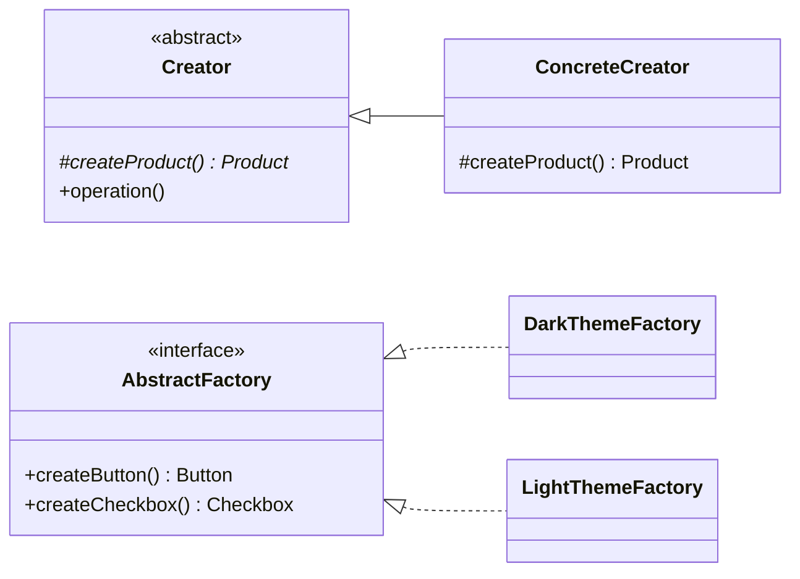

## The five "factories"

| Technique | GoF pattern? | Mechanism | Choice made by | Creates |
|---|---|---|---|---|
| **Static factory method** | No (Java idiom, *Effective Java* Item 1) | A named static method instead of a constructor | The method, from its arguments | One object |
| **Simple factory** | No | One method with a conditional | A runtime value | One object of several possible classes |
| **Factory Method** | **Yes** | An overridable method in a creator class | The **subclass** | One product |
| **Abstract Factory** | **Yes** | An object with several creation methods | The **factory object** you pass in | A **family** of related products |
| **Builder** | **Yes** | Step-by-step construction | The client (and director) | One complex object |

## Side by side

```java
// Static factory method: a named constructor.
Duration timeout = Duration.ofSeconds(30);
List<String> names = List.of("a", "b");

// Simple factory: choose a class from data.
ReportWriter writer = ReportWriters.forFormat("csv");

// Factory Method (GoF): the subclass decides; the base class owns the workflow.
abstract class ReportExporter {
    protected abstract ReportWriter createWriter();
    public final ExportedFile export(...) { ReportWriter w = createWriter(); ... }
}

// Abstract Factory (GoF): one object creates a consistent family.
interface UiFactory {
    Button createButton();
    Checkbox createCheckbox();
}
final class DarkThemeFactory implements UiFactory { ... }   // dark button + dark checkbox
final class LightThemeFactory implements UiFactory { ... }  // light button + light checkbox

// Builder (GoF / Effective Java): assemble one complex object step by step.
SearchQuery q = SearchQuery.builder("laptop").category("computers").build();
```



## How to choose

1. Do you just need a readable alternative to a constructor, perhaps with caching or a subtype? → **Static factory method.**
2. Does the class depend on a runtime value such as configuration or user input? → **Simple factory**, or a `Map<String, Supplier<T>>`, or DI.
3. Does a base class own a workflow that needs an object whose class only subclasses know? → **Factory Method.**
4. Must several related objects be created consistently — all from the same family? → **Abstract Factory.**
5. Does one object have many optional parts or complex validation? → **Builder.**

> [!MISTAKE] "Factory Method" as a label for any creation method
> Calling `ReportWriters.forFormat(...)` or `List.of(...)` a Factory Method is the most common inaccuracy in interviews about creational patterns. Neither involves a subclass overriding a creation step.

## Interview questions and answers

**What is the difference between Factory Method and Abstract Factory?**
Factory Method uses inheritance: a subclass overrides one creation method used by the base class's logic. Abstract Factory uses composition: a factory object with several creation methods produces a family of products that belong together, and you switch families by switching the factory object.

**Is a simple factory a design pattern?**
It is a widely used idiom, but it is not one of the 23 GoF patterns. It centralises a conditional that selects a class.

**When would you prefer a builder over a factory?**
When the object has many optional parameters or needs validation of the complete set of fields. Factories focus on *which* class to create; builders focus on *how* to assemble one object.

**How does dependency injection relate to factories?**
A DI container acts as a general-purpose factory and composition root. In many applications it removes the need for hand-written factories, but factories are still useful when objects must be created at runtime from data.

## Related topics

- [Factory Method Pattern](/design-patterns/creational/factory-method)
- [Builder Pattern](/design-patterns/creational/builder)
- [Dependency Injection in Java](/spring/core/dependency-injection)
- [All 23 GoF Patterns: Overview](/design-patterns/gof-overview)

## References

- Gamma, Helm, Johnson, Vlissides. *Design Patterns*. Addison-Wesley, 1994. Discussion of creational patterns, pp. 135–136.
- Joshua Bloch. *Effective Java*, 3rd edition, Items 1 and 2.
