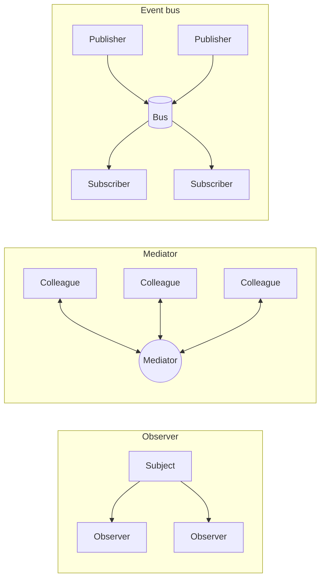

## The short answer

| | [Observer](/design-patterns/behavioral/observer) | [Mediator](/design-patterns/behavioral/mediator) | Event bus (publish/subscribe) |
|---|---|---|---|
| Who knows whom | Subject knows its observers (through an interface) | Colleagues know the mediator; mediator knows colleagues | Publishers and subscribers know only the bus and event types |
| Where the logic is | Each observer decides how to react | **Centralised** in the mediator | Each subscriber decides; nobody coordinates |
| Direction | One-to-many broadcast | Many-to-one-to-many, two-way | Many-to-many broadcast |
| Control flow | Easy to find: look at the subject's observers | Easy to find: read the mediator | Hard to find: search for subscribers of an event type |
| Typical scope | One object and its dependents | One dialog, workflow or interaction | A whole application, or many services via a broker |

The deciding questions:

1. *Is there one source of change and several dependents?* → **Observer**.
2. *Do several peers interact with rules that need one place to live?* → **Mediator**.
3. *Do many unrelated components publish and consume events, and must they not know each other at all?* → **Event bus**.

## In code

**Observer**: the subject holds the list.

```java
orderPublisher.subscribe(event -> loyalty.award(event));   // subscribe to *this* subject
```

**Mediator**: colleagues report, the mediator decides.

```java
class CheckoutForm implements FormMediator {
    public void changed(Widget source) {
        if (source == sameAsBilling) shipping.setEnabled(!sameAsBilling.checked());
        submit.setEnabled(isComplete());                    // coordination rules live here
    }
}
```

**Event bus**: in Spring, `ApplicationEventPublisher` is an in-process bus.

```java
publisher.publishEvent(new OrderPlaced(orderId));          // publisher knows no listener

@EventListener
void on(OrderPlaced e) { loyalty.award(e); }               // listener knows no publisher
```

See [Application Events and Listeners](/spring/core/application-events).

## Coupling and control flow



Decoupling has a price: the more decoupled the components, the harder it is to answer "what happens when an order is placed?". Observer keeps the answer near the subject, Mediator puts it in one class, and an event bus spreads it across the codebase. Good tracing and an event catalogue become essential with a bus.

## Failure handling

| Concern | Observer | Mediator | Event bus |
|---|---|---|---|
| A reaction fails | Subject decides: stop or continue with others | Mediator handles it explicitly | Bus policy; in-process usually isolated per listener |
| Ordering | Usually registration order, often unspecified | Explicit in mediator code | Unspecified unless configured (`@Order`) |
| Transactions | Same thread and transaction as the subject | Same | Spring: `@TransactionalEventListener(phase = AFTER_COMMIT)` to react only after commit |
| Durability | None (in memory) | None | None in-process; a broker (Kafka, RabbitMQ) adds durability |

## At architecture scale: choreography versus orchestration

The same distinction reappears between microservices:

- **Choreography** (event bus style): each service publishes domain events to a broker and reacts to others' events. No central coordinator. Simple to start, but the overall business process is implicit and hard to change.
- **Orchestration** (mediator style): a saga orchestrator sends commands to services and decides the next step from their replies. The process is explicit in one place, at the cost of a central component.

See [Event-Driven Microservices](/microservices/communication/event-driven-spring-cloud-stream) and the saga in the [order management case study](/system-design/case-studies/order-management-system).

## How to choose

- Start with **direct calls** when there is one dependent and the reaction must succeed atomically.
- Use **Observer** for a clear owner of state with optional, independent reactions.
- Use a **Mediator** when interaction rules between peers are complex and keep changing.
- Use an **event bus** for cross-module domain events in a modular monolith, and a **broker** across services.

## Interview questions and answers

**What is the difference between Observer and Mediator?**
Observer broadcasts state changes to observers without deciding what they do. A mediator knows its colleagues and coordinates them, holding the interaction rules.

**Is publish/subscribe the same as Observer?**
It is the same idea with an intermediary. In Observer the subscriber registers with the subject; in pub/sub it registers with a bus or broker, so publishers and subscribers do not know each other.

**What is the downside of an event bus?**
Implicit control flow: it is hard to see who reacts to an event, in what order, and what happens on failure.

**How do these map to sagas?**
Choreography is event-bus style; orchestration is mediator style.

## Related topics

- [Observer Pattern](/design-patterns/behavioral/observer)
- [Mediator Pattern](/design-patterns/behavioral/mediator)
- [Application Events and Listeners](/spring/core/application-events)
- [Event-Driven Microservices with Spring Cloud Stream](/microservices/communication/event-driven-spring-cloud-stream)

## References

- Gamma, Helm, Johnson, Vlissides. *Design Patterns*. Addison-Wesley, 1994. Observer (p. 293), Mediator (p. 273), and the discussion "Mediator versus Observer".
- Gregor Hohpe, Bobby Woolf. *Enterprise Integration Patterns*. Addison-Wesley, 2003. Publish-Subscribe Channel.
