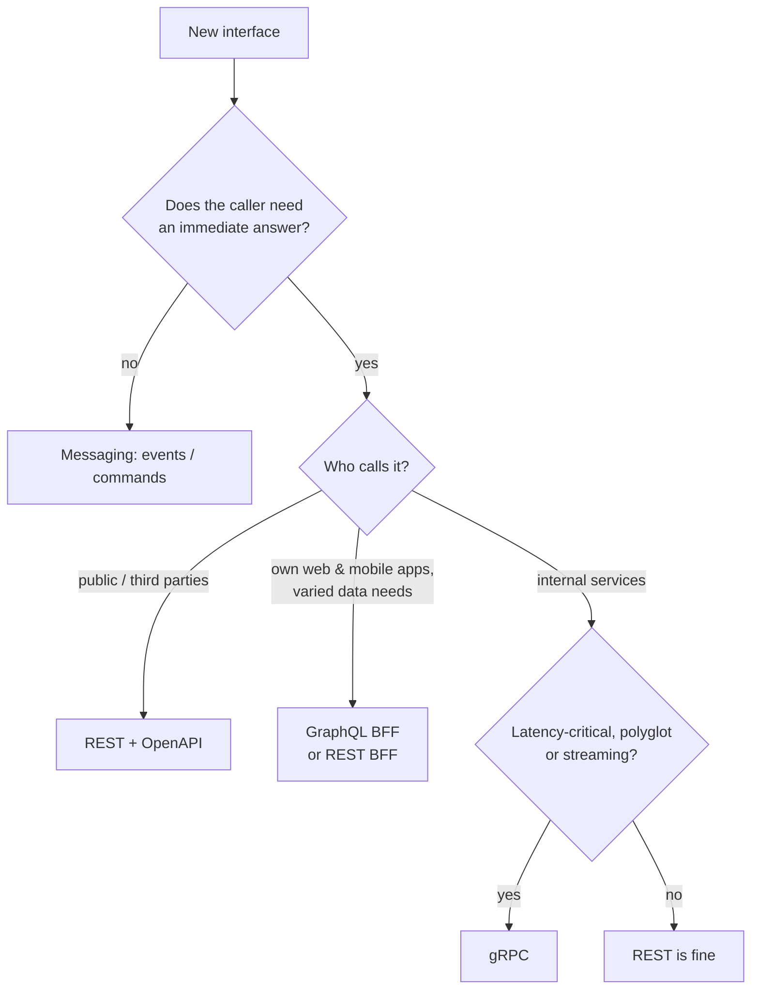

## The short answer

| | REST | GraphQL | gRPC | Messaging (Kafka, RabbitMQ) |
|---|---|---|---|---|
| Style | Resources + HTTP verbs | Client-specified query over one endpoint | Remote procedure calls from a `.proto` contract | Asynchronous events or commands |
| Payload | Usually JSON | JSON | Protocol Buffers (binary) | Any (Avro, Protobuf, JSON) |
| Transport | HTTP/1.1, 2, 3 | HTTP (POST/GET), WebSocket for subscriptions | **HTTP/2** only | Broker protocol |
| Coupling in time | Synchronous | Synchronous | Synchronous (+ streams) | **Decoupled** |
| HTTP caching | Excellent (GET, ETags, CDNs) | Hard (POST, varied queries) | None built in | n/a |
| Browser support | Native | Native | Needs gRPC-Web / Connect proxy | No (via a back end) |
| Streaming | SSE, chunked | Subscriptions | **Client, server and bidirectional** | Inherent |
| Contract | OpenAPI (optional) | Schema (required, introspectable) | `.proto` (required, code-generated) | Schema registry (recommended) |
| Best for | Public APIs, CRUD, cacheable reads | Many clients with different data needs; aggregating back ends | Internal service-to-service, low latency, polyglot | Events, workflows, buffering, fan-out |

ByteByteGo's timeline of API styles (SOAP → REST → GraphQL → gRPC) makes the same point: each style emerged for a different set of problems; none replaced the others.

## REST

Resources identified by URLs, manipulated with standard methods, representations in JSON, status codes for outcomes.

```http
GET /v1/orders/981          → 200 { "id": "981", "status": "SHIPPED", ... }
POST /v1/orders             → 201 Location: /v1/orders/982
```

- ✅ Universally understood; works with every client, proxy and CDN; GET responses are cacheable; easy to debug with curl.
- ❌ **Over-fetching** (getting fields you do not need) and **under-fetching** (several round trips to assemble a screen); versioning by convention.

See [RESTful API Design](/spring/web/rest-api-design-and-error-handling).

## GraphQL

One endpoint; the client sends a query describing exactly the shape it needs; the server resolves fields from its schema.

```graphql
query {
  order(id: "981") {
    status
    customer { name }
    lines { product { title } quantity }
  }
}
```

- ✅ No over- or under-fetching; one round trip per screen; strongly typed, introspectable schema; evolve by adding fields and deprecating old ones (no URL versions).
- ❌ Caching is harder (use persisted queries, client caches); the **N+1 problem** (resolving `customer` for 100 orders = 100 calls) needs batching (DataLoader / Spring for GraphQL's `@BatchMapping`); query cost limits are needed to stop expensive queries; errors return HTTP 200 with an `errors` array.

```java
@Controller
class OrderGraph {
    @QueryMapping Order order(@Argument String id) { return orders.find(id); }

    @BatchMapping                                      // one call for all orders in the response
    Map<Order, Customer> customer(List<Order> orders) { return customers.byOrders(orders); }
}
```

Typical use: a **backend-for-frontend** or gateway layer aggregating several services for web and mobile clients.

## gRPC

Define services and messages in Protocol Buffers; generate client and server code in many languages; call remote methods like local ones over HTTP/2.

```protobuf
service Inventory {
  rpc Reserve(ReserveRequest) returns (ReserveReply);
  rpc WatchStock(StockQuery) returns (stream StockLevel);   // server streaming
}
message ReserveRequest { string sku = 1; int32 quantity = 2; string order_id = 3; }
```

- ✅ Compact binary encoding and HTTP/2 multiplexing → low latency and CPU; strict contracts with generated code; deadlines and cancellation propagate across calls; four call types including bidirectional streaming.
- ❌ Not callable directly from browsers; binary payloads are harder to inspect (use `grpcurl`); HTTP/2 multiplexes many calls over one long-lived connection, so **L4 load balancing is insufficient** — use L7 balancing (Envoy, a service mesh) or client-side balancing; schema changes must follow Protobuf's [compatibility rules](/data-systems/encoding-and-schema-evolution).

Typical use: internal service-to-service traffic in polyglot microservices, mobile clients with tight bandwidth, streaming telemetry.

## Messaging

Not a request/response API at all: producers publish events or commands to a broker; consumers process them later.

- ✅ Temporal decoupling (the consumer can be down), load levelling, fan-out to many consumers, replay (Kafka).
- ❌ Eventual consistency; harder to trace; no immediate answer to the caller; duplicates must be handled ([idempotency](/microservices/reliability/idempotency)).

See [Message Queues and Delivery Semantics](/system-design/building-blocks/message-queues-and-delivery-semantics).

## How to choose



Many systems use **all of them**: REST for the public API, GraphQL as a backend-for-frontend, gRPC between internal services, and Kafka for events — each where it fits.

## Interview questions and answers

**When would you choose gRPC over REST?**
For internal, latency-sensitive or high-volume service-to-service calls, especially across languages or with streaming, where generated contracts and binary encoding pay off.

**What problem does GraphQL solve?**
Over- and under-fetching for clients with different data needs, by letting each client ask for exactly the fields it needs in one request.

**What is the GraphQL N+1 problem?**
Resolving a nested field per parent item causes one back-end call per item; batch loaders combine them into one call.

**Why does gRPC need L7 load balancing?**
HTTP/2 multiplexes many requests over one persistent connection, so balancing connections (L4) sends all of a client's calls to one server.

**When is messaging better than any synchronous API?**
When the caller does not need an immediate result, when work should survive the consumer being down, or when one event has many consumers.

## Related topics

- [RESTful API Design and Global Exception Handling](/spring/web/rest-api-design-and-error-handling)
- [Encoding and Schema Evolution](/data-systems/encoding-and-schema-evolution)
- [Message Queues and Delivery Semantics](/system-design/building-blocks/message-queues-and-delivery-semantics)
- [API Gateway with Spring Cloud Gateway](/microservices/fundamentals/api-gateway)

## References

- Alex Xu. *ByteByteGo System Design Handbook*: SOAP vs REST vs GraphQL vs RPC.
- [gRPC documentation: core concepts](https://grpc.io/docs/what-is-grpc/core-concepts/); [GraphQL specification](https://spec.graphql.org/); [Spring for GraphQL](https://docs.spring.io/spring-graphql/reference/).
- Roy Fielding. *Architectural Styles and the Design of Network-based Software Architectures* (REST), 2000.
