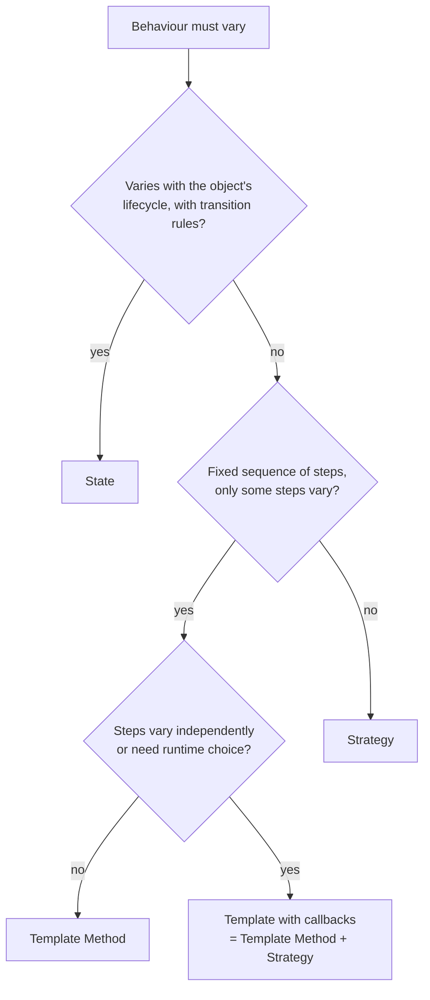

## The short answer

| Pattern | What varies | How | Who chooses |
|---|---|---|---|
| **[Strategy](/design-patterns/behavioral/strategy)** | The whole algorithm | Composition: the context holds an interchangeable object | The **client**, usually once |
| **[State](/design-patterns/behavioral/state)** | Behaviour per lifecycle state | Composition: the context holds the current state object | The **states themselves**, on each transition |
| **[Template Method](/design-patterns/behavioral/template-method)** | Some steps of a fixed algorithm | Inheritance: subclasses override steps | The **subclass**, at compile time |

The deciding questions:

1. *Does the object's behaviour change as it moves through a lifecycle, with rules about which change is allowed?* → **State**.
2. *Is there a fixed sequence of steps where only some steps differ?* → **Template Method** (or a template with callbacks).
3. *Otherwise, are there interchangeable ways to do the same job?* → **Strategy**.

## The same problem, three ways

Calculating a shipping price illustrates the difference.

**Strategy**: the client picks a pricing algorithm.

```java
interface ShippingPricing { BigDecimal price(Parcel p); }

final class Checkout {
    private final ShippingPricing pricing;                 // chosen by the client
    Checkout(ShippingPricing pricing) { this.pricing = pricing; }
    BigDecimal shipping(Parcel p) { return pricing.price(p); }
}

new Checkout(p -> p.weightKg().multiply(RATE));            // flat rate per kilo
new Checkout(new ZoneBasedPricing(zones));                 // or a zone table
```

**State**: the price depends on where the parcel is in its lifecycle, and the parcel moves itself on.

```java
interface ParcelState {
    BigDecimal surcharge();
    ParcelState next();                                    // states choose their successor
}
record Booked() implements ParcelState {
    public BigDecimal surcharge() { return BigDecimal.ZERO; }
    public ParcelState next() { return new InTransit(); }
}
record InTransit() implements ParcelState {
    public BigDecimal surcharge() { return new BigDecimal("5.00"); }   // re-routing fee
    public ParcelState next() { return new Delivered(); }
}
```

**Template Method**: the algorithm is fixed; a subclass changes one step.

```java
abstract class ShippingCalculator {
    final BigDecimal price(Parcel p) {                     // fixed skeleton
        BigDecimal base = basePrice(p);                    // varying step
        return base.add(fuelSurcharge(base)).add(insurance(p));
    }
    protected abstract BigDecimal basePrice(Parcel p);
    protected BigDecimal insurance(Parcel p) { return BigDecimal.ZERO; }   // hook
    private BigDecimal fuelSurcharge(BigDecimal b) { return b.multiply(new BigDecimal("0.08")); }
}
```

## Side by side

| | Strategy | State | Template Method |
|---|---|---|---|
| Mechanism | Composition | Composition | Inheritance |
| Granularity | Whole algorithm | Whole set of behaviours for one state | Individual steps |
| Changes at runtime | Yes, if the client swaps it | Yes, constantly, by design | No |
| Do the variants know each other? | No | Yes: each state knows its successors | No |
| Typical number of methods in the varying type | One | Several (one per event) | Several abstract steps and hooks |
| Client awareness | Client chooses the strategy | Client usually unaware of state objects | Client chooses the subclass |
| Java 21 lightweight form | A lambda | An enum with constant-specific methods, or sealed records | A method taking lambdas (callbacks) |
| Classic JDK/Spring example | `Comparator`, `RetryPolicy` | `Thread.State`, circuit breaker states | `AbstractList`, `HttpServlet`, `JdbcTemplate` (callback form) |

## Structure: identical diagrams, different intent

Strategy and State have the *same* class diagram: a context holding a reference to an interface with several implementations. You cannot tell them apart from the UML; you tell them apart by asking **who changes the reference and why**. In Strategy, a client configures the context. In State, the context replaces its state object as a consequence of its own operations.

Template Method looks different (a class hierarchy, no separate interface), but it solves an overlapping problem with inheritance instead of composition. Head First's design principle "favour composition over inheritance" is why Strategy is usually preferred when either would work.

## How to choose



## They combine well

- A **template method** whose varying step is a **strategy** object: this is how `JdbcTemplate` works with `RowMapper`.
- A **state** object that delegates part of its work to a **strategy** (for example, a pricing strategy configured per tenant).
- **State** transitions implemented with a **template method** in a base state class that logs and validates every transition.

## Interview questions and answers

**What is the difference between Strategy and State if the class diagrams are the same?**
Intent and control. A strategy is chosen by the client and strategies are independent. States represent a lifecycle and switch themselves as events occur.

**When would you choose Template Method over Strategy?**
When the overall algorithm is fixed and should be enforced, only a few steps vary, and the variations do not need to change at runtime or combine.

**Which one uses inheritance?**
Template Method. Strategy and State use composition.

**Give a Spring example combining two of them.**
`JdbcTemplate` fixes the JDBC algorithm (template) and takes a `RowMapper` (strategy) for the varying step.

## Related topics

- [Strategy Pattern](/design-patterns/behavioral/strategy)
- [State Pattern](/design-patterns/behavioral/state)
- [Template Method Pattern](/design-patterns/behavioral/template-method)
- [OO design principles](/design-patterns/oo-design-principles)

## References

- Gamma, Helm, Johnson, Vlissides. *Design Patterns*. Addison-Wesley, 1994. Strategy (p. 315), State (p. 305), Template Method (p. 325) and "Discussion of behavioral patterns".
- Eric Freeman, Elisabeth Robson. *Head First Design Patterns* (2nd edition). O'Reilly, 2020. Chapters 1, 8 and 10.
