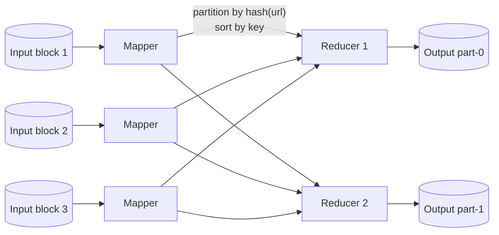

## Simple definition

There are three broad kinds of system:

| Kind | Input | Measured by | Example |
|---|---|---|---|
| **Services** (online) | A request; respond quickly | Response time, availability | A REST API |
| **Batch processing** (offline) | A large, **bounded** dataset; runs for minutes or hours | **Throughput** | Nightly reports, search index builds, ML training sets |
| **Stream processing** (near-real-time) | **Unbounded** events, processed shortly after they happen | Latency and throughput | Fraud detection, live dashboards |

A **batch job** reads a fixed set of input files, computes, and writes output files. Nobody waits for it interactively, so it can be optimised for throughput and retried freely when it fails.

## The Unix philosophy

Long before Hadoop, Unix tools did batch processing. To find the five most requested URLs in a web server log:

```bash
cat access.log | awk '{print $7}' | sort | uniq -c | sort -r -n | head -n 5
```

This handles gigabytes easily, because `sort` spills to disk and runs in parallel. The design principles behind it are the ones distributed batch systems copied:

1. **Each program does one thing well.**
2. **Uniform interface:** every tool reads and writes text lines, so any output can be any input.
3. **Composition:** programs are connected by pipes and do not know who produced their input or who consumes their output.
4. **Immutable inputs and experimentation:** inputs are never modified, so you can rerun, inspect intermediate output, and iterate.

The limitation: it runs on one machine.

## MapReduce and distributed filesystems

**MapReduce** (Google, 2004; Hadoop) is like Unix tools distributed across thousands of machines. Its "files" live in a **distributed filesystem** such as HDFS, which splits files into blocks replicated across machines (or uses erasure coding), a **shared-nothing** design on commodity hardware. Object stores like S3 play this role today.

A job has two callback functions written by the developer, and a framework does the rest:



1. **Map:** called once per input record; emits zero or more key-value pairs (`url → 1`). Mappers run on the machines that store the input (**move computation to the data**).
2. **Shuffle:** the framework partitions mapper output by key hash, sorts it, and copies each partition to its reducer.
3. **Reduce:** called once per key with all its values (`url → [1, 1, 1]`); emits output (`url → 3`).

Real workflows chain many jobs, each writing files that the next reads, coordinated by schedulers (Oozie, Airflow). Fault tolerance is simple: if a task fails, rerun it on its input; outputs only become visible when the whole job succeeds.

## Joins in batch jobs

Batch joins scan entire datasets, unlike OLTP index lookups.

| Join | How | When |
|---|---|---|
| **Sort-merge join** (reduce-side) | Both inputs are mapped with the join key, so the shuffle brings matching records to the same reducer, sorted; the reducer merges them | General case; no assumptions about inputs |
| **Broadcast hash join** (map-side) | The small input is loaded into an in-memory hash table on every mapper; the large input streams past | One side fits in memory |
| **Partitioned hash join** (map-side) | Both inputs are already partitioned identically on the join key; each mapper joins one partition pair | Inputs produced with the same partitioning |

Example: joining a user-activity log with a user-profile database. Querying the live database for each of billions of events would overload it and give nondeterministic results. Instead, take a **snapshot** of the profiles into the distributed filesystem and join the two files.

### Skew

If one key has enormous numbers of records (a celebrity), the reducer for that key becomes a **straggler** and the whole job waits. Techniques: detect hot keys by sampling and spread their records over several reducers (Pig's skewed join, Spark's adaptive query execution), or do the join in two stages.

## Outputs of batch workflows

Batch jobs typically build:

- **Search indexes** (Google's original MapReduce use: building Lucene/inverted indexes)
- **Key-value stores** for serving results (recommendations, "people you may know"), built as files and then loaded or swapped in atomically
- **Training data, aggregates and reports.**

> [!KEY] Treat batch outputs as immutable
> Writing each record to a production database from inside a job is slow, can overload the database, and leaves partial results if the job fails. Build a fresh output dataset and switch readers to it. A bad job's output can be rolled back by switching back — **human fault tolerance**.

## Beyond MapReduce: dataflow engines

MapReduce materialises every intermediate result to the distributed filesystem and forces every stage into map + sort + reduce. **Dataflow engines** — Apache Spark, Apache Flink (batch mode), Tez — treat the whole workflow as one job:

- Operators are arbitrary functions (filter, join, group, aggregate), not just map and reduce.
- Sorting happens only where needed.
- Intermediate state stays in memory or local disk, not replicated HDFS files.
- The engine can **pipeline** operators and optimise the whole plan.
- Fault tolerance by **recomputation**: Spark tracks the lineage of each dataset partition (RDD) and recomputes lost partitions from their inputs, which requires deterministic operators.

```java
// Spark (Java API): the same job, expressed as a dataflow
Dataset<Row> top = spark.read().json("s3://logs/2026-10-*/")
        .groupBy("url").count()
        .orderBy(col("count").desc())
        .limit(5);
```

**Declarative APIs** (Spark SQL, DataFrames) let the optimiser choose join algorithms and column pruning, combining the flexibility of code with database-style optimisation. Iterative algorithms (PageRank, machine learning) and graph processing (the **Pregel** bulk synchronous parallel model) run far more efficiently in these engines.

Java's own `Stream` API follows the same functional style on a single machine; see [Lambdas and Streams](/java/advanced/functional-programming-and-streams).

## Batch versus MPP databases

Massively parallel processing (MPP) data warehouses also run analytical SQL across many machines. Batch frameworks differ by:

- **Diversity of storage:** raw files of any format (a **data lake**, "sushi principle: raw data is better") rather than a predefined schema loaded first.
- **Diversity of processing:** arbitrary code (ML, image processing), not only SQL.
- **Designed for frequent faults:** tolerating task failures and preemption on shared clusters.

The line has blurred: Spark SQL, Trino and BigQuery offer SQL over files in object storage (the "lakehouse").

## Common mistakes

> [!MISTAKE] Calling external services from mappers
> Querying a production database or API per record makes jobs slow, nondeterministic and dangerous to the service. Snapshot the data and join it as a file.

- **Writing directly into the serving database** from a job, leaving partial results on failure.
- **Ignoring skew**, so one straggler task delays the whole job.
- **Nondeterministic operators** (random numbers, current time, hash-map iteration order) that break recomputation-based fault tolerance.

## Quick check

**What are the phases of a MapReduce job?**
Map (per-record extraction of key-value pairs), shuffle (partition, sort and transfer by key), and reduce (process all values per key).

**When would you use a broadcast hash join?**
When one input is small enough to fit in memory on every mapper.

**Why should batch outputs be immutable files rather than database writes?**
Failed jobs leave no partial results, outputs can be swapped atomically, and bad outputs can be rolled back.

**How do dataflow engines improve on MapReduce?**
They plan the whole workflow, avoid materialising intermediate results to the distributed filesystem, sort only when necessary, pipeline operators, and recompute lost data from lineage.

**What is a straggler and what causes it?**
A slow task that delays job completion, often caused by skew: one key with a disproportionate number of records.

## Summary

- Batch processing transforms bounded datasets for throughput, with simple fault tolerance.
- MapReduce distributes the Unix philosophy: map, shuffle, reduce over a distributed filesystem.
- Joins scan whole datasets: sort-merge, broadcast hash or partitioned hash.
- Dataflow engines (Spark, Flink) generalise MapReduce with whole-job optimisation.

## Related topics

- [Stream Processing](/data-systems/stream-processing)
- [Storage Engines: column stores and warehouses](/data-systems/storage-engines)
- [Partitioning (Sharding)](/data-systems/partitioning)

## References

- Martin Kleppmann. *Designing Data-Intensive Applications*. O'Reilly, 2017. Chapter 10: Batch Processing.
- Jeffrey Dean, Sanjay Ghemawat. "MapReduce: Simplified Data Processing on Large Clusters." OSDI 2004.
- Matei Zaharia et al. "Resilient Distributed Datasets." NSDI 2012.
