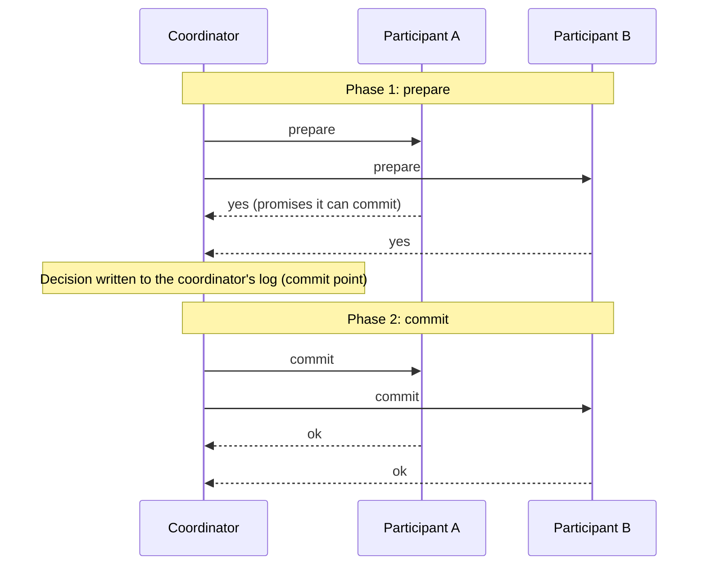

## Simple definition

Given that networks, clocks and nodes are unreliable (see [The Trouble with Distributed Systems](/data-systems/distributed-systems-faults)), how do we build systems that still behave predictably? The approach is to find **general-purpose abstractions with useful guarantees**, implement them once, carefully, and let applications rely on them — just as transactions hide crashes and concurrency.

The most important such abstraction is **consensus**: getting several nodes to **agree** on something (who the leader is, whether a transaction commits, which value a register holds) in a way that cannot be undone, even when some nodes fail.

## A spectrum of consistency guarantees

| Guarantee | Promise | Cost |
|---|---|---|
| **Eventual consistency** (convergence) | If writes stop, all replicas *eventually* return the same value | Cheap; but says nothing about *when*, or what you read meanwhile |
| **Causal consistency** | Operations that are causally related are seen in the same order by everyone | Moderate; available under partitions |
| **Linearizability** (strong consistency) | The system behaves as if there were **one copy** of the data and every operation took effect atomically at one point in time | Expensive; unavailable during partitions for some nodes |

## Linearizability

In a linearizable system, as soon as one client's write completes, **all** later reads (by any client) must return that value or a newer one. Once any read has returned a new value, no later read may return the old one. It is a **recency guarantee**.

```mermaid {title="A non-linearizable read: Bob sees the old score after Alice saw the new one"}
sequenceDiagram
    participant A as Alice
    participant L as Leader
    participant F as Follower (lagging)
    participant B as Bob
    L->>L: final score written
    A->>L: read score
    L-->>A: 3–2 final
    A->>B: "The match is over!"
    B->>F: read score
    F-->>B: 2–2 still playing
```

> [!KEY] Linearizability is not serializability
> **Serializability** is an isolation property of *transactions* (multiple objects): the result equals *some* serial order. **Linearizability** is a recency property of *single objects* (registers): reads see the latest write. A database can be one without the other; providing both is called **strict serializability**.

### When you need it

- **Locks and leader election:** every node must agree who holds the lock (ZooKeeper, etcd).
- **Uniqueness constraints:** usernames, bank balances not going negative, not selling the same seat twice.
- **Cross-channel timing dependencies:** a web server stores a photo and puts a "resize" message on a queue; if the resizer reads from a non-linearizable replica, it may not find the photo yet.

### Which replication methods are linearizable?

| Method | Linearizable? |
|---|---|
| Single-leader (reads from leader or synchronous follower) | Potentially, if no split brain |
| **Consensus algorithms** | Yes |
| Multi-leader | No |
| Leaderless with quorums | Usually not (LWW, sloppy quorums, clock skew) |

### The cost: CAP

If the network between two data centres is interrupted, a linearizable system must make the replicas that cannot reach the leader **unavailable** (they cannot know whether newer writes happened). A system that keeps all replicas available during a partition cannot be linearizable. That is the precise meaning of the CAP theorem: when a **P**artition occurs, choose **C**onsistency (linearizability) or **A**vailability. Linearizability is also slow even without partitions: response time is proportional to network delay uncertainty. See [CAP Theorem and PACELC](/system-design/building-blocks/cap-theorem-and-pacelc).

## Ordering guarantees

Order matters everywhere: the leader determines the order of writes in the replication log; serializability is about ordering transactions; timestamps and clocks try to order events.

### Causality

If A happened before B and B might depend on A, then everyone should see A before B: a question before its answer, a row's creation before its update. A **causal order** is a partial order (concurrent events are not ordered). **Causal consistency** is the strongest model that remains available during network partitions, which makes it attractive.

### Sequence numbers and Lamport timestamps

A single leader can assign a monotonically increasing **sequence number** to every operation, giving a total order consistent with causality. Without a single leader, a **Lamport timestamp** does it: each node keeps a counter; each timestamp is the pair `(counter, nodeId)`; every node includes its maximum counter in every message, and receivers advance their counter past it.

```text
Node 1: (1,1) ──msg──▶ Node 2: receives max=1 → next op is (2,2)
```

Lamport timestamps produce a total order consistent with causality. But they are not enough to enforce constraints such as unique usernames: a node only knows the total order **after the fact**, once it has collected everyone's operations. To decide *now*, you need **total order broadcast**.

### Total order broadcast

A protocol that delivers messages to all nodes with two guarantees:

- **Reliable delivery:** if one node gets a message, all eventually do.
- **Totally ordered delivery:** every node gets messages in the **same order**.

This is exactly what database replication needs (**state machine replication**: every replica applies the same deterministic writes in the same order). It is how ZooKeeper and etcd replicate, and the same idea as Kafka's per-partition log. Total order broadcast is **equivalent to consensus**.

## Distributed transactions and two-phase commit

To commit a transaction **atomically across several nodes** (database partitions, or a database and a message broker), all nodes must agree to commit or all abort. The classic algorithm is **two-phase commit (2PC)**:



Two promises make it work: a participant that votes "yes" gives up the right to abort, and the coordinator's decision, once written to its log, is irrevocable.

**The problem: blocking.** If the coordinator crashes after participants voted yes but before they hear the decision, they are **in doubt**: they cannot commit or abort on their own and must hold their locks until the coordinator recovers. In practice:

- in-doubt transactions block other transactions on the same rows
- the coordinator is a single point of failure, often an application server that is not itself replicated
- XA transactions (the cross-technology 2PC standard used by Java's JTA) cannot detect deadlocks across systems and amplify failures.

This is why microservices avoid distributed transactions and use **sagas** with compensating actions and the **transactional outbox** instead. See the [order management case study](/system-design/case-studies/order-management-system).

## Consensus algorithms

**Consensus** means: one or more nodes propose values, and the algorithm decides one. Formal properties:

- **Uniform agreement:** no two nodes decide differently.
- **Integrity:** no node decides twice.
- **Validity:** the decided value was proposed by some node.
- **Termination:** every node that does not crash eventually decides (fault tolerance).

The FLP result proves no deterministic algorithm can always reach consensus in a fully asynchronous system with even one crash. Practical algorithms use timeouts (the partially synchronous model) and guarantee safety always, liveness when the network behaves.

The well-known algorithms — **Paxos** (Multi-Paxos), **Raft**, **Zab** (ZooKeeper) and **Viewstamped Replication** — implement total order broadcast. Raft, the most widely taught:

1. Nodes are followers, candidates or a leader. Time is divided into numbered **terms** (epochs).
2. A follower that hears nothing from a leader within an election timeout becomes a candidate and asks for votes. A **majority** vote elects it leader for that term.
3. The leader appends client commands to its log and replicates them; an entry is **committed** once a majority stores it.
4. A leader from an older term is fenced out: nodes reject messages with a stale term number.

Costs: every decision needs a majority round trip; a cluster of *2f + 1* nodes tolerates *f* failures (3 nodes tolerate 1, 5 tolerate 2); dynamic membership is complex; and flaky networks can cause frequent elections.

Systems built on consensus: etcd and Consul (Raft), ZooKeeper (Zab), Kafka's KRaft controller (Raft), CockroachDB and TiKV (Raft per range), Spanner (Paxos per split).

## Distributed locks and coordination services

Applications rarely implement consensus themselves. They use a **coordination service** — ZooKeeper, etcd, Consul — which holds a small amount of critical data, fully replicated with consensus, and offers:

| Feature | Use |
|---|---|
| Linearizable atomic operations (compare-and-set) | Locks, leases, unique IDs |
| Total ordering of operations | Fencing tokens (ZooKeeper's `zxid`) |
| Failure detection (sessions, ephemeral nodes) | Leader election; automatic release of a dead holder's lock |
| Change notifications (watches) | Configuration and membership updates |

Typical uses: electing a leader among several instances of a scheduler, assigning partitions to nodes (Kafka, HBase, Solr), and **service discovery** (see [Service Discovery](/microservices/fundamentals/service-discovery)).

> [!WARNING] A distributed lock is only as safe as its fencing
> A lock held through a lease can expire while its holder is paused. Unless the protected resource checks a **fencing token**, two holders can act at once. Use locks for efficiency (avoid duplicate work), and design for correctness separately (idempotency, fencing, database constraints).

## Common mistakes

> [!MISTAKE] Building uniqueness on an eventually consistent store
> "Check whether the username exists, then insert" against replicas or a leaderless store allows duplicates. Use a linearizable operation: a unique constraint on a single leader, or compare-and-set in a consensus-backed store.

- **Confusing linearizability with serializability.**
- **Using 2PC/XA across services** and discovering blocking in-doubt transactions in production.
- **Even-sized consensus clusters** (4 nodes tolerate no more failures than 3).
- **Treating a Redis lock as a correctness mechanism** without fencing.

## Quick check

**What does linearizability guarantee?**
That the system behaves as if there were a single copy of the data: once a write completes or a read returns a new value, all later reads return that value or newer.

**Why is linearizability unavailable during a network partition?**
Replicas that cannot reach the leader or a quorum cannot know whether newer writes exist, so they must refuse requests to remain linearizable.

**What problem do Lamport timestamps solve, and what can they not do?**
They give a total order consistent with causality without a single leader; they cannot decide *in real time* whether an operation (like claiming a username) conflicts with one not yet seen.

**Why is two-phase commit called blocking?**
If the coordinator fails after participants have voted yes, they must wait, holding locks, until it recovers and tells them the outcome.

**How many node failures can a 5-node Raft cluster tolerate?**
Two, because a majority (3) is still available.

## Summary

- Linearizability makes a system behave like one copy; it costs availability and latency.
- Causality and total order are the core ordering ideas; total order broadcast equals consensus.
- 2PC gives atomic commit but blocks on coordinator failure; microservices prefer sagas.
- Use consensus through coordination services (etcd, ZooKeeper) for leader election, locks with fencing, and membership.

## Related topics

- [CAP Theorem and PACELC](/system-design/building-blocks/cap-theorem-and-pacelc)
- [Replication](/data-systems/replication)
- [The Trouble with Distributed Systems](/data-systems/distributed-systems-faults)
- [Service Discovery](/microservices/fundamentals/service-discovery)

## References

- Martin Kleppmann. *Designing Data-Intensive Applications*. O'Reilly, 2017. Chapter 9: Consistency and Consensus.
- Diego Ongaro, John Ousterhout. "In Search of an Understandable Consensus Algorithm (Raft)." USENIX ATC 2014.
- Leslie Lamport. "Time, Clocks, and the Ordering of Events in a Distributed System." *Communications of the ACM* 21(7), 1978.
- Michael J. Fischer, Nancy Lynch, Michael Paterson. "Impossibility of Distributed Consensus with One Faulty Process." *JACM* 32(2), 1985.
