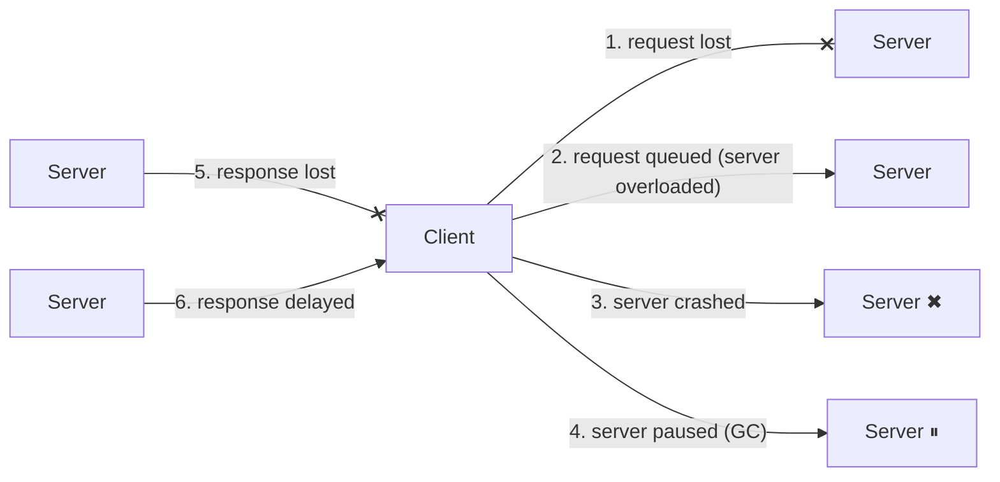

## Simple definition

On a single computer, things either work or break completely: a bug or a hardware fault usually crashes the whole machine, and a deterministic program gives the same result each time. In a **distributed system** — several computers communicating over a network — some parts can fail while others keep running. This is a **partial failure**, and it is **nondeterministic**: the same request may succeed, fail, or leave you not knowing which.

Everything in this page is a reason to be pessimistic: assume the network, clocks and processes will misbehave, and build systems that remain correct anyway.

## Unreliable networks

Most distributed systems use **asynchronous packet networks** (Ethernet, IP, the internet): a message may be delivered, delayed, or lost, with no guarantee about when it arrives. When you send a request and get no reply, any of these may have happened:



The sender **cannot tell** which. Cases 2, 4, 5 and 6 mean the request may have been processed. The only practical tool is a **timeout**, and after a timeout you still do not know whether the operation happened — which is why retries require **idempotency**.

Network faults are common in practice: misconfigured switches, cable cuts, a network partition isolating one data centre, a NIC that drops inbound but not outbound packets. Even within one data centre, studies report about 12 network faults per month in medium-sized clusters.

### Choosing timeouts

- Too **long**: users wait; failures are detected slowly.
- Too **short**: a merely slow node is declared dead. Its work is moved to other nodes, adding load to an already stressed system, possibly cascading.

Network delays are dominated by **queueing**: at switches, in the OS when the CPU is busy, in the TCP send buffer, and in VM hypervisors. Delays vary with load, so instead of a fixed constant, measure the distribution of round-trip times and adjust (as TCP retransmission and the Phi Accrual failure detector in Akka and Cassandra do).

### Why not just use a synchronous network?

Telephone circuits reserve fixed bandwidth for a call, so delay is bounded. Data centre networks and the internet use **packet switching** because they are optimised for **bursty traffic** and high utilisation. The price is unbounded delays. No current mechanism gives a general-purpose network guaranteed latency.

## Unreliable clocks

Each machine has its own quartz clock, which drifts (Google assumes 200 ppm, about 17 seconds a day). Clocks are synchronised with **NTP**, which is limited by network delay and can be misconfigured or blocked.

| | Time-of-day (wall-clock) clock | Monotonic clock |
|---|---|---|
| Java | `System.currentTimeMillis()`, `Instant.now()` | `System.nanoTime()` |
| Meaning | Date and time according to a calendar | An arbitrary counter that only moves forward |
| Can jump backwards | **Yes** (NTP corrections, leap seconds) | No |
| Comparable across machines | Roughly, with unknown error | No |
| Use for | Displaying and recording timestamps | Measuring durations and timeouts |

```java
long start = System.nanoTime();          // correct for elapsed time
doWork();
Duration elapsed = Duration.ofNanos(System.nanoTime() - start);
```

### Dangers of relying on synchronised clocks

- **Last write wins with timestamps:** if node A's clock is 3 ms ahead of node B's, a write on B that happened *later* can get an *earlier* timestamp and be silently discarded. Clock skew directly causes **data loss** in LWW systems (Cassandra, Riak with LWW).
- **Clock readings have a confidence interval**, usually unknown. Google's **Spanner** makes it explicit: its TrueTime API returns `[earliest, latest]`, and Spanner waits out the uncertainty (about 7 ms with GPS and atomic clocks in each data centre) before committing, so timestamps reflect causality.
- **Snapshot isolation across nodes** needs a global ordering of transactions; timestamps work only if clock uncertainty is accounted for.

For ordering events, prefer **logical clocks** (sequence numbers, Lamport timestamps), which capture causality without relying on physical time. See [Consistency and Consensus](/data-systems/consistency-and-consensus).

## Process pauses

A thread can be paused for a long time at any moment, without noticing:

- a **stop-the-world garbage collection** pause (seconds, in badly tuned JVMs; see [Garbage Collection](/java/advanced/garbage-collection))
- a VM being suspended or live-migrated
- the OS swapping memory to disk, or context switching
- a laptop lid closed; a slow disk I/O for lazily loaded classes.

Consider a leader holding a **lease** (a lock with a timeout):

```java
while (true) {
    request = getIncomingRequest();
    if (lease.expiryTimeMillis() - System.currentTimeMillis() < 10_000) {
        lease = lease.renew();
    }
    if (lease.isValid()) {
        process(request);            // a 15-second GC pause right here...
    }
}
```

If the process pauses after checking the lease, the lease can expire, another node can take over, and then this node wakes up and writes as if it were still the leader. It does not know it was paused.

## Knowledge, truth and lies

A node cannot trust its own judgement of the situation. Distributed systems therefore rely on a **quorum**: decisions require votes from a majority of nodes, so one confused node cannot act alone. If a majority declares a node dead, it is dead — even if it is actually still running.

### Fencing tokens

To stop a node that *believes* it holds a lock (but has lost it) from corrupting data, use a **fencing token**: a number that increases every time the lock is granted. Every write to the storage service includes the token, and the storage rejects tokens older than the last one it saw.

```mermaid {title="Fencing tokens stop a paused client from corrupting data"}
sequenceDiagram
    participant C1 as Client 1
    participant L as Lock service
    participant C2 as Client 2
    participant S as Storage
    C1->>L: acquire lease
    L-->>C1: ok, token 33
    Note over C1: long GC pause, lease expires
    C2->>L: acquire lease
    L-->>C2: ok, token 34
    C2->>S: write (token 34)
    S-->>C2: ok
    C1->>S: write (token 33)
    S-->>C1: rejected: token 33 < 34
```

ZooKeeper's `zxid` or znode version can serve as a fencing token. A Redis-based lock without fencing does not protect against this scenario. See [Distributed locking trade-offs](/data-systems/consistency-and-consensus#distributed-locks-and-coordination-services).

### Byzantine faults

Everything above assumes nodes are **honest but unreliable**. A **Byzantine fault** is a node that lies — sends corrupted or malicious messages. Byzantine fault-tolerant protocols (needing more than two-thirds honest nodes) matter in aerospace and blockchains, but are usually too expensive for data-centre systems, where you trust your own nodes and protect against weaker problems (checksums for corruption, input validation for users).

## System models

To reason about correctness, algorithms are designed for a **system model**:

| Timing model | Assumption | Realism |
|---|---|---|
| Synchronous | Bounded network delay, pauses and clock error | Unrealistic |
| **Partially synchronous** | Usually behaves synchronously, but sometimes exceeds bounds | **Realistic for most systems** |
| Asynchronous | No timing assumptions, not even clocks | Very restrictive |

| Node-failure model | Assumption |
|---|---|
| Crash-stop | A node fails by stopping, forever |
| **Crash-recovery** | Nodes crash and may restart; stable storage survives, memory does not |
| Byzantine | Nodes may do anything |

Algorithms specify **safety** properties ("nothing bad happens", such as uniqueness of fencing tokens) that must hold always, and **liveness** properties ("something good eventually happens", such as availability) that may hold only under conditions. The same split applies to [concurrent objects in Java](/java/advanced/concurrent-object-design).

## The fallacies of distributed computing

The classic list of false assumptions (Peter Deutsch and others): the network is reliable; latency is zero; bandwidth is infinite; the network is secure; topology does not change; there is one administrator; transport cost is zero; the network is homogeneous. Every one appears in production incidents.

## Common mistakes

> [!MISTAKE] Using wall-clock time to measure durations or order events
> `System.currentTimeMillis()` can jump backwards. Use `System.nanoTime()` for durations and logical clocks or sequence numbers for ordering.

- **Retrying non-idempotent requests after a timeout**, duplicating operations that actually succeeded.
- **Locks without fencing tokens** protecting shared storage.
- **Treating "no reply" as "it failed".** It may have succeeded.
- **Timeouts shorter than GC pauses**, causing spurious failovers.

## Quick check

**Why can't a client distinguish a slow server from a dead one?**
In an asynchronous network, lost requests, lost responses, overload and crashes all look the same: no reply before the timeout.

**Which Java clock should measure a timeout?**
`System.nanoTime()`, the monotonic clock; wall-clock time can jump.

**How can clock skew lose data?**
With last-write-wins, a write from a node whose clock is behind can be considered older than a write that actually happened before it, and be discarded.

**What is a fencing token?**
A monotonically increasing number issued with each lock grant; storage rejects writes carrying a token older than one it has already seen.

**What does "the truth is defined by the majority" mean?**
A node cannot trust its own view; decisions such as declaring a node dead are made by a quorum.

## Summary

- Distributed systems fail partially and nondeterministically.
- Networks lose and delay messages; timeouts are the only detector and are inherently uncertain.
- Clocks drift and jump; use monotonic clocks for durations, logical clocks for order.
- Processes pause; protect shared resources with quorums, leases and fencing tokens.

## Related topics

- [Consistency and Consensus](/data-systems/consistency-and-consensus)
- [Replication](/data-systems/replication)
- [Circuit Breakers and Resilience4j](/microservices/reliability/circuit-breakers-and-resilience4j)
- [Garbage Collection](/java/advanced/garbage-collection)

## References

- Martin Kleppmann. *Designing Data-Intensive Applications*. O'Reilly, 2017. Chapter 8: The Trouble with Distributed Systems.
- Martin Kleppmann. "[How to do distributed locking](https://martin.kleppmann.com/2016/02/08/how-to-do-distributed-locking.html)." 2016.
- James C. Corbett et al. "Spanner: Google's Globally-Distributed Database." OSDI 2012.
