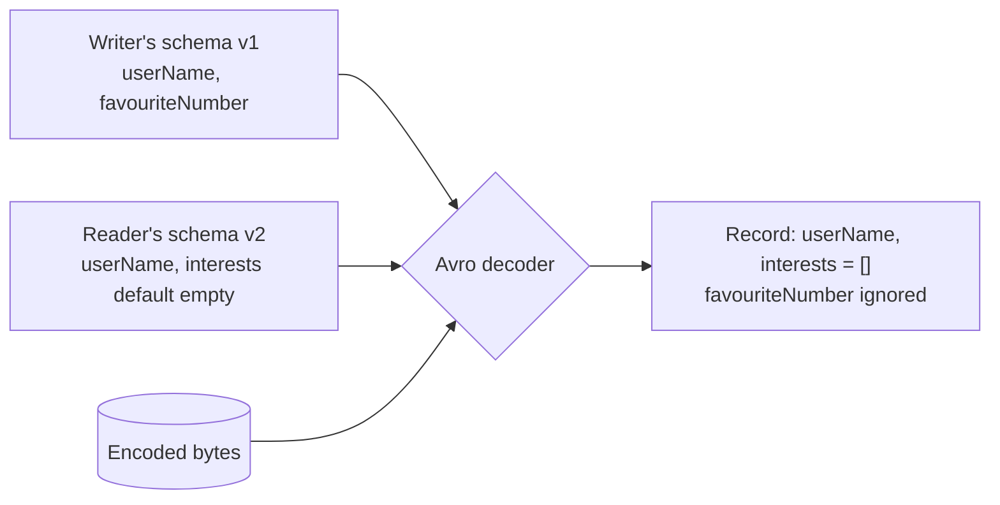

## Simple definition

In memory, data lives in objects, lists and maps linked by pointers. To write it to a file or send it over the network, it must be **encoded** (serialized) into a self-contained sequence of bytes, and **decoded** on the other side.

The interesting problem is not the encoding itself but **change**. Applications evolve, and during a **rolling upgrade** old and new versions of the code run at the same time, reading and writing the same data. Two properties are needed:

- **Backward compatibility:** newer code can read data written by older code.
- **Forward compatibility:** older code can read data written by newer code (ignoring what it does not understand).

Forward compatibility is the harder one, and it is what lets you deploy services independently.

## Language-specific formats

Java's `java.io.Serializable`, Python's `pickle` and similar formats are convenient but:

- tie the data to one language
- are a **security risk**: decoding instantiates arbitrary classes, and deserialization gadget chains have caused many remote code execution vulnerabilities
- have weak versioning and poor performance.

Use them only for transient, same-version, trusted data — ideally not at all. Java's serialization filters (`jdk.serialFilter`) reduce but do not remove the risk.

## JSON, XML and CSV

Textual formats are human-readable and universally supported, which makes them the default for public APIs. Their weaknesses:

| Problem | Example |
|---|---|
| Number ambiguity | JSON does not distinguish integers from floats; numbers above 2⁵³ lose precision in JavaScript (Twitter returns IDs as both number and string for this reason) |
| No binary strings | Binary data is Base64-encoded, growing it by 33% |
| Optional schemas | JSON Schema exists but is not universally used; many APIs hard-code the interpretation |
| Size | Field names repeated in every record |

Binary encodings of JSON (MessagePack, CBOR, BSON) save some space but keep field names.

## Protocol Buffers

Protocol Buffers (Google) and Thrift (Facebook) use a **schema** and **field tags** — small numbers that identify fields in the encoded bytes instead of names.

```protobuf
message Person {
  string user_name = 1;
  optional int64 favourite_number = 2;
  repeated string interests = 3;
}
```

The encoded record contains `(tag, type, value)` triples, so it is compact (about a third of the JSON size in typical cases). **Evolution rules follow from the tags:**

- You may **rename** a field: names are not in the data.
- You may **add** a field with a new tag. Old code skips unknown tags (forward compatible). New code reading old data sees the default value (backward compatible), so new fields must be optional or have defaults.
- You may **remove** an optional field, but **never reuse its tag** (mark it `reserved`).
- Changing a type is risky: widening an `int32` to `int64` is fine for new readers, but old readers truncate.

gRPC uses Protocol Buffers for both messages and service definitions.

## Avro

Apache Avro, from the Hadoop ecosystem, takes another approach: the encoded data contains **no tags and no names**, just values concatenated in schema order. To decode, you need the exact **writer's schema**, and Avro resolves it against the **reader's schema** field by field, by name:



- A field in the writer's schema but not the reader's is ignored.
- A field in the reader's schema but not the writer's is filled with the reader's **default** — so you may only add or remove fields that have defaults.

How does the reader get the writer's schema? Large files include it once in the header; databases store a version number per record; and messaging systems use a **schema registry** (Confluent Schema Registry, Apicurio) where each message carries a small schema ID.

Because Avro has no tags, schemas can be **generated** from database schemas automatically, which makes it popular for data pipelines and change data capture.

## Comparing formats

| | JSON | Protocol Buffers | Avro |
|---|---|---|---|
| Schema | Optional | Required (`.proto`) | Required (JSON schema) |
| Field identity in data | Names | Numeric tags | Position, resolved by name via schemas |
| Size | Largest | Small | Smallest |
| Human-readable | Yes | No | No |
| Evolution | By convention | Tag rules | Default-value rules + writer/reader schema |
| Typical use | Public REST APIs, configuration | gRPC, internal services | Kafka with schema registry, Hadoop, data lakes |

Schemas are valuable documentation, enable code generation and compile-time checks, and let a registry **reject incompatible changes** before they are deployed.

## Modes of dataflow

Compatibility must hold wherever data passes between processes.

### Through databases

A value written by new code may be read by old code that is still running, and **data outlives code**: rows written five years ago are still there. Watch out for a subtle forward-compatibility bug: old code reads a record with a new field, decodes it into an object that does not know the field, and writes it back — **losing the new field**. ORMs and DTO mappers must preserve unknown fields, or deployments must be ordered so old writers are gone before new fields appear.

Schema migrations should be **expand and contract**: add the new column (nullable), deploy code that writes both, backfill, switch reads, then drop the old column. See [Auditing and Migrations](/spring/data/auditing-and-migrations).

### Through services: REST and RPC

- Servers are usually upgraded before clients, so servers need backward compatibility on requests and forward compatibility on responses.
- REST/JSON APIs evolve by adding optional fields and never removing or changing the meaning of existing ones; breaking changes need a new **version** (URL, header or media type). See [RESTful API Design](/spring/web/rest-api-design-and-error-handling).
- RPC frameworks make a remote call look like a local function call, but a network call is fundamentally different: it can time out with an unknown outcome, retries may duplicate it (so it needs [idempotency](/system-design/case-studies/payment-system)), latency varies, and parameters must be encoded. Do not hide those differences.

### Through asynchronous messages

Producers and consumers of a broker are deployed independently, and messages may sit in a topic for days. Both directions of compatibility are needed, and consumers that republish messages must preserve unknown fields. A schema registry with a compatibility mode (`BACKWARD`, `FORWARD`, `FULL`) enforces the rules at publish time. See [Event-Driven Microservices](/microservices/communication/event-driven-spring-cloud-stream).

The **actor model** (Akka) distributes message passing across nodes; rolling upgrades of actor systems need the same care.

## Common mistakes

> [!MISTAKE] Reusing a deleted field's tag or name
> Old data with the previous meaning will be decoded as the new field. Mark removed Protobuf tags as `reserved` and never recycle names in Avro or JSON.

- **Adding a required field**, which breaks every reader of old data.
- **Deserializing untrusted input with Java serialization.**
- **Changing a field's meaning** (cents to euros) while keeping its name and type: every compatibility check passes and every consumer is wrong.
- **Read-modify-write that drops unknown fields** during rolling upgrades.

## Quick check

**What is the difference between backward and forward compatibility?**
Backward: new code reads old data. Forward: old code reads new data.

**Why can you rename a field in Protocol Buffers but not change its tag?**
The encoded data contains tags, not names; the tag is the field's identity.

**How does an Avro reader decode data without tags?**
It uses the writer's schema to parse the bytes and resolves fields by name against its own reader's schema, filling defaults where needed.

**What does a schema registry provide?**
A central store of versioned schemas, small schema IDs to embed in messages, and enforcement of compatibility rules when new schemas are registered.

**Why are RPC calls not like local calls?**
They can fail or time out with an unknown outcome, have variable latency, may be retried and duplicated, and require encoding parameters.

## Summary

- Encoding turns in-memory objects into bytes; evolution keeps old and new code working together.
- Avoid language-specific serialization; use JSON for public APIs and Protocol Buffers or Avro internally.
- Add optional fields with defaults, never reuse identifiers, never change meanings.
- Compatibility applies to databases, service APIs and message streams alike.

## Related topics

- [RESTful API Design and Global Exception Handling](/spring/web/rest-api-design-and-error-handling)
- [Event-Driven Microservices with Spring Cloud Stream](/microservices/communication/event-driven-spring-cloud-stream)
- [Auditing and Migrations](/spring/data/auditing-and-migrations)
- [Stream Processing](/data-systems/stream-processing)

## References

- Martin Kleppmann. *Designing Data-Intensive Applications*. O'Reilly, 2017. Chapter 4: Encoding and Evolution.
- [Protocol Buffers language guide](https://protobuf.dev/programming-guides/proto3/) — updating a message type.
- [Apache Avro specification](https://avro.apache.org/docs/) — schema resolution.
