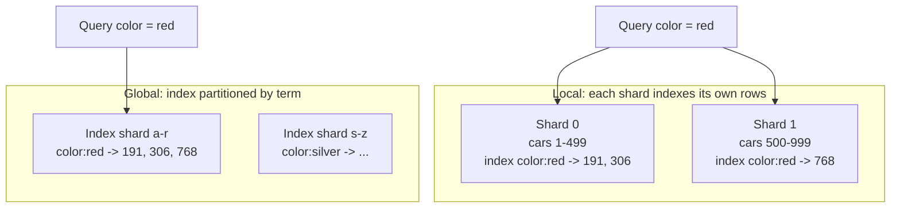

## Simple definition

**Partitioning**, called **sharding** in many databases, splits a large dataset into smaller pieces called **partitions** (shards), each stored on a different node. Each record belongs to exactly one partition. The goal is **scalability**: spread both the data and the query load across many machines, so the system can grow by adding nodes.

Partitioning is usually combined with [replication](/data-systems/replication): each partition is copied to several nodes, and each node holds several partitions, some as leader and some as follower.

## Horizontal versus vertical partitioning

| | Horizontal partitioning (sharding) | Vertical partitioning |
|---|---|---|
| Splits | **Rows**: different records on different nodes | **Columns or tables**: different attributes or features on different nodes |
| Example | Users A–M on shard 1, N–Z on shard 2 | Profile columns in one table, large `bio` and `avatar` columns in another; or orders and catalogue in separate databases |
| Goal | Scale beyond one machine | Separate hot from cold data, or split by feature or service |

This page is mostly about horizontal partitioning. Vertical partitioning by feature is what happens when a monolith's database is split per microservice.

## Partitioning key-value data

The aim is to spread data and load **evenly**. If one partition gets more than its share, the partitioning is **skewed**; a partition with disproportionate load is a **hot spot**.

### By key range

Assign each partition a continuous range of keys, like volumes of an encyclopaedia (A–B, C–D...). Boundaries are chosen to balance data, manually or automatically.

- ✅ Keys are sorted within a partition: **range scans** are efficient (all readings for sensor X in October).
- ❌ Hot spots for sequential keys: if the key is a timestamp, all of today's writes go to one partition. Fix: prefix the key with something else (sensor ID), at the cost of range scans across all sensors.

Used by HBase, Bigtable, MongoDB (range sharding), CockroachDB, and TiDB.

### By hash of key

Apply a good hash function to the key and assign each partition a range of **hashes**.

- ✅ Even distribution, even for skewed keys.
- ❌ Range queries on the key are lost: adjacent keys are scattered across all partitions.

Do **not** use `hash(key) mod N` with *N* = number of nodes: when *N* changes, almost every key moves. See rebalancing below and [Consistent Hashing](/system-design/building-blocks/consistent-hashing).

**Compound keys** combine both: Cassandra hashes the first part of the primary key (partition key) and sorts by the rest (clustering columns), so `(user_id, timestamp)` lets you range-scan one user's events efficiently.

### Other partitioning criteria

| Scheme | How | Note |
|---|---|---|
| List partitioning | Explicit lists of values per partition (country → region shard) | Good for data residency |
| Round-robin | Records distributed in turn | Even, but a key lookup must ask every partition |
| Directory-based | A lookup service maps each key (or tenant) to a partition | Flexible moves; the directory is a critical dependency |

### Hot keys

Hashing cannot help when **one key** is hot: a celebrity's post receiving millions of comments. Applications can split it by appending a random suffix (`post123_07`), spreading writes over 100 keys, at the cost of reading all 100 and combining. Do this only for the few known hot keys.

## Partitioning and secondary indexes

Secondary indexes ("all red cars") do not map neatly to partitions. Two approaches:

| | Local index (document-partitioned) | Global index (term-partitioned) |
|---|---|---|
| Where index entries live | In the same partition as the records they index | In partitions of their own, partitioned by the indexed term |
| Writes | Fast: one partition | Slower: may touch several partitions; usually updated **asynchronously** |
| Reads by secondary key | **Scatter/gather**: query every partition and merge — tail latency amplification | Read only the partition holding the term |
| Examples | MongoDB, Cassandra, Elasticsearch, SolrCloud | DynamoDB global secondary indexes, Riak search |

## Rebalancing partitions

Over time, data grows, load changes and nodes are added or fail, so partitions must move. Requirements: load stays fair afterwards, the database keeps serving during the move, and no more data moves than necessary.

| Strategy | How | Trade-off | Used by |
|---|---|---|---|
| **hash mod N** | Partition = hash % nodes | Changing N moves nearly all keys — avoid | — |
| **Fixed number of partitions** | Create many more partitions than nodes (e.g. 1,000 for 10 nodes); move whole partitions to new nodes | Simple; the partition count is fixed up front, so choose it well | Elasticsearch, Riak, Couchbase, Kafka (topic partitions) |
| **Dynamic partitioning** | Split a partition when it exceeds a size, merge when small | Adapts to data volume; an empty database starts with one partition (pre-split) | HBase, MongoDB, RethinkDB |
| **Proportional to nodes** | Fixed partitions per node; a new node splits random partitions | Partition size stays stable as data grows | Cassandra (vnodes) |
| **Consistent hashing** | Nodes and keys on a hash ring; a key belongs to the next node clockwise | Only ~1/N of keys move when a node joins | Dynamo-style stores, caches |

> [!TIP] Keep a human in the loop
> Fully automatic rebalancing combined with automatic failure detection can be dangerous: an overloaded node looks dead, its partitions move, the move adds load, and failures cascade. Many operators prefer the system to propose a plan that a person approves.

## Request routing

How does a client know which node holds key "foo"? This is **service discovery** for data, with three options:

1. Contact **any node**; it forwards the request if needed (Cassandra, Riak use a **gossip protocol** to share cluster state).
2. A **routing tier** (partition-aware load balancer) forwards requests (MongoDB's `mongos`).
3. **Partition-aware clients** connect directly to the right node.

The mapping of partitions to nodes is often kept in a coordination service such as **ZooKeeper** or etcd, which notifies routers when it changes (HBase, Kafka before KRaft, SolrCloud). See [Service Discovery](/microservices/fundamentals/service-discovery).

## The costs of sharding

Before sharding, ask whether you need it. A single modern database server holds terabytes and handles tens of thousands of queries per second, and **read replicas** often solve read load more simply. ByteByteGo's proximity-service example makes exactly this point: the geospatial index fits on one server, so replicas beat sharding.

Sharding costs:

- **Cross-shard joins** are expensive or impossible; data is denormalised so queries hit one shard.
- **Cross-shard transactions** need distributed commit protocols (see [Consistency and Consensus](/data-systems/consistency-and-consensus)) or sagas.
- **Referential integrity** across shards is not enforced by the database.
- **Resharding** is operationally risky.
- **Choosing the shard key** is hard to undo. Pick a key that matches the dominant access pattern (tenant ID, user ID) and has high cardinality with even load.

## Common mistakes

> [!MISTAKE] Sharding by a monotonically increasing key with range partitioning
> All new writes land on the last partition, creating a permanent hot spot. Hash the key or prefix it.

- **`hash % N` sharding**, making every capacity change a full reshuffle.
- **Sharding too early**, taking on cross-shard complexity before replicas, caching and indexing are exhausted.
- **A shard key unrelated to queries**, so every request scatters to all shards.

## Quick check

**What is the difference between horizontal and vertical partitioning?**
Horizontal splits rows across nodes; vertical splits columns or tables.

**What is the trade-off between key-range and hash partitioning?**
Key ranges allow efficient range scans but risk hot spots; hashing spreads load evenly but loses range queries.

**Why avoid hash mod N?**
Changing the number of nodes moves almost every key.

**What is scatter/gather?**
Querying every partition and merging results, needed for secondary-key queries on locally indexed partitions.

**How do clients find the right partition?**
Through any node that forwards, a routing tier, or partition-aware clients, using a mapping kept by gossip or a coordination service such as ZooKeeper.

## Summary

- Partitioning spreads data and load; replication keeps each partition available.
- Key-range partitioning supports scans; hash partitioning avoids hot spots.
- Secondary indexes are local (scatter/gather reads) or global (multi-partition writes).
- Rebalance with fixed or dynamic partitions or consistent hashing, never hash mod N.
- Shard only when simpler options are exhausted, and choose the shard key carefully.

## Related topics

- [Consistent Hashing](/system-design/building-blocks/consistent-hashing)
- [Replication](/data-systems/replication)
- [Transactions and Isolation Levels](/data-systems/transactions-and-isolation)
- [Diagram Building Blocks: sharding](/system-design/diagram-patterns#sharding)

## References

- Martin Kleppmann. *Designing Data-Intensive Applications*. O'Reilly, 2017. Chapter 6: Partitioning.
- Alex Xu. *ByteByteGo System Design Handbook*: vertical and horizontal partitioning; back-of-the-envelope estimation (replicas versus sharding).
