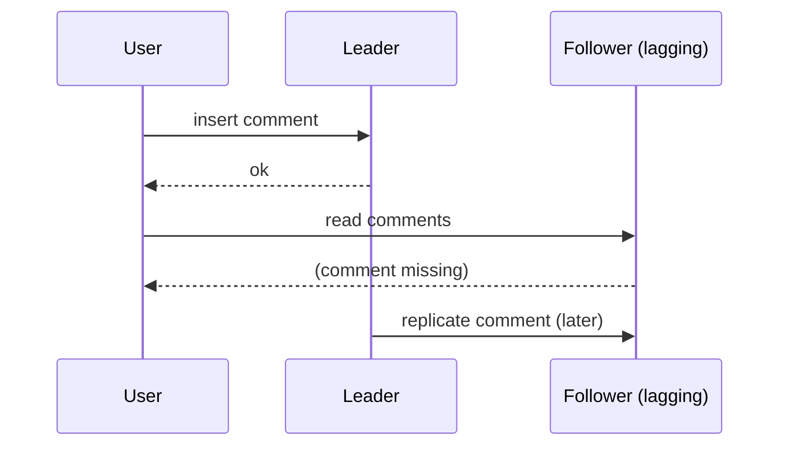

## Simple definition

**Replication** keeps a copy of the same data on several machines connected by a network. Reasons to do it:

- **High availability:** keep working when a machine or a whole data centre fails.
- **Read scalability:** serve more reads from more copies.
- **Latency:** keep data geographically close to users.

If data never changed, replication would be trivial: copy it once. All the difficulty comes from **handling changes**. There are three main approaches: **single-leader**, **multi-leader** and **leaderless**.

## Single-leader replication

One replica is the **leader** (primary, master). All writes go to it. It sends each change to the **followers** (replicas, secondaries) through a **replication log**, and they apply changes in the same order. Reads can go to the leader or any follower.

```mermaid {title="Single-leader replication with one synchronous and one asynchronous follower"}
sequenceDiagram
    participant C as Client
    participant L as Leader
    participant F1 as Follower 1 (sync)
    participant F2 as Follower 2 (async)
    C->>L: write x = 5
    L->>F1: replicate
    L->>F2: replicate
    F1-->>L: ack
    L-->>C: ok (durable on 2 nodes)
    F2-->>L: ack (later)
```

This is how PostgreSQL streaming replication, MySQL, MongoDB replica sets, Kafka partitions and Redis replicas work.

### Synchronous versus asynchronous

| | Synchronous follower | Asynchronous follower |
|---|---|---|
| Leader waits for its ack | Yes | No |
| Guarantee | Up-to-date copy on at least two nodes | Writes acknowledged to the client may be lost if the leader fails |
| Risk | One slow or dead follower blocks all writes | Followers lag behind |

Fully synchronous replication is impractical, so systems use **semi-synchronous**: one follower is synchronous, the rest asynchronous, and another follower is promoted to synchronous if it fails.

### Adding followers

Take a consistent **snapshot** of the leader, copy it, then let the new follower request all changes since the snapshot's **log position** (PostgreSQL's LSN, MySQL's binlog coordinates).

### Handling outages

- **Follower failure — catch-up recovery:** the follower knows the last change it applied and requests everything since.
- **Leader failure — failover:** detect the failure (usually a timeout), choose a new leader (the most up-to-date follower, by election or a controller), and reconfigure clients and the old leader.

Failover is full of traps:

- With asynchronous replication, the new leader may lack the old leader's last writes. If the old leader comes back, its unreplicated writes are usually discarded — **acknowledged data is lost**.
- Discarded writes are dangerous when other systems saw them. (GitHub once reused auto-increment IDs that a Redis store had already seen, leaking private data.)
- **Split brain:** two nodes both believe they are the leader and both accept writes. Protection needs **fencing** (see [The Trouble with Distributed Systems](/data-systems/distributed-systems-faults)).
- Choosing the timeout: too long delays recovery; too short causes unnecessary failovers under load, which add even more load.

### Replication logs

| Method | How | Trade-off |
|---|---|---|
| Statement-based | Send the SQL statements | Non-deterministic functions (`NOW()`, `RAND()`), auto-increments and triggers diverge |
| Write-ahead log shipping | Send the storage engine's WAL bytes | Tied to the engine's on-disk format; leader and followers need the same version |
| **Logical (row-based) log** | Send row-level changes: inserted row, updated columns, deleted key | Decoupled from storage; also usable by external consumers (**change data capture**) |
| Trigger-based | Application-level triggers write changes to a table | Flexible, but slow and fragile |

## The problems of replication lag

Reading from asynchronous followers scales reads, but followers can be behind. The system is **eventually consistent**: if writes stop, followers catch up. Under normal operation lag is milliseconds; under load or network trouble it can be seconds or minutes. Users notice three anomalies:

| Anomaly | What the user sees | Guarantee that prevents it | How |
|---|---|---|---|
| Reading your own write | Posts a comment, refreshes, comment is gone | **Read-your-writes** | Read data the user may have modified from the leader (or for a minute after an update); track the client's last write position |
| Moving backward in time | Refresh shows a comment, next refresh does not | **Monotonic reads** | Route each user's reads to the same replica (by hash of user ID) |
| Seeing an answer before the question | A causally later write appears before the earlier one | **Consistent prefix reads** | Write causally related data to the same partition; track causal dependencies |



> [!KEY] Do not pretend replication is synchronous
> If the application cannot tolerate these anomalies, design for it explicitly (route reads to the leader, track write positions) or use a system with stronger guarantees. ByteByteGo's **read replica pattern** uses exactly these techniques with MySQL replicas behind a database middleware.

## Multi-leader replication

Several nodes accept writes, each forwarding changes to the others. Use cases:

- **Multiple data centres:** a leader in each, so writes are local and a data-centre outage does not stop writes.
- **Offline clients:** each device's local database is a leader (calendar apps, mobile apps); syncing is multi-leader replication with very long lag.
- **Collaborative editing:** each user's local copy accepts edits (Google Docs-style).

The big problem: **write conflicts**. Two leaders accept conflicting changes to the same record concurrently. Strategies:

- **Avoid conflicts:** route all writes for a record to the same leader ("home" data centre per user).
- **Last write wins (LWW):** keep the write with the highest timestamp or ID — simple, but **silently loses data**, and clocks are unreliable.
- **Merge values**, or record the conflict and let the application or user resolve it (on write or on read).
- **Automatic resolution:** **CRDTs** (conflict-free replicated data types such as counters and sets that merge mathematically), mergeable persistent data structures, and **operational transformation** (used in collaborative editors).

Multi-leader setups also struggle with auto-increment keys, triggers and integrity constraints, and with **replication topologies** (ring, star, all-to-all) where changes can arrive out of causal order.

## Leaderless replication

Any replica accepts writes directly from the client, or through a coordinator that does not enforce ordering. Amazon's Dynamo popularised the approach; Cassandra, ScyllaDB and Riak follow it.

### Quorums

With *n* replicas, a write is sent to all and succeeds when **w** acknowledge; a read queries replicas and succeeds when **r** respond. If

> **w + r > n**

then the set of nodes written and the set read must overlap, so at least one read response has the latest value (identified by a version number). Typical: n = 3, w = 2, r = 2. Smaller w gives faster writes; smaller r gives faster reads.

How stale replicas catch up:

- **Read repair:** a reader that sees stale values writes the newest back.
- **Anti-entropy:** a background process compares replicas (often with Merkle trees) and copies missing data.

### Limits of quorums

Even with w + r > n, edge cases return stale values: concurrent writes with LWW, a write concurrent with a read, a write that succeeded on fewer than w nodes (not rolled back), or a node restored from a stale replica. Quorums give a **probabilistic** guarantee, not linearizability (see [Consistency and Consensus](/data-systems/consistency-and-consensus)). Monitor staleness.

**Sloppy quorums and hinted handoff:** during a network partition, a write may be accepted by nodes *outside* the key's usual n replicas, and handed back when the partition heals. This increases write availability but means a read quorum may not see the write.

### Detecting concurrent writes

Two writes are **concurrent** if neither knew about the other — not necessarily simultaneous. Leaderless systems detect this with **version numbers** per key, extended to **version vectors** (one counter per replica) across replicas. The server keeps all concurrent values (**siblings**) and the client merges them; deletions need tombstones.

## Comparing the approaches

| | Single-leader | Multi-leader | Leaderless |
|---|---|---|---|
| Writes accepted by | One node | Several leaders | Any replica (quorum) |
| Conflicts | None (one order) | Yes, must be resolved | Yes, concurrent writes |
| Write availability during leader loss | Paused until failover | Continues at other leaders | Continues if w nodes reachable |
| Read-after-write | Easy on the leader | Hard across leaders | Probabilistic with quorums |
| Examples | PostgreSQL, MySQL, MongoDB, Kafka | Multi-region MySQL/Postgres tools, CouchDB, offline sync | Cassandra, ScyllaDB, Riak, DynamoDB (internally) |

## Common mistakes

> [!MISTAKE] Reading from replicas right after writing
> A create-then-redirect flow that reads from a read replica will sometimes show "not found". Route post-write reads to the leader, or pass the write's log position to the reader.

- **Assuming failover is safe with asynchronous replication.** It can lose acknowledged writes.
- **Last-write-wins on data that matters**, silently discarding updates.
- **Using quorums as if they were linearizable** (for locks, uniqueness or counters).

## Quick check

**What is the main risk of asynchronous replication?**
If the leader fails, writes it acknowledged but had not yet replicated can be lost.

**Name the three replication-lag anomalies and their guarantees.**
Not seeing your own write (read-your-writes), time moving backwards across reads (monotonic reads), and causally ordered writes appearing out of order (consistent prefix reads).

**What is split brain?**
Two nodes both acting as leader and accepting writes, causing divergence and data loss.

**Why does w + r > n help in leaderless replication?**
The write and read sets must overlap in at least one node, so a read sees at least one up-to-date value.

**Why is last-write-wins dangerous?**
It discards all but one of several concurrent writes, and relies on unreliable clocks to choose.

## Summary

- Replication provides availability, read scaling and locality; the difficulty is handling changes.
- Single-leader is simplest; failover and replication lag are its hazards.
- Multi-leader and leaderless replication increase availability but require conflict handling.
- Design explicitly for read-your-writes and other lag anomalies.

## Related topics

- [Partitioning (Sharding)](/data-systems/partitioning)
- [Consistency and Consensus](/data-systems/consistency-and-consensus)
- [CAP Theorem and PACELC](/system-design/building-blocks/cap-theorem-and-pacelc)
- [The Trouble with Distributed Systems](/data-systems/distributed-systems-faults)

## References

- Martin Kleppmann. *Designing Data-Intensive Applications*. O'Reilly, 2017. Chapter 5: Replication.
- Giuseppe DeCandia et al. "Dynamo: Amazon's Highly Available Key-Value Store." SOSP 2007.
- Alex Xu. *ByteByteGo System Design Handbook*: read replica pattern; trade-off between latency and consistency.
