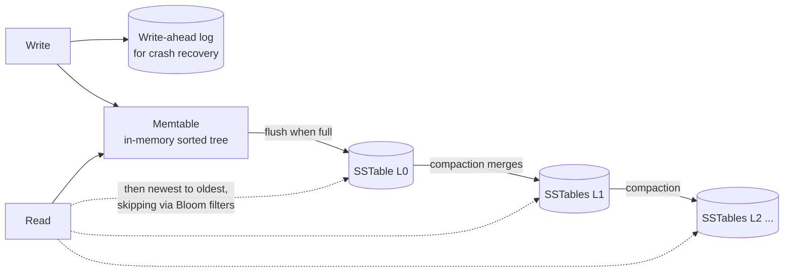

## Simple definition

A **storage engine** is the part of a database that decides how data is laid out on disk and in memory, and how it is found again. You rarely write one, but choosing and tuning a database requires knowing roughly what it does. Two families dominate transactional workloads:

- **Log-structured engines** (LSM-trees): append writes sequentially and merge files in the background. RocksDB, Cassandra, ScyllaDB, HBase, LevelDB.
- **Page-oriented engines** (B-trees): update fixed-size pages in place. PostgreSQL, MySQL InnoDB, Oracle, SQL Server.

Analytics workloads use a third approach: **column-oriented storage**.

## The simplest database: an append-only log

```bash
db_set() { echo "$1,$2" >> database; }
db_get() { grep "^$1," database | sed -e "s/^$1,//" | tail -n 1; }
```

Writing is as fast as it can be: append to the end of a file. Reading is terrible: scan the whole file. An **index** is extra metadata that speeds up reads — and every index slows down writes, because it must be updated too. That trade-off is why databases do not index everything by default.

### Hash index

Keep an in-memory hash map from each key to the **byte offset** of its latest value in the log (Bitcask does this). Reads are one seek. To stop the log growing forever, split it into **segments**, and **compact** old segments in the background by keeping only the latest value per key. Deletes append a **tombstone**.

Limits: all keys must fit in memory, and range queries ("all keys between A and B") are impossible.

## SSTables and LSM-trees

A **Sorted String Table (SSTable)** is a segment file whose entries are **sorted by key**. Sorting makes merging segments efficient (like merge sort) and allows a **sparse** in-memory index: keep one key per few kilobytes, and scan a small block for the rest. Ranges become possible.

How do you produce sorted files from writes arriving in random order? The **Log-Structured Merge-tree (LSM-tree)**:



1. Writes go to an in-memory balanced tree, the **memtable** (and to a log on disk, so a crash does not lose them).
2. When the memtable is full, write it out as a new SSTable. This is a sequential write.
3. Reads check the memtable, then SSTables from newest to oldest.
4. **Compaction** merges SSTables in the background, discarding overwritten and deleted values. Strategies: **size-tiered** (merge similar-sized files; better write throughput) and **leveled** (non-overlapping levels; better read and space efficiency).
5. A **Bloom filter** per SSTable answers "definitely not here" for missing keys, avoiding disk reads.

LSM-trees sustain very high write throughput because disk writes are sequential and compacted data is compressed well.

## B-trees

The B-tree, standard since the 1970s, breaks the database into fixed-size **pages** (typically 4–16 KB) arranged in a tree. Each page holds keys and references to child pages covering key ranges; leaf pages hold values (or references to them). With a branching factor of several hundred, a four-level tree of 4 KB pages can address about 256 TB.

- **Lookup:** follow references from the root down to a leaf: O(log n) page reads, usually with upper levels cached.
- **Update:** overwrite the page in place. If a page is full, **split** it in two and update the parent.
- **Crash safety:** a split modifies several pages; a crash midway corrupts the tree. Every modification is first written to a **write-ahead log (WAL, redo log)**, which is replayed on recovery. Concurrent access to pages is protected by lightweight locks (latches).

## LSM-trees versus B-trees

| | LSM-tree | B-tree |
|---|---|---|
| Write pattern | Sequential appends and merges | Random page overwrites (plus WAL) |
| Write throughput | Usually higher | Lower; each write touches a page and the log |
| Read latency | Can need several SSTables; less predictable | Predictable: one path from root to leaf |
| Write amplification | From repeated compaction | From writing whole pages for small changes, and the WAL |
| Space | Compresses well, less fragmentation | Pages partly empty after splits |
| Risks | Compaction can fall behind under sustained high write load and hurt latency | Mature, well understood |
| Transactions | Harder to attach range locks | Each key lives in exactly one place: natural for locks |

**Write amplification** — one logical write causing many physical writes — matters on SSDs, which wear out, and on throughput-bound systems. Benchmark with your own workload; general claims are unreliable.

## Other indexing structures

- **Primary index:** finds a row by its primary key. In a **clustered index** (InnoDB), the row is stored inside the index; in a **heap file** design (PostgreSQL), the index points to the row's location.
- **Secondary indexes:** on non-unique columns; each entry points to a list of matching rows (or includes the primary key). Essential for joins and filters.
- **Covering index** (index with included columns): stores some columns in the index so a query can be answered from the index alone.
- **Multi-column (concatenated) indexes:** `(last_name, first_name)` serves queries on `last_name` or both, not on `first_name` alone. **Spatial indexes** (R-trees) and **geohash** handle multi-dimensional queries like "restaurants near me", see [Designing a Proximity Service](/system-design/case-studies/proximity-service).
- **Full-text and fuzzy indexes:** Lucene uses an SSTable-like term dictionary and finite automata for fuzzy matching.

## In-memory databases

When the dataset fits in RAM, keep it there (Redis, Memcached, VoltDB, SAP HANA). Durability comes from append-only logs, snapshots or replication. They are fast mainly because they **avoid encoding data structures into disk formats**, not merely because they avoid reading from disk (the OS caches disk pages anyway). They also offer data structures that are awkward on disk, such as Redis' sorted sets and priority queues.

## OLTP versus OLAP

| | OLTP (transaction processing) | OLAP (analytics) |
|---|---|---|
| Typical query | Read or write a few records by key | Aggregate over millions of records |
| Used by | End users, through the application | Analysts, dashboards, BI tools |
| Data | Current state | History of events over time |
| Size | Gigabytes to terabytes | Terabytes to petabytes |
| Bottleneck | Disk seek time, many small requests | Disk bandwidth, scanning |

Running analytics on the OLTP database hurts production traffic. Instead, data is copied into a separate **data warehouse** with **ETL** (extract-transform-load) or ELT pipelines, often fed by change data capture, see [Stream Processing](/data-systems/stream-processing).

Warehouses typically use a **star schema**: a central **fact table** (one row per event: a sale, a click) with foreign keys to **dimension tables** (product, store, date, customer). A **snowflake schema** further normalises the dimensions.

## Column-oriented storage

Fact tables can have hundreds of columns, but a query typically reads four or five. A row-oriented engine must load every column of every row. A **column store** stores each column in its own file, in the same row order, so a query reads only the columns it needs.

```text
Row store:    [date, product, store, qty, price, ...] [date, product, ...] ...
Column store: date:    2026-10-01, 2026-10-01, 2026-10-02, ...
              product: 69, 69, 74, 31, ...
              qty:     1, 3, 1, 2, ...
```

- **Compression:** columns contain many repeated values; **bitmap encoding** and **run-length encoding** shrink them dramatically, and operations can work on compressed data directly with vectorised CPU instructions.
- **Sort order:** sorting rows by a common filter column (date) makes range scans and compression even better. Vertica keeps several sort orders in replicas.
- **Writes** are harder: column stores use an LSM-like approach with an in-memory buffer merged into the column files.
- **Materialised aggregates** and **data cubes** precompute sums by dimension for very fast, but less flexible, queries.

Examples: Amazon Redshift, Google BigQuery, Snowflake, ClickHouse, Apache Parquet files.

## Common mistakes

> [!MISTAKE] Indexing every column
> Every index slows down writes and uses space. Index the columns that real queries filter, join or sort on; check with `EXPLAIN`.

- **Running heavy analytics on the production OLTP database.**
- **Ignoring compaction and vacuum** settings (LSM compaction backlog, PostgreSQL autovacuum), which degrades performance over time.
- **Choosing an engine from benchmarks** that do not resemble your workload.

## Quick check

**Why do LSM-trees have high write throughput?**
Writes are buffered in memory and flushed as sequential, sorted files; random in-place updates are avoided.

**What is the role of the write-ahead log in a B-tree?**
It records every modification before it is applied to pages, so the tree can be restored to a consistent state after a crash.

**What does a Bloom filter do in an LSM engine?**
It tells cheaply whether a key is definitely absent from an SSTable, avoiding unnecessary disk reads.

**What is the difference between OLTP and OLAP?**
OLTP serves many small key-based reads and writes for users; OLAP scans and aggregates large volumes of history for analysis.

**Why are column stores efficient for analytics?**
Queries read only the columns they need, and columns compress very well, which reduces I/O and enables vectorised processing.

## Summary

- Log-structured engines append and compact; B-trees update pages in place with a WAL.
- Indexes speed reads and slow writes; choose them per query pattern.
- OLTP and OLAP have different access patterns, so analytics moves to warehouses.
- Column storage and compression make large scans fast.

## Related topics

- [Transactions and Isolation Levels](/data-systems/transactions-and-isolation)
- [Choosing a Database](/system-design/building-blocks/choosing-a-database)
- [Batch Processing](/data-systems/batch-processing)
- [Stream Processing](/data-systems/stream-processing)

## References

- Martin Kleppmann. *Designing Data-Intensive Applications*. O'Reilly, 2017. Chapter 3: Storage and Retrieval.
- Patrick O'Neil et al. "The Log-Structured Merge-Tree (LSM-Tree)." *Acta Informatica* 33(4), 1996.
- Rudolf Bayer, Edward McCreight. "Organization and Maintenance of Large Ordered Indices." 1970.
