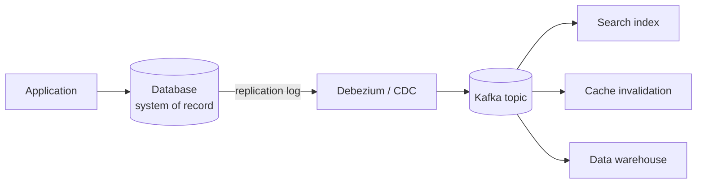

## Simple definition

Batch processing assumes the input is **bounded**: a known, finite size, so a job can finish. Real data is **unbounded**: users keep clicking, sensors keep measuring, orders keep arriving. Running batch jobs every day means results are a day late. **Stream processing** handles each event shortly after it happens.

An **event** is a small, self-contained, immutable record of something that happened at a point in time ("user 42 added item X to cart at 10:01:03"). A **producer** writes it once; it may be processed by several **consumers**. Related events are grouped into a **topic** or stream.

## Transmitting event streams

Polling a database for new events is slow and expensive, so events are delivered through a messaging system. Two questions shape the design:

1. What if producers send faster than consumers process? **Drop** messages, **buffer** them in a queue, or apply **back-pressure** (block the producer).
2. What if nodes crash? Are messages **lost** or **durable**?

### Two families of message broker

| | Traditional message broker (AMQP/JMS style) | **Log-based broker** |
|---|---|---|
| Examples | RabbitMQ, ActiveMQ, Amazon SQS | Apache Kafka, Amazon Kinesis, Apache Pulsar, Redpanda |
| Storage | Messages deleted once acknowledged | Append-only log, retained for days or weeks |
| Delivery to several consumers | Load balancing (each message to one consumer) or fan-out | Each **consumer group** reads the whole log; partitions are assigned to group members |
| Ordering | Can be lost with redelivery and load balancing | Total order **within a partition** |
| Consumer position | Broker tracks per-message acks | Consumer stores an **offset** per partition |
| Replay old messages | No | Yes: reset the offset |
| Best for | Task queues where per-message processing is expensive and order does not matter | High-throughput event streams where order matters and replay is useful |

```mermaid {title="A log-based broker: partitions, offsets and consumer groups"}
flowchart LR
    P[Producer] -- "key = orderId<br/>hash → partition" --> T0
    P --> T1
    subgraph Topic["Topic: orders"]
        T0["Partition 0<br/>offsets 0..1041"]
        T1["Partition 1<br/>offsets 0..998"]
    end
    T0 --> G1A["Group billing<br/>consumer A (offset 1040)"]
    T1 --> G1B["Group billing<br/>consumer B (offset 990)"]
    T0 --> G2["Group analytics<br/>consumer C (offset 512)"]
    T1 --> G2
```

Because log reads do not delete anything, adding a new consumer never affects existing ones, and the log's disk usage is bounded by a retention time rather than by consumer speed. A slow consumer just falls behind (monitor **consumer lag**). Kafka's speed comes from sequential disk I/O, batching and **zero-copy** transfer (`sendfile`) from the page cache to the network socket. See [Message Queues and Delivery Semantics](/system-design/building-blocks/message-queues-and-delivery-semantics).

## Databases and streams

A database's replication log *is* a stream of changes. Making that explicit solves a hard problem: keeping several systems (database, cache, search index, data warehouse) in sync.

### The dual-write problem

If the application writes to the database **and** to the search index, races and partial failures make them diverge: two clients' writes can reach the two systems in different orders, and one write can fail while the other succeeds.

### Change data capture (CDC)

**CDC** reads the database's replication log (PostgreSQL logical decoding, MySQL binlog) and publishes every change as an event, in commit order. Downstream systems — caches, search indexes, warehouses — consume the stream and become **derived data**, with the database as the single **system of record**. Tools: Debezium, Maxwell, AWS DMS, and Kafka Connect.



A new consumer needs the history too: start from a **snapshot** taken at a known log position, or use **log compaction** (Kafka keeps only the latest value per key), which lets a consumer rebuild the full current state by reading the compacted topic from the start.

The **transactional outbox** pattern is application-level CDC: the service writes events to an `outbox` table in the same transaction as its data, and a relay publishes them. See [Event-Driven Microservices](/microservices/communication/event-driven-spring-cloud-stream).

### Event sourcing

**Event sourcing** stores application state as an append-only log of **domain events** ("ItemAddedToCart", "OrderPlaced") instead of mutable rows. Current state is derived by replaying events (with periodic snapshots for speed).

| | CDC | Event sourcing |
|---|---|---|
| Events describe | Low-level row changes | Business-level intent and facts |
| Application writes to | A mutable database | An append-only event store |
| Log compaction | Possible (later values replace earlier) | Not possible: later events do not supersede earlier ones |

Benefits of immutable events: a complete audit trail, easier debugging (replay what happened), recovery from bugs by recomputing, and the ability to derive **several read models** from the same events (**CQRS**: command query responsibility segregation). Costs: schema evolution of old events, eventual consistency between write and read sides, and handling **deletion** (privacy law can require removing data that was meant to be immutable — "excision" or crypto-shredding).

> [!KEY] The log as the source of truth
> "The truth is the log. The database is a cache of a subset of the log." Mutable state is the integral of an event stream over time; the change log is its derivative.

## Processing streams

What can you do with a stream?

1. Write it to a store (database, cache, search index) — CDC consumers.
2. Push it to users (alerts, live dashboards).
3. Transform it into another stream, through a pipeline of **operators** (filter, map, join, aggregate). This is stream processing proper.

Use cases:

- **Complex event processing (CEP):** search for event patterns ("three failed logins from different countries within a minute").
- **Stream analytics:** rates, rolling averages, percentiles over windows; often with probabilistic structures (HyperLogLog, Bloom filters).
- **Maintaining materialised views:** keep an aggregate continuously up to date.
- **Search on streams:** match events against stored queries (alerting on new listings).

Frameworks: Apache Flink, Kafka Streams, Spark Structured Streaming, Apache Beam (with Google Dataflow).

### Reasoning about time

| Time | Meaning |
|---|---|
| **Event time** | When the event actually happened (set by the device) |
| **Processing time** | When the processor handles it |

They can differ by seconds or days (a phone offline in a tunnel, a consumer restarting after an outage, reprocessing history). Windows based on processing time give wrong answers whenever there is a backlog. Use event time, and decide how long to wait for **stragglers**: a **watermark** declares "no more events earlier than T expected"; late events are dropped or emitted as corrections.

Device clocks are unreliable too; log three timestamps (device event time, device send time, server receive time) to estimate the offset.

### Window types

| Window | Definition | Example |
|---|---|---|
| **Tumbling** | Fixed length, non-overlapping | Requests per minute, 10:00–10:01, 10:01–10:02 |
| **Hopping** | Fixed length, overlapping by a hop size | 5-minute windows every 1 minute (smoothed rate) |
| **Sliding** | All events within an interval of each other | Events within 5 minutes of each other |
| **Session** | No fixed length; closes after a period of inactivity | A user's website visit, ending after 30 idle minutes |

### Stream joins

| Join | Inputs | Example |
|---|---|---|
| **Stream–stream** (window join) | Two event streams within a time window | Match search events with clicks on results within an hour |
| **Stream–table** (enrichment) | Events joined with a local copy of a database kept fresh by CDC | Add the user's profile to each activity event |
| **Table–table** (materialised view maintenance) | Two changelog streams producing a continuously updated join | A Twitter-style timeline cache updated by tweets and follows |

Joins over time raise **time dependence**: if the user's profile changed, which version do you join with? Make it deterministic by joining against the version valid at the event's time (slowly changing dimensions).

## Fault tolerance and exactly-once

A batch task can simply be rerun. A stream never ends, so stream processors use:

- **Microbatching** (Spark Streaming: one-second batches) or **checkpointing** (Flink: periodic consistent snapshots of operator state, using barriers in the stream).
- **Atomic commit** of outputs, state changes and input offsets together (Kafka transactions, used by Kafka Streams' `exactly_once_v2`).
- **Idempotence:** make processing an event twice have the same effect as once — store the offset or event ID with the output and skip duplicates.
- **Rebuilding state** after failure from a changelog topic or a checkpoint.

"Exactly-once" really means **effectively once**: an event may be processed more than once internally, but the visible effect happens once. It stops at system boundaries: an email sent by a stream processor cannot be "un-sent" on retry, so external side effects need their own idempotency keys.

## Common mistakes

> [!MISTAKE] Dual writes to keep systems in sync
> Writing to the database and then publishing to Kafka (or updating a cache) in application code eventually diverges. Use CDC or a transactional outbox so one system is the source of truth.

- **Windowing by processing time** for business metrics.
- **Assuming global ordering** in Kafka; ordering is per partition, so choose the key (order ID, customer ID) that must stay ordered.
- **Unbounded consumer lag** going unnoticed.
- **Non-idempotent consumers** with at-least-once delivery.

## Quick check

**How does a log-based broker differ from a traditional message queue?**
It retains messages in an append-only partitioned log; consumers track their own offsets, can replay, and each consumer group reads the whole stream with ordering per partition.

**What is change data capture?**
Extracting the database's change log as a stream of events, so derived systems can be updated in the same order as the database.

**How does event sourcing differ from CDC?**
Event sourcing records business-level events as the primary store; CDC derives low-level change events from a mutable database.

**Why use event time rather than processing time for windows?**
Processing can be delayed (outages, backlogs, reprocessing), which would put events in the wrong windows.

**What does exactly-once mean in stream processing?**
Effectively once: the visible result is as if each event were processed once, achieved with atomic commits, checkpoints and idempotence.

## Summary

- Streams are unbounded; log-based brokers make them durable, ordered per partition and replayable.
- CDC and event sourcing turn databases into streams and keep derived data consistent.
- Stream processors filter, join and aggregate over windows, using event time and watermarks.
- Exactly-once is effectively-once through checkpoints, atomic commit and idempotence.

## Related topics

- [Message Queues and Delivery Semantics](/system-design/building-blocks/message-queues-and-delivery-semantics)
- [Event-Driven Microservices with Spring Cloud Stream](/microservices/communication/event-driven-spring-cloud-stream)
- [Encoding and Schema Evolution](/data-systems/encoding-and-schema-evolution)
- [Batch Processing](/data-systems/batch-processing)

## References

- Martin Kleppmann. *Designing Data-Intensive Applications*. O'Reilly, 2017. Chapter 11: Stream Processing, and Chapter 12: The Future of Data Systems.
- Jay Kreps. "[The Log: What every software engineer should know about real-time data's unifying abstraction](https://engineering.linkedin.com/distributed-systems/log-what-every-software-engineer-should-know-about-real-time-datas-unifying)." 2013.
- Tyler Akidau et al. *Streaming Systems*. O'Reilly, 2018.
- Alex Xu. *ByteByteGo System Design Handbook*: why is Kafka fast; at-most once, at-least once and exactly once.
