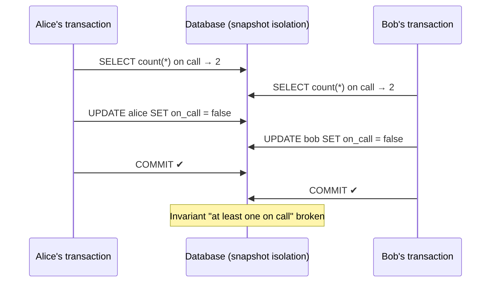

## Simple definition

A **transaction** groups several reads and writes into one logical unit: either all of them take effect (**commit**) or none do (**abort**, rollback). Transactions let applications ignore whole classes of problems — crashes halfway through, concurrent clients interfering — because the database handles them.

How well it handles concurrency is set by the **isolation level**. Weaker levels are faster but allow **anomalies** that cause real bugs, and the names of isolation levels mean different things in different databases. Knowing the anomalies is more useful than knowing the names.

## What ACID really means

| Letter | Meaning | What it is *not* |
|---|---|---|
| **Atomicity** | All writes of a transaction happen or none do; on error, the transaction can be safely retried | Not about concurrency ("abortability" would be a better name) |
| **Consistency** | Application invariants hold (debits equal credits) | Mostly the *application's* job; the database only enforces declared constraints. Different from consistency in CAP or replication |
| **Isolation** | Concurrent transactions do not interfere; ideally as if run one after another (serializability) | Rarely serializable by default |
| **Durability** | Committed data survives crashes (written to disk/WAL, or replicated) | Not absolute: disks fail, replicas can all be lost |

## The anomalies

| Anomaly | What happens | Example |
|---|---|---|
| **Dirty read** | Read another transaction's uncommitted write | See an order total that is later rolled back |
| **Dirty write** | Overwrite another transaction's uncommitted write | Two buyers' writes to a listing and its invoice interleave |
| **Read skew** (non-repeatable read) | Two reads in one transaction see different committed states | A backup or report sees money "missing" between two accounts during a transfer |
| **Lost update** | Two read-modify-write cycles; one overwrites the other | Two increments of a counter yield +1 |
| **Write skew** | Two transactions read the same data, then write *different* records based on what they read; an invariant breaks | Two on-call doctors both go off call because each saw the other still on call |
| **Phantom** | A write changes the result of another transaction's search query | Two users book the same meeting room slot because each checked "no overlapping booking" |

## Isolation levels and what they prevent

| Level | Dirty read | Dirty write | Read skew | Lost update | Write skew / phantoms |
|---|---|---|---|---|---|
| Read uncommitted | ❌ | ✅ | ❌ | ❌ | ❌ |
| **Read committed** | ✅ | ✅ | ❌ | ❌ | ❌ |
| **Snapshot isolation** ("repeatable read" in PostgreSQL and MySQL) | ✅ | ✅ | ✅ | Depends on DB* | ❌ |
| **Serializable** | ✅ | ✅ | ✅ | ✅ | ✅ |

\* PostgreSQL's repeatable read detects lost updates and aborts; MySQL InnoDB's does not. Defaults: PostgreSQL and SQL Server use read committed; MySQL InnoDB uses repeatable read; Oracle's "serializable" is actually snapshot isolation.

### Read committed

- **No dirty writes:** row-level write locks held until commit.
- **No dirty reads:** the database remembers the old committed value and returns it to readers until the writer commits (no read locks).

It still allows read skew, lost updates and write skew.

### Snapshot isolation and MVCC

Each transaction reads from a **consistent snapshot** of the database as of the moment it started. Implemented with **multi-version concurrency control (MVCC)**: the database keeps several versions of each row, tagged with the transaction IDs that created and deleted them, and a reader sees only versions committed before its snapshot.

> Readers never block writers, and writers never block readers.

Snapshot isolation is ideal for long read-only queries: backups, reports, integrity checks. Old versions are garbage-collected later (PostgreSQL's VACUUM).

## Preventing lost updates

Many application bugs are lost updates in read-modify-write cycles. Options, best first:

```sql
-- 1. Atomic update: let the database do the read-modify-write
UPDATE counters SET value = value + 1 WHERE key = 'visits';

-- 2. Explicit lock on the rows you will update
BEGIN;
SELECT * FROM accounts WHERE id = 42 FOR UPDATE;
-- compute in the application
UPDATE accounts SET balance = :new WHERE id = 42;
COMMIT;

-- 3. Compare-and-set / optimistic locking with a version column
UPDATE documents SET content = :new, version = version + 1
WHERE id = :id AND version = :expectedVersion;     -- 0 rows updated = someone else won; retry
```

4. **Automatic detection:** PostgreSQL's repeatable read and serializable levels abort the losing transaction.

In JPA, option 3 is `@Version` and option 2 is `@Lock(PESSIMISTIC_WRITE)`; see [Transactions in Spring](/spring/data/transactions). In replicated multi-leader or leaderless systems, locks and compare-and-set do not work across replicas; use commutative operations or conflict resolution.

## Write skew and phantoms

Write skew is a generalisation of lost updates: the transactions update **different** objects, so row locks on what they write do not help.



The pattern: (1) a `SELECT` checks a condition, (2) the application decides, (3) a write changes the condition. Fixes:

- **Serializable isolation** (preferred).
- `SELECT ... FOR UPDATE` on the rows the check depends on — only works if those rows exist.
- When the check is about **absence** (no booking for this room at this time), there is nothing to lock: a **phantom**. **Materialise the conflict** by creating lockable rows (one row per room per time slot), or use a database **constraint** (a unique index, or PostgreSQL's exclusion constraints for overlapping ranges).

## Serializability: three implementations

### 1. Actual serial execution

Run transactions one at a time on a single thread. Feasible since RAM got cheap and OLTP transactions got short. Used by VoltDB, Redis (Lua scripts and `MULTI`) and Datomic. Requirements: transactions are **stored procedures** submitted whole (no network round-trips mid-transaction), the active data fits in memory, and write throughput fits one CPU core per partition. Cross-partition transactions are much slower.

### 2. Two-phase locking (2PL)

The traditional approach for 30 years. Readers take **shared locks**, writers take **exclusive locks**, and locks are held until commit. Writers block readers *and* readers block writers. Phantoms are prevented with **predicate locks** or, in practice, **index-range (next-key) locks**. Downsides: much lower throughput, unpredictable latency, and frequent **deadlocks** that abort transactions. (Not to be confused with two-phase *commit*.)

### 3. Serializable snapshot isolation (SSI)

An **optimistic** technique (2008, used by PostgreSQL's serializable level and CockroachDB). Transactions run on snapshots without blocking; at commit, the database checks whether the premises the transaction read have changed (stale MVCC reads, or writes that affect earlier reads) and aborts it if so. Good performance when contention is low; under high contention, many aborts.

| | Serial execution | Two-phase locking | SSI |
|---|---|---|---|
| Approach | One thread | Pessimistic locks | Optimistic, detect at commit |
| Readers block writers | n/a | Yes | No |
| Weakness | One core per partition; short transactions only | Throughput, deadlocks, latency | Aborts under contention |

**Application rule for serializable isolation:** be ready to **retry** aborted transactions (serialization failures, deadlocks), and keep transactions short. Retrying is only safe if the transaction has no external side effects (sending email) or those are idempotent.

## Common mistakes

> [!MISTAKE] Read-modify-write in application code at read committed
> `account = repo.find(id); account.setBalance(account.getBalance() - x); repo.save(account);` loses updates under concurrency. Use an atomic `UPDATE`, `@Version`, or `SELECT ... FOR UPDATE`.

- **Assuming "repeatable read" means the same thing in every database.**
- **Check-then-insert uniqueness** in code instead of a unique constraint.
- **Long transactions** holding locks or old snapshots (bloat, contention).
- **Not retrying** serialization failures, or retrying transactions with non-idempotent side effects.

## Quick check

**What does the C in ACID depend on?**
Mostly on the application: the database enforces declared constraints, but invariants are defined by application logic.

**What does snapshot isolation prevent that read committed does not?**
Read skew (non-repeatable reads): each transaction sees one consistent snapshot.

**What is write skew?**
Two transactions read overlapping data, then update different rows based on what they read, together violating an invariant that each preserved alone.

**What are three ways to prevent lost updates?**
Atomic write operations, explicit locks (`SELECT ... FOR UPDATE`), and compare-and-set with a version column; some databases also detect them automatically.

**How does SSI differ from two-phase locking?**
SSI is optimistic: it does not block, and aborts transactions at commit if their reads became stale. 2PL is pessimistic: it blocks conflicting reads and writes with locks.

## Summary

- ACID's isolation is rarely serializable by default; know your database's levels.
- Learn the anomalies: dirty reads/writes, read skew, lost updates, write skew, phantoms.
- Snapshot isolation (MVCC) suits most reads; prevent lost updates explicitly.
- Serializability comes from serial execution, 2PL or SSI; retry aborted transactions.

## Related topics

- [Transactions in Spring: @Transactional, Propagation and Isolation](/spring/data/transactions)
- [Consistency and Consensus](/data-systems/consistency-and-consensus)
- [Designing Concurrent Objects](/java/advanced/concurrent-object-design) — the in-memory analogue

## References

- Martin Kleppmann. *Designing Data-Intensive Applications*. O'Reilly, 2017. Chapter 7: Transactions.
- Hal Berenson et al. "A Critique of ANSI SQL Isolation Levels." SIGMOD 1995.
- Michael J. Cahill et al. "Serializable Isolation for Snapshot Databases." SIGMOD 2008.
- Alex Xu. *ByteByteGo System Design Handbook*: database isolation levels; optimistic locking.
