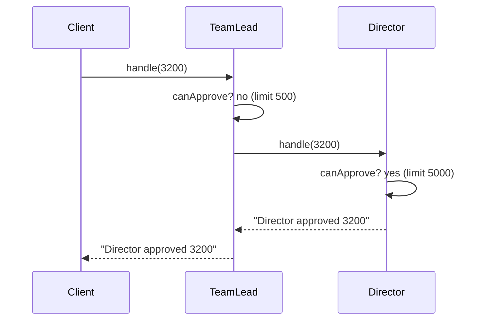

## Simple definition

The **Chain of Responsibility** pattern passes a request along a **chain of handler objects**. Each handler either handles the request or passes it to the next one. The sender does not know which handler will deal with it.

GoF intent: *"Avoid coupling the sender of a request to its receiver by giving more than one object a chance to handle the request. Chain the receiving objects and pass the request along the chain until an object handles it."*

## The problem

Expense claims need approval at different levels: a team lead up to 500, a director up to 5,000 and the CFO up to 50,000, but never for personal items. A single method with nested `if` statements works until:

- the limits differ per department
- a new level ("VP") is inserted
- some claims must skip a level.

Each change edits the same method, and the code that submits a claim knows the whole approval hierarchy.

## Real-world analogy

A customer-support call. The first-line agent handles what they can; harder issues go to a specialist, then to engineering. You talk to "support", not to a specific person, and you do not need to know the escalation path.

## Structure

- **Handler** (`Approver`) — handles a request or forwards it to its successor.
- **Concrete handlers** (`TeamLead`, `Director`, `Cfo`) — decide whether they can handle it.
- **Client** — sends the request to the first handler.

```mermaid {title="Chain of Responsibility — class diagram of the example"}
classDiagram
    direction LR
    class Approver {
        <<abstract>>
        -Approver next
        +then(Approver) Approver
        +handle(ExpenseClaim) String
        #canApprove(ExpenseClaim)* boolean
    }
    class TeamLead
    class Director
    class Cfo
    Approver <|-- TeamLead
    Approver <|-- Director
    Approver <|-- Cfo
    Approver --> Approver : next
```



## Java implementation

The code is in `examples/java/src/hub/patterns/chain/ChainOfResponsibilityDemo.java`.

### Classic linked handlers



`handle()` is `final`: the forwarding logic is written once (a small [Template Method](/design-patterns/behavioral/template-method)), and subclasses only answer "can I approve this?".

### Modern variant: a list of handlers



Handlers are lambdas returning `Optional`; the first non-empty answer wins. The chain is just a `List`, so it is easy to build from configuration and to test each rule alone.



## Two flavours of chain

| Flavour | Behaviour | Examples |
|---|---|---|
| **Pure (GoF)** | Exactly one handler handles the request; the rest pass it on | Approval levels, event bubbling in UI toolkits, exception handler lookup |
| **Pipeline / middleware** | *Every* handler may act, then decide whether to continue | Servlet filters, Spring Security's filter chain, Spring Cloud Gateway filters, Netty pipelines |

In the pipeline flavour each handler receives the rest of the chain and calls it explicitly:

```java
public void doFilter(ServletRequest req, ServletResponse res, FilterChain chain)
        throws IOException, ServletException {
    if (!isAuthenticated(req)) {
        ((HttpServletResponse) res).sendError(401);   // stop the chain
        return;
    }
    chain.doFilter(req, res);                         // continue
    // code here runs on the way back, after the rest of the chain
}
```

That is why [Spring Security's filter chain](/spring/security/security-filter-chain) can both reject requests early and wrap the remainder of the processing.

## Advantages and disadvantages

| Advantages | Disadvantages |
|---|---|
| Sender and receivers are decoupled | No guarantee anyone handles the request; add a default at the end |
| Handlers can be added, removed or reordered without changing the client | Hard to see which handler acted; log decisions |
| Each handler has a single responsibility | Long chains add latency and make debugging harder |
| Chains can be configured at runtime | Order dependencies between handlers are implicit |

## When to use it

- More than one object may handle a request and the handler is not known in advance.
- You want to issue a request without specifying the receiver explicitly.
- Processing steps (authentication, validation, rate limiting, logging) should be composable and reorderable.

## When not to use it

- There is always exactly one known receiver: call it directly.
- Every handler must run in a fixed order with no early exit: a simple sequence of method calls is clearer.

## Common mistakes

> [!MISTAKE] A chain with no end
> If no handler accepts the request, the classic version falls off the end. Always define what happens then: a default handler, an exception or an explicit "rejected" result.

- **Handlers that depend on each other's side effects** without documenting the order.
- **Cycles** when handlers are linked by hand.
- **Forgetting to call `chain.doFilter(...)`** in a servlet filter, which silently drops the request.

## Real-world uses

- `javax.servlet.Filter` / `jakarta.servlet.Filter` and `FilterChain`.
- Spring Security's `SecurityFilterChain`, Spring MVC `HandlerInterceptor`s and Spring Cloud Gateway filters.
- `java.util.logging.Logger` passes records to parent loggers' handlers.
- Exception handling: the JVM searches up the call stack for a matching `catch`, and Spring MVC tries `HandlerExceptionResolver`s in order.

## Interview questions and answers

**What is Chain of Responsibility?**
A behavioral pattern that passes a request along a chain of handlers until one handles it, so the sender does not depend on a specific receiver.

**Where does Spring use it?**
The Spring Security filter chain, servlet filters, MVC interceptors, gateway filters and the list of exception resolvers.

**What is the risk of the pattern?**
A request may go unhandled, and with long chains it is hard to see which handler acted. Provide a terminal default and log decisions.

**How does it differ from Decorator?**
Both link objects. A decorator always forwards and adds behaviour; a chain handler may stop the request and is about choosing *who* handles it.

## Summary

- Chain of Responsibility decouples a request's sender from its handler.
- The classic chain stops at the first handler; the pipeline flavour lets each handler act and continue.
- Servlet filters and Spring Security are chains.
- Always define what happens at the end of the chain.

## Related topics

- [Spring Security Filter Chain](/spring/security/security-filter-chain)
- [Command Pattern](/design-patterns/behavioral/command) — requests as objects that can travel a chain
- [Decorator Pattern](/design-patterns/structural/decorator)

## References

- Gamma, Helm, Johnson, Vlissides. *Design Patterns*. Addison-Wesley, 1994. Chain of Responsibility, p. 223.
- Eric Freeman, Elisabeth Robson. *Head First Design Patterns* (2nd edition). O'Reilly, 2020. Appendix: Leftover patterns.
