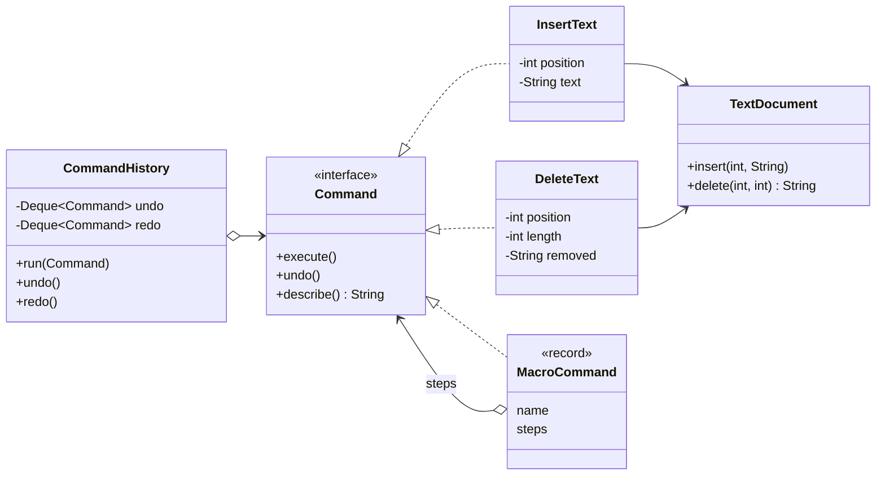

## Simple definition

The **Command** pattern wraps a request — "insert this text at position 5" — in an **object**. Because the request is now a value, it can be stored in a history, undone, redone, queued for later, sent to another thread or logged and replayed.

GoF intent: *"Encapsulate a request as an object, thereby letting you parameterize clients with different requests, queue or log requests, and support undoable operations."* It is also known as **Action** or **Transaction**.

## The problem

A text editor needs undo and redo. If menu items and keyboard shortcuts call `document.insert(...)` directly:

- there is no record of what was done, so nothing can be undone
- the same action is wired separately to the menu, the toolbar and the shortcut
- you cannot record a sequence of actions as a macro.

## Real-world analogy

A restaurant order slip. The waiter (invoker) writes your request on a slip (command) and hands it to the kitchen (receiver). The slip can wait in a queue, be cancelled, or be kept for the bill. The waiter does not need to know how to cook.

## Structure

- **Command** — declares `execute()` (and here `undo()`).
- **Concrete command** (`InsertText`, `DeleteText`, `MacroCommand`) — binds a receiver to an action and its parameters.
- **Receiver** (`TextDocument`) — knows how to perform the work.
- **Invoker** (`CommandHistory`) — asks commands to execute and keeps them for undo.
- **Client** — creates commands and gives them to the invoker.



## Java implementation

The code is in `examples/java/src/hub/patterns/command/CommandDemo.java`.









## Step-by-step walkthrough

1. **Each command stores everything it needs**: the receiver and the parameters. `DeleteText` also captures the removed text during `execute()`, because `undo()` needs it.
2. **The invoker pushes executed commands on an undo stack.** Undo pops one, calls `undo()`, and pushes it on the redo stack.
3. **A new command clears the redo stack.** After you type something new, the old "future" no longer applies. Every editor works this way.
4. **`MacroCommand` is a composite of commands** (the [Composite](/design-patterns/structural/composite) pattern). Its `undo()` reverses the steps in reverse order, so one undo removes the whole sign-off.

> [!TIP] Undo by inverse operation or by snapshot
> This example undoes by applying the inverse operation. When inverses are hard to compute (an image filter), store a snapshot of the state before execution instead: that is the [Memento](/design-patterns/behavioral/memento) pattern, and the two are often combined.

## Lambdas as commands

In Java, `Runnable`, `Callable` and any functional interface are command interfaces. When you need only `execute()`, a lambda is a perfectly good command:

```java
ExecutorService pool = Executors.newVirtualThreadPerTaskExecutor();
pool.submit(() -> emailService.send(welcomeEmail));   // a command, queued and executed later
```

Use classes when commands need undo, a name for logging, serialization or several methods.

## Command versus Strategy

Both put behaviour in an object, but they answer different questions:

| | Command | [Strategy](/design-patterns/behavioral/strategy) |
|---|---|---|
| Question | *What* should be done (a request with its arguments) | *How* should something be done (an algorithm) |
| Arguments | Captured in the object at creation | Passed in on each call |
| Typical lifecycle | Created, executed once, maybe undone, stored | Long-lived, called many times |
| Example | `InsertText(doc, 5, ",")` | `DiscountPolicy.discountFor(cart)` |

## Advantages and disadvantages

| Advantages | Disadvantages |
|---|---|
| Undo, redo, macros, queuing, scheduling and logging become possible | One class per action can lead to many small classes |
| Invoker is decoupled from the receiver | Correct undo needs careful captured state |
| Commands can be composed and serialized | Undo history uses memory; bound it |
| New commands do not change existing code (OCP) | — |

## When to use it

- Undo/redo or transactional behaviour.
- Queuing, scheduling or executing requests on another thread or machine (job queues, executors).
- Logging requests so they can be replayed after a crash (write-ahead logs, event logs).
- Decoupling UI elements from actions (menus, buttons and shortcuts share one command).

## When not to use it

- A direct method call is enough and none of the above is needed.
- The request is not really an operation but a choice of algorithm: use Strategy.

## Common mistakes

> [!MISTAKE] Commands that read state at undo time
> `DeleteText.undo()` must restore what was deleted *when it executed*, not what is at that position now. Capture the required state in `execute()`.

- **Not clearing the redo stack** after a new command.
- **Unbounded history**, causing memory growth in long sessions.
- **Commands that depend on global state** instead of their stored receiver and arguments, which breaks replay.

## Command at architecture scale

- **Message queues and job systems:** a message such as `SendInvoice{orderId}` is a serialized command.
- **CQRS:** the write side receives *commands* (`PlaceOrder`) that express intent and may be rejected, as opposed to *events* (`OrderPlaced`) that state facts.
- **Event sourcing and write-ahead logs:** logged operations are replayed to rebuild state; see [Storage Engines](/data-systems/storage-engines).

## Real-world uses

- `java.lang.Runnable` and `java.util.concurrent.Callable` with `Executor`s.
- Swing's `Action` interface and `UndoManager` / `UndoableEdit`.
- Spring Batch steps, Quartz jobs and `TaskScheduler` tasks.
- Database transaction logs and Redis' append-only file (AOF).

## Interview questions and answers

**What is the Command pattern?**
A behavioral pattern that encapsulates a request as an object, so requests can be parameterized, queued, logged and undone.

**How do you implement undo with Command?**
Each command implements `undo()` using state it captured on `execute()`. An invoker keeps a stack of executed commands; undo pops and reverses. Redo uses a second stack that is cleared by new commands.

**What is a macro command?**
A command composed of other commands, executed in order and undone in reverse order.

**Is a `Runnable` a command?**
Yes: an object representing an action to perform later, often on another thread.

**Command versus Strategy?**
Command captures a specific request with its arguments; Strategy is an interchangeable algorithm called with different arguments.

## Summary

- Command turns a request into an object: storable, queueable, undoable.
- The invoker manages history; the receiver does the work.
- Lambdas are commands when only `execute()` is needed.
- The idea scales up to job queues, CQRS and write-ahead logs.

## Related topics

- [Memento Pattern](/design-patterns/behavioral/memento) — snapshot-based undo
- [Strategy Pattern](/design-patterns/behavioral/strategy)
- [The Java Concurrency API](/java/advanced/concurrency-api) — executors run commands

## References

- Gamma, Helm, Johnson, Vlissides. *Design Patterns*. Addison-Wesley, 1994. Command, p. 233.
- Eric Freeman, Elisabeth Robson. *Head First Design Patterns* (2nd edition). O'Reilly, 2020. Chapter 6 (the remote control).
