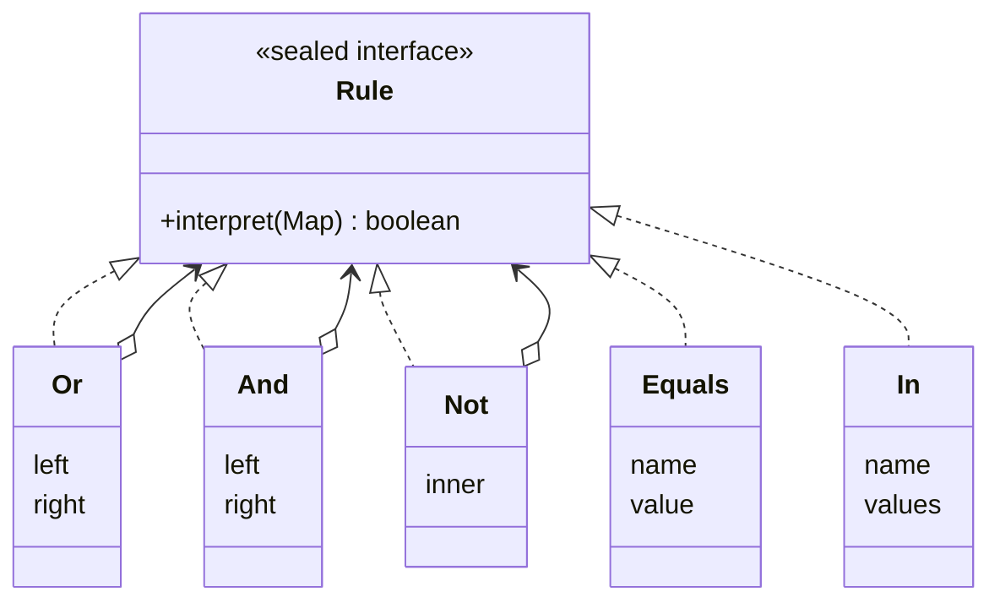

## Simple definition

The **Interpreter** pattern defines a class for each rule of a small language's **grammar**. A sentence in the language is parsed into a tree of these objects (an **abstract syntax tree**, AST), and calling `interpret(context)` on the root evaluates it recursively.

GoF intent: *"Given a language, define a representation for its grammar along with an interpreter that uses the representation to interpret sentences in the language."*

## The problem

Product managers want to enable features for some users without a code release:

```text
plan = pro and not country in [US, CA] or beta = true
```

Hard-coding each rule in Java requires a deployment for every change. Storing rules as data needs a way to **represent** and **evaluate** them safely, without `eval` or scripting engines with full system access.

## Real-world analogy

Musical notation. A score is a sentence in a language with a grammar (notes, rests, bars). A musician interprets it to produce sound, the same score for every orchestra.

## Structure

- **Abstract expression** (`Rule`) — declares `interpret(context)`.
- **Terminal expressions** (`Equals`, `In`) — leaves of the tree, evaluated directly against the context.
- **Nonterminal expressions** (`And`, `Or`, `Not`) — contain sub-expressions and combine their results.
- **Context** — the input (`Map<String, String>` of user attributes).
- **Client / parser** — builds the AST from text.



The structure is a [Composite](/design-patterns/structural/composite): nonterminals are composites, terminals are leaves.

## Java implementation

The code is in `examples/java/src/hub/patterns/interpreter/InterpreterDemo.java`.

### Grammar as sealed records



### Parser



GoF's Interpreter does not cover parsing, but you always need one. A **recursive-descent parser** has one method per grammar rule (`expr`, `term`, `factor`). Operator precedence falls out of the nesting: `and` binds tighter than `or` because `term` is called from `expr`.



```mermaid {title="AST for: plan = pro and not country in [US, CA] or beta = true"}
flowchart TD
    OR[Or] --> AND[And]
    OR --> B["Equals beta = true"]
    AND --> P["Equals plan = pro"]
    AND --> NOT[Not]
    NOT --> IN["In country [US, CA]"]
```

## When a DSL is worth it

| Situation | Better choice |
|---|---|
| A few simple, stable rules | Plain Java code |
| Rules change often and are edited by non-developers, with a small grammar | **Interpreter** (this pattern) |
| Rich expressions and existing tooling are acceptable | An embedded language: SpEL, MVEL, CEL, JSON Logic |
| Large grammar, performance-critical | A parser generator (ANTLR) and compilation to bytecode or a VM |

> [!WARNING] Never evaluate untrusted input with a general-purpose engine
> Evaluating user-supplied text with a full scripting engine, or with SpEL using `StandardEvaluationContext`, can let attackers call arbitrary methods. A small purpose-built interpreter like this one can only do what its grammar allows. If you use SpEL for user input, use `SimpleEvaluationContext`.

## Interpreter and Visitor

Putting `interpret` in every node is fine for one operation. If you also need to pretty-print, validate and optimise rules, each operation adds a method to every class. Two alternatives:

- **[Visitor](/design-patterns/behavioral/visitor):** keep the nodes as data and put each operation in a visitor.
- **Sealed interfaces and pattern matching (Java 21):** write `switch (rule) { case And(var l, var r) -> ... }` in a separate class per operation; the compiler checks exhaustiveness.

## Advantages and disadvantages

| Advantages | Disadvantages |
|---|---|
| Easy to change and extend a small grammar: one class per rule | Complex grammars produce many classes and are hard to maintain |
| Rules become data that can be stored, versioned and edited | Tree-walking is slow compared with compiled code |
| Safe: only operations the grammar allows can run | Needs a parser, error messages and tooling |

## When to use it

- A simple language that changes or is edited often: feature flags, pricing rules, search filters, validation rules, alert conditions.
- Efficiency is not critical, or results can be cached.

## When not to use it

- The grammar is large (use a parser generator) or performance-critical (compile).
- An existing expression language already fits and is safe for your inputs.

## Common mistakes

> [!MISTAKE] Parsing on every evaluation
> Parse a rule once, keep the AST, and evaluate it many times. Parsing per request wastes CPU and repeats error handling.

- **Poor error messages** ("syntax error") that make rules impossible to fix for non-developers.
- **Unbounded recursion** on deeply nested input; limit depth for untrusted rules.
- **Mixing evaluation with I/O** inside terminal expressions, making rules slow and unpredictable.

## Real-world uses

- `java.util.regex.Pattern` compiles a regular expression into a tree of node objects that match input.
- Spring Expression Language (SpEL) parses expressions into an AST of `SpelNode`s; see [Spring Expression Language](/spring/core/spring-expression-language).
- JPA Criteria and Spring Data `Specification`s build query expression trees.
- `java.text.MessageFormat` and template engines interpret format strings.

## Interview questions and answers

**What is the Interpreter pattern?**
A behavioral pattern that represents each grammar rule of a small language as a class, builds sentences into an AST, and evaluates them by recursive `interpret` calls.

**What are terminal and nonterminal expressions?**
Terminals are leaves evaluated directly (a comparison, a literal). Nonterminals combine sub-expressions (and, or, not).

**Does the pattern include parsing?**
No. GoF assumes the AST exists; in practice you write a parser, often recursive descent.

**When would you not use it?**
For complex grammars or performance-critical evaluation; use a parser generator or compile to code instead.

## Summary

- Interpreter turns a small grammar into classes and evaluates an AST recursively.
- It is a Composite with an `interpret` operation.
- Pair it with a parser; parse once, evaluate many times.
- Prefer safe, purpose-built interpreters for user-editable rules.

## Related topics

- [Composite Pattern](/design-patterns/structural/composite)
- [Visitor Pattern](/design-patterns/behavioral/visitor)
- [Spring Expression Language](/spring/core/spring-expression-language)
- [Modern Java: records, sealed classes and pattern matching](/java/fundamentals/modern-java-features)

## References

- Gamma, Helm, Johnson, Vlissides. *Design Patterns*. Addison-Wesley, 1994. Interpreter, p. 243.
- Robert Nystrom. *Crafting Interpreters*. Genever Benning, 2021. Chapters 5–7 (representing code, parsing, evaluating).
