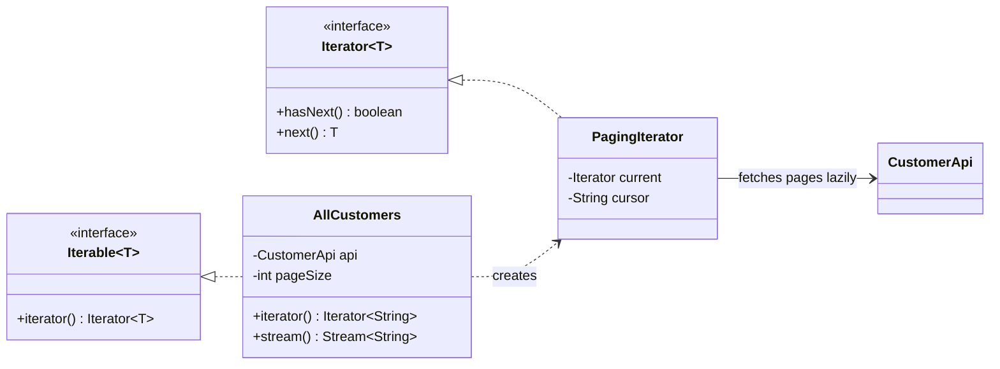

## Simple definition

The **Iterator** pattern gives a way to visit the elements of a collection **one at a time, without exposing how the collection is stored**: an array, a linked list, a tree, a database cursor or pages from a remote API.

GoF intent: *"Provide a way to access the elements of an aggregate object sequentially without exposing its underlying representation."* It is also known as **Cursor**.

## The problem

A CRM API returns customers in pages of 100 with a `nextCursor` token. Every piece of code that needs "all customers" writes the same loop: call, process, read the cursor, call again, stop when the cursor is null. The paging protocol leaks into business logic, gets copied with small bugs, and fetches pages eagerly even when the caller only needs the first few results.

## Real-world analogy

A TV remote's "next channel" button. You move through channels one by one without knowing whether they arrive by cable, satellite or the internet.

## Structure

- **Iterator** (`java.util.Iterator`) — `hasNext()` and `next()`.
- **Concrete iterator** — the anonymous class in `AllCustomers.iterator()`, which keeps traversal state (current page, cursor).
- **Aggregate** (`java.lang.Iterable`) — creates iterators.
- **Concrete aggregate** (`AllCustomers`).



## Java implementation

The code is in `examples/java/src/hub/patterns/iterator/IteratorDemo.java`.





The `for` loop knows nothing about pages. Pages are fetched **lazily**, only when the current one is exhausted, so the stream that takes two customers fetches one page.

## Step-by-step walkthrough

1. **Implement `Iterable<T>`** so the aggregate works with the enhanced `for` loop.
2. **Return a new iterator per call.** Each traversal keeps its own state; two loops over the same aggregate do not interfere.
3. **Make `hasNext()` idempotent.** It may be called many times; it fetches only when the buffer is empty. The `while` loop also handles empty pages.
4. **`next()` throws `NoSuchElementException`** when there are no more elements, as the contract requires.
5. **Get streams for free** with `StreamSupport.stream(spliterator(), false)`: the default `spliterator()` wraps the iterator.

## External versus internal iteration

| | External iteration | Internal iteration |
|---|---|---|
| Who controls the loop | The client (`for`, `hasNext`/`next`) | The collection (`forEach`, streams) |
| Early exit, interleaving two collections | Easy | Needs operators such as `takeWhile`, `limit`, `zip` |
| Parallelism | Manual | `parallelStream()` via `Spliterator` |
| Java API | `Iterator`, `ListIterator` | `Iterable.forEach`, `Stream` |

GoF described external iterators; Java 8 streams added internal iteration. Both are the Iterator pattern. See [Lambdas and Streams](/java/advanced/functional-programming-and-streams).

## Fail-fast and weakly consistent iterators

- **Fail-fast** (`ArrayList`, `HashMap`): if the collection is structurally modified during iteration other than through the iterator's own `remove()`, the next call throws `ConcurrentModificationException`. It is a best-effort bug detector, not a concurrency guarantee.
- **Weakly consistent** (`ConcurrentHashMap`, `ConcurrentLinkedQueue`): never throw; they may or may not reflect changes made after the iterator was created.
- **Snapshot** (`CopyOnWriteArrayList`): iterate over the array as it was when the iterator was created.

```java
for (String s : names) {
    if (s.isBlank()) names.remove(s);          // ConcurrentModificationException
}
names.removeIf(String::isBlank);              // correct
```

See [The Java Collections Framework](/java/fundamentals/collections-framework).

## Advantages and disadvantages

| Advantages | Disadvantages |
|---|---|
| Clients do not depend on the collection's internal structure | Overkill for simple arrays and lists that already have iterators |
| Several traversals can run at once | An iterator over a mutable collection can be invalidated |
| Lazy traversal of large or remote data | Hidden I/O inside `hasNext()` can surprise callers (document it) |
| Uniform loops over different structures (SRP: traversal logic is separate) | — |

## When to use it

- A custom data structure (tree, graph, ring buffer) needs to be traversed.
- Large, lazy or remote data: paged APIs, database cursors, file lines (`Files.lines`).
- Several traversal orders over the same structure (in-order, breadth-first).

## When not to use it

- A standard collection already provides what you need.
- You need random access by index; iterators are sequential.

## Common mistakes

> [!MISTAKE] Hidden I/O failures
> An iterator over a remote API can fail in `hasNext()`. `Iterator` cannot throw checked exceptions, so wrap them (for example in `UncheckedIOException`) and document the behaviour, or expose a stream that the caller closes.

- **Returning the same iterator instance** from every `iterator()` call.
- **`hasNext()` with side effects** that advance the position.
- **Leaking resources:** an iterator over a database cursor or file must be closed; prefer `Stream` with try-with-resources.

## Real-world uses

- `java.util.Iterator`, `ListIterator`, `Spliterator`, `Enumeration` (legacy).
- `java.util.Scanner`, `BufferedReader.lines()`, `Files.lines`, `DirectoryStream`.
- JDBC `ResultSet` is a cursor-style iterator.
- Spring Data's `Stream<T>` repository methods and `Slice`/`Page` with `Pageable`; AWS SDK paginators.

## Interview questions and answers

**What is the Iterator pattern?**
A behavioral pattern that provides sequential access to a collection's elements without exposing its internal representation.

**What is the difference between `Iterator` and `Iterable`?**
`Iterable` is the aggregate: it creates iterators and enables the for-each loop. `Iterator` is the cursor that keeps traversal state.

**What is a fail-fast iterator?**
One that throws `ConcurrentModificationException` if the collection is structurally modified during iteration, except through the iterator itself.

**External versus internal iteration?**
External: the client drives the loop with `hasNext`/`next`. Internal: the collection drives it and calls back the client, as in `forEach` and streams.

## Summary

- Iterator separates traversal from storage.
- `Iterable` creates iterators; each iterator holds its own state.
- Iterators can be lazy, which suits paged and remote data.
- Know fail-fast versus weakly consistent behaviour in the JDK.

## Related topics

- [The Java Collections Framework](/java/fundamentals/collections-framework)
- [Lambdas, Method References and Streams](/java/advanced/functional-programming-and-streams)
- [Composite Pattern](/design-patterns/structural/composite) — iterating trees

## References

- Gamma, Helm, Johnson, Vlissides. *Design Patterns*. Addison-Wesley, 1994. Iterator, p. 257.
- Eric Freeman, Elisabeth Robson. *Head First Design Patterns* (2nd edition). O'Reilly, 2020. Chapter 9 (diner and pancake-house menus).
- [`java.util.Iterator`](https://docs.oracle.com/en/java/javase/21/docs/api/java.base/java/util/Iterator.html), Java SE 21 API.
