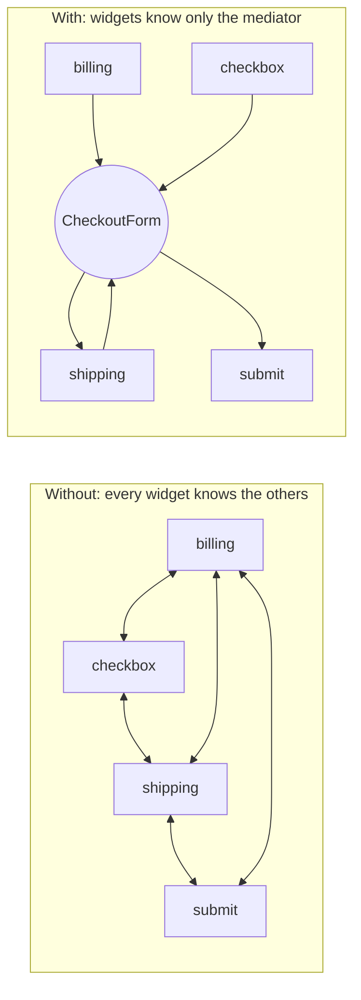
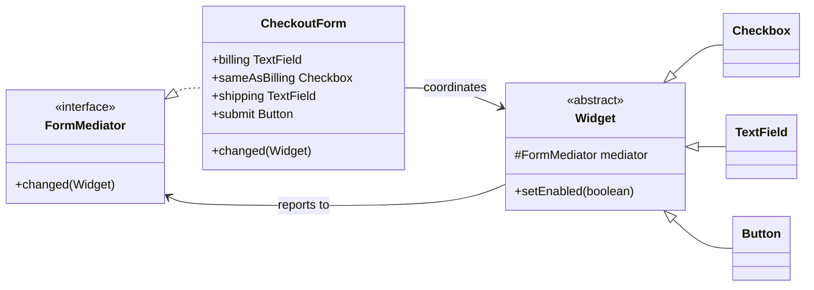

## Simple definition

The **Mediator** pattern puts the rules for how a group of objects interact into **one object**, the mediator. The objects (colleagues) report events to the mediator instead of calling each other; the mediator decides what happens next.

GoF intent: *"Define an object that encapsulates how a set of objects interact. Mediator promotes loose coupling by keeping objects from referring to each other explicitly, and it lets you vary their interaction independently."*

## The problem

A checkout form has a billing address field, a "ship to billing address" checkbox, a shipping address field and a submit button:

- ticking the checkbox copies the billing address and disables the shipping field
- editing the billing address updates the shipping field if the box is ticked
- submit is enabled only when both addresses are filled in.

If each widget references the others, the checkbox knows the text fields, the text fields know the button, and so on. With *n* widgets there can be *n × (n − 1)* connections. Widgets cannot be reused in another form because they are wired to this one.

## Real-world analogy

An air-traffic control tower. Pilots do not negotiate runways with each other; they talk to the tower, which knows about all aircraft and gives instructions.

## Structure

- **Mediator** (`FormMediator`) — the interface colleagues use to report events.
- **Concrete mediator** (`CheckoutForm`) — knows all colleagues and coordinates them.
- **Colleagues** (`Checkbox`, `TextField`, `Button`) — know only the mediator.

## Java implementation

The code is in `examples/java/src/hub/patterns/mediator/MediatorDemo.java`.









All interaction rules are in `CheckoutForm.changed()`. The widgets are generic and reusable; a different form reuses them with a different mediator.

## Mediator versus similar patterns

| Pattern | Who knows whom | Communication |
|---|---|---|
| **Mediator** | Colleagues know the mediator; mediator knows colleagues | Two-way: colleagues report, mediator commands |
| **[Observer](/design-patterns/behavioral/observer)** | Subject knows only an observer interface | One-way broadcast; subject does not decide what observers do |
| **[Facade](/design-patterns/structural/facade)** | Clients know the facade; subsystem does not know it | One-way: facade calls into the subsystem |
| **Event bus** | Publishers and subscribers know only the bus | Broadcast with no central logic; see [the comparison](/comparisons/observer-mediator-event-bus) |

Mediators are often *implemented* with Observer: colleagues publish events and the mediator subscribes.

## Advantages and disadvantages

| Advantages | Disadvantages |
|---|---|
| Replaces many-to-many coupling with one-to-many | The mediator can become a god object containing all logic |
| Colleagues are simpler and reusable | Mediator changes affect every interaction |
| Interaction logic is in one place: easy to read and change | Adds an indirection when only two objects interact |

## When to use it

- A set of objects communicates in well-defined but complex ways.
- Reusing an object is hard because it refers to many others.
- Behaviour distributed across classes should be customisable without subclassing each of them.

## When not to use it

- Only two or three objects interact simply.
- Objects only need to broadcast changes without central coordination: use Observer or an event bus.

## Common mistakes

> [!MISTAKE] The mediator becomes the application
> If the mediator starts validating data, calling services and formatting output, split it: one mediator per dialog or workflow, with domain logic delegated elsewhere.

- **Colleagues that still talk to each other**, undermining the pattern.
- **Event loops:** the mediator updates a colleague, which reports a change, which triggers the mediator again. Guard against re-entrant updates (here `setText` does not notify).

## At architecture scale

A **saga orchestrator** in microservices is a mediator: services do not call each other; the orchestrator receives replies and decides the next step. **Choreography** is the Observer-style alternative where services react to each other's events. See the [order management case study](/system-design/case-studies/order-management-system).

## Real-world uses

- GUI dialogs and controllers (Swing dialogs, JavaFX controllers, MVC controllers).
- `java.util.concurrent.Executor` and `Timer` mediate between tasks and threads.
- Spring's `ApplicationEventMulticaster` dispatches events between beans that do not know each other.
- MediatR-style command dispatchers and workflow engines (Camunda, Temporal) at a larger scale.

## Interview questions and answers

**What is the Mediator pattern?**
A behavioral pattern that encapsulates how a set of objects interact in a mediator object, so the objects do not reference each other directly.

**How does it reduce coupling?**
It turns a mesh of many-to-many references into a hub: each colleague depends only on the mediator.

**What is the main risk?**
The mediator becoming a god object. Keep one mediator per interaction context and delegate domain logic.

**How does Mediator differ from Observer?**
Observer broadcasts a change to unknown listeners without deciding what they do. A mediator knows its colleagues and actively coordinates them.

## Summary

- Mediator centralises interaction rules between colleagues.
- Colleagues know only the mediator, so they become reusable.
- Watch for god-object mediators and event loops.
- Saga orchestrators are mediators at architecture scale.

## Related topics

- [Observer Pattern](/design-patterns/behavioral/observer)
- [Observer vs Mediator vs Event Bus](/comparisons/observer-mediator-event-bus)
- [Facade Pattern](/design-patterns/structural/facade)

## References

- Gamma, Helm, Johnson, Vlissides. *Design Patterns*. Addison-Wesley, 1994. Mediator, p. 273 (the font dialog example).
- Eric Freeman, Elisabeth Robson. *Head First Design Patterns* (2nd edition). O'Reilly, 2020. Appendix: Leftover patterns.
