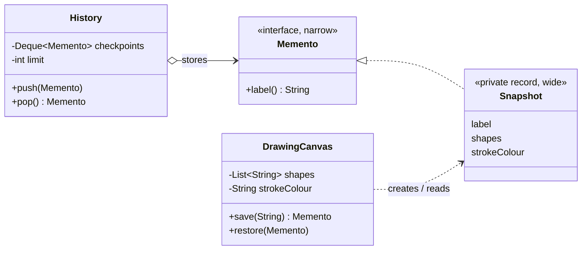
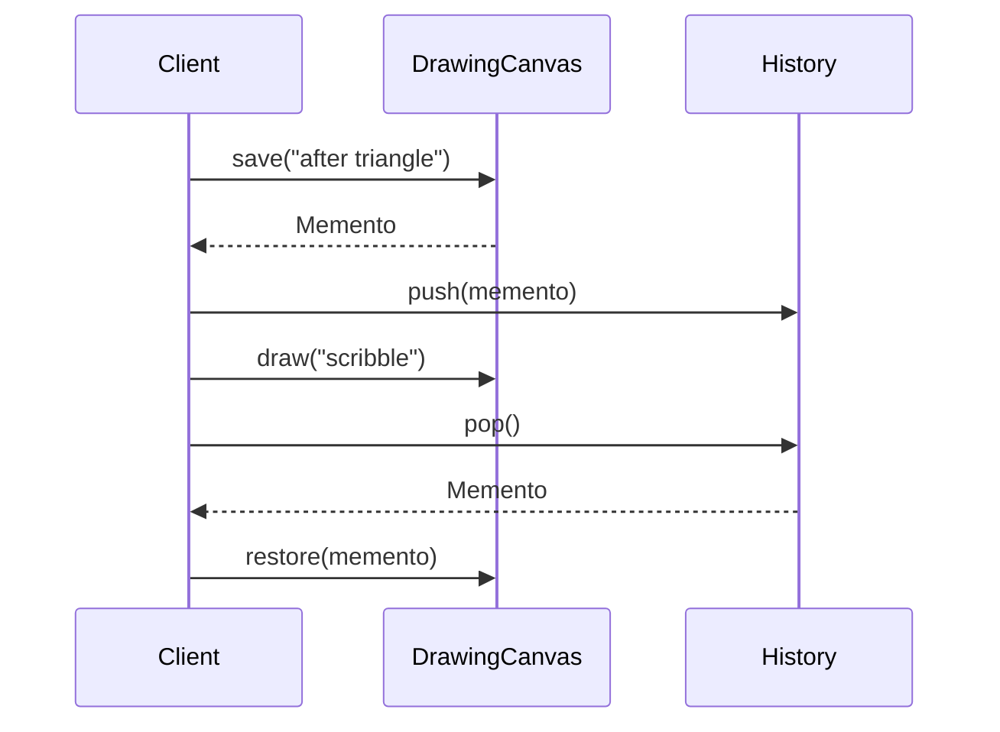

## Simple definition

The **Memento** pattern lets an object save a **snapshot** of its internal state and later restore it, while keeping that state **private**: other objects can store snapshots but cannot read or change what is inside them.

GoF intent: *"Without violating encapsulation, capture and externalize an object's internal state so that the object can be restored to this state later."* It is also known as **Token**.

## The problem

A drawing app needs "checkpoints": save now, experiment, and roll back if the experiment fails. The obvious solution, adding getters and setters for every field so a history class can copy them, exposes the canvas's internals to the world. Any class could then put the canvas into an invalid state, and changing the internal representation breaks the history class.

## Real-world analogy

A save point in a video game. The game writes an opaque save file; you can keep several and load one later, but you do not edit its bytes. Only the game knows how to read it.

## Structure

- **Originator** (`DrawingCanvas`) — creates a memento of its current state and restores from one.
- **Memento** (`DrawingCanvas.Memento` / `Snapshot`) — stores the state; offers a **narrow** interface to everyone and a **wide** one only to the originator.
- **Caretaker** (`History`) — keeps mementos and decides when to restore; never inspects them.

## Java implementation

The code is in `examples/java/src/hub/patterns/memento/MementoDemo.java`.







## Step-by-step walkthrough

1. **Narrow and wide interfaces.** The public `Memento` interface exposes only a label. The private `Snapshot` record holds the real state. Outside `DrawingCanvas`, nobody can name `Snapshot`, so nobody can read its fields. This is how Java expresses GoF's "wide interface for the originator only" (in C++ GoF used `friend`).
2. **Restoring checks the type.** A memento from a different originator is rejected.
3. **Immutable state makes snapshots cheap.** `shapes` is an immutable list, so `save()` can store the reference without copying. Every `draw()` creates a new list, leaving old snapshots untouched. With mutable state, `save()` must deep-copy, see [Prototype](/design-patterns/creational/prototype).
4. **The caretaker bounds memory.** `History` keeps at most two checkpoints and drops the oldest.

## Memento versus Command for undo

| | Memento (snapshot) | [Command](/design-patterns/behavioral/command) (inverse operation) |
|---|---|---|
| Stores | The *state* before a change | The *operation* and what is needed to reverse it |
| Undo | Restore the snapshot | Execute the inverse |
| Memory | Proportional to state size | Proportional to the change |
| Works when | Inverses are hard to compute (filters, complex edits) | Inverses are simple (insert/delete) |

Editors often combine them: each command stores a memento of the part of the state it changes.

## Advantages and disadvantages

| Advantages | Disadvantages |
|---|---|
| Preserves encapsulation: state stays private | Snapshots of large state consume memory and time |
| Simplifies the originator: history management lives elsewhere | Caretakers do not know how big mementos are |
| Easy to implement checkpoints, undo and rollback | In languages without access control tricks, the narrow interface is hard to enforce |

## When to use it

- Undo, checkpoints, "cancel" in dialogs, rollback of a failed multi-step operation.
- Exposing the state directly would break encapsulation.

## When not to use it

- The state is very large and changes are small: prefer Command with inverses, or store diffs.
- The state is already immutable and shareable: simply keep references to previous versions (persistent data structures).

## Common mistakes

> [!MISTAKE] Snapshots that share mutable state
> If `save()` stores a reference to a mutable list and the originator keeps modifying that list, every "snapshot" changes with it. Deep-copy mutable state or make it immutable.

- **Unbounded histories** in long-running sessions.
- **Mementos that expose setters** or public fields, so caretakers can tamper with state.
- **Serializing mementos** to disk without versioning, so old saves cannot be loaded after a release.

## Real-world uses

- Undo stacks in editors and IDEs, often combined with Command.
- `javax.swing.undo.StateEdit` stores before/after state snapshots.
- Database **savepoints** and MVCC snapshots are mementos at the storage level; see [Transactions and Isolation Levels](/data-systems/transactions-and-isolation).
- Event-sourced systems take periodic **snapshots** of aggregates so they do not replay every event.

## Interview questions and answers

**What is the Memento pattern?**
A behavioral pattern in which an originator captures its state in an opaque memento object that a caretaker stores, so the originator can be restored later without exposing its internals.

**What are the roles?**
Originator (creates and restores from mementos), memento (holds state), caretaker (stores mementos, never looks inside).

**How do you keep a memento opaque in Java?**
Expose a narrow public interface and implement it with a private nested class or record of the originator, as in this example.

**Memento or Command for undo?**
Memento when computing an inverse is hard and state is small; Command when operations have simple inverses or state is large.

## Summary

- Memento saves and restores state without exposing it.
- Use a narrow public interface and a private implementation.
- Immutable state makes snapshots cheap; bound the history.
- Often combined with Command for undo.

## Related topics

- [Command Pattern](/design-patterns/behavioral/command)
- [Prototype Pattern](/design-patterns/creational/prototype) — copying state
- [Modern Java: records](/java/fundamentals/modern-java-features)

## References

- Gamma, Helm, Johnson, Vlissides. *Design Patterns*. Addison-Wesley, 1994. Memento, p. 283.
- Eric Freeman, Elisabeth Robson. *Head First Design Patterns* (2nd edition). O'Reilly, 2020. Appendix: Leftover patterns.
