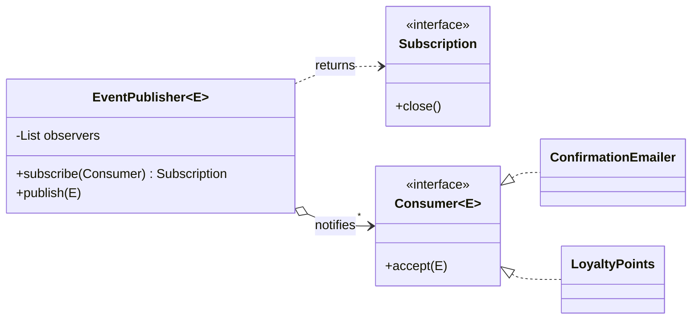

## Simple definition

The **Observer** pattern lets an object (the **subject**) keep a list of interested objects (**observers**) and notify all of them automatically when something happens. The subject knows only that observers implement a small interface; it does not know what they do.

GoF intent: *"Define a one-to-many dependency between objects so that when one object changes state, all its dependents are notified and updated automatically."* Also known as **Dependents** and **Publish-Subscribe**.

## The problem

When an order is placed, the shop must send a confirmation email, award loyalty points, record analytics and run fraud checks. If `OrderService.placeOrder()` calls each of these services directly:

- the order service depends on every downstream concern and grows with each new one
- adding a feature (a Slack notification) means editing order code
- one failing concern can break order placement.

## Real-world analogy

A newspaper subscription. The publisher does not know its readers personally; it delivers each edition to everyone on the subscription list. Readers subscribe and unsubscribe at will.

## Structure

- **Subject** (`EventPublisher<E>`) — keeps observers, offers subscribe/unsubscribe, notifies.
- **Observer** (`Consumer<E>`) — the update interface.
- **Concrete observers** (`ConfirmationEmailer`, `LoyaltyPoints`, lambdas).

## Java implementation

The code is in `examples/java/src/hub/patterns/observer/ObserverDemo.java`.







## Step-by-step walkthrough

1. **Observers are just `Consumer<E>`.** Any lambda or class can subscribe; Java does not need a custom `Observer` interface (and `java.util.Observer` is deprecated).
2. **`subscribe` returns a `Subscription`.** Callers keep it and `close()` it to unsubscribe. This prevents the **lapsed listener** leak, where forgotten observers keep objects alive forever.
3. **`CopyOnWriteArrayList`** lets observers be added or removed while a notification is in progress, and makes concurrent subscription safe. It suits lists that are read far more often than they change.
4. **Failures are isolated.** The fraud check throws, but the email and loyalty observers still run. Decide this policy consciously: sometimes a failing observer *should* abort the operation.
5. **Notification is synchronous.** `publish` returns after all observers ran, on the caller's thread. A slow observer slows the publisher.

## Push versus pull

| Model | Subject sends | Pros | Cons |
|---|---|---|---|
| **Push** (this example) | An event with the relevant data | Observers need no reference back to the subject | The subject guesses what observers need |
| **Pull** | Just "I changed" (or itself) | Observers fetch exactly what they need | Observers depend on the subject's API; extra calls |

Modern code mostly pushes **immutable event objects** (records), which can also be logged and sent across process boundaries.

## From in-process observers to messaging

| Scope | Mechanism | Delivery |
|---|---|---|
| One object graph | Observer (this article) | Synchronous, in memory |
| One Spring application | [`ApplicationEventPublisher` and `@EventListener`](/spring/core/application-events), `@TransactionalEventListener` | Sync or async; can run after commit |
| Streams of values with back-pressure | Reactive Streams (`java.util.concurrent.Flow`, Project Reactor) | Asynchronous, demand-driven |
| Several services | A message broker (Kafka, RabbitMQ) | Durable, asynchronous, [at-least-once](/system-design/building-blocks/message-queues-and-delivery-semantics) |

> [!WARNING] In-memory observers are lost on crash
> If the process dies after the order is saved but before observers run, the email is never sent. When a side effect must happen, store the event in the same transaction (the transactional outbox) and deliver it through a broker. See [Event-Driven Microservices](/microservices/communication/event-driven-spring-cloud-stream).

## Advantages and disadvantages

| Advantages | Disadvantages |
|---|---|
| Subject and observers are loosely coupled (only an interface) | Notification order is usually unspecified |
| New observers need no change to the subject (OCP) | Hard to follow control flow: "who reacts to this?" |
| Broadcast to any number of observers | Memory leaks if observers do not unsubscribe |
| Natural fit for UIs and domain events | Cascades: observers triggering more updates can loop or storm |

## When to use it

- A change in one object requires changing others, and you do not know how many or which.
- Domain events: "order placed", "payment failed" with several independent reactions.
- UI models notifying views ([MVC](/design-patterns/compound-patterns-mvc)).

## When not to use it

- There is exactly one dependent: call it directly.
- The reactions must be atomic with the change and must all succeed: use explicit calls in a transaction.
- Interactions are complex and two-way: consider a [Mediator](/design-patterns/behavioral/mediator).

## Common mistakes

> [!MISTAKE] The lapsed listener
> A short-lived screen subscribes to a long-lived publisher and never unsubscribes. The publisher's list keeps the screen, and everything it references, in memory. Always unsubscribe (return a handle, use try-with-resources or lifecycle hooks).

- **Modifying the observer list while iterating** over an `ArrayList` (`ConcurrentModificationException`).
- **Slow observers** blocking the publisher thread; move heavy work to an executor.
- **Observers that mutate the subject** during notification, causing re-entrant updates.
- **Assuming delivery order** between observers.

## Real-world uses

- `java.beans.PropertyChangeSupport` and `PropertyChangeListener`.
- Swing/AWT and JavaFX listeners; JavaFX observable properties.
- Spring `ApplicationEvent`s and `@EventListener`; Spring Boot lifecycle events.
- `java.util.concurrent.Flow` (Reactive Streams) and Project Reactor's `Flux`.
- `java.util.Observable`/`Observer` (deprecated since Java 9: not serializable, not thread-safe, and `Observable` is a class, not an interface).

## Interview questions and answers

**What is the Observer pattern?**
A behavioral pattern where a subject maintains a list of observers and notifies them of changes, so dependents update automatically without the subject knowing their concrete types.

**Why was `java.util.Observable` deprecated?**
It is a class (forcing inheritance), its notification model is limited, it is not thread-safe in a useful way, and its events carry no type information. Use `PropertyChangeSupport`, Flow or your own typed publisher.

**What is the lapsed-listener problem?**
A memory leak caused by observers that are never unsubscribed, so the subject keeps them reachable.

**Observer versus pub/sub with a broker?**
Same idea; a broker adds durability, asynchrony and process isolation, and decouples publisher and subscriber in time as well as code.

**Observer versus Mediator?**
Observer broadcasts without coordinating; a mediator knows its participants and directs their interaction.

## Summary

- Observer is one-to-many notification through a small interface.
- Return unsubscribe handles, isolate failures, and keep notification fast.
- Spring events, reactive streams and message brokers are the same idea at larger scales.
- Durable side effects need an outbox and a broker, not in-memory observers.

## Related topics

- [Application Events and Listeners](/spring/core/application-events)
- [Observer vs Mediator vs Event Bus](/comparisons/observer-mediator-event-bus)
- [Spring WebFlux and Project Reactor](/spring/web/webflux-and-reactive-programming)
- [Event-Driven Microservices with Spring Cloud Stream](/microservices/communication/event-driven-spring-cloud-stream)

## References

- Gamma, Helm, Johnson, Vlissides. *Design Patterns*. Addison-Wesley, 1994. Observer, p. 293.
- Eric Freeman, Elisabeth Robson. *Head First Design Patterns* (2nd edition). O'Reilly, 2020. Chapter 2 (the weather station).
- Doug Lea. *Concurrent Programming in Java: Design Principles and Patterns*. Observer designs and completion callbacks.
