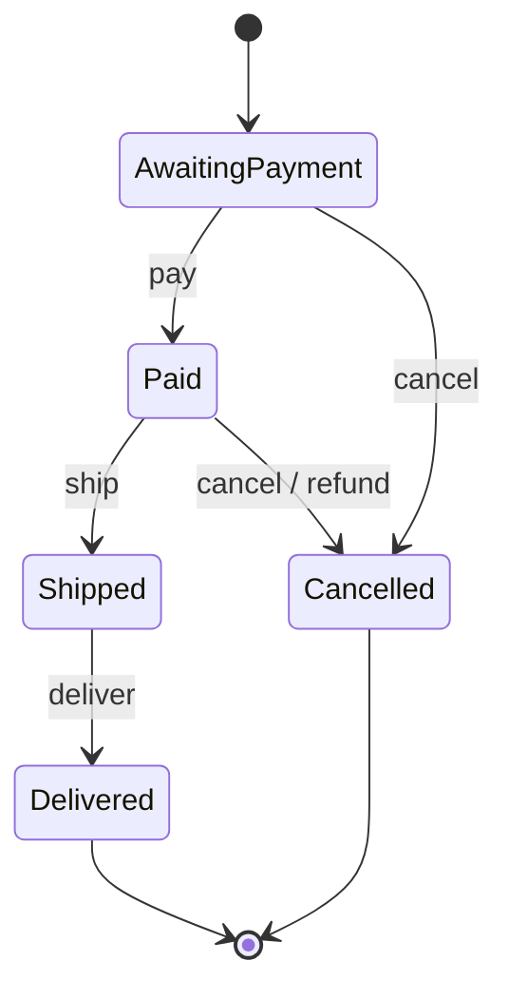
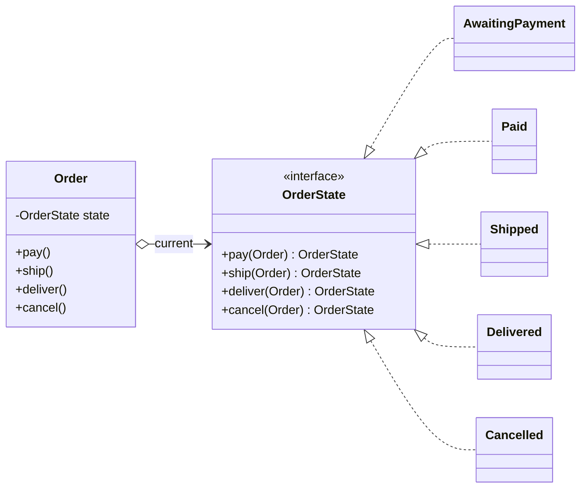

## Simple definition

The **State** pattern moves state-specific behaviour into separate **state objects**. The main object (the **context**) delegates each request to its current state object, and the state object decides what to do and which state comes next. To the outside, the object appears to change its class.

GoF intent: *"Allow an object to alter its behavior when its internal state changes. The object will appear to change its class."*

## The problem

An order can be awaiting payment, paid, shipped, delivered or cancelled. Every operation behaves differently in each state:

```java
void cancel() {
    switch (status) {
        case AWAITING_PAYMENT -> status = CANCELLED;
        case PAID -> { refund(); status = CANCELLED; }
        case SHIPPED, DELIVERED -> throw new IllegalStateException("too late");
        case CANCELLED -> throw new IllegalStateException("already cancelled");
    }
}
```

`pay()`, `ship()` and `deliver()` contain similar `switch` statements. The rules for one state are scattered across every method; adding a state ("on hold") means editing all of them, and it is easy to forget one.

## Real-world analogy

A traffic light. Pressing the pedestrian button means different things when the light is green (start the change cycle), amber (do nothing) or red (nothing; already walking). The behaviour belongs to the state, not the button.

## Structure

- **Context** (`Order`) — holds the current state and delegates to it.
- **State** (`OrderState`) — one method per event.
- **Concrete states** (`AwaitingPayment`, `Paid`, `Shipped`, `Delivered`, `Cancelled`) — implement the behaviour and return the next state.





## Java implementation

The code is in `examples/java/src/hub/patterns/state/StateDemo.java`.









## Step-by-step walkthrough

1. **Default methods reject everything.** Each state overrides only the events that are valid in it. An invalid transition (cancelling a shipped order) throws a clear exception without any code in `Shipped`.
2. **States return the next state.** The transition table is distributed across the state classes, next to the behaviour it governs.
3. **The context stores the result.** `state = state.cancel(this)` keeps transitions explicit and makes states stateless, so they could be shared singletons.
4. **Adding a state** ("OnHold") means one new class and changes only in the states that can transition to it.

## Alternatives in modern Java

**Enum with constant-specific bodies** — compact when states have no data:

```java
enum Status {
    AWAITING_PAYMENT { Status pay() { return PAID; } Status cancel() { return CANCELLED; } },
    PAID             { Status ship() { return SHIPPED; } Status cancel() { return CANCELLED; } },
    SHIPPED          { Status deliver() { return DELIVERED; } },
    DELIVERED, CANCELLED;

    Status pay()     { throw new IllegalStateException(name()); }
    Status ship()    { throw new IllegalStateException(name()); }
    Status deliver() { throw new IllegalStateException(name()); }
    Status cancel()  { throw new IllegalStateException(name()); }
}
```

**Sealed records with state-specific data** — when each state carries different fields (`Shipped(trackingNumber)`, `Cancelled(reason)`), a sealed interface plus `switch` pattern matching lets the compiler check that every state is handled.

**A transition table** (`Map<Status, Map<Event, Status>>`) or a library such as Spring Statemachine — when transitions are configured rather than coded, or when you need guards, actions and persistence of state machines.

## State versus Strategy

The class diagrams are identical; the difference is **who changes the object and why**:

| | State | Strategy |
|---|---|---|
| Who chooses the object | The states themselves, as transitions | The client, usually once |
| Do the objects know each other | Yes, they return the next state | No, strategies are independent |
| What it models | A lifecycle with rules | Interchangeable algorithms |

See [Strategy vs State vs Template Method](/comparisons/strategy-state-template-method).

## Advantages and disadvantages

| Advantages | Disadvantages |
|---|---|
| State-specific behaviour is localised in one class per state | More classes than a `switch` for simple machines |
| Invalid transitions are impossible or explicit | The full transition table is spread across classes; draw the diagram |
| Adding states touches fewer places | States are coupled to each other (they create successors) |
| Removes large conditional blocks | — |

## When to use it

- An object's behaviour depends on its state and it must change behaviour at runtime.
- Operations have large, multi-part conditionals on the same status field.
- Domain lifecycles: orders, payments, documents, tickets, connections.

## When not to use it

- Two or three states with trivial behaviour: an enum and a `switch` are clearer.
- The state machine is configured at runtime: use a table-driven approach or a workflow engine.

## Common mistakes

> [!MISTAKE] Status checks outside the state machine
> If other services write `if (order.status() == PAID)` and change the status themselves, the rules leak out again. Expose behaviour (`order.ship()`), not a settable status.

- **Persisting the state object** instead of a status value. Store an enum or string and map it back to a state object when loading.
- **Forgetting concurrency:** two requests transitioning the same order concurrently need optimistic locking (`@Version`) in the database.
- **Silent no-ops** for invalid events, which hide bugs. Prefer explicit rejection.

## Real-world uses

- TCP connection states (the GoF book's own example).
- Order, payment and subscription lifecycles in DDD aggregates; see [DDD fundamentals](/domain-driven-design/fundamentals).
- `java.lang.Thread.State` (an enum of states), JSF and Spring Web Flow lifecycles, Spring Statemachine.
- The [circuit breaker](/microservices/reliability/circuit-breakers-and-resilience4j) is a state machine: CLOSED, OPEN, HALF_OPEN.

## Interview questions and answers

**What is the State pattern?**
A behavioral pattern in which an object delegates behaviour to a state object and changes that object when its state changes, so its behaviour changes without conditionals.

**State versus Strategy?**
Same structure. States know about each other and drive transitions themselves; strategies are independent and chosen by the client.

**How would you implement a state machine in Java 21?**
For simple machines, an enum with constant-specific methods; for states with data, a sealed interface of records with pattern-matching `switch`; for configurable machines, a transition table or Spring Statemachine.

**How do you persist an object that uses the State pattern?**
Persist a status value (enum), and rebuild the state object on load. Protect concurrent transitions with optimistic locking.

## Summary

- State replaces status `switch` statements with polymorphic state objects.
- Each state handles valid events and returns the next state.
- Enums and sealed records are lightweight alternatives in Java 21.
- Draw the state diagram; it is the specification.

## Related topics

- [Strategy vs State vs Template Method](/comparisons/strategy-state-template-method)
- [Strategy Pattern](/design-patterns/behavioral/strategy)
- [Domain-Driven Design Fundamentals](/domain-driven-design/fundamentals)
- [Circuit Breakers and Resilience4j](/microservices/reliability/circuit-breakers-and-resilience4j)

## References

- Gamma, Helm, Johnson, Vlissides. *Design Patterns*. Addison-Wesley, 1994. State, p. 305.
- Eric Freeman, Elisabeth Robson. *Head First Design Patterns* (2nd edition). O'Reilly, 2020. Chapter 10 (the gumball machine).
