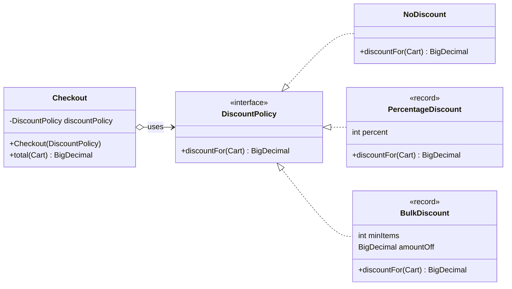
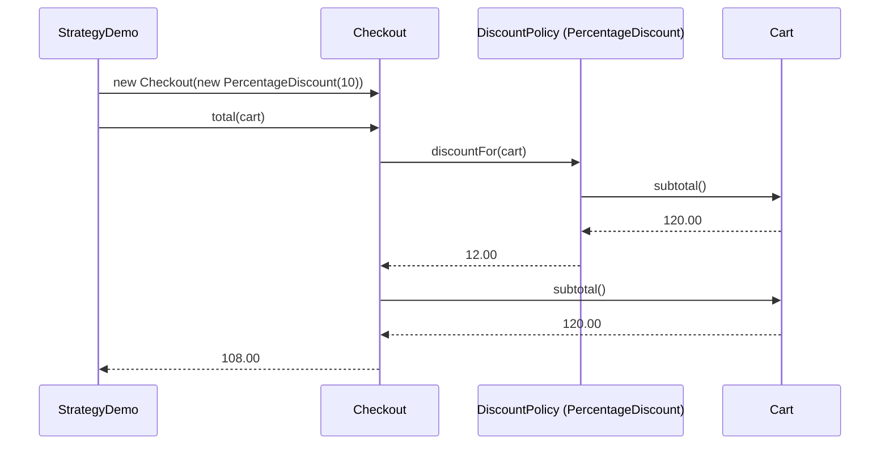

## Simple definition

The **Strategy** pattern defines a family of algorithms, puts each one in its own class behind a common interface, and lets the client choose which one to use. The code that *uses* the algorithm does not change when you add a new one.

GoF intent: *"Define a family of algorithms, encapsulate each one, and make them interchangeable. Strategy lets the algorithm vary independently from clients that use it."*

## The problem

An online shop calculates a cart total. Marketing keeps inventing discounts: a percentage off, a fixed amount off for bulk orders, weekend promotions. The first implementation is a conditional:

```java
BigDecimal total(Cart cart, String promo) {
    BigDecimal discount = switch (promo) {
        case "NONE" -> BigDecimal.ZERO;
        case "TEN_PERCENT" -> cart.subtotal().multiply(new BigDecimal("0.10"));
        case "BULK" -> cart.itemCount() >= 3 ? new BigDecimal("5.00") : BigDecimal.ZERO;
        default -> throw new IllegalArgumentException(promo);
    };
    return cart.subtotal().subtract(discount);
}
```

Every new promotion means editing this method, retesting the existing promotions, and resolving merge conflicts with other developers who are editing it too. Each discount rule cannot be tested in isolation. The method violates the [Open/Closed Principle](/design-patterns/solid-principles#o--openclosed-principle): it must be modified, rather than extended, for every new rule.

## Real-world analogy

Getting to the airport. The goal is fixed — arrive before your flight — but the *way* varies: drive, take a taxi, take the train. You pick a strategy based on cost, time and luggage, and the rest of your trip plan does not change.

## Structure

The pattern has three roles:

- **Strategy** — the interface every algorithm implements (`DiscountPolicy`).
- **ConcreteStrategy** — one implementation per algorithm (`NoDiscount`, `PercentageDiscount`, `BulkDiscount`, or a lambda).
- **Context** — the class that uses a strategy without knowing which one (`Checkout`).



The sequence diagram shows the runtime collaboration. The client chooses the strategy; the context only delegates.



## Java implementation

The complete example is in `examples/java/src/hub/patterns/strategy/`. CI compiles it with Java 21 and checks its output on every build.

### The strategy interface



`@FunctionalInterface` is optional, but it documents that the interface has exactly one abstract method — so a lambda can implement it.

### The context



### Concrete strategies







The cart that every strategy reads:



### Running it



Expected output:



To run it yourself from the repository root:

```bash
javac -d out $(find examples/java/src/hub/patterns/strategy -name "*.java")
java -cp out hub.patterns.strategy.StrategyDemo
```

## Step-by-step walkthrough

1. **Find what varies.** The discount rule varies; the total calculation (subtotal minus discount, rounded to two decimals) does not. Only the varying part goes behind the interface.
2. **Define the interface in the context's terms.** `DiscountPolicy.discountFor(Cart)` takes exactly the data a policy needs. It returns an amount instead of a total, so no strategy can forget the rounding rule — the context owns it.
3. **Implement each rule separately.** `PercentageDiscount` validates its percentage in a compact record constructor. `BulkDiscount` caps the discount at the subtotal so a total can never go negative. Each class can be unit-tested on its own.
4. **Inject the strategy into the context.** `Checkout` receives its policy through the constructor and never asks which one it has. There is no `instanceof` and no `switch`.
5. **Use a lambda when a class adds nothing.** The weekend promotion in `StrategyDemo` is a lambda that reuses `PercentageDiscount`. It has no name of its own, no state and no tests of its own, so a lambda is the clearest form.
6. **Avoid null checks with a Null Object.** `NoDiscount` returns zero. The context can always call its policy, even when there is no promotion.

> [!KEY] Where does the choice happen?
> Strategy moves the decision about *which algorithm* out of the context — it does not eliminate it. Something still selects the strategy: a map keyed by promotion code, a configuration value, or a dependency-injection container. Keep that selection in one place.

## Advantages and disadvantages

| Advantages | Disadvantages |
|---|---|
| New algorithms are added without editing the context (OCP) | One more type per algorithm; small variations may not justify it |
| Each algorithm is small and unit-testable on its own | Clients must know enough to choose a strategy |
| Algorithms can be swapped at runtime | The interface must suit every strategy; a strategy that needs extra data forces a wider interface |
| Replaces conditionals with polymorphism | Indirection makes the flow slightly harder to follow in a debugger |

## When to use it

- Several variants of an algorithm exist **now**, or a second one is clearly coming.
- The variant must be chosen at runtime — per customer, per request, per configuration.
- You want to test each variant in isolation.
- A conditional that selects behaviour keeps growing.

## When not to use it

- There is only one algorithm, and no realistic second one. An interface with a single implementation is speculative generality.
- The variants differ by a constant, not by behaviour. A parameter (such as a percentage) is enough.
- The behaviour changes because of the object's *own* state transitions — that is the [State pattern](/design-patterns/gof-overview#patterns-that-are-easy-to-confuse).

## Common implementation mistakes

> [!MISTAKE] The context inspects the strategy
> `if (policy instanceof BulkDiscount b) { ... }` inside the context defeats the pattern. If the context needs to know which strategy it has, the interface is missing a method — or the variation is not really a strategy.

- **Leaking context responsibilities into strategies.** If every strategy repeats the rounding logic, one of them will eventually get it wrong. Keep invariant work in the context.
- **Stateful strategies shared between threads.** Strategies are often singletons in a DI container. Make them immutable, as the records here are.
- **A strategy interface with many methods.** If strategies implement half of the methods as no-ops, split the interface ([Interface Segregation](/design-patterns/solid-principles#i--interface-segregation-principle)).
- **Classes where a lambda would do — and the reverse.** A named class is better once a strategy has business meaning, configuration or its own tests.

## Relationship to SOLID

- **Open/Closed:** new behaviour arrives as a new class; `Checkout` stays closed for modification.
- **Single Responsibility:** each discount rule changes for its own reasons, in its own class.
- **Dependency Inversion:** `Checkout` depends on the `DiscountPolicy` abstraction, not on concrete rules.
- **Liskov Substitution:** every policy must honour the contract documented on the interface — never negative, never more than the subtotal. A policy that breaks this would break `Checkout`.

## Comparison with similar patterns

| Pattern | How it differs from Strategy |
|---|---|
| **State** | Same structure, different intent. With State, the object switches its own behaviour as its state changes, and states often know about each other. With Strategy, the client picks the behaviour, and strategies are independent. |
| **Template Method** | Varies steps through *inheritance*, fixed at compile time. Strategy varies the whole algorithm through *composition*, at runtime. |
| **Command** | A Command represents a *request* — something to do, often later, possibly undoable. A Strategy represents *how* to do something the context is already doing. |
| **Dependency Injection** | DI is how a strategy usually reaches its context. DI is the wiring mechanism; Strategy is the design. See [Dependency Injection in Java](/spring/core/dependency-injection). |

## Real-world uses

- `java.util.Comparator` passed to `List.sort` or a `TreeMap`: the sorting algorithm is fixed; the ordering is a strategy.
- `java.util.concurrent.RejectedExecutionHandler` for a `ThreadPoolExecutor`.
- Spring Security's `PasswordEncoder`: hashing algorithms are interchangeable implementations of one interface.
- Spring's `ResourceLoader` and many other single-purpose interfaces with several implementations chosen by configuration.

## Interview questions and answers

**What problem does Strategy solve?**
It removes conditionals that select between algorithms. Each algorithm lives in its own class behind a common interface, so new algorithms can be added without modifying the code that uses them.

**How is Strategy different from State?**
They have the same class diagram. With Strategy, the client chooses the algorithm and the strategies are independent of each other. With State, the context changes its state object itself as events occur, and each state typically decides the next state.

**How has Java 8 changed the Strategy pattern?**
A strategy interface with a single method is a functional interface, so simple strategies can be lambdas or method references. The pattern remains; the ceremony shrinks.

**Who decides which strategy to use?**
The client, a factory, a lookup map or a DI container — never the context itself. Centralise the selection so that adding a strategy touches one place.

**How would you test code that uses Strategy?**
Unit-test each concrete strategy on its own. Test the context with a simple stub strategy — often a lambda — to check the invariant logic, such as rounding.

> [!INTERVIEW] Mention the cost
> A strong answer ends with the trade-off: "I'd introduce Strategy once there are at least two real variants. With one variant, an interface is just indirection."

## Summary

- Strategy puts interchangeable algorithms behind one interface and lets the client choose.
- The context owns the invariant logic and delegates only the variable part.
- Lambdas make small strategies cheap; named classes suit strategies with business meaning.
- Use Strategy for real, present variation. Do not use it for a single algorithm or a varying constant.

## Related topics

- [All 23 GoF Patterns: Overview](/design-patterns/gof-overview)
- [SOLID Principles Explained](/design-patterns/solid-principles)
- [Factory Method Pattern](/design-patterns/creational/factory-method) — often used to create the right strategy
- [Dependency Injection in Java](/spring/core/dependency-injection)

## References

- Gamma, Helm, Johnson, Vlissides. *Design Patterns*. Addison-Wesley, 1994. Strategy, p. 315.
- Joshua Bloch. *Effective Java*, 3rd edition, Item 42: "Prefer lambdas to anonymous classes".
- [`java.util.Comparator`](https://docs.oracle.com/en/java/javase/21/docs/api/java.base/java/util/Comparator.html), Java SE 21 API.
- [Spring Security `PasswordEncoder`](https://docs.spring.io/spring-security/reference/features/authentication/password-storage.html), Spring Security reference.
