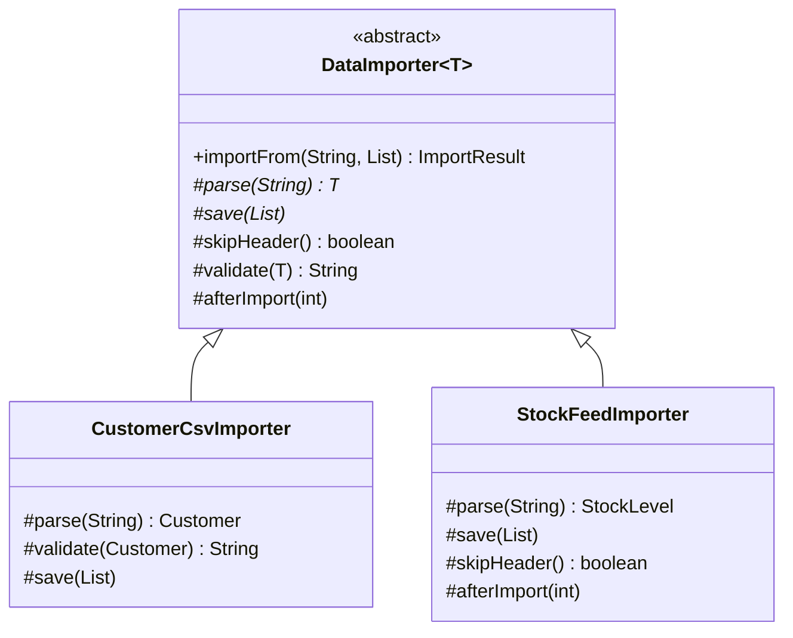

## Simple definition

The **Template Method** pattern puts the **fixed outline of an algorithm** in a base-class method (the template method) and leaves certain **steps** for subclasses to implement. Subclasses change the steps, never the order.

GoF intent: *"Define the skeleton of an algorithm in an operation, deferring some steps to subclasses. Template Method lets subclasses redefine certain steps of an algorithm without changing the algorithm's structure."*

## The problem

Several importers load data: customers from CSV files, stock levels from a warehouse feed, prices from a partner. Each one:

1. skips a header (maybe)
2. parses each line
3. validates the record and collects rejects
4. saves the valid records
5. does something afterwards (maybe).

Writing each importer from scratch duplicates the loop, the error handling and the reporting. When the reject-handling policy changes, every importer must change, and they drift apart.

## Real-world analogy

A recipe card for "bake bread": mix, knead, prove, shape, bake. Each bread (sourdough, rye, brioche) uses its own ingredients and timings for some steps, but no baker bakes before proving.

## Structure

- **Abstract class** (`DataImporter<T>`) — the `final` template method plus abstract steps and hooks.
- **Concrete classes** (`CustomerCsvImporter`, `StockFeedImporter`) — implement steps and override hooks.

Two kinds of step:

- **Primitive operations** (abstract): subclasses *must* implement them (`parse`, `save`).
- **Hooks** (concrete with a default): subclasses *may* override them (`skipHeader`, `validate`, `afterImport`).



## Java implementation

The code is in `examples/java/src/hub/patterns/templatemethod/TemplateMethodDemo.java`.







## Step-by-step walkthrough

1. **The template method is `final`.** Subclasses cannot reorder or skip steps. This is the pattern's guarantee.
2. **Steps are `protected`.** They are called by the template, not by clients.
3. **Error handling lives in the template.** Every importer gets the same reject collection, for free.
4. **Hooks have safe defaults.** `CustomerCsvImporter` does not override `afterImport`; `StockFeedImporter` does not validate.

## The Hollywood Principle

*"Don't call us, we'll call you."* High-level components (the base class) call low-level components (the subclass steps), never the other way round. Subclasses plug into a framework rather than orchestrating it. This inversion of control is how frameworks work: Spring calls your `@Bean` methods, JUnit calls your `@Test` methods, and the servlet container calls `HttpServlet.doGet`. See [OO design principles](/design-patterns/oo-design-principles).

## Template Method with callbacks instead of inheritance

Spring's `*Template` classes (`JdbcTemplate`, `TransactionTemplate`, `RestTemplate`) keep the *idea* — a fixed algorithm with variable steps — but supply the steps as **callback objects**, not subclasses:

```java
List<Customer> customers = jdbcTemplate.query(
        "SELECT email, name FROM customer WHERE active = ?",
        (rs, rowNum) -> new Customer(rs.getString("email"), rs.getString("name")),   // the variable step
        true);
```

`JdbcTemplate` performs the invariant steps: get a connection, prepare the statement, bind parameters, iterate the result set, translate `SQLException`s and release resources. You supply only the row mapping. This combines Template Method with [Strategy](/design-patterns/behavioral/strategy) and avoids inheritance.

## Template Method versus Strategy

| | Template Method | Strategy |
|---|---|---|
| Varies | Some *steps* of an algorithm | The *whole* algorithm |
| Mechanism | Inheritance; fixed at compile time | Composition; can change at runtime |
| Coupling | Subclass is tightly bound to the base class | Strategy knows only its interface |
| Code reuse | Shared steps live in the base class | Shared code needs another mechanism |

See [Strategy vs State vs Template Method](/comparisons/strategy-state-template-method).

## Advantages and disadvantages

| Advantages | Disadvantages |
|---|---|
| Removes duplication of the algorithm's invariant parts | Inheritance couples subclasses to the base class (fragile base class) |
| Guarantees the order of steps | One subclass per variation; combinations do not compose |
| Hooks provide controlled extension points | Hard to follow: logic is split between parent and child |
| Natural fit for frameworks (inversion of control) | Subclasses can break invariants if steps are poorly specified (LSP) |

## When to use it

- Several classes share an algorithm's structure but differ in some steps.
- You want to control the extension points of a framework or library.
- You want to factor out common behaviour (resource handling, error handling) once.

## When not to use it

- Steps need to vary independently and combine: use Strategy objects.
- The whole algorithm differs: use Strategy.
- You want to change behaviour at runtime.

## Common mistakes

> [!MISTAKE] A non-final template method
> If subclasses can override the template method itself, they can skip validation or reorder steps, and the pattern's guarantee is gone. Make it `final`.

- **Too many hooks**, turning the base class into a configuration maze. Prefer a few well-named hooks.
- **Calling overridable methods from constructors**, which run before the subclass is initialized.
- **Public steps** that clients call directly, bypassing the template.

## Real-world uses

- `java.io.InputStream.read(byte[], int, int)` is built on the abstract `read()`; `java.util.AbstractList` implements most of `List` using `get` and `size`.
- `javax.servlet.http.HttpServlet.service()` dispatches to `doGet`, `doPost`.
- Spring: `AbstractApplicationContext.refresh()` with hooks such as `onRefresh()`; `OncePerRequestFilter.doFilterInternal`; `AbstractRoutingDataSource.determineCurrentLookupKey`.
- JUnit lifecycle methods (`@BeforeEach`, `@Test`, `@AfterEach`) are hooks in a template run by the engine.

## Interview questions and answers

**What is the Template Method pattern?**
A behavioral pattern where a base class defines an algorithm's skeleton in a final method and subclasses implement or override specific steps.

**What is a hook?**
A step with a default (often empty) implementation that subclasses may override to extend the algorithm at a predefined point.

**Why make the template method final?**
So that subclasses cannot change the algorithm's structure, which is the pattern's guarantee.

**How does JdbcTemplate relate to the pattern?**
It applies the same idea with callbacks: it fixes the algorithm (connection, statement, iteration, cleanup, exception translation) and you pass the variable part, such as a `RowMapper`.

**Template Method versus Strategy?**
Template Method varies steps via inheritance at compile time; Strategy varies the entire algorithm via composition at runtime.

## Summary

- Template Method fixes an algorithm's structure and lets subclasses supply steps.
- Abstract steps are mandatory; hooks are optional.
- It embodies the Hollywood Principle and underlies frameworks.
- Spring's templates use callbacks instead of subclassing; prefer that when steps vary independently.

## Related topics

- [Strategy vs State vs Template Method](/comparisons/strategy-state-template-method)
- [Strategy Pattern](/design-patterns/behavioral/strategy)
- [OO design principles](/design-patterns/oo-design-principles)

## References

- Gamma, Helm, Johnson, Vlissides. *Design Patterns*. Addison-Wesley, 1994. Template Method, p. 325.
- Eric Freeman, Elisabeth Robson. *Head First Design Patterns* (2nd edition). O'Reilly, 2020. Chapter 8 (coffee and tea, the Hollywood Principle).
- Doug Lea. *Concurrent Programming in Java*. Before/after control with template methods (readers and writers).
