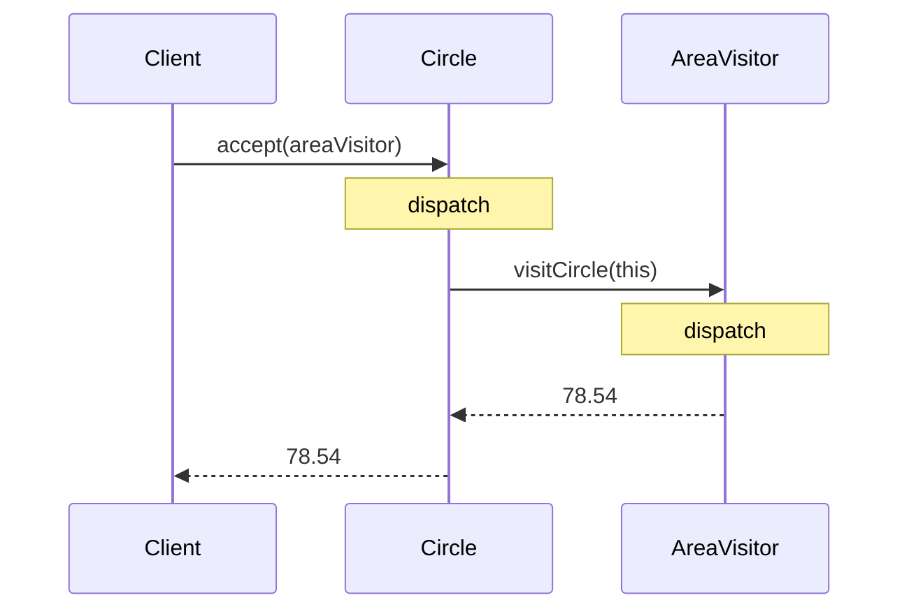
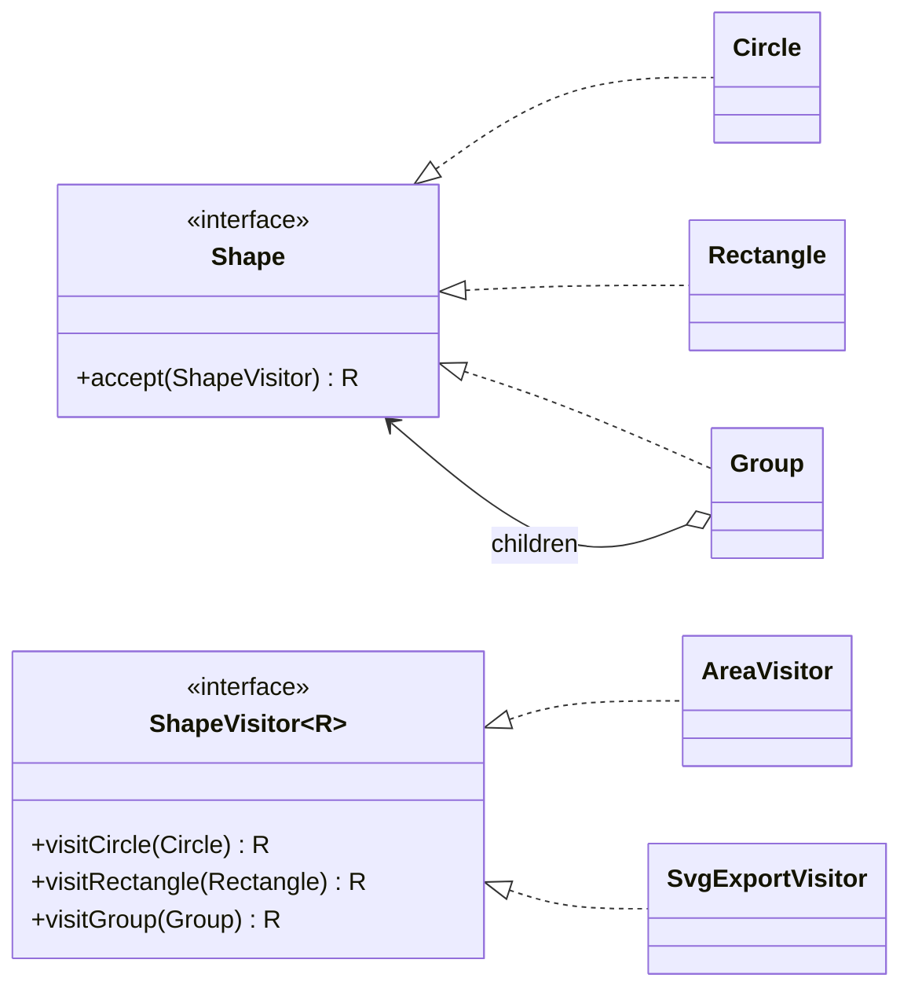

## Simple definition

The **Visitor** pattern moves an operation out of the classes it works on and into a separate **visitor** object. Each class in the hierarchy has one generic `accept(visitor)` method; adding a new operation means writing a new visitor, not editing every class.

GoF intent: *"Represent an operation to be performed on the elements of an object structure. Visitor lets you define a new operation without changing the classes of the elements on which it operates."*

## The problem

A drawing is a tree of shapes: circles, rectangles and groups. Over time, the product needs: total area, SVG export, PDF export, bounding boxes, hit testing, validation.

Adding `area()`, `toSvg()`, `toPdf()`, `boundingBox()`... to every shape class:

- bloats each class with unrelated concerns (SRP)
- forces you to edit every class for each new operation (OCP)
- is impossible if the classes belong to a library you cannot change.

## Real-world analogy

An insurance agent visiting a street. Each building (house, bank, shop) "accepts" the agent, and the agent offers the policy appropriate to that type of building. A tax inspector visiting the same street does something entirely different, without the buildings changing.

## Double dispatch

Java chooses which *overridden* method to run from the runtime type of **one** object (the receiver). Visitor needs the operation to depend on **two** runtime types: the element's and the visitor's. It gets this with two calls:

1. `shape.accept(visitor)` dispatches on the **shape's** runtime type: `Circle.accept` runs.
2. Inside, `visitor.visitCircle(this)` dispatches on the **visitor's** runtime type: `AreaVisitor.visitCircle` runs.

## Structure

- **Visitor** (`ShapeVisitor<R>`) — one `visitX` method per element type.
- **Concrete visitors** (`AreaVisitor`, `SvgExportVisitor`) — one operation each.
- **Element** (`Shape`) — declares `accept(visitor)`.
- **Concrete elements** (`Circle`, `Rectangle`, `Group`) — implement `accept` by calling the matching `visitX`.

## Java implementation

The code is in `examples/java/src/hub/patterns/visitor/VisitorDemo.java`.

### Classic Visitor





The visitor is generic in its result type `R`, so one interface serves operations returning `Double`, `String` or anything else.

### The Java 21 alternative: sealed types and pattern matching





With a **sealed** interface, the compiler knows every implementation. A `switch` over it with record patterns is checked for **exhaustiveness**: add `Div` to `permits` and every switch that does not handle it fails to compile. That is exactly the safety Visitor's `visitX` methods provided, with no `accept` boilerplate.

## Visitor versus pattern matching

| | Classic Visitor | Sealed types + `switch` (Java 21) |
|---|---|---|
| Boilerplate | `accept` in every element, a visitor interface | None |
| Adding an operation | New visitor class | New method with a `switch` |
| Adding an element type | Change visitor interface and all visitors | Add to `permits`; compiler flags every switch |
| Works on classes you do not control | Only if they already have `accept` | Only if they are in a sealed hierarchy (or use `instanceof` patterns without exhaustiveness) |
| Deconstruction | Manual getters | Record patterns: `case Add(Node l, Node r)` |

For new Java 21 code with a closed set of data types, **prefer sealed interfaces and pattern matching**. Classic Visitor remains common in existing libraries (compilers, `javax.lang.model`, ASM) and in languages without pattern matching.

## The expression problem

Visitor sits on one side of a classic trade-off:

- **Object-oriented style** (methods in each class): easy to add *types*, hard to add *operations*.
- **Visitor / functional style** (operations outside the types): easy to add *operations*, hard to add *types*.

Choose Visitor when the hierarchy is stable and operations keep growing (ASTs, document models). Avoid it when new element types are added often.

## Advantages and disadvantages

| Advantages | Disadvantages |
|---|---|
| New operations without changing element classes (OCP for operations) | Adding element types breaks every visitor |
| Related behaviour is gathered in one visitor class | Elements must expose enough state for visitors, which can weaken encapsulation |
| Visitors can accumulate state while traversing | Boilerplate and indirection; double dispatch is unfamiliar to many developers |
| Works across unrelated classes in one structure | — |

## When to use it

- An object structure (often a [Composite](/design-patterns/structural/composite)) has a stable set of types and many unrelated operations: compilers, query planners, document exporters.
- Operations need to be defined outside the classes, for example in another module.

## When not to use it

- The element hierarchy changes often.
- There are only one or two operations.
- You can use sealed interfaces and pattern matching instead.

## Common mistakes

> [!MISTAKE] Using instanceof chains and calling it Visitor
> `if (s instanceof Circle) ... else if (s instanceof Rectangle) ...` without a sealed hierarchy loses the compiler's exhaustiveness check: a new shape type silently falls through. Use either real double dispatch or a sealed `switch`.

- **Visitors that also traverse** in inconsistent ways; decide whether elements or visitors drive traversal of children.
- **Overloading `visit(Circle)`, `visit(Rectangle)`** and calling `visitor.visit(shape)` with a `Shape` static type: overloads are chosen at compile time, so it does not work without `accept`.

## Real-world uses

- `javax.lang.model.element.ElementVisitor` and `TypeVisitor` (annotation processors).
- `java.nio.file.FileVisitor` with `Files.walkFileTree`.
- Compiler and bytecode tools: the Java compiler's tree visitors, ASM's `ClassVisitor`, JavaParser.
- Spring's `BeanDefinitionVisitor` resolves placeholders across bean definitions.

## Interview questions and answers

**What is the Visitor pattern?**
A behavioral pattern that separates operations from the object structure they act on, so new operations can be added as visitor classes without changing the element classes.

**What is double dispatch?**
Selecting a method based on the runtime types of two objects. Visitor achieves it with `element.accept(visitor)`, which calls `visitor.visitConcreteElement(this)`.

**What is Visitor's main weakness?**
Adding a new element type requires changing the visitor interface and every visitor.

**How do Java 21 features change Visitor?**
Sealed interfaces plus pattern-matching `switch` give exhaustive, type-safe dispatch over a closed hierarchy without `accept` methods, so classic Visitor is often unnecessary.

## Summary

- Visitor adds operations to a stable hierarchy without modifying it.
- It relies on double dispatch through `accept` and `visitX`.
- It trades easy new operations for hard new types (the expression problem).
- In Java 21, sealed interfaces with pattern matching are usually simpler.

## Related topics

- [Composite Pattern](/design-patterns/structural/composite)
- [Interpreter Pattern](/design-patterns/behavioral/interpreter)
- [Modern Java: records, sealed classes and pattern matching](/java/fundamentals/modern-java-features)

## References

- Gamma, Helm, Johnson, Vlissides. *Design Patterns*. Addison-Wesley, 1994. Visitor, p. 331.
- [JEP 441: Pattern Matching for switch](https://openjdk.org/jeps/441) and [JEP 440: Record Patterns](https://openjdk.org/jeps/440) (final in Java 21).
- Eric Freeman, Elisabeth Robson. *Head First Design Patterns* (2nd edition). O'Reilly, 2020. Appendix: Leftover patterns.
