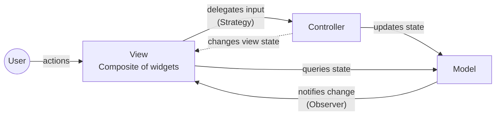
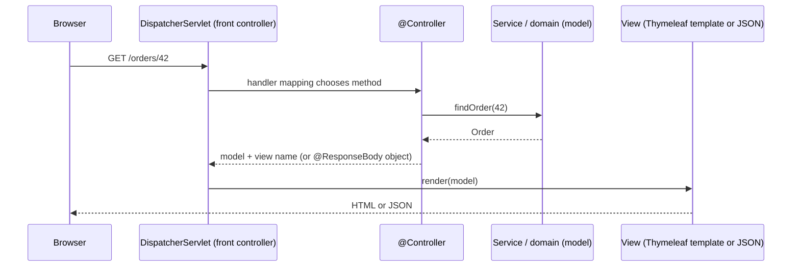

## Simple definition

A **compound pattern** is a set of patterns that work together to solve a recurring, larger problem. The best-known is **Model-View-Controller (MVC)**, which *Head First Design Patterns* calls "the king of compound patterns". It is built from three GoF patterns:

| MVC part | Pattern | Role |
|---|---|---|
| Model ↔ View | **Observer** | The model notifies views when its state changes |
| View → Controller | **Strategy** | The view delegates "what to do with user input" to a controller object that can be swapped |
| View | **Composite** | The view is a tree of nested UI components that render recursively |

Recognising these lets you understand MVC frameworks instead of memorising them.

## The problem MVC solves

In an interactive application, three concerns change for different reasons:

- the **data and business rules** (a playlist, an account balance)
- the **presentation** (a list, a chart, a mobile layout)
- the **input handling** (clicks, keyboard shortcuts, voice commands).

Mixing them in one class means a layout change can break a business rule, and you cannot show the same data in two views.

## The three roles

- **Model** — the application's state and logic. Knows nothing about views or controllers, except that it can notify observers.
- **View** — displays the model. Gets data from the model; forwards user actions to the controller.
- **Controller** — interprets user input and calls the model; may tell the view to change (for example, disable a button).

## The patterns inside, one by one

**Observer (model → views).** The model keeps a list of observers. When state changes, it notifies them; each view then pulls the data it needs. Several views (a table and a chart) stay in sync with one model, and the model has no compile-time dependency on any of them. See [Observer](/design-patterns/behavioral/observer).

**Strategy (view → controller).** The view does not decide what a button click means; it calls `controller.increaseTempo()`. Swap the controller and the same view drives a different behaviour (a "read-only" controller, or one adapted to a different model). See [Strategy](/design-patterns/behavioral/strategy).

**Composite (the view itself).** A window contains panels that contain buttons and labels. The controller or framework tells the top-level view to render, and the request propagates down the tree. See [Composite](/design-patterns/structural/composite).

Often a fourth pattern appears: an **Adapter** lets an existing model or controller work with a view that expects a different interface (Head First adapts a heart-rate model to a beat-model view).

## MVC on the web: Spring MVC

Web MVC (also called **Model 2**) adapts the idea to request/response. There is no long-lived view to notify, so Observer drops out; the controller prepares the model per request.

Patterns visible in Spring MVC:

- **Front Controller:** `DispatcherServlet` receives every request.
- **Strategy:** `HandlerMapping`, `HandlerAdapter`, `ViewResolver` and `HttpMessageConverter` are pluggable strategies.
- **Adapter:** `HandlerAdapter` lets the dispatcher call different handler types uniformly.
- **Chain of Responsibility:** filters and `HandlerInterceptor`s.
- **Template Method:** template engines render a view skeleton with data.

See [Spring MVC Architecture](/spring/web/spring-mvc-architecture) for the full flow.

## MVC, MVP and MVVM

| | MVC | MVP (Model-View-Presenter) | MVVM (Model-View-ViewModel) |
|---|---|---|---|
| View knows | Model and controller | Only the presenter, through an interface | Only the view model, via data binding |
| Who updates the view | View observes the model | Presenter calls view methods | Binding framework syncs view and view-model properties |
| Testability of UI logic | Moderate | High (fake the view interface) | High (view model is plain code) |
| Typical in | Server-side web, classic desktop | Android (older), GWT | WPF, Angular, Vue, Jetpack Compose state holders |

All three separate presentation from domain logic; they differ in how tightly the view is coupled to the rest.

## Other common compound patterns

| Combination | Where you see it |
|---|---|
| **Composite + Iterator + Visitor** | Compilers and document models: build a tree, traverse it, apply operations |
| **Command + Memento** | Undo: commands store snapshots of what they change |
| **Abstract Factory + Bridge** | A factory chooses the platform implementor for an abstraction |
| **Decorator + Factory** | Factories assemble decorator stacks so clients cannot get the order wrong |
| **Proxy + Factory + Strategy** | Spring AOP: a proxy factory builds proxies whose interceptors are pluggable strategies |
| **Observer + Mediator** | Colleagues publish events; a mediator subscribes and coordinates |

## Common mistakes

> [!MISTAKE] Business logic in controllers
> "Fat controllers" that validate, calculate and persist make logic untestable without HTTP and impossible to reuse from a batch job or message listener. Controllers translate between HTTP and application services; rules live in the model.

- **Views that modify the model directly**, bypassing the controller's rules.
- **Models that know about views**, for example by formatting HTML.
- **Treating MVC as the whole architecture.** MVC organises the presentation layer; you still need to structure the domain and persistence (see [Introduction to Software Architecture](/software-architecture/introduction)).

## Quick check

**Which three patterns make up classic MVC?**
Observer (model notifies views), Strategy (view delegates to a swappable controller) and Composite (nested view components).

**Why does Observer largely disappear in web MVC?**
Each HTTP request builds a fresh view from the model; there is no long-lived view to notify.

**What is the front controller in Spring MVC?**
`DispatcherServlet`, which receives all requests and dispatches them to handlers.

**How do MVP and MVVM differ from MVC?**
In MVP the presenter drives a passive view through an interface; in MVVM data binding keeps the view and view model in sync.

## Summary

- Compound patterns combine several patterns to solve a larger problem.
- MVC = Observer + Strategy + Composite (+ often Adapter).
- Web MVC uses a front controller and pluggable strategies instead of observers.
- Keep business logic in the model, not in controllers or views.

## Related topics

- [Spring MVC Architecture](/spring/web/spring-mvc-architecture)
- [OO design principles](/design-patterns/oo-design-principles)
- [Introduction to Software Architecture](/software-architecture/introduction)

## References

- Eric Freeman, Elisabeth Robson. *Head First Design Patterns* (2nd edition). O'Reilly, 2020. Chapter 12: Compound patterns.
- Gamma, Helm, Johnson, Vlissides. *Design Patterns*. Addison-Wesley, 1994. Section 1.2: Design patterns in Smalltalk MVC.
- Martin Fowler. [GUI Architectures](https://martinfowler.com/eaaDev/uiArchs.html).
