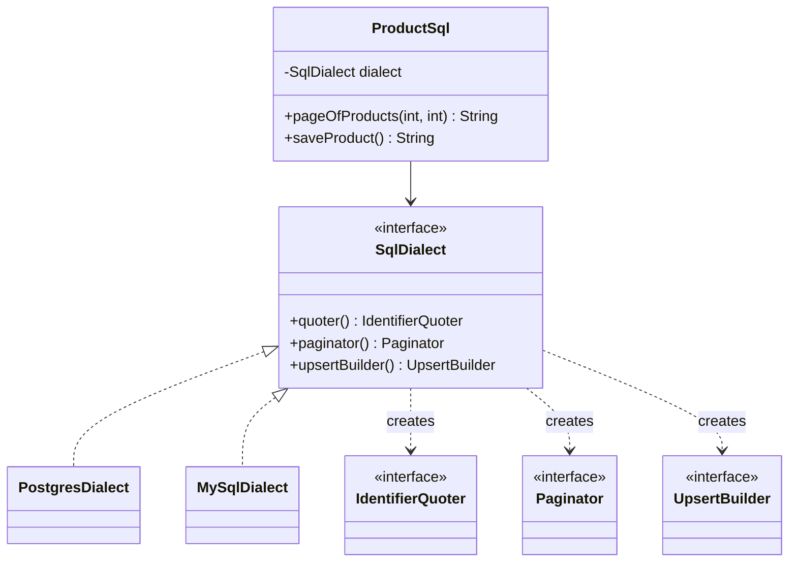

## Simple definition

The **Abstract Factory** pattern provides one interface for creating a **family of related objects**. Client code asks the factory for each object it needs and never names a concrete class, so a whole family can be swapped by swapping one factory.

GoF intent: *"Provide an interface for creating families of related or dependent objects without specifying their concrete classes."* It is also known as **Kit**.

## The problem

A repository must run on PostgreSQL and MySQL. Three pieces of SQL generation differ by database:

| Concern | PostgreSQL | MySQL |
|---|---|---|
| Quoting identifiers | `"name"` | `` `name` `` |
| Pagination | `LIMIT 20 OFFSET 40` | `LIMIT 40, 20` |
| Upsert | `ON CONFLICT (...) DO UPDATE` | `ON DUPLICATE KEY UPDATE` |

These pieces must **match each other**: a PostgreSQL upsert with MySQL quoting is a syntax error. With `if (db == POSTGRES)` checks scattered across the code, nothing stops a developer from mixing them, and adding a third database means editing every branch.

## Real-world analogy

Furniture collections. If you buy the "Nordic" collection, the chair, table and sofa all match. You choose the collection once; the shop makes sure every piece comes from it.

## Structure

- **AbstractFactory** (`SqlDialect`) — one creation method per product.
- **ConcreteFactory** (`PostgresDialect`, `MySqlDialect`) — creates products of one family.
- **AbstractProduct** (`IdentifierQuoter`, `Paginator`, `UpsertBuilder`).
- **ConcreteProduct** — the family-specific implementations, here lambdas inside each factory.
- **Client** (`ProductSql`) — uses only the abstract interfaces.

## Java implementation

The code is in `examples/java/src/hub/patterns/abstractfactory/AbstractFactoryDemo.java`.

### Abstract products and the abstract factory





### Concrete factories





Each factory builds its upsert with **its own** quoter. Consistency within the family is enforced by construction, not by convention.

### Client





## Step-by-step walkthrough

1. **Identify the family.** Which objects vary *together*? Here: quoting, pagination and upsert, all varying by database.
2. **Define an abstract product per role** and one factory interface with a method per product.
3. **Implement one concrete factory per family.** Products inside a family may share state (the quoter).
4. **Choose the factory once**, at startup or in configuration, and inject it. The client is written once.
5. **Add a family** (say, SQL Server) by adding one factory class; no client changes.

## Abstract Factory versus Factory Method

| | Factory Method | Abstract Factory |
|---|---|---|
| Creates | One product | A family of related products |
| Mechanism | Inheritance: a subclass overrides a creation method | Composition: the client holds a factory object |
| Typical shape | One abstract method in a class that also does other work | An interface whose *only* job is creation |
| Relationship | Concrete factories are often *implemented* with factory methods | — |

See [Factory patterns compared](/comparisons/factory-patterns) for the full comparison, including the simple factory idiom.

## Advantages and disadvantages

| Advantages | Disadvantages |
|---|---|
| Products from one family are guaranteed to be compatible | **Adding a new product type** means changing the factory interface and every concrete factory |
| Swapping families is a one-line configuration change | More interfaces and classes than a simple `switch` |
| Client code depends only on abstractions (DIP) | Overkill when there is only one family |
| Family-specific code is isolated in one place | — |

> [!TRADEOFF] Easy to add families, hard to add products
> Abstract Factory is open for new *families* (rows) but closed for new *product types* (columns). If you expect many new products and few families, reconsider.

## When to use it

- A system must work with one of several families of products: databases, cloud providers, UI themes, operating systems, test doubles versus real services.
- Products must be used together and mixing families would be a bug.
- You want to reveal only interfaces of a product library, not implementations.

## When not to use it

- Only one product varies: use [Factory Method](/design-patterns/creational/factory-method) or a simple factory.
- Only one family will ever exist.
- The "family" is just configuration values; a configuration object is simpler.

## Common mistakes

> [!MISTAKE] A factory interface that grows forever
> Adding `createX()` for every new object turns the factory into a dumping ground. Group only products that genuinely vary together.

- **Leaking concrete types** (`PostgresPaginator`) into client code, defeating the pattern.
- **Choosing the family in many places.** Select it once (composition root, Spring profile or `@ConditionalOnProperty`) and inject it.
- **Confusing it with a service locator.** A factory creates related products; a locator hands out arbitrary services by name and hides dependencies.

## Relationship to SOLID

- **Dependency Inversion:** the client depends on `SqlDialect`, not on database specifics.
- **Open/Closed:** new families extend the system without modifying the client.
- **Single Responsibility:** each factory knows one family.

## Real-world uses

- `javax.xml.parsers.DocumentBuilderFactory` and `javax.xml.transform.TransformerFactory`: the implementation family is chosen at runtime.
- Hibernate's `Dialect`: a family of SQL-generation strategies per database, the same idea as this example.
- Swing's pluggable look-and-feel (`UIManager`): one family of UI delegates per theme.
- In Spring, a `@Configuration` class activated by a profile acts as a concrete factory for a family of beans.

## Interview questions and answers

**What problem does Abstract Factory solve?**
Creating families of related objects that must be used together, without the client naming concrete classes, so the family can be swapped as a unit.

**How does it differ from Factory Method?**
Factory Method creates one product through a subclass-overridden method. Abstract Factory is an object with several creation methods, one per product in a family, and the client is given a factory instance.

**What is the main drawback?**
Adding a new kind of product requires changing the factory interface and all implementations.

**Where do you see it in Java?**
JAXP factories, Hibernate dialects, Swing look-and-feel, and Spring profile-specific configuration classes.

## Summary

- Abstract Factory creates **families** of products that must be compatible.
- The client receives a factory and uses only abstract product types.
- Easy to add a family, harder to add a product type.
- Often implemented with factory methods, and usually chosen once and injected.

## Related topics

- [Factory Method Pattern](/design-patterns/creational/factory-method)
- [Factory patterns compared](/comparisons/factory-patterns)
- [Bridge Pattern](/design-patterns/structural/bridge) — often combined with Abstract Factory to create the right implementor
- [Dependency Injection in Java](/spring/core/dependency-injection)

## References

- Gamma, Helm, Johnson, Vlissides. *Design Patterns*. Addison-Wesley, 1994. Abstract Factory, p. 87.
- Eric Freeman, Elisabeth Robson. *Head First Design Patterns* (2nd edition). O'Reilly, 2020. Chapter 4 (the ingredient factory).
- [PostgreSQL `INSERT ... ON CONFLICT`](https://www.postgresql.org/docs/current/sql-insert.html) and [MySQL `INSERT ... ON DUPLICATE KEY UPDATE`](https://dev.mysql.com/doc/refman/8.4/en/insert-on-duplicate.html).
