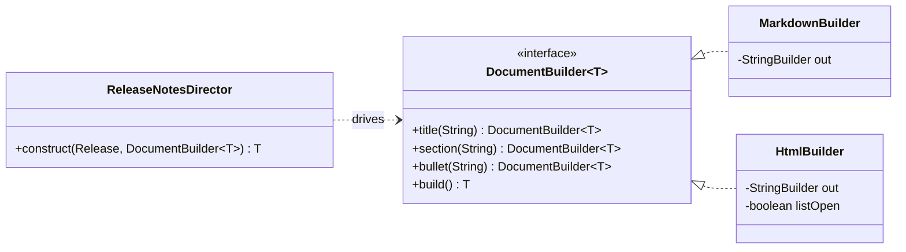
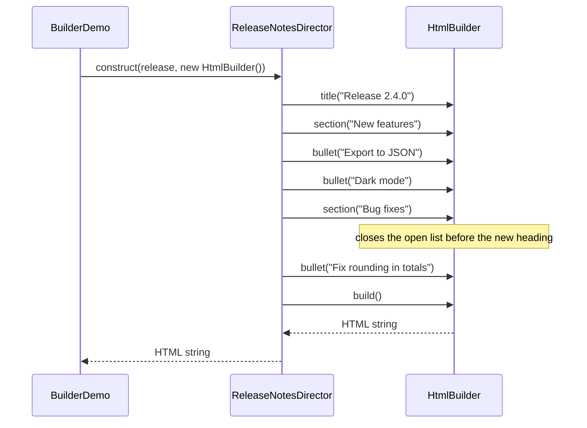
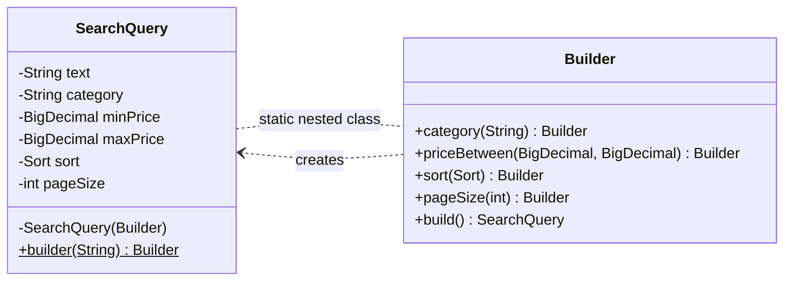

## Simple definition

The **Builder** pattern constructs a complex object step by step, instead of in one constructor call. The construction logic lives in a separate builder object, so the same steps can produce a valid, often immutable, result.

GoF intent: *"Separate the construction of a complex object from its representation so that the same construction process can create different representations."*

In Java you will meet two forms, and it is worth knowing both:

| Form | What it solves | Typical example |
|---|---|---|
| **GoF Builder** | One construction *process* producing different *representations* | A director builds release notes as Markdown or HTML |
| **Fluent ("Effective Java") builder** | Readable, validated creation of an object with many optional fields | `HttpRequest.newBuilder().uri(...).timeout(...).build()` |

## The problem

### Many optional parameters

A product search has one required field (the text) and several optional ones (category, price range, sort order, page size). Constructors scale badly:

```java
// Telescoping constructors: which argument is which?
new SearchQuery("laptop", "computers", null, new BigDecimal("1500"), Sort.PRICE_ASC, 20);
```

Positional `null`s are unreadable, and two adjacent `BigDecimal` parameters are easy to swap. The JavaBeans alternative — a no-argument constructor plus setters — makes the object mutable and allows it to exist in a half-initialised, invalid state.

### One process, several outputs

Release notes must be published as Markdown for the repository and HTML for the website. The *structure* — title, features section, fixes section — is identical; only the output format differs. Duplicating the structure in two renderers means every structural change must be made twice.

## Real-world analogy

Ordering at a sandwich counter. You state the bread, then the filling, then the extras, one step at a time; the sandwich is handed over only when you say "that's it". Different counters (builders) follow the same ordering process but produce a wrap or a baguette.

## Structure

### GoF form

- **Builder** — interface with one method per construction step (`DocumentBuilder`).
- **ConcreteBuilder** — implements the steps for one representation and returns the result (`MarkdownBuilder`, `HtmlBuilder`).
- **Director** — knows the *order* of steps, not the representation (`ReleaseNotesDirector`).
- **Product** — the result (`String` here: a Markdown or HTML document).





### Fluent form

The fluent builder is a static nested class with the same fields as the target. Each setter-like method returns `this`, and `build()` validates the combination and calls a private constructor.



## Java implementation

The code is in `examples/java/src/hub/patterns/builder/`, compiled and run by CI with Java 21.

### Fluent builder for an immutable object



### GoF builder: interface, concrete builders, director









### Running it





## Step-by-step walkthrough

1. **Required parameters go into the builder's constructor.** `SearchQuery.builder("laptop")` cannot be called without search text, so a missing required value is a compile error rather than a runtime surprise.
2. **Defaults live in the builder.** `sort = RELEVANCE` and `pageSize = 20` are declared once. Callers state only what differs from the defaults.
3. **Named methods replace positional arguments.** `priceBetween(min, max)` groups two related values, which makes them harder to misuse than two separate `BigDecimal` constructor arguments.
4. **`build()` validates the whole object at once.** Cross-field rules such as "min must not exceed max" can only be checked when all fields are known. An invalid query never exists.
5. **The product is immutable.** `SearchQuery` has only `final` fields and a private constructor, so it is thread-safe and can be shared freely.
6. **The GoF director owns the sequence.** `ReleaseNotesDirector` decides that features come before fixes and that empty sections are skipped. A new format, such as AsciiDoc, needs a new builder only.
7. **Concrete builders own representation details.** `HtmlBuilder` tracks whether a `<ul>` is open and escapes text. The director never sees these details.

> [!VERSION] Records and builders
> A Java record (Java 16+) with a compact constructor is often enough for small value objects with all-required fields. A builder still helps when there are many optional fields or cross-field validation. You can also put a builder *inside* a record.

## Advantages and disadvantages

| Advantages | Disadvantages |
|---|---|
| Readable creation code with named steps | More code: the builder duplicates the target's fields |
| Supports immutability and validation of the complete object | Missing required fields are only caught at `build()`, unless they go in the builder's constructor |
| Sensible defaults in one place | A builder for a three-field object is ceremony |
| GoF form: one construction process, many representations | GoF form: adds a director and a builder hierarchy |

## When to use it

- An object has **four or more** parameters, several of them optional (Bloch's rule of thumb).
- Objects must be immutable and valid from the moment they exist.
- The same construction steps must produce different representations (GoF form): documents, reports, test fixtures, SQL dialects.
- Test data builders: `anOrder().withLines(2).paid().build()` makes tests readable.

## When not to use it

- The object has a few required fields — use a constructor or a record.
- The object is mutable configuration that is changed after creation anyway.
- Code generation such as Lombok's `@Builder` would hide validation you actually need. Generated builders do not validate cross-field rules unless you add them.

## Common implementation mistakes

> [!MISTAKE] Builders that skip validation
> A builder that copies fields and calls the constructor without checks gives you readability but loses the main safety benefit. Validate in `build()` (or in the target's constructor) and fail with a clear message.

- **Reusing a builder after `build()`.** A mutable builder used twice can leak state between products. Either document that builders are single-use, or make `build()` copy everything it needs — including defensive copies of collections.
- **Mutable products.** Adding setters to the product undoes the reason for the builder.
- **Required fields as optional builder methods.** Put them in the builder's constructor or in the static `builder(...)` method.
- **Sharing builders between threads.** Builders are mutable and not thread-safe. Products can be immutable and shared; builders should be confined to one thread.

## Relationship to SOLID

- **Single Responsibility:** construction and validation live in the builder; the product focuses on behaviour.
- **Open/Closed (GoF form):** a new representation is a new concrete builder; the director does not change.
- **Dependency Inversion (GoF form):** the director depends on the `DocumentBuilder` abstraction.

## Comparison with similar patterns

| Pattern | Difference |
|---|---|
| **Factory Method / Abstract Factory** | Create an object in one call, focusing on *which class*. Builder focuses on *how* one complex object is assembled, step by step. See [factory patterns compared](/comparisons/factory-patterns). |
| **Prototype** | Creates a new object by copying an existing one and adjusting it, instead of assembling it from parts. |
| **Composite** | Builders often assemble Composite structures, such as document trees. |
| **Static factory methods** | Good for a few named variants (`Duration.ofSeconds`). A builder suits many independent optional settings. |

## Real-world uses

- `java.net.http.HttpRequest.newBuilder()` and `HttpClient.newBuilder()` (Java 11+).
- `java.util.stream.Stream.builder()` and `Locale.Builder`.
- `StringBuilder` assembles a string step by step, although it has no director or separate product interface.
- Spring's `UriComponentsBuilder`, `ResponseEntity.ok().header(...).body(...)`, and the `HttpSecurity` DSL in Spring Security.

## Interview questions and answers

**What problem does the Builder pattern solve?**
It replaces telescoping constructors and half-initialised JavaBeans with readable, step-by-step creation. `build()` validates the complete object, which can then be immutable.

**What is the difference between the GoF Builder and the builder in *Effective Java*?**
The GoF Builder separates a construction *process* (the director) from the *representation* (interchangeable concrete builders). The *Effective Java* builder is a fluent nested class that creates one immutable type with many optional parameters. Both build objects step by step, but they solve different problems.

**Is a builder thread-safe?**
Usually not, and it does not need to be. A builder is used by one thread to create an object. The product it creates can be immutable and therefore safe to share.

**When would you use a record instead of a builder?**
When all fields are required and few in number. A record gives you a canonical constructor, accessors, `equals`, `hashCode` and `toString`, and a compact constructor can validate the fields.

**How does Builder relate to Factory Method?**
Factory Method decides *which class* to instantiate in one step. Builder controls *how* a complex object is assembled. A director can even use a factory method to obtain its builder.

> [!INTERVIEW] Mention validation and immutability
> The strongest arguments for a builder are not "fewer constructor arguments" but "the object is always valid" and "the object is immutable". Lead with those.

## Summary

- Builder assembles complex objects step by step and returns them only when they are complete.
- The fluent form gives readable, validated creation of immutable objects with many optional fields.
- The GoF form separates the construction process (director) from interchangeable representations (builders).
- Use records or constructors for small objects; use a builder when the parameter list or validation becomes complex.

## Related topics

- [Factory Method Pattern](/design-patterns/creational/factory-method)
- [Factory patterns compared](/comparisons/factory-patterns)
- [All 23 GoF Patterns: Overview](/design-patterns/gof-overview)

## References

- Gamma, Helm, Johnson, Vlissides. *Design Patterns*. Addison-Wesley, 1994. Builder, p. 97.
- Joshua Bloch. *Effective Java*, 3rd edition, Item 2: "Consider a builder when faced with many constructor parameters".
- [`java.net.http.HttpRequest.Builder`](https://docs.oracle.com/en/java/javase/21/docs/api/java.net.http/java/net/http/HttpRequest.Builder.html), Java SE 21 API.
