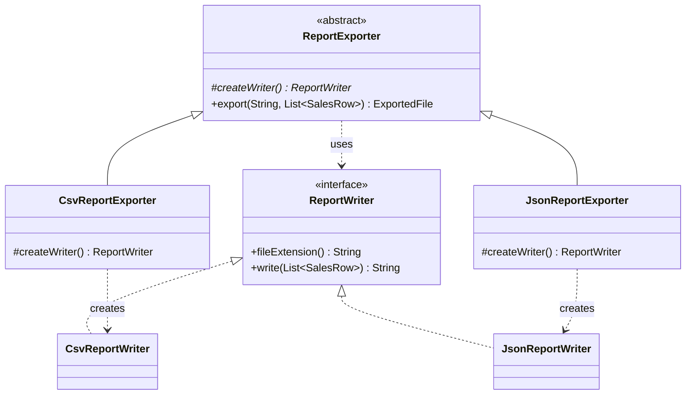
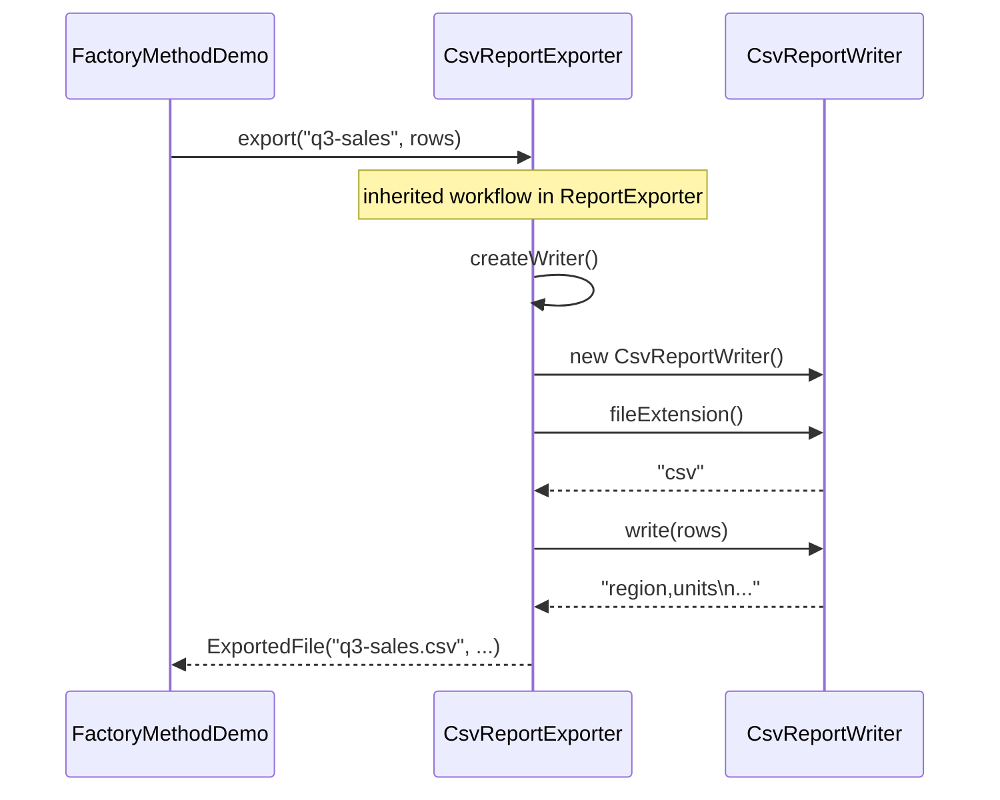

## Simple definition

The **Factory Method** pattern declares a method for creating an object in a base class, and lets **subclasses** decide which concrete class to instantiate. The base class contains the code that *uses* the object; subclasses supply only the creation step.

GoF intent: *"Define an interface for creating an object, but let subclasses decide which class to instantiate. Factory Method lets a class defer instantiation to subclasses."* The book also calls it a *virtual constructor*.

> [!IMPORTANT] Three different things are called "factory"
> - **GoF Factory Method** — an overridable method in a creator class; subclasses choose the product. Relies on inheritance.
> - **Simple factory** — one method (often static) that picks a class with a conditional. Not a GoF pattern.
> - **Static factory method** — a static method used instead of a constructor, such as `List.of(...)` or `Optional.of(...)`. A Java idiom from *Effective Java*, Item 1. Not a GoF pattern either.
>
> All three are useful. Only the first is the Factory Method pattern. The [factory patterns comparison](/comparisons/factory-patterns) puts them side by side with Abstract Factory.

## The problem

A reporting module exports sales data. The export workflow is always the same: validate the rows, create a writer, build a file name with the right extension, write the content. Only the *writer* differs — CSV for finance, JSON for an API consumer.

A first version hard-codes the choice:

```java
ExportedFile export(String baseName, List<SalesRow> rows, String format) {
    if (rows.isEmpty()) throw new IllegalArgumentException("Nothing to export");
    ReportWriter writer = format.equals("csv") ? new CsvReportWriter() : new JsonReportWriter();
    ...
}
```

The workflow and the choice of class are tangled together. Adding a format means editing the workflow, and a framework that ships `export` cannot know which formats its users will add.

## Real-world analogy

A franchise restaurant chain publishes a fixed process for serving a meal: take the order, prepare the dish, plate it, serve it. Each franchise decides *what* "prepare the dish" produces according to local menus. Head office owns the process; the franchise owns one step.

## Structure

Four roles:

- **Product** — the interface of the objects created (`ReportWriter`).
- **ConcreteProduct** — implementations (`CsvReportWriter`, `JsonReportWriter`).
- **Creator** — declares the factory method and usually contains the workflow that uses the product (`ReportExporter`).
- **ConcreteCreator** — overrides the factory method to return a specific product (`CsvReportExporter`, `JsonReportExporter`).





## Java implementation

The full example is in `examples/java/src/hub/patterns/factorymethod/`. CI compiles and runs it with Java 21.

### Product and concrete products







### Creator and concrete creators







### For contrast: a simple factory



### Running it





## Step-by-step walkthrough

1. **The creator owns the workflow.** `ReportExporter.export` validates input, obtains a writer, builds the file name from the writer's extension and writes the content. It is `final`, so subclasses cannot change the workflow — only the creation step.
2. **The factory method is the single extension point.** `createWriter()` is `protected abstract`. It is not part of the public API; it exists for subclasses.
3. **Concrete creators make one decision each.** `CsvReportExporter` returns a `CsvReportWriter`. Adding XML means adding `XmlReportWriter` and `XmlReportExporter`; `ReportExporter` does not change.
4. **The client chooses a creator, not a product.** `FactoryMethodDemo` works with `ReportExporter` references. It never instantiates a writer.
5. **The simple factory is different.** `ReportWriters.forFormat` selects a class from a runtime string. There is no subclassing and no deferred decision — it centralises a conditional. That is fine when the choice depends on data, such as a user-selected format.

> [!KEY] Factory Method is usually a Template Method step
> `export` is a [Template Method](/design-patterns/gof-overview#behavioral-patterns): a fixed algorithm with one step left to subclasses. In Factory Method, that step happens to be *creating an object*. The GoF book notes this connection explicitly.

## Advantages and disadvantages

| Advantages | Disadvantages |
|---|---|
| The creator's workflow is written once and reused | One creator subclass per product — a parallel class hierarchy |
| New products are added without modifying the creator (OCP) | Relies on inheritance, which fixes the choice at compile time |
| Products can be swapped in tests by subclassing the creator | Overkill when the creator has no workflow of its own |
| Frameworks can call user-supplied creation code at the right moment | Easy to confuse with simple and static factories |

## When to use it

- A base class contains a workflow that needs an object, but cannot know its concrete class.
- You are writing a framework or library and users must plug in their own product types.
- Subclasses already exist for other reasons, and each naturally knows which product it needs.

## When not to use it

- The choice depends on a runtime value (a format string, a configuration key). Use a simple factory, a `Map<String, Supplier<ReportWriter>>`, or dependency injection.
- There is no shared workflow — creation is all the creator does. Pass a `Supplier<ReportWriter>` or the product itself instead.
- You need to create *families* of related objects that must be used together. That is [Abstract Factory](/comparisons/factory-patterns).

> [!TRADEOFF] Composition often wins in modern Java
> Instead of subclassing `ReportExporter`, you could give it a `Supplier<ReportWriter>` in its constructor. That turns Factory Method (inheritance) into Strategy-like composition — choosable at runtime and with no parallel hierarchy. Choose the subclass form when subclasses exist anyway or when a framework needs a fixed extension hook.

## Common implementation mistakes

> [!MISTAKE] Calling every `create...()` method "Factory Method"
> `ReportWriters.forFormat("csv")` is a simple factory. `List.of(...)` is a static factory method. Neither involves a subclass deciding what to create. In an interview, naming them correctly is a quick way to show precision.

- **Calling the factory method from the constructor.** The subclass is not fully initialised while the superclass constructor runs, so an overridden `createWriter()` may see unset fields. Call it lazily from the workflow, as `export` does.
- **Making the factory method public.** It is an extension point for subclasses, not an API for clients. Keep it `protected`.
- **Leaking concrete types.** If clients cast the product to `CsvReportWriter`, the abstraction has failed.
- **A creator with no workflow.** A creator whose only method is the factory method is an unnecessary layer; use a `Supplier` or a simple factory.

## Relationship to SOLID

- **Open/Closed:** new products and creators are added without editing `ReportExporter`.
- **Dependency Inversion:** the workflow depends on the `ReportWriter` abstraction.
- **Single Responsibility:** the workflow and the choice of product are separated into different classes.
- **Liskov Substitution:** every creator subclass must return a product that honours the `ReportWriter` contract, or the shared workflow breaks.

## Comparison with similar patterns

| Pattern | Difference |
|---|---|
| **Abstract Factory** | An object (not a subclass) creates a *family* of related products. Abstract Factory is often implemented with several factory methods. |
| **Simple factory** | One method with a conditional. No inheritance, choice by runtime value. Not GoF. |
| **Static factory method** | A named alternative to a constructor (`Optional.of`, `Duration.ofSeconds`). Not GoF. |
| **Builder** | Constructs one complex object step by step. Factory Method creates an object in one call. See [Builder](/design-patterns/creational/builder). |
| **Template Method** | Factory Method is frequently one step of a template method. |
| **Prototype** | Creates objects by copying an instance, so it needs no creator hierarchy. |

## Real-world uses

- `java.util.Collection.iterator()`: each collection class decides which `Iterator` implementation to return. Code written against `Collection` uses the iterator without knowing its class.
- `java.net.URLStreamHandler.openConnection` returns a protocol-specific `URLConnection`.
- In Spring, `@Bean` methods and the `FactoryBean` interface create objects on the container's behalf. These *resemble* factory methods. The [Patterns in Spring](/spring/patterns-in-spring) section discusses how closely.

## Interview questions and answers

**What is the Factory Method pattern?**
A creator class declares a method for creating a product and uses it inside its own logic. Subclasses override the method to choose the concrete product. The creator depends only on the product interface.

**What is the difference between Factory Method and a simple factory?**
Factory Method uses inheritance: a subclass decides what to create, and the decision is fixed per subclass. A simple factory is one method that selects a class from its arguments with a conditional. A simple factory is not a GoF pattern.

**Is `List.of()` an example of Factory Method?**
No. It is a static factory method — an idiom that replaces a constructor with a named static method. It can return different implementation classes, but no subclass overrides anything.

**What is the difference between Factory Method and Abstract Factory?**
Factory Method creates one product through subclassing. Abstract Factory is an object whose methods create a family of related products; you swap the whole factory object to switch families.

**Why should a constructor not call the factory method?**
In Java, an overridden method called from a superclass constructor runs before the subclass's fields are initialised. It can observe default values such as `null`.

> [!INTERVIEW] Show the modern alternative
> After explaining the classic form, mention that passing a `Supplier<Product>` achieves the same decoupling through composition. Then explain when you would still choose the subclass form.

## Summary

- Factory Method defers *which class to instantiate* to subclasses of a creator.
- The creator usually owns a workflow; the factory method is one step of it.
- Simple factories and static factory methods are useful, but they are different things.
- Prefer composition (`Supplier`, DI) when the choice depends on runtime data.

## Related topics

- [Factory patterns compared](/comparisons/factory-patterns)
- [Builder Pattern](/design-patterns/creational/builder)
- [Strategy Pattern](/design-patterns/behavioral/strategy)
- [All 23 GoF Patterns: Overview](/design-patterns/gof-overview)

## References

- Gamma, Helm, Johnson, Vlissides. *Design Patterns*. Addison-Wesley, 1994. Factory Method, p. 107.
- Joshua Bloch. *Effective Java*, 3rd edition, Item 1: "Consider static factory methods instead of constructors"; Item 19: constructors must not invoke overridable methods.
- [`java.util.Collection`](https://docs.oracle.com/en/java/javase/21/docs/api/java.base/java/util/Collection.html), Java SE 21 API.
