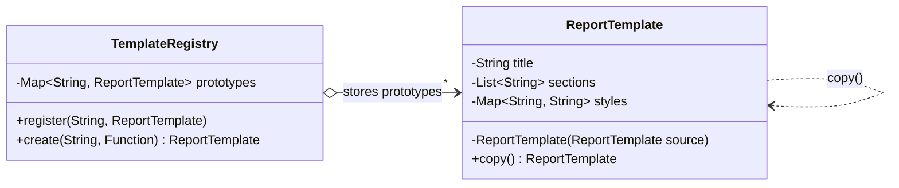

## Simple definition

The **Prototype** pattern creates a new object by **copying an existing one**, the prototype, and then adjusting the copy. The client does not need to know the concrete class or how the original was configured.

GoF intent: *"Specify the kinds of objects to create using a prototypical instance, and create new objects by copying this prototype."*

## The problem

A reporting tool offers report templates such as "Monthly sales". Each template has a title, a list of sections and a map of styles, assembled from configuration that is slow to load. Users create many reports from each template and tweak them.

- Rebuilding a template from configuration for every report is slow and duplicates setup code.
- Calling `new ReportTemplate(...)` requires knowing every field and its default.
- Sharing one template object between reports is wrong: editing one report would change all of them.

What we want is: **"give me a copy of that configured object"**.

## Real-world analogy

Cell division: a cell creates a copy of itself, and the copy then develops independently. Or a document template: you "Save as" a new file and edit the copy, never the template.

## Structure

- **Prototype** — declares a copy operation (`copy()`).
- **ConcretePrototype** (`ReportTemplate`) — implements copying, including deep-copying its mutable parts.
- **Client / registry** (`TemplateRegistry`) — asks a prototype to copy itself.

## Java implementation

The code is in `examples/java/src/hub/patterns/prototype/PrototypeDemo.java`.

### The prototype, with a copy constructor



### A registry of prototypes



The registry copies on the way **in** (so the caller cannot mutate a registered prototype afterwards) and on the way **out** (so every client gets an independent object).

### The shallow-copy bug





March and April are independent; the registered prototype is untouched. The shallow copy, in contrast, shares its list with the original, so adding "Oops" to the copy changes both.

## Shallow versus deep copy

| | Shallow copy | Deep copy |
|---|---|---|
| Primitive and immutable fields (`int`, `String`, records of immutables) | Copied | Copied |
| References to mutable objects (`List`, `Map`, arrays, entities) | **Shared** with the original | New copies |
| Cost | Cheap | Proportional to the object graph |
| Safe when | All fields are immutable | Always, if done for every mutable field |

A practical rule: **copy what is mutable, share what is immutable**. Immutable fields (strings, records of immutable values, `List.copyOf` results) can safely be shared, which makes copies cheap.

## Why not `Cloneable`?

Java has a built-in mechanism, `Object.clone()` with the `Cloneable` marker interface. It is widely considered broken:

- `Cloneable` has no `clone()` method; the contract is defined by a protected method on `Object`.
- `clone()` creates objects **without calling a constructor**, bypassing invariants.
- It is shallow by default and does not work with `final` fields that need deep copies.
- It throws a checked `CloneNotSupportedException` and returns `Object`.

Prefer a **copy constructor** or a **static copy factory** (`ReportTemplate.copyOf(other)`). Arrays are the exception: `array.clone()` is fine.

> [!TIP] Records and immutability reduce the need for Prototype
> If an object is immutable, you never need to copy it: share it, and use a `with`-style method that returns a modified copy. Many uses of Prototype disappear with [records](/java/fundamentals/modern-java-features) and immutable collections.

## Advantages and disadvantages

| Advantages | Disadvantages |
|---|---|
| Creates objects without knowing their concrete class | Deep copying complex graphs (cycles, shared references) is tricky |
| Avoids repeating expensive initialization | Every subclass must implement copying correctly |
| Lets you configure "kinds" of objects at runtime and register them | Easy to introduce shared-state bugs with shallow copies |
| Fewer subclasses: variants are data, not classes | — |

## When to use it

- Object creation is expensive (parsing, I/O, computation) and many similar objects are needed.
- The kinds of objects to create are determined at runtime (loaded from configuration, built by users in an editor).
- You want to avoid a parallel hierarchy of factories for a hierarchy of products.

## When not to use it

- The objects are immutable: share them instead of copying.
- Construction is cheap and simple: a constructor or [Builder](/design-patterns/creational/builder) is clearer.
- The object graph has many cycles or external resources (sockets, file handles) that cannot be meaningfully copied.

## Common mistakes

> [!MISTAKE] Copying the reference instead of the collection
> `this.items = other.items` in a copy constructor creates a shallow copy. Use `new ArrayList<>(other.items)` or an immutable copy.

- **Forgetting nested mutable objects**, for example copying a list but not the mutable objects inside it.
- **Handing out the registered prototype itself** instead of a copy.
- **Overriding `clone()` in a class hierarchy** and forgetting to call `super.clone()` consistently.

## Prototype in Spring

Spring's **prototype scope** borrows the name: each `getBean()` or injection creates a new instance. It does not copy an existing object; it runs the bean definition again. See [Bean Lifecycle and Scopes](/spring/core/bean-lifecycle-and-scopes).

## Real-world uses

- Copy constructors in the JDK: `new ArrayList<>(collection)`, `new HashMap<>(map)`.
- `array.clone()` for arrays.
- Graphic editors and game engines: duplicate a configured shape or enemy.
- JavaScript's prototype-based inheritance is built on the same idea.

## Interview questions and answers

**What is the Prototype pattern?**
A creational pattern that creates new objects by copying a prototype instance rather than by calling a constructor of a known class.

**What is the difference between shallow and deep copy?**
A shallow copy shares references to mutable objects with the original; a deep copy creates independent copies of them.

**Why avoid `Cloneable` in Java?**
It bypasses constructors, is shallow by default, conflicts with final fields, throws a checked exception and returns `Object`. Copy constructors or copy factories are clearer and safer.

**How is Spring's prototype scope related?**
In name only: Spring creates a fresh bean from its definition each time; it does not clone an existing instance.

## Summary

- Prototype creates objects by copying a configured instance.
- Deep-copy mutable state; share immutable state.
- In Java, use copy constructors or copy factories, not `Cloneable`.
- Immutable objects often remove the need for the pattern.

## Related topics

- [Factory patterns compared](/comparisons/factory-patterns)
- [Builder Pattern](/design-patterns/creational/builder)
- [Modern Java: records and sealed classes](/java/fundamentals/modern-java-features)
- [Bean Lifecycle and Scopes](/spring/core/bean-lifecycle-and-scopes)

## References

- Gamma, Helm, Johnson, Vlissides. *Design Patterns*. Addison-Wesley, 1994. Prototype, p. 117.
- Joshua Bloch. *Effective Java* (3rd edition). Item 13: Override clone judiciously.
