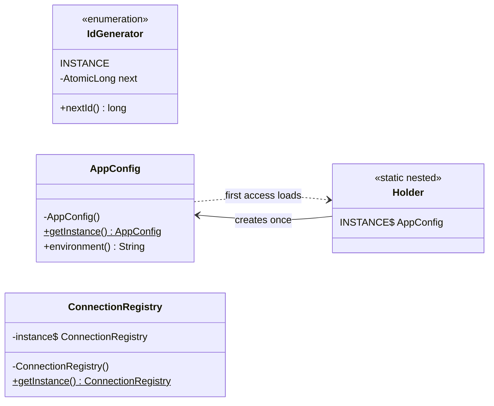

## Simple definition

The **Singleton** pattern makes sure a class has **exactly one instance** in a process and gives everyone a way to reach it.

GoF intent: *"Ensure a class only has one instance, and provide a global point of access to it."*

The two halves of that sentence are very different. "Only one instance" is sometimes a genuine requirement. "A global point of access" is the part that causes most of the problems, because it lets any code reach the object without declaring the dependency.

## The problem

Some resources really should exist once per process:

- an ID generator whose counter must not restart
- a connection pool or thread pool that is expensive to create and must be shared
- a registry of loaded plugins or metrics.

If every caller wrote `new IdGenerator()`, each would get its own counter, and IDs would collide. The class itself should enforce "one instance only", and creation should be **thread-safe** and ideally **lazy** (created on first use).

## Real-world analogy

A country has one official government at a time. Citizens do not create their own; they refer to "the government". The analogy also shows the risk: if every institution refers to "the government" directly, you cannot run an experiment with a different one.

## Structure

- A **private constructor**, so nobody else can call `new`.
- A **static field** holding the one instance.
- A **static accessor** (`getInstance()`), or an enum constant.

## Java implementation

The code is in `examples/java/src/hub/patterns/singleton/SingletonDemo.java`, compiled and run by CI with Java 21.

### 1. Enum singleton (recommended)



The JVM guarantees an enum constant is created exactly once, safely, when the enum class is initialized. Enums also defeat the two classic ways of creating a second instance: **reflection** (`Constructor.newInstance` refuses enum types) and **serialization** (deserializing an enum returns the existing constant). Joshua Bloch calls this "the best way to implement a singleton" in *Effective Java*. Its only limitation: an enum cannot extend another class.

### 2. Initialization-on-demand holder (lazy)



`Holder` is not initialized until `getInstance()` first touches it. Class initialization is performed under a JVM lock and its result is safely published to all threads (JLS §12.4.2), so this is **lazy and thread-safe with no synchronization in your code**.

### 3. Double-checked locking (know it, rarely write it)



Without `volatile`, this idiom is **broken**: the write of the reference can become visible to another thread before the constructor's writes to the object's fields, so a second thread can see a half-built object. `volatile` creates the [happens-before](/java/advanced/java-memory-model) edge that prevents this. Use it only when you need lazy initialization of an *instance* field (the holder idiom works only for static fields).

### 4. The testable alternative: inject it



`InvoiceNumberer` does not call `IdGenerator.INSTANCE` itself. It receives a `LongSupplier`. Production code passes the singleton; a test passes `() -> 42`. One instance still exists, but nobody reaches for it globally.

### Running it

The `main` method of `SingletonDemo` reads `AppConfig` twice, then runs eight threads that each call `IdGenerator.INSTANCE.nextId()` and `ConnectionRegistry.getInstance()` 1,000 times, and finally builds two `InvoiceNumberer`s.



Eight threads making 8,000 calls produce 8,000 unique IDs, and every thread sees the same `ConnectionRegistry`. The constructor message appears only when `AppConfig` is first used, proving laziness.

## Thread-safety options compared

| Implementation | Lazy | Thread-safe | Reflection/serialization safe | Notes |
|---|---|---|---|---|
| Eager `static final` field | No | Yes | No (needs extra code) | Simple; fine if creation is cheap |
| `synchronized getInstance()` | Yes | Yes | No | Lock on every call |
| Double-checked locking + `volatile` | Yes | Yes | No | Easy to get wrong |
| Holder idiom | Yes | Yes | No | Best lazy option for classes |
| **Enum** | At enum init | Yes | **Yes** | Best overall; cannot extend a class |

## Why Singleton is often called an anti-pattern

The pattern is not wrong; the **global access point** is what hurts:

- **Hidden dependencies.** A method that calls `PaymentGateway.getInstance()` does not declare that it needs a payment gateway. You discover it at runtime or in production.
- **Hard to test.** You cannot substitute a fake without static mocking. Tests that share a mutable singleton leak state into each other and pass or fail depending on order.
- **Global mutable state.** Any code can change it, from any thread.
- **Violates the Single Responsibility Principle.** The class manages both its job and its own lifecycle.
- **"One per JVM" is not "one per system".** Each class loader, each JVM in a cluster and each container replica has its own copy. A singleton cannot coordinate a distributed system; you need a database, a lock service or a leader election for that.

> [!KEY] Separate "one instance" from "global access"
> Keep the one-instance guarantee, drop the global access: create the object once at the composition root and pass it to whoever needs it. That is exactly what Spring does.

## Singleton in Spring

A Spring bean has **singleton scope by default**: one instance per `ApplicationContext`, not per JVM. The class is ordinary, with a public constructor and injected dependencies, so it is easy to test. This is the modern replacement for hand-written singletons. See [Bean Lifecycle and Scopes](/spring/core/bean-lifecycle-and-scopes).

Because singleton beans are shared across request threads, they must be **stateless or thread-safe**. Storing per-request data in a field of a singleton bean is a classic concurrency bug.

## When to use it

- A stateless or thread-safe service that should be shared and has no reason to be swapped: an enum of strategies, a `Comparator` constant, a cached `ObjectMapper` held by the composition root.
- Inside a framework or library where you are the composition root.
- Constants and immutable lookup tables (`enum` is ideal).

## When not to use it

- To share mutable state between unrelated parts of the program.
- As a shortcut to avoid passing a dependency through constructors.
- When you need one instance *per cluster*: use infrastructure (a database row, a lease, a leader election) instead.
- In application code that already uses a DI container: declare a bean instead.

## Common mistakes

> [!MISTAKE] Double-checked locking without volatile
> Compiles, passes tests on x86, and fails rarely on other hardware or after JIT reordering. If you write DCL, the field must be `volatile`; better still, use the holder idiom or an enum.

- **Lazy initialization with a race:** `if (instance == null) instance = new X();` without synchronization can create two instances.
- **Mutable fields in a shared singleton** without synchronization.
- **Serializable singletons** that do not implement `readResolve()`, so deserialization creates a second instance (enums avoid this).
- **Static mocking in tests** as a routine practice. It is a sign the design needs dependency injection.

## Real-world uses

- `java.lang.Runtime.getRuntime()` — one runtime per JVM.
- `java.awt.Desktop.getDesktop()`, `java.util.Collections.emptyList()` (a shared immutable instance).
- Enum-based singletons such as `java.util.concurrent.TimeUnit` constants and `java.math.RoundingMode`.
- Spring's default bean scope.

## Interview questions and answers

**How do you write a thread-safe singleton in Java?**
Use an enum with one constant, or the initialization-on-demand holder idiom for lazy creation. Both rely on the JVM's class initialization guarantees, so no explicit locking is needed.

**Why must the field be volatile in double-checked locking?**
Without it, another thread can observe a non-null reference to an object whose constructor writes are not yet visible. `volatile` establishes happens-before between the write and later reads.

**Why is the enum singleton considered the best?**
It is concise, thread-safe, and safe against reflection and serialization attacks that create a second instance.

**Why do people call Singleton an anti-pattern?**
Because of the global access point: hidden dependencies, global mutable state and hard-to-test code. Keeping one instance but injecting it solves this.

**Is a Spring singleton bean the same as the GoF Singleton?**
No. A Spring singleton is one instance per container, created and injected by the container; the class itself does not enforce it and can be instantiated freely in tests.

> [!INTERVIEW] Mention the cluster
> A strong answer notes that a singleton is one per class loader, so in a horizontally scaled service there are as many "singletons" as replicas.

## Summary

- Singleton guarantees one instance per class loader and provides access to it.
- Prefer an **enum**; use the **holder idiom** for lazy creation; DCL needs `volatile`.
- The global access point causes hidden dependencies and untestable code. Create one instance and **inject it** instead.
- In Spring, singleton scope gives you the benefits without the drawbacks.

## Related topics

- [Bean Lifecycle and Scopes](/spring/core/bean-lifecycle-and-scopes)
- [The Java Memory Model and Happens-Before](/java/advanced/java-memory-model)
- [Dependency Injection in Java](/spring/core/dependency-injection)
- [Factory patterns compared](/comparisons/factory-patterns)

## References

- Gamma, Helm, Johnson, Vlissides. *Design Patterns*. Addison-Wesley, 1994. Singleton, p. 127.
- Eric Freeman, Elisabeth Robson. *Head First Design Patterns* (2nd edition). O'Reilly, 2020. Chapter 5.
- Joshua Bloch. *Effective Java* (3rd edition). Item 3: Enforce the singleton property with a private constructor or an enum type.
- [Java Language Specification §12.4.2](https://docs.oracle.com/javase/specs/jls/se21/html/jls-12.html#jls-12.4.2): detailed initialization procedure.
