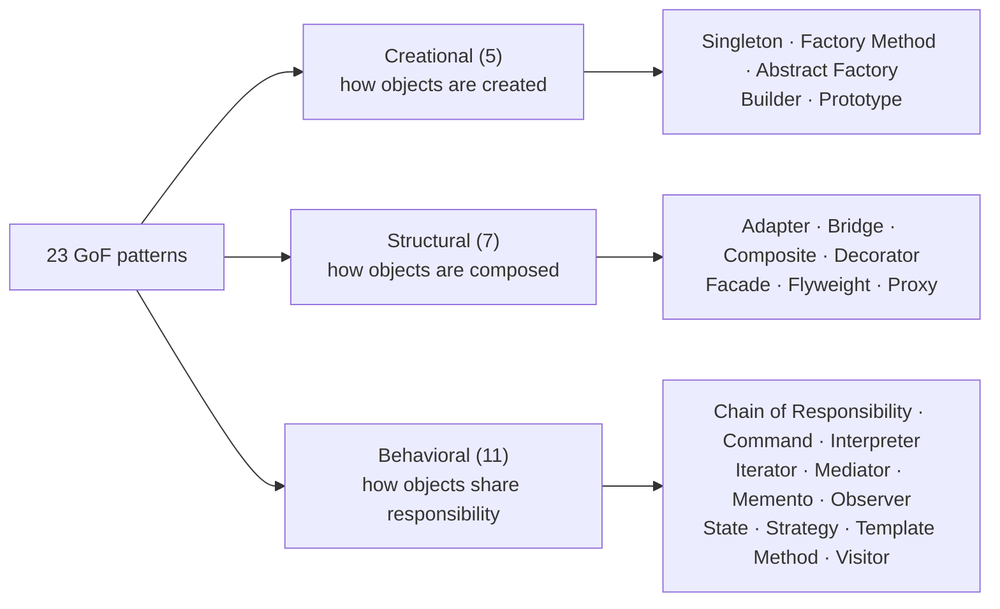

## Simple definition

The **Gang of Four (GoF) catalogue** is the set of 23 object-oriented design patterns published in *Design Patterns: Elements of Reusable Object-Oriented Software* (1994). The book sorts them along two axes:

- **Purpose** — what the pattern does: *creational*, *structural* or *behavioral*.
- **Scope** — whether the relationships are fixed at compile time through inheritance (*class* scope) or set up at runtime through composition (*object* scope).

This page is the map. Each pattern gets its own article; patterns not yet written are listed as plain text so that no page pretends to be finished.

## Why a classification matters

A classification turns 23 unrelated names into a few questions you can ask about a design:

1. Is the difficulty *creating* objects, *wiring* objects together, or *distributing behaviour* among them?
2. Should the variation be fixed when the code is compiled, or chosen while the program runs?

Answering those two questions usually narrows the candidates to two or three patterns. The [comparison pages](/comparisons) then help you choose between them.

## The three categories

### Creational patterns

Creational patterns hide *which* concrete class is instantiated and *how*. Client code then depends on abstractions instead of `new ConcreteClass()`.

| # | Pattern | Intent in one line | Scope | In the JDK or Spring |
|---|---|---|---|---|
| 1 | Singleton | Ensure a class has one instance and provide a global access point to it. | Object | `Runtime.getRuntime()` |
| 2 | [Factory Method](/design-patterns/creational/factory-method) | Let subclasses decide which class to instantiate. | Class | `Collection.iterator()` (each collection creates its own iterator) |
| 3 | Abstract Factory | Create families of related objects without naming their concrete classes. | Object | `javax.xml.parsers.DocumentBuilderFactory` |
| 4 | [Builder](/design-patterns/creational/builder) | Separate the construction of a complex object from its representation. | Object | `StringBuilder`, `HttpRequest.newBuilder()` |
| 5 | Prototype | Create new objects by copying an existing instance. | Object | `Object.clone()` (with well-known caveats) |

### Structural patterns

Structural patterns describe how objects are wired together. Several of them have the same shape — a class that holds a reference to another object — and differ only in **intent**.

| # | Pattern | Intent in one line | Scope | In the JDK or Spring |
|---|---|---|---|---|
| 6 | [Adapter](/design-patterns/structural/adapter) | Convert one interface into another that clients expect. | Class or object | `Arrays.asList`, `InputStreamReader` |
| 7 | Bridge | Decouple an abstraction from its implementation so both can vary. | Object | JDBC: `DriverManager` and `Connection` over vendor drivers |
| 8 | Composite | Treat individual objects and groups of objects uniformly. | Object | AWT/Swing `Container` holding `Component`s |
| 9 | Decorator | Attach responsibilities to an object dynamically by wrapping it. | Object | `BufferedInputStream`, `Collections.unmodifiableList` |
| 10 | Facade | Provide one simple interface to a complex subsystem. | Object | Spring's `JdbcTemplate` over raw JDBC (resembles) |
| 11 | Flyweight | Share fine-grained objects to support large numbers efficiently. | Object | `Integer.valueOf` cache for −128…127 |
| 12 | Proxy | Provide a placeholder that controls access to another object. | Object | `java.lang.reflect.Proxy`, Spring AOP proxies |

> [!NOTE] Adapter is the only dual-scope pattern
> The GoF book lists Adapter under both scopes. A *class adapter* inherits from the adaptee. An *object adapter* holds a reference to it. In Java, which has single inheritance of classes, the object adapter is the usual choice.

### Behavioral patterns

Behavioral patterns are about algorithms and about who is responsible for what: who decides, who reacts, and where variation is plugged in.

| # | Pattern | Intent in one line | Scope | In the JDK or Spring |
|---|---|---|---|---|
| 13 | Chain of Responsibility | Pass a request along a chain of handlers until one handles it. | Object | Servlet `FilterChain`, Spring Security filter chain |
| 14 | Command | Encapsulate a request as an object. | Object | `Runnable`, `Callable` |
| 15 | Interpreter | Represent a grammar and interpret sentences in it. | Class | `java.util.regex.Pattern` (internally), Spring Expression Language |
| 16 | Iterator | Access elements sequentially without exposing the underlying structure. | Object | `java.util.Iterator` |
| 17 | Mediator | Centralise complex communication between objects in one object. | Object | No clean JDK example; a dialog controller coordinating form widgets is the classic case |
| 18 | Memento | Capture and restore an object's state without breaking encapsulation. | Object | Undo stacks in editors; rarely visible in library APIs |
| 19 | Observer | Notify dependents automatically when an object changes. | Object | `java.util.concurrent.Flow`, Spring `ApplicationEvent` |
| 20 | State | Let an object change behaviour when its internal state changes. | Object | Common in workflow engines; no canonical JDK example |
| 21 | [Strategy](/design-patterns/behavioral/strategy) | Define interchangeable algorithms behind one interface. | Object | `Comparator`, Spring Security `PasswordEncoder` |
| 22 | Template Method | Define an algorithm's skeleton and let subclasses fill in steps. | Class | `java.util.AbstractList`, `HttpServlet.service` |
| 23 | Visitor | Add operations to an object structure without changing its classes. | Object | `java.nio.file.FileVisitor`, `javax.lang.model` element visitors |

> [!VERSION] Examples refer to Java 21
> JDK examples are drawn from the Java SE 21 API. Some are clean implementations of a pattern (`Iterator`, `Comparator`). Others only *resemble* it, and the table says so. The [Patterns in Spring](/spring/patterns-in-spring) section applies the same standard to Spring.

## Class scope versus object scope

The scope axis is easy to overlook, but it is often the more useful one in practice.

| Scope | Mechanism | Fixed when? | Patterns |
|---|---|---|---|
| **Class** | Inheritance | Compile time | Factory Method, Adapter (class form), Interpreter, Template Method |
| **Object** | Composition and delegation | Runtime | The other nineteen (and Adapter in its object form) |

The proportion — four class-scope patterns against nineteen object-scope ones — illustrates the book's advice to *favour object composition over class inheritance*. Several pairs of patterns solve the same problem with each mechanism:

- **Template Method** (inheritance) and **Strategy** (composition) both let you vary steps of an algorithm.
- **Factory Method** (inheritance) and **Abstract Factory** (composition) both hide which concrete class is created.
- **Class adapter** and **object adapter** both translate interfaces.

> [!KEY] A quick decision rule
> If the variation must change at runtime, or several variations must be combined, prefer the composition-based pattern. If the variation is fixed per subtype and the base class genuinely owns the algorithm, the inheritance-based pattern is simpler.

## How to choose: start from the problem

The categories are useful for learning. When designing, it is faster to start from the symptom.

| Symptom in the code | Candidate patterns |
|---|---|
| A growing `switch` or `if` chain selects behaviour | Strategy, State, Command |
| A constructor with many optional parameters | Builder |
| Client code calls `new` on classes that vary by configuration or platform | Factory Method, Abstract Factory |
| A third-party API does not match your interface | Adapter |
| A complex subsystem leaks into every caller | Facade |
| You need to add logging, caching or security around calls | Decorator, Proxy |
| Objects are tightly coupled through many-to-many calls | Mediator, Observer |
| Tree structures where leaves and groups are handled differently | Composite (often with Visitor or Iterator) |
| Undo or snapshots are needed | Memento, Command |
| A request may be handled by one of several handlers in order | Chain of Responsibility |

## Patterns that are easy to confuse

| Confused pair | The deciding question |
|---|---|
| Strategy vs State | Does the *client* choose the behaviour (Strategy), or does the object switch behaviour itself as its state changes (State)? |
| Strategy vs Template Method | Is the variation plugged in through composition at runtime (Strategy) or fixed through subclassing (Template Method)? |
| Adapter vs Decorator vs Proxy vs Facade | Does the wrapper *translate* an interface, *add* behaviour, *control access*, or *simplify* a subsystem? See [the comparison](/comparisons/adapter-decorator-proxy-facade). |
| Factory Method vs Abstract Factory vs simple factory | Is creation deferred to a subclass, delegated to a factory object that makes a family, or just centralised in one method? See [the comparison](/comparisons/factory-patterns). |
| Observer vs Mediator | Do subjects broadcast to any number of observers, or does one mediator coordinate a known set of colleagues? |
| Command vs Strategy | Does the object represent a *request* to execute later (Command), or a *way of doing* something (Strategy)? |
| Composite vs Decorator | Both use recursive composition. Composite aggregates many children; Decorator wraps exactly one object to add behaviour. |

## Patterns and modern Java

Since the book was written in 1994, Java has gained features that change how several patterns are implemented — and occasionally whether you need a named class at all.

| Pattern | Modern Java alternative or simplification |
|---|---|
| Strategy, Command, Observer | A lambda or method reference implementing a functional interface |
| Builder | Records with compact constructors cover simple value objects; builders still help with many optional fields |
| Singleton | An `enum` with one constant, or — better — one instance managed by a DI container |
| Iterator | `Iterable` plus the enhanced `for` loop, and streams |
| Visitor | Sealed interfaces with pattern matching for `switch` (Java 21) for closed hierarchies |
| Prototype | Copy constructors or static copy factories, avoiding `Cloneable` |
| Template Method | Default methods in interfaces, or a Strategy passed as a lambda |

> [!TRADEOFF] Shorter is not always clearer
> A lambda is ideal for a one-line strategy. Once a strategy has a name in the business vocabulary, configuration, or its own tests, a named class usually communicates better.

## Common mistakes

> [!MISTAKE] Learning the UML instead of the intent
> Interviewers rarely care whether you can redraw a class diagram from memory. They care whether you recognise the *problem* and can explain the *consequences*. Learn each pattern as "problem → solution shape → cost".

- **Treating the catalogue as complete.** Patterns such as Dependency Injection, Repository, Null Object and Specification are widely used but are not among the 23 GoF patterns.
- **Mixing up levels.** Microservices, Saga and Circuit Breaker are architecture or distributed-systems patterns, not GoF patterns.
- **Using Singleton as a global variable.** Singleton is the most criticised GoF pattern because it hides dependencies and shares state between tests. Prefer a single instance managed by [Dependency Injection](/spring/core/dependency-injection).

## Interview questions and answers

**How many GoF patterns are there, and how are they classified?**
Twenty-three, in three categories by purpose: five creational, seven structural and eleven behavioral. They are also classified by scope — class patterns use inheritance and are fixed at compile time; object patterns use composition and can change at runtime.

**Which GoF patterns use inheritance rather than composition?**
Factory Method, Template Method, Interpreter and the class form of Adapter.

**Name a pattern from each category that you have used in the JDK.**
Creational: `HttpRequest.newBuilder()` (Builder). Structural: `BufferedReader` wrapping a `Reader` (Decorator). Behavioral: `Comparator` passed to `List.sort` (Strategy).

**Is Dependency Injection a GoF pattern?**
No. It became popular later, through frameworks such as Spring and Martin Fowler's 2004 article that named it. It is closely related to the Strategy pattern and to the Dependency Inversion Principle.

> [!INTERVIEW] Answer with a trade-off
> When you name a pattern, add its main cost in the same sentence. For example: "Visitor makes adding operations cheap but adding element types expensive."

## Summary

- The 23 GoF patterns are classified by **purpose** (creational, structural, behavioral) and by **scope** (class or object).
- Only four patterns rely on inheritance; the catalogue as a whole favours composition.
- Start from the symptom in your code, shortlist candidates, then decide using the patterns' consequences.
- Modern Java features make several patterns smaller, but the underlying problems remain.

## Related topics

- [What Are Design Patterns?](/design-patterns/what-are-design-patterns)
- [SOLID Principles Explained](/design-patterns/solid-principles)
- [Creational patterns](/design-patterns/creational), [structural patterns](/design-patterns/structural) and [behavioral patterns](/design-patterns/behavioral)
- [Factory patterns compared](/comparisons/factory-patterns)
- [Adapter vs Decorator vs Proxy vs Facade](/comparisons/adapter-decorator-proxy-facade)

## References

- Gamma, Helm, Johnson, Vlissides. *Design Patterns: Elements of Reusable Object-Oriented Software*. Addison-Wesley, 1994. The catalogue and the purpose/scope table are on the inside front cover and in chapter 1.
- Joshua Bloch. *Effective Java*, 3rd edition. Addison-Wesley, 2018.
- Martin Fowler. "[Inversion of Control Containers and the Dependency Injection pattern](https://martinfowler.com/articles/injection.html)", 2004.
- [Java SE 21 API documentation](https://docs.oracle.com/en/java/javase/21/docs/api/)
