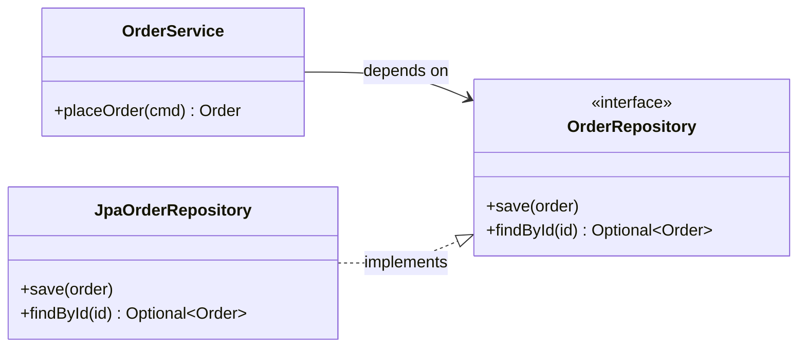

## Simple definition

**SOLID** is an acronym for five object-oriented design principles. Each one keeps code easy to change:

| Letter | Principle | One-line summary |
|---|---|---|
| **S** | Single Responsibility | A module should have one reason to change — one actor it answers to. |
| **O** | Open/Closed | Add behaviour by adding code, not by editing working code. |
| **L** | Liskov Substitution | A subtype must be usable anywhere its supertype is expected. |
| **I** | Interface Segregation | Clients should not depend on methods they do not use. |
| **D** | Dependency Inversion | Policy should not depend on details; both depend on abstractions. |

Robert C. Martin collected these principles around 2000. Michael Feathers later arranged them into the SOLID acronym.

## Problem statement

Code rarely fails because it was hard to write. It fails because it becomes hard to *change*. The typical symptoms are:

- **Rigidity:** a small change forces edits in many places.
- **Fragility:** a change in one place breaks something unrelated.
- **Immobility:** a useful piece cannot be reused because it drags its dependencies along.

Each SOLID principle targets one cause of these symptoms.

## Why it matters

SOLID is the bridge between general object-oriented concepts and concrete design patterns. Strategy, Decorator and Template Method are ways of satisfying the Open/Closed Principle. Adapter, and every port in [Hexagonal Architecture](/hexagonal-architecture/layered-vs-hexagonal), apply Dependency Inversion. Understanding the principles lets you derive the patterns instead of memorising them.

## S — Single Responsibility Principle

### What it says

Martin's later and more precise wording (*Clean Architecture*, 2017) is: **"A module should be responsible to one, and only one, actor."** An *actor* is a group of people who request changes, such as finance, operations or marketing. The common shorthand "a class should do one thing" is misleading. Instead, ask *who* would ask for this code to change.

### Example

```java
// Three actors share one class:
// finance (pay rules), HR (reporting format), DBAs (storage).
class Employee {
    Money calculatePay() { ... }        // finance
    String formatHoursReport() { ... }  // HR
    void save() { ... }                 // database administrators
}
```

A change that finance requests, such as a new overtime rule, is now deployed together with HR's report code and can break it. Separate the responsibilities:

```java
record Employee(EmployeeId id, String name, List<TimeEntry> hours) { }

final class PayCalculator   { Money payFor(Employee e) { ... } }
final class HoursReporter   { String reportFor(Employee e) { ... } }
interface EmployeeRepository { void save(Employee e); }
```

> [!MISTAKE] Splitting by verbs
> SRP is not "one method per class". Splitting cohesive code that always changes together creates scattered logic and more coupling, not less. Group code by *reason to change*.

## O — Open/Closed Principle

### What it says

**Software entities should be open for extension but closed for modification** (Bertrand Meyer, 1988). In practice: when requirements add a *new variant*, you should be able to add a new class rather than edit a stable one.

### Example

```java
// Closed for extension: every new discount type edits this method.
BigDecimal discount(Cart cart, String type) {
    if (type.equals("PERCENT")) { ... }
    else if (type.equals("BULK")) { ... }
    // next promotion: edit again, retest everything
}
```

```java
// Open for extension: new promotions are new classes.
interface DiscountPolicy { BigDecimal discountFor(Cart cart); }

record PercentageDiscount(int percent) implements DiscountPolicy { ... }
record BulkDiscount(int minItems, BigDecimal amountOff) implements DiscountPolicy { ... }
```

This is exactly the [Strategy pattern](/design-patterns/behavioral/strategy). Decorator, Template Method, Observer and Visitor each provide an extension point in a different way.

> [!TRADEOFF] You cannot be closed against everything
> Every extension point is a guess about what will vary. Add one when a second real variant appears, not in anticipation of variants that may never come.

## L — Liskov Substitution Principle

### What it says

Barbara Liskov (1987; formalised with Jeannette Wing in 1994): if `S` is a subtype of `T`, a program that uses `T` must keep working correctly when given an `S`. A subtype must honour the supertype's **contract**:

- it must not strengthen preconditions (accept less);
- it must not weaken postconditions (promise less);
- it must preserve invariants;
- it must not throw new kinds of exceptions that callers cannot expect.

### Example

The classic violation is a `Square` that extends a mutable `Rectangle`:

```java
class Rectangle {
    protected int width, height;
    void setWidth(int w)  { width = w; }
    void setHeight(int h) { height = h; }
    int area() { return width * height; }
}

class Square extends Rectangle {
    @Override void setWidth(int w)  { width = w; height = w; }  // keeps the square square...
    @Override void setHeight(int h) { width = h; height = h; }  // ...but breaks Rectangle's contract
}

void resize(Rectangle r) {
    r.setWidth(5);
    r.setHeight(4);
    assert r.area() == 20;   // fails for a Square: area is 16
}
```

A square *is a* rectangle in geometry, but a mutable `Square` cannot honour the behaviour that callers of a mutable `Rectangle` rely on. The fix is to model the types differently. For example, use immutable shapes behind a common `Shape` interface, or a sealed hierarchy where neither type extends the other.

> [!KEY] A real JDK example
> `List.of(...)` and `Collections.unmodifiableList(...)` return `List`s whose `add` method throws `UnsupportedOperationException`. The `List` interface documents `add` as an *optional operation*, so this is technically within the contract. It is still a well-known source of runtime surprises, and it shows why contracts must be explicit.

## I — Interface Segregation Principle

### What it says

**Clients should not be forced to depend on methods they do not use.** Prefer several small, role-specific interfaces to one large one.

### Example

```java
// One "fat" interface: a read-only report job now depends on delete().
interface OrderStore {
    Optional<Order> findById(OrderId id);
    List<Order> findByCustomer(CustomerId id);
    void save(Order order);
    void delete(OrderId id);
}
```

```java
// Role interfaces: each client depends only on what it needs.
interface OrderReader { Optional<Order> findById(OrderId id); List<Order> findByCustomer(CustomerId id); }
interface OrderWriter { void save(Order order); void delete(OrderId id); }

final class JpaOrderStore implements OrderReader, OrderWriter { ... }  // one class can implement both
```

The benefits are smaller test doubles, clearer intent, and fewer recompilations or redeployments when an unrelated method changes. The [hexagonal example](/hexagonal-architecture/spring-boot-implementation) applies ISP: it defines separate `PlaceOrderUseCase` and `GetOrderQuery` ports.

## D — Dependency Inversion Principle

### What it says

1. **High-level modules should not depend on low-level modules. Both should depend on abstractions.**
2. **Abstractions should not depend on details. Details should depend on abstractions.**

"High-level" means business policy, such as placing an order. "Low-level" means mechanisms, such as JDBC, HTTP clients or message brokers. The important word is *inversion*. The abstraction is owned by the high-level module and expressed in its terms. The low-level module implements it, so the source-code dependency points *against* the flow of control.



`OrderService` calls the database at runtime, but in the source code the JPA class depends on the service's interface, not the other way round. You can replace JPA with JDBC, or with an in-memory fake in tests, without touching `OrderService`.

> [!MISTAKE] DIP is not "add an interface everywhere"
> An interface placed *next to its only implementation*, in the low-level package, and shaped like that implementation, inverts nothing. The abstraction must belong to the client and speak the client's language. Also, depending directly on stable abstractions such as `java.util.List` or `java.time.Clock` is fine.

### DIP versus Dependency Injection

They are related but different:

- **Dependency Inversion** is a *design principle* about which way source-code dependencies point.
- **Dependency Injection** is a *technique* for supplying an object's dependencies from outside, for example through its constructor.

DI is the usual way to *wire* a design that follows DIP. See [Dependency Injection in Java](/spring/core/dependency-injection).

## How SOLID maps to design patterns

| Principle | Patterns that put it into practice |
|---|---|
| SRP | Facade (separates a client-facing API from subsystem details), Command (separates the request from the executor) |
| OCP | Strategy, Decorator, Template Method, Observer, Visitor, Chain of Responsibility |
| LSP | Every pattern that relies on polymorphism assumes it — Composite, Proxy and Decorator in particular |
| ISP | Adapter (presents only the interface the client needs), role-specific ports |
| DIP | Factory Method, Abstract Factory, Adapter, and ports and adapters in general |

## Real-world applications

- **Spring** applications rely on DIP and DI: services depend on interfaces, and the container supplies implementations.
- **JDBC** follows DIP at platform scale. Your code depends on `java.sql.Connection`, and each database vendor's driver implements it.
- **Servlet filters** and **Spring Security filters** follow OCP. You add a filter to the chain instead of modifying the request-processing code.

## Advantages and disadvantages

| Advantages | Disadvantages |
|---|---|
| Changes stay local; less rigidity and fragility | Applied mechanically, they produce many tiny types and indirection |
| Code becomes testable with simple fakes | Abstractions guessed too early are usually wrong and costly to undo |
| Clear vocabulary for design reviews | Principles conflict at times — e.g. ISP's small interfaces vs. cohesion |

## Common mistakes

- **Treating SOLID as rules instead of heuristics.** Each principle trades simplicity for flexibility. Spend that only where change actually happens.
- **Interfaces with a single implementation everywhere.** An interface is justified when it supports a second implementation, such as a test fake, protects a boundary, or inverts a dependency. Otherwise it is noise.
- **Inheritance for code reuse.** Reusing code through `extends` is the most common route to LSP violations. Prefer composition.
- **Confusing DIP with DI or IoC.** Know the difference; interviewers ask about it often.

## Interview questions and answers

**What does the Single Responsibility Principle really mean?**
A module should answer to one actor — one source of change requests. "Do one thing" is an oversimplification. The test is whether two pieces of code change for the same reason, at the same time, at the request of the same people.

**Give an example of a Liskov violation.**
A mutable `Square extends Rectangle` whose setters change both dimensions. Code that sets width and height independently breaks when given a `Square`. Another example: a subclass method that throws `UnsupportedOperationException` for an operation that callers of the supertype rely on.

**How do the Open/Closed Principle and the Strategy pattern relate?**
Strategy is one concrete way to achieve OCP. The context class is closed for modification, and new behaviour is added as new strategy classes.

**What is the difference between Dependency Inversion and Dependency Injection?**
DIP is a principle: high-level policy owns abstractions, and low-level details implement them. DI is a technique for passing dependencies in from outside. You can use DI without following DIP, for example by injecting concrete classes. You can also follow DIP while wiring dependencies by hand.

> [!INTERVIEW] Bring a trade-off
> After explaining a principle, name its cost. "OCP adds extension points; I add them when a second variant shows up rather than speculatively." This shows the judgement interviewers look for.

## Summary

- SOLID is five heuristics for code that stays easy to change.
- SRP is about actors and reasons to change, not "one method per class".
- OCP, LSP and DIP are what make polymorphism-based patterns such as Strategy and Adapter work.
- ISP keeps interfaces client-shaped. DIP makes the policy own its abstractions.
- Apply the principles where change actually happens, and keep everything else simple.

## Related topics

- [What Are Design Patterns?](/design-patterns/what-are-design-patterns)
- [Strategy Pattern](/design-patterns/behavioral/strategy) (OCP in practice)
- [Dependency Injection in Java](/spring/core/dependency-injection) (wiring DIP)
- [Layered versus Hexagonal Architecture](/hexagonal-architecture/layered-vs-hexagonal) (DIP at architecture scale)

## References

- Robert C. Martin. "Design Principles and Design Patterns", 2000.
- Robert C. Martin. *Clean Architecture*. Prentice Hall, 2017 (chapters 7–11).
- Bertrand Meyer. *Object-Oriented Software Construction*. Prentice Hall, 1988.
- Barbara Liskov and Jeannette Wing. "A Behavioral Notion of Subtyping". *ACM TOPLAS*, 1994.
- [Java SE 21 `List` interface documentation](https://docs.oracle.com/en/java/javase/21/docs/api/java.base/java/util/List.html) (optional operations and unmodifiable lists)
