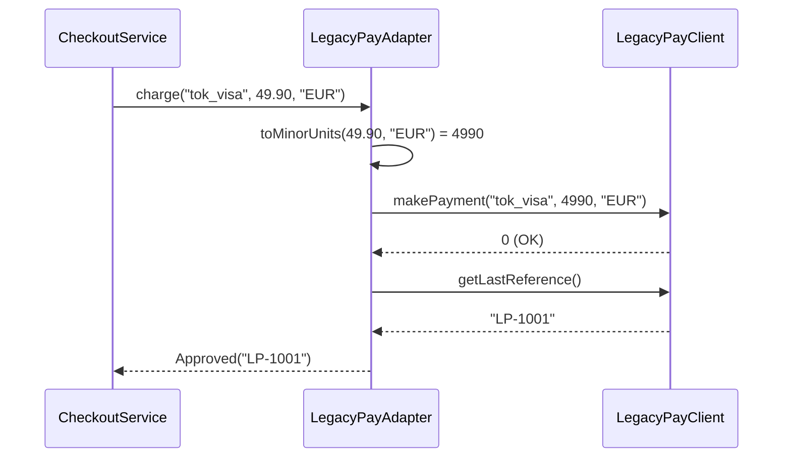

## Simple definition

The **Adapter** pattern lets code work with a class whose interface does not match what the code expects. The adapter implements the interface the client wants and translates every call into the interface the existing class provides.

GoF intent: *"Convert the interface of a class into another interface clients expect. Adapter lets classes work together that couldn't otherwise because of incompatible interfaces."* It is also known as **Wrapper**.

## The problem

A checkout service needs to charge customers. The company has a contract with a payment provider whose Java SDK, `LegacyPayClient`, was designed years ago with conventions that clash with the rest of the codebase:

| Our code expects | The SDK provides |
|---|---|
| `BigDecimal` amounts in major units (`49.90`) | `long` amounts in minor units (`4990` cents) |
| A typed result: approved or declined | An `int` status code (`0`, `51`, `54`) |
| Unchecked, domain-level exceptions | A checked `LegacyPayException` |
| The transaction ID in the result | A separate `getLastReference()` call |

If `CheckoutService` calls the SDK directly, these conventions spread through business code. Tests need the real SDK. Switching provider later would touch every caller.

## Real-world analogy

A travel plug adapter. Your laptop charger (the client) expects a particular socket shape (the target interface). The hotel wall socket (the adaptee) provides electricity in a different shape. The adapter changes the *shape* of the connection without changing the laptop or the wall.

## Structure

- **Target** — the interface the client uses, defined in the client's terms (`PaymentGateway`).
- **Client** — code that uses the target (`CheckoutService`).
- **Adaptee** — the existing class with the incompatible interface (`LegacyPayClient`).
- **Adapter** — implements the target and delegates to the adaptee (`LegacyPayAdapter`).

```mermaid {title="Adapter — class diagram of the example (object adapter)"}
classDiagram
    direction LR
    class CheckoutService {
        -PaymentGateway gateway
        +pay(String, BigDecimal) String
    }
    class PaymentGateway {
        <<interface>>
        +charge(String, BigDecimal, String) PaymentResult
    }
    class LegacyPayAdapter {
        -LegacyPayClient client
        +charge(String, BigDecimal, String) PaymentResult
        -toMinorUnits(BigDecimal, String)$ long
    }
    class LegacyPayClient {
        +makePayment(String, long, String) int
        +getLastReference() String
    }
    CheckoutService --> PaymentGateway : uses
    PaymentGateway <|.. LegacyPayAdapter
    LegacyPayAdapter --> LegacyPayClient : delegates to
```



## Java implementation

The code is in `examples/java/src/hub/patterns/adapter/`, compiled and run by CI with Java 21.

### Target: the interface we want



The result is a **sealed interface** with two records. The compiler can therefore check that every `switch` over a result handles both cases (Java 21 pattern matching for `switch`).

### Adaptee: the SDK we cannot change



### Adapter



### Client



### Running it





## Step-by-step walkthrough

1. **Define the target in your own terms first.** `PaymentGateway` is designed for what checkout needs, not copied from the SDK. This is the most important decision: a target that mirrors the adaptee adapts nothing.
2. **Translate units safely.** `toMinorUnits` asks `java.util.Currency` how many fraction digits the currency has — 2 for EUR, 0 for JPY. `RoundingMode.UNNECESSARY` throws if the amount has more decimals than the currency allows, instead of silently rounding money.
3. **Translate status codes into types.** The magic numbers `0`, `51` and `54` are mapped to `Approved` and `Declined`. An unknown code becomes a decline with a diagnostic reason, not an exception that would crash checkout.
4. **Translate exceptions.** The SDK's checked `LegacyPayException` is wrapped in `PaymentGatewayException`, keeping the original as the *cause* for debugging. Callers no longer depend on vendor exception types.
5. **Hide awkward call sequences.** The SDK needs a second call, `getLastReference()`, to obtain the transaction ID. The adapter combines both calls into one result.
6. **The client never sees the adaptee.** `CheckoutService` depends only on `PaymentGateway`. In tests it can receive a lambda or a stub instead of the SDK.

> [!WARNING] Adapters inherit the adaptee's concurrency limits
> `LegacyPayClient` stores `lastReference` in a field, so two threads sharing one client can read each other's references. An adapter that will be shared — for example, as a Spring singleton bean — must account for this: create a client per call, synchronise, or use a thread-safe SDK method if one exists. Read the SDK's threading documentation before wrapping it.

## Object adapter versus class adapter

The GoF book describes two forms:

| | Object adapter | Class adapter |
|---|---|---|
| Mechanism | Holds a reference to the adaptee (composition) | Extends the adaptee and implements the target (inheritance) |
| Works with subclasses of the adaptee | Yes — any instance can be passed in | No — bound to one concrete class |
| Can override adaptee behaviour | No | Yes |
| Exposes the adaptee's public methods | No | Yes, unintentionally |
| Usual choice in Java | **Yes** | Rarely |

Java allows only one superclass, and a class adapter leaks the adaptee's methods to every caller. The object adapter is the default choice; this example uses it.

## Advantages and disadvantages

| Advantages | Disadvantages |
|---|---|
| Reuses existing code you cannot or should not change | An extra class and a level of indirection |
| Keeps vendor conventions out of business code | Translation can be lossy; some adaptee features may not fit the target |
| Clients can be tested with simple fakes of the target | Several adapters around one adaptee can duplicate translation logic |
| Swapping the vendor means writing a new adapter only | A poorly designed target just moves the mess into the adapter |

## When to use it

- Integrating a third-party library, legacy module or external API whose interface does not match yours.
- Isolating code from a dependency that is likely to change, such as a payment or messaging provider.
- Implementing the outbound ports of [Hexagonal Architecture](/hexagonal-architecture/layered-vs-hexagonal), where every outbound adapter is an Adapter in the GoF sense.
- Making several similar services, such as two payment providers, usable through one interface.

## When not to use it

- You own both sides and can simply change one of the interfaces.
- The interfaces already match. A pass-through wrapper adds indirection without value.
- You need to *add* behaviour, not translate it — that is a Decorator. To *simplify* a whole subsystem, use a Facade. See [the comparison](/comparisons/adapter-decorator-proxy-facade).

## Common implementation mistakes

> [!MISTAKE] A target interface copied from the adaptee
> If `PaymentGateway.charge` took `long amountInCents` and returned `int`, the adapter would only forward calls. The value of the pattern comes from designing the target around *your* needs.

- **Leaking adaptee types.** Returning SDK objects or throwing SDK exceptions through the target defeats the isolation.
- **Silent lossy conversions.** Rounding money, truncating strings or ignoring unknown status codes without a trace creates bugs that are hard to diagnose.
- **Business rules in the adapter.** The adapter should translate, not decide. A rule such as "retry declined payments twice" belongs in the application, not in the vendor wrapper.
- **Untested adapters.** Adapters contain real logic — unit conversion, code mapping — and need their own tests against the adaptee or a contract test.

## Relationship to SOLID

- **Dependency Inversion:** the client depends on an abstraction it owns (`PaymentGateway`), not on the vendor's concrete class.
- **Single Responsibility:** translation is the adapter's only job.
- **Open/Closed:** a new provider means a new adapter; `CheckoutService` does not change.
- **Interface Segregation:** the target exposes only what clients need, not every SDK method.

## Comparison with similar patterns

| Pattern | Interface relative to the wrapped object | Purpose |
|---|---|---|
| **Adapter** | *Different* | Make an incompatible interface usable |
| **Decorator** | *Same* | Add behaviour, can be stacked |
| **Proxy** | *Same* | Control access: lazy loading, security, remote calls, transactions |
| **Facade** | *New, simpler* | One entry point to a whole subsystem |
| **Bridge** | Designed up front | Separate abstraction from implementation *before* they diverge; Adapter fixes the mismatch *afterwards* |

A full side-by-side treatment, with code, is in [Adapter vs Decorator vs Proxy vs Facade](/comparisons/adapter-decorator-proxy-facade).

At the architecture level, Domain-Driven Design's **Anti-Corruption Layer** applies the same idea to a whole model: it translates another [bounded context's](/domain-driven-design/strategic/bounded-context) language into yours. It is usually built from adapters, facades and translators.

## Real-world uses

- `java.util.Arrays.asList(array)` presents an array as a `List`.
- `java.io.InputStreamReader` adapts a byte stream (`InputStream`) to a character stream (`Reader`).
- `java.util.Collections.enumeration(collection)` adapts a `Collection` to the legacy `Enumeration` interface.
- Spring MVC's `HandlerAdapter` lets the `DispatcherServlet` invoke different kinds of handler through one interface.
- Every outbound adapter in the [Hexagonal Architecture example](/hexagonal-architecture/spring-boot-implementation).

## Interview questions and answers

**What is the Adapter pattern?**
A structural pattern that converts the interface of an existing class into the interface a client expects. The adapter implements the target interface and delegates to the adaptee, translating calls, data and errors.

**What is the difference between an object adapter and a class adapter?**
An object adapter holds a reference to the adaptee. A class adapter inherits from it. In Java, object adapters are preferred: they work with any subclass of the adaptee and do not expose its methods.

**How is Adapter different from Decorator and Proxy?**
All three wrap another object. An adapter changes the interface. A decorator keeps the interface and adds behaviour. A proxy keeps the interface and controls access to the real object.

**Where do you see adapters in Hexagonal Architecture?**
Every adapter that implements an outbound port is a GoF Adapter: it translates the application's port interface into a technology's API, such as JPA or an HTTP client. Inbound adapters, such as REST controllers, translate the other way.

**What should an adapter not do?**
It should not contain business rules. It translates; decisions belong in the application or domain layer.

> [!INTERVIEW] Talk about translation, not just delegation
> A weak answer says "the adapter calls the other class". A strong answer lists what is translated: units, data types, error codes, exceptions and call sequences. That shows you have written one.

## Summary

- Adapter makes an existing class usable through an interface it does not implement.
- Design the target interface around the client's needs; the adapter absorbs the mismatch.
- Prefer object adapters (composition) in Java.
- Adapters translate; they do not add behaviour (Decorator), control access (Proxy) or simplify subsystems (Facade).

## Related topics

- [Adapter vs Decorator vs Proxy vs Facade](/comparisons/adapter-decorator-proxy-facade)
- [Layered versus Hexagonal Architecture](/hexagonal-architecture/layered-vs-hexagonal)
- [What Is a Bounded Context?](/domain-driven-design/strategic/bounded-context) — and the Anti-Corruption Layer
- [All 23 GoF Patterns: Overview](/design-patterns/gof-overview)

## References

- Gamma, Helm, Johnson, Vlissides. *Design Patterns*. Addison-Wesley, 1994. Adapter, p. 139.
- Eric Evans. *Domain-Driven Design*. Addison-Wesley, 2003. Chapter 14: Anti-Corruption Layer.
- [`java.util.Currency`](https://docs.oracle.com/en/java/javase/21/docs/api/java.base/java/util/Currency.html), Java SE 21 API.
- [JEP 441: Pattern Matching for switch](https://openjdk.org/jeps/441) (final in Java 21).
