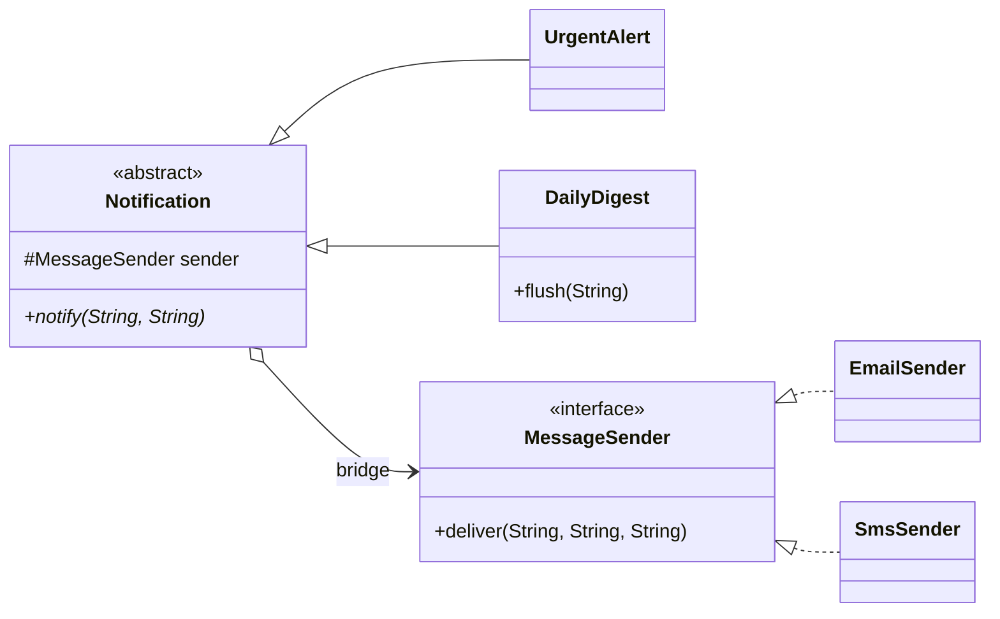

## Simple definition

The **Bridge** pattern separates *what* something does (the **abstraction**) from *how* it is done (the **implementation**) into two class hierarchies. The abstraction holds a reference to an implementation object; that reference is the "bridge". Both sides can then be extended independently.

GoF intent: *"Decouple an abstraction from its implementation so that the two can vary independently."* It is also known as **Handle/Body**.

## The problem

A system sends notifications. There are kinds of notification (urgent alerts, daily digests) and channels (email, SMS). Modelling this with inheritance alone gives a class per combination:

```text
Notification
├── UrgentEmailAlert   ├── UrgentSmsAlert   ├── UrgentSlackAlert
└── EmailDigest        └── SmsDigest        └── SlackDigest
```

Two kinds × three channels = six classes, and each new kind or channel multiplies the count. This is the **class explosion** problem: two independent dimensions of variation are tangled into one hierarchy, and logic is duplicated across the combinations.

## Real-world analogy

A universal remote control and the devices it controls. "Remote" (basic, advanced with macros) and "device" (TV, radio, projector) vary independently. Any remote works with any device through an agreed interface. You do not need an "advanced TV remote" class.

## Structure

- **Abstraction** (`Notification`) — the high-level interface; holds a reference to an implementor.
- **Refined abstraction** (`UrgentAlert`, `DailyDigest`) — variants of the abstraction.
- **Implementor** (`MessageSender`) — the low-level interface the abstraction uses.
- **Concrete implementor** (`EmailSender`, `SmsSender`).



## Java implementation

The code is in `examples/java/src/hub/patterns/bridge/BridgeDemo.java`.

### Implementor: the "how"



### Abstraction: the "what"





Four combinations run from four classes. Adding Slack is one new `MessageSender`; adding "weekly report" is one new `Notification` subclass. With inheritance only, either change would need a class per combination.

## Step-by-step walkthrough

1. **Find the two dimensions.** Ask "what varies?" twice. Here: the *kind* of notification and the *channel*.
2. **Define the implementor interface in primitive terms.** `deliver(recipient, subject, body)` is a low-level operation every channel can provide.
3. **Build the abstraction on top of the primitives.** `UrgentAlert` repeats delivery; `DailyDigest` batches. Neither knows which channel it uses.
4. **Compose at runtime.** `new UrgentAlert(new SmsSender())`. The combination is chosen by the caller, or by an [Abstract Factory](/design-patterns/creational/abstract-factory) or DI configuration.

## Bridge versus similar patterns

| Pattern | Structure | Key difference |
|---|---|---|
| **Bridge** | Abstraction holds an implementor | Designed **up front** to let two hierarchies vary independently |
| **[Adapter](/design-patterns/structural/adapter)** | Wrapper holds an adaptee | Applied **after the fact** to make an existing mismatched interface fit |
| **[Strategy](/design-patterns/behavioral/strategy)** | Context holds a strategy | Same shape; Strategy swaps one *algorithm*, Bridge separates a whole *implementation platform*, and the abstraction side usually has its own hierarchy too |

> [!KEY] Bridge is "composition over inheritance" applied to two dimensions
> Whenever a hierarchy is growing by multiplication (`A1B1`, `A1B2`, `A2B1`...), extract one dimension into its own interface and compose.

## Advantages and disadvantages

| Advantages | Disadvantages |
|---|---|
| Avoids class explosion; extensions are additive | More interfaces and indirection than a single class |
| Abstraction and implementation evolve and are released independently | Designing a good implementor interface takes thought; too narrow and features are lost, too wide and implementors suffer |
| Implementation can be switched at runtime | Unnecessary if there is only one dimension of variation |
| Hides platform details from clients | — |

## When to use it

- A class varies in two (or more) orthogonal dimensions.
- You want to switch implementations at runtime, or share one implementation among several abstractions.
- Platform independence: the abstraction runs on several back ends (databases, graphics APIs, operating systems, message channels).

## When not to use it

- Only one dimension varies: a simple interface (or Strategy) is enough.
- The two dimensions are not really independent; some combinations are invalid.

## Common mistakes

> [!MISTAKE] An implementor interface that mirrors one implementation
> If `MessageSender` had `sendSmtpMessage(...)`, every non-email channel would have to fake SMTP concepts. Design the implementor around primitives that all platforms can offer.

- **Letting the abstraction check the implementor's type** (`if (sender instanceof SmsSender)`), which re-couples the hierarchies.
- **Creating the implementor inside the abstraction** with `new`; pass it in so it can vary.

## Real-world uses

- **JDBC:** `java.sql.Connection`, `Statement` and `ResultSet` are the abstraction applications use; each vendor's driver is the implementation. The `DriverManager` connects them.
- **SLF4J:** your code logs through the SLF4J API; Logback or Log4j 2 is the bridged implementation.
- **AWT peers:** each `java.awt.Component` delegates to a platform-specific peer.
- Spring's `JdbcTemplate` over any `DataSource`, and `RestClient` over a pluggable `ClientHttpRequestFactory`.

## Interview questions and answers

**What problem does Bridge solve?**
Class explosion when a type varies in two independent dimensions. It separates them into two hierarchies connected by composition.

**What is the difference between Bridge and Adapter?**
Bridge is designed in advance so abstraction and implementation can vary independently. Adapter is applied afterwards to make an existing class with an incompatible interface usable.

**What is the difference between Bridge and Strategy?**
The object structure is similar. Strategy encapsulates one interchangeable algorithm used by a context. Bridge separates an entire abstraction hierarchy from an implementation hierarchy, usually for platform independence.

**Give a JDK example.**
JDBC: applications program against `java.sql` interfaces, and vendor drivers provide the implementations.

## Summary

- Bridge splits two independent dimensions of variation into two hierarchies.
- The abstraction holds a reference to an implementor: that is the bridge.
- It replaces multiplication of subclasses with addition.
- JDBC drivers and logging facades are everyday Bridges.

## Related topics

- [Adapter Pattern](/design-patterns/structural/adapter)
- [Strategy Pattern](/design-patterns/behavioral/strategy)
- [Abstract Factory Pattern](/design-patterns/creational/abstract-factory)
- [Adapter vs Decorator vs Proxy vs Facade](/comparisons/adapter-decorator-proxy-facade)

## References

- Gamma, Helm, Johnson, Vlissides. *Design Patterns*. Addison-Wesley, 1994. Bridge, p. 151.
- Eric Freeman, Elisabeth Robson. *Head First Design Patterns* (2nd edition). O'Reilly, 2020. Appendix: Leftover patterns — Bridge.
