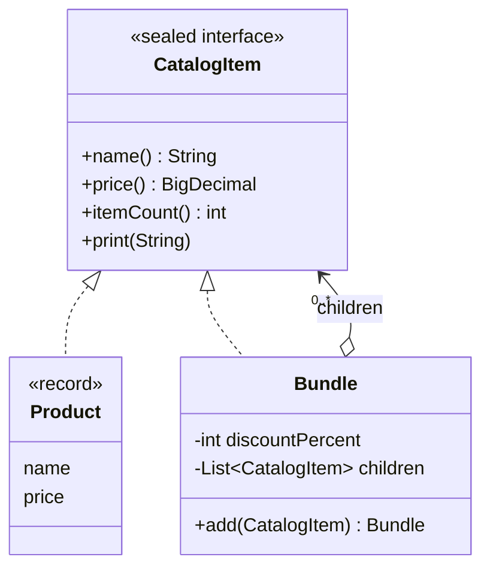

## Simple definition

The **Composite** pattern arranges objects in a **tree** and gives single objects (leaves) and groups (composites) the **same interface**. Client code can then call `price()` on a single product or on a bundle of bundles without caring which it has.

GoF intent: *"Compose objects into tree structures to represent part-whole hierarchies. Composite lets clients treat individual objects and compositions of objects uniformly."*

## The problem

An online shop sells products and **bundles**. A bundle contains products and other bundles, and applies its own discount. A cart can hold both.

Without Composite, every piece of code that computes a price, counts items or prints the cart needs `if (item instanceof Bundle) { loop over children... recursively }`. That recursion and type-checking is duplicated in every operation, and adding a new kind of item touches all of them.

## Real-world analogy

A company organisation chart. You can ask any unit, from a single employee to the whole division, "what is your salary cost?" An employee answers directly; a department asks each of its members and sub-departments and adds up the answers.

## Structure

- **Component** (`CatalogItem`) — the common interface.
- **Leaf** (`Product`) — has no children; does the work itself.
- **Composite** (`Bundle`) — stores children and implements operations by delegating to them.
- **Client** — works only with `CatalogItem`.

The recursive arrow from `Bundle` back to `CatalogItem` is the heart of the pattern: a composite contains components, which may themselves be composites.

## Java implementation

The code is in `examples/java/src/hub/patterns/composite/CompositeDemo.java`.









The cart total adds a three-level bundle and a single cable with one expression: `cart.stream().map(CatalogItem::price)`. The peripherals kit is discounted 10% inside the office bundle, which is then discounted another 5%.

## Step-by-step walkthrough

1. **Define the component interface** with operations that make sense for both leaves and groups: price, item count, printing.
2. **Leaves implement them directly.** A `Product` returns its own price.
3. **Composites implement them by delegating** to children and combining the results (sum, then discount).
4. **Recursion is implicit.** `Bundle.price()` calls `child.price()`; if the child is a bundle, it recurses. No caller writes a loop over levels.
5. **Sealed interface.** `sealed ... permits Product, Bundle` documents the closed set of node types and lets `switch` expressions over `CatalogItem` be checked for exhaustiveness.

## Transparency versus safety

Where do child-management methods (`add`, `remove`) go?

| Design | `add()` declared on | Benefit | Cost |
|---|---|---|---|
| **Transparency** (GoF default) | The component interface | Clients treat everything uniformly | Leaves must reject `add()` at runtime |
| **Safety** (this example) | Only the composite | The compiler prevents adding to a leaf | Clients must know they hold a composite to add children |

Modern Java code usually prefers **safety**: build trees with the concrete composite type, then pass them around as the component type.

## Advantages and disadvantages

| Advantages | Disadvantages |
|---|---|
| Uniform treatment of single objects and groups simplifies clients | The component interface can become too general for some leaves |
| New leaf or composite types fit without client changes | Hard to restrict which children a composite may contain (type rules move to runtime checks) |
| Natural fit for recursive data: files, UI trees, ASTs, org charts | Deep trees can be expensive to traverse repeatedly; consider caching aggregate values |

## When to use it

- Your data is a part-whole hierarchy (a tree) and clients should not care about the difference.
- Operations naturally aggregate over children: totals, rendering, validation, permissions.

## When not to use it

- The structure is flat, or leaves and groups behave very differently.
- You need many unrelated operations over the tree: consider pairing Composite with [Visitor](/design-patterns/behavioral/visitor), or a sealed hierarchy with pattern matching.

## Common mistakes

> [!MISTAKE] Cycles in the tree
> Adding a bundle to itself, directly or indirectly, makes `price()` recurse forever. Composites that accept arbitrary children should check for cycles or build trees immutably from the bottom up.

- **Type checks in clients** (`instanceof Bundle`) defeat the purpose.
- **Exposing the mutable children list**, letting callers bypass the composite's rules.
- **Parent pointers out of sync** when children move, if you maintain them.

## Real-world uses

- **Files and directories:** `java.nio.file.Path` trees; a directory's size is the sum of its contents.
- **UI toolkits:** `java.awt.Container` is a `Component` that contains components; the same for JavaFX `Parent` and HTML's DOM.
- **Spring:** `CompositeCacheManager`, `CompositePropertySource`, `CompositeHealthContributor` in Actuator, and Spring Security's `DelegatingAuthenticationEntryPoint` treat many delegates as one.
- **Compilers and query languages:** abstract syntax trees, such as the rule tree in the [Interpreter example](/design-patterns/behavioral/interpreter).

## Interview questions and answers

**What is the Composite pattern?**
A structural pattern that composes objects into trees and gives leaves and composites a common interface, so clients treat them uniformly.

**What is the difference between transparency and safety in Composite?**
Transparency puts child-management methods on the component so all nodes look alike; safety puts them only on composites so the compiler prevents misuse.

**How does Composite relate to Decorator?**
Both use recursive composition. A decorator wraps exactly one component to add behaviour; a composite holds many children to aggregate them.

**Give a JDK example.**
`java.awt.Container` extends `Component` and holds child components.

## Summary

- Composite represents part-whole hierarchies as trees.
- Leaves and composites share one interface; composites delegate to children.
- Prefer the safe variant and sealed interfaces in modern Java.
- Common in files, UI trees, ASTs and "composite" Spring infrastructure classes.

## Related topics

- [Visitor Pattern](/design-patterns/behavioral/visitor) — operations over composite trees
- [Iterator Pattern](/design-patterns/behavioral/iterator) — traversing them
- [Decorator Pattern](/design-patterns/structural/decorator)
- [Compound patterns and MVC](/design-patterns/compound-patterns-mvc) — the view in MVC is a composite

## References

- Gamma, Helm, Johnson, Vlissides. *Design Patterns*. Addison-Wesley, 1994. Composite, p. 163.
- Eric Freeman, Elisabeth Robson. *Head First Design Patterns* (2nd edition). O'Reilly, 2020. Chapter 9 (menus and menu items).
