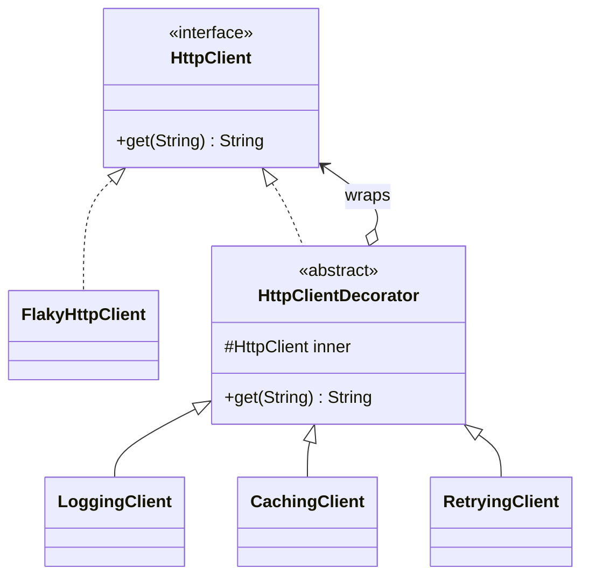

## Simple definition

The **Decorator** pattern adds behaviour to an object by **wrapping** it in another object that implements the **same interface**. The wrapper does its extra work and forwards the call to the wrapped object. Wrappers can be stacked, and each adds one responsibility.

GoF intent: *"Attach additional responsibilities to an object dynamically. Decorators provide a flexible alternative to subclassing for extending functionality."* It is also known as **Wrapper**.

## The problem

An HTTP client must sometimes log requests, sometimes cache responses, sometimes retry failures, and sometimes all three. Using inheritance:

```text
HttpClient
├── LoggingHttpClient
├── CachingHttpClient
├── RetryingHttpClient
├── LoggingCachingHttpClient
├── LoggingRetryingHttpClient
├── CachingRetryingHttpClient
└── LoggingCachingRetryingHttpClient
```

Three features need seven subclasses, and the combination is fixed at compile time. Head First's coffee-shop example makes the same point with condiments: every combination of milk, mocha and whip becomes a class.

## Real-world analogy

Clothing. You wear a shirt, then a jumper over it, then a raincoat. Each layer adds a capability (warmth, waterproofing) without changing the person underneath, and you choose the layers each morning.

## Structure

- **Component** (`HttpClient`) — the interface clients use.
- **Concrete component** (`FlakyHttpClient`) — the real object.
- **Decorator** (`HttpClientDecorator`) — implements the component and holds a component.
- **Concrete decorators** (`LoggingClient`, `CachingClient`, `RetryingClient`) — each adds one behaviour around the forwarded call.



`HttpClientDecorator` both **is** an `HttpClient` and **has** an `HttpClient`. That double relationship is what allows stacking.

## Java implementation

The code is in `examples/java/src/hub/patterns/decorator/DecoratorDemo.java`.





### Stacking them





```mermaid {title="Decorator — the first request travels through the stack"}
sequenceDiagram
    participant C as Client
    participant L as LoggingClient
    participant K as CachingClient
    participant R as RetryingClient
    participant F as FlakyHttpClient
    C->>L: get("/products/42")
    L->>K: get(...)
    K->>R: get(...) (cache miss)
    R->>F: get(...)
    F--xR: IllegalStateException
    R->>F: get(...) (retry)
    F-->>R: 200 OK
    R-->>K: 200 OK
    K-->>L: 200 OK (now cached)
    L-->>C: 200 OK
```

## Order matters

The same three decorators in a different order produce different behaviour:

| Stack (outer → inner) | Effect |
|---|---|
| Logging → Caching → Retrying (example) | One log line per call; cache hits are logged; retries are invisible to the log |
| Retrying → Logging → Caching | Every retry attempt is logged |
| Caching → Retrying → Logging | Cache hits are not logged at all |
| Logging → Retrying → Caching | A failure is not cached, but a retry may hit a cache filled by another call |

Decide the order deliberately and build it in one place (a factory or configuration class). Resilience4j documents its own fixed order for the same reason, see [Circuit Breakers and Resilience4j](/microservices/reliability/circuit-breakers-and-resilience4j).

## Decorator in java.io

`java.io` is the textbook Decorator:

```java
try (var in = new DataInputStream(
                  new BufferedInputStream(
                      new GZIPInputStream(
                          new FileInputStream("data.bin.gz"))))) {
    int version = in.readInt();
}
```

`FileInputStream` is the concrete component; `FilterInputStream` is the abstract decorator; `BufferedInputStream`, `GZIPInputStream` and `DataInputStream` each add one capability. The same structure appears in `Reader`/`BufferedReader` and in `Collections.unmodifiableList(list)` and `Collections.synchronizedList(list)`.

## Advantages and disadvantages

| Advantages | Disadvantages |
|---|---|
| Combine behaviours at runtime, in any order | Many small objects; stack traces and debugging get deeper |
| Each decorator has one responsibility (SRP) | Order dependencies are easy to get wrong |
| Extend behaviour without modifying the component (OCP) | Object identity differs: `decorated != original` |
| Avoids subclass explosion | Decorating a wide interface means forwarding many methods (use a base decorator) |

## When to use it

- Adding cross-cutting behaviour (logging, caching, retries, metrics, compression, encryption) to individual objects.
- Combinations of features that should be chosen at runtime.
- When subclassing is impossible (final classes) or impractical (combinatorial explosion).

## When not to use it

- The behaviour applies uniformly to many beans: Spring [AOP](/spring/core/aop-and-proxies) applies the same wrapping declaratively.
- You need to change the interface: that is an [Adapter](/design-patterns/structural/adapter).
- The extra logic controls *whether* the call happens (access, lazy creation): that is usually described as a [Proxy](/design-patterns/structural/proxy), though the code looks the same.

## Common mistakes

> [!MISTAKE] Forgetting to forward a method
> When the component interface has many methods and a decorator overrides only some, forgetting one silently bypasses the wrapped object or throws. Use an abstract base decorator that forwards everything.

- **Decorators that depend on a specific inner type**, which breaks reordering.
- **Leaking the inner object**, so callers bypass the decoration.
- **Relying on `equals` or identity** of decorated objects.

## Relationship to SOLID

- **Open/Closed:** new behaviour arrives as new decorator classes.
- **Single Responsibility:** each decorator does one thing.
- **Liskov Substitution:** a decorator must honour the component's contract, or stacking breaks.

## Real-world uses

- `java.io` streams, readers and writers.
- `Collections.unmodifiable*`, `Collections.synchronized*`, `Collections.checked*`.
- Spring: `TransactionAwareDataSourceProxy`, `LazyConnectionDataSourceProxy` and `ContentCachingRequestWrapper` (for `HttpServletRequest`); servlet `HttpServletRequestWrapper` itself.
- Resilience4j's `Decorators.ofSupplier(...).withRetry(...).withCircuitBreaker(...)` builder.

## Interview questions and answers

**What is the Decorator pattern?**
A structural pattern that adds responsibilities to an object at runtime by wrapping it in objects that implement the same interface and forward calls.

**Why prefer Decorator to inheritance?**
Inheritance fixes combinations at compile time and causes a subclass per combination; decorators combine freely at runtime and keep each behaviour in its own class.

**Give a JDK example.**
`new BufferedReader(new InputStreamReader(System.in))`. (Note that `InputStreamReader` is an adapter, and `BufferedReader` is a decorator.)

**How is Decorator different from Proxy?**
The structure is the same. A decorator *adds* behaviour and is usually stacked by the client; a proxy *controls access* to the real subject and often creates or manages it.

## Summary

- Decorator wraps an object in another with the same interface to add behaviour.
- Decorators are stackable; their order is part of the design.
- `java.io` is the classic example; Spring AOP is the declarative cousin.
- It replaces subclass explosion with composition.

## Related topics

- [Adapter vs Decorator vs Proxy vs Facade](/comparisons/adapter-decorator-proxy-facade)
- [Proxy Pattern](/design-patterns/structural/proxy)
- [AOP, Advice Types and Proxies](/spring/core/aop-and-proxies)
- [Circuit Breakers and Resilience4j](/microservices/reliability/circuit-breakers-and-resilience4j)

## References

- Gamma, Helm, Johnson, Vlissides. *Design Patterns*. Addison-Wesley, 1994. Decorator, p. 175.
- Eric Freeman, Elisabeth Robson. *Head First Design Patterns* (2nd edition). O'Reilly, 2020. Chapter 3 (Starbuzz Coffee and java.io).
