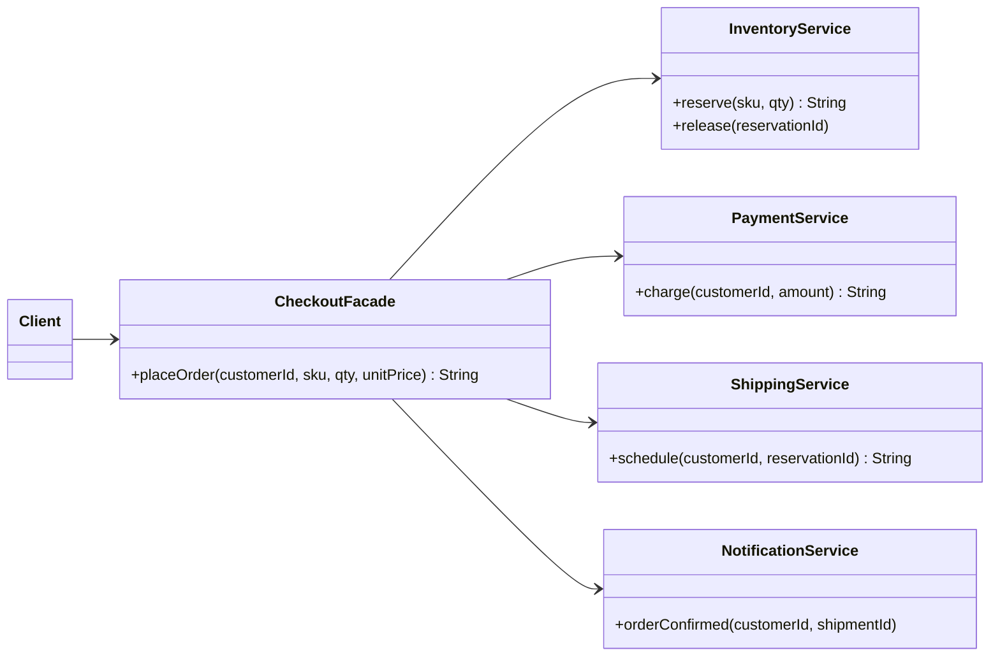

## Simple definition

The **Facade** pattern provides **one simple interface** to a set of classes that together form a subsystem. Clients call the facade; the facade knows which subsystem objects to call and in what order.

GoF intent: *"Provide a unified interface to a set of interfaces in a subsystem. Facade defines a higher-level interface that makes the subsystem easier to use."*

## The problem

Placing an order involves four services: reserve stock, charge the card, schedule shipping and send a confirmation. If payment fails, the stock reservation must be released.

If every caller (the web controller, the mobile API, the batch re-order job) coordinates these four services itself:

- the sequence and the compensation logic are duplicated and drift apart
- each caller depends on four classes and their details
- changing the subsystem (adding fraud checks) means changing every caller.

## Real-world analogy

A hotel concierge. You say "book me dinner and a taxi for 8 pm". The concierge calls the restaurant, the taxi company and updates your bill. You could do it yourself, but you do not need to know the phone numbers.

## Structure

- **Facade** (`CheckoutFacade`) — knows which subsystem classes handle a request and delegates.
- **Subsystem classes** (`InventoryService`, `PaymentService`, `ShippingService`, `NotificationService`) — do the work; have no reference to the facade.
- **Client** — calls the facade.



## Java implementation

The code is in `examples/java/src/hub/patterns/facade/FacadeDemo.java`.







The second order exceeds the card limit. The facade releases the reservation, so no caller can forget to compensate.

## Step-by-step walkthrough

1. **Identify a use case** that requires several subsystem calls in a fixed order: "place an order".
2. **Write one method for it** on the facade, expressed in the client's vocabulary.
3. **Put coordination and compensation inside**, so the subsystem's protocol is encoded once.
4. **Leave the subsystem accessible.** A facade is a convenience, not a wall: advanced clients may still call `InventoryService` directly.

## Facade and the Principle of Least Knowledge

Head First pairs Facade with the **Principle of Least Knowledge** (the Law of Demeter): *talk only to your immediate friends*. A method should call methods on itself, its parameters, objects it creates and its fields, not on objects returned by other calls.

```java
// Violates it: the client reaches through three objects
order.getCustomer().getAccount().getWallet().debit(amount);

// Follows it: ask the nearest object to do the work
order.chargeCustomer(amount);
```

A facade gives clients one "immediate friend" instead of a web of subsystem objects. See [OO design principles](/design-patterns/oo-design-principles).

## Facade versus similar patterns

| Pattern | Purpose | Direction of knowledge |
|---|---|---|
| **Facade** | Simplify a subsystem for clients | Facade knows the subsystem; subsystem does not know the facade |
| **[Adapter](/design-patterns/structural/adapter)** | Make one existing interface match another | Adapter wraps usually *one* object and changes its interface |
| **[Mediator](/design-patterns/behavioral/mediator)** | Coordinate peers that would otherwise talk to each other | Colleagues *know* the mediator and send it events |
| **[API gateway](/microservices/fundamentals/api-gateway)** | A facade at the network edge for many microservices | Same idea, at the architecture level |

In layered and hexagonal architectures, an **application service** (a use-case class) is usually a facade over the domain and the outbound ports.

## Advantages and disadvantages

| Advantages | Disadvantages |
|---|---|
| Simple entry point for common use cases | Can grow into a "god object" that knows everything |
| Clients are decoupled from subsystem details | Adds a layer; trivial pass-through facades are noise |
| Coordination and compensation are written once | Advanced features may be hidden, tempting people to bypass it |
| Subsystem can change behind a stable interface | — |

## When to use it

- A subsystem is complex and most clients need only a few common operations.
- You want to layer a system: each layer exposes a facade to the one above.
- Wrapping a legacy or third-party library behind a small, intention-revealing API.

## When not to use it

- The subsystem is already simple.
- You need to change an interface for compatibility: use an Adapter.
- The facade would just forward each method one-to-one.

## Common mistakes

> [!MISTAKE] The facade that does everything
> A facade should coordinate, not contain business rules. If `CheckoutFacade` starts calculating tax and choosing carriers, move that logic into the domain and keep the facade thin.

- **One facade per subsystem class**, which adds layers without simplifying anything.
- **Hiding the subsystem completely**, forcing every new need through the facade.
- **Facades that return subsystem internals**, re-exposing the complexity they were meant to hide.

## Real-world uses

- `javax.faces.context.FacesContext` and `java.net.URL.openStream()` hide multi-step protocols.
- SLF4J's `LoggerFactory` is a facade over logging back ends (and a Bridge, see [Bridge](/design-patterns/structural/bridge)).
- Spring's `JdbcTemplate`, `RestClient` and `KafkaTemplate` present a simple API over connection management, resource cleanup and exception translation.
- Application services in [Hexagonal Architecture](/hexagonal-architecture/spring-boot-implementation).

## Interview questions and answers

**What is the Facade pattern?**
A structural pattern that provides a single, simplified interface to a complex subsystem of classes.

**How is Facade different from Adapter?**
Adapter makes an existing interface match one a client expects. Facade defines a new, simpler interface over many classes.

**Does a facade prevent access to the subsystem?**
No. It is a convenience; clients that need more control can still use the subsystem classes directly.

**Which principle does Facade support?**
The Principle of Least Knowledge (Law of Demeter): clients talk to one immediate friend instead of reaching through many objects.

## Summary

- Facade gives a subsystem one simple, use-case-oriented entry point.
- It encodes call order and compensation once.
- Keep it thin; business rules belong elsewhere.
- API gateways and application services are facades at larger scales.

## Related topics

- [Adapter vs Decorator vs Proxy vs Facade](/comparisons/adapter-decorator-proxy-facade)
- [Mediator Pattern](/design-patterns/behavioral/mediator)
- [API Gateway with Spring Cloud Gateway](/microservices/fundamentals/api-gateway)
- [OO design principles](/design-patterns/oo-design-principles)

## References

- Gamma, Helm, Johnson, Vlissides. *Design Patterns*. Addison-Wesley, 1994. Facade, p. 185.
- Eric Freeman, Elisabeth Robson. *Head First Design Patterns* (2nd edition). O'Reilly, 2020. Chapter 7 (home theater facade, Principle of Least Knowledge).
