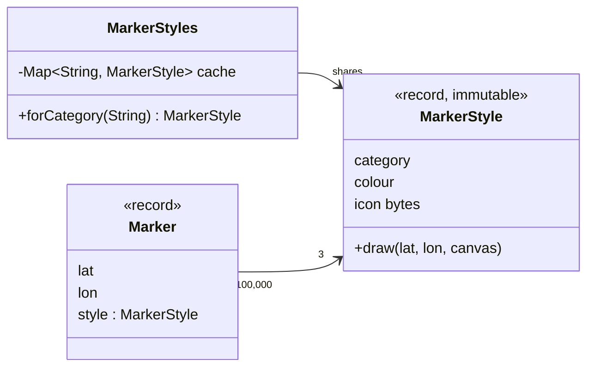

## Simple definition

The **Flyweight** pattern saves memory when a program needs a very large number of similar objects. It splits each object's state into:

- **intrinsic state**: shared, immutable and independent of context, stored once in a shared flyweight object
- **extrinsic state**: varies per object and is stored (or passed in) by the context.

A **factory** makes sure each distinct flyweight exists only once.

GoF intent: *"Use sharing to support large numbers of fine-grained objects efficiently."*

## The problem

A map shows 100,000 points of interest. Each marker has a position and a category style: colour, label font and a 16 KB icon image. If every marker stores its own icon, the icons alone need 100,000 × 16 KB ≈ 1.6 GB. Yet there are only three categories, so there are only three distinct icons.

## Real-world analogy

Movable type in a printing press. A page uses thousands of letter "e"s, but the printer owns a limited set of "e" blocks and reuses them; only their *position* on the page differs. Fonts on a computer work the same way: glyph shapes are stored once per font, not per character on screen.

## Structure

- **Flyweight** (`MarkerStyle`) — immutable intrinsic state; operations take extrinsic state as parameters.
- **Flyweight factory** (`MarkerStyles`) — creates and caches flyweights by key.
- **Context** (`Marker`) — extrinsic state plus a reference to a flyweight.

## Java implementation

The code is in `examples/java/src/hub/patterns/flyweight/FlyweightDemo.java`.









100,000 markers share three style objects: 48 KB of icon data instead of about 1.6 GB.

## Step-by-step walkthrough

1. **Measure first.** Flyweight only pays off when there are *many* objects and a *large* shared part. Use a heap histogram (`jcmd <pid> GC.class_histogram`) to confirm.
2. **Split the state.** Ask of each field: "is it the same for many objects and never changes?" Those fields are intrinsic.
3. **Make the flyweight immutable.** Shared objects must not change, or one marker's change would affect all.
4. **Centralise creation in a factory.** `computeIfAbsent` on a `ConcurrentHashMap` creates each flyweight at most once and is thread-safe.
5. **Pass extrinsic state in.** `draw(lat, lon, canvas)` receives the position from the context.

> [!WARNING] Flyweight trades memory for complexity
> Code that was `marker.icon()` becomes `marker.style().icon()`, and every operation must receive context. Do not apply it speculatively.

## Flyweight versus object pooling and caching

| | Flyweight | Object pool | Cache |
|---|---|---|---|
| Objects are | Shared simultaneously by many clients | Borrowed exclusively, then returned | Reused to avoid recomputation |
| State | Immutable intrinsic state | Mutable, reset on return | Usually immutable values |
| Example | `Integer.valueOf(42)`, glyphs | JDBC connection pool (HikariCP) | Spring `@Cacheable` |

## Advantages and disadvantages

| Advantages | Disadvantages |
|---|---|
| Large memory savings with many similar objects | More complex code; state split across objects |
| Fewer allocations, less GC pressure | Extrinsic state must be computed or passed on each call (CPU for memory) |
| Shared immutable objects are naturally thread-safe | The factory's cache can grow unbounded if keys are unbounded |

## When to use it

- An application uses a very large number of objects, and memory is a real constraint.
- Most object state can be made extrinsic, and the remaining intrinsic state has few distinct values.
- Object identity does not matter to clients.

## When not to use it

- Object counts are modest; modern JVMs allocate small objects very cheaply.
- The intrinsic part is tiny compared with the extrinsic part.
- Clients compare objects by identity or need to mutate them.

## Common mistakes

> [!MISTAKE] A mutable flyweight
> If `MarkerStyle` had a `setColour()` method, recolouring one restaurant would recolour all of them. Flyweights must be immutable.

- **Unbounded factory caches** keyed on user input, creating a memory leak instead of a saving.
- **Comparing boxed integers with `==`:** `Integer.valueOf(127) == Integer.valueOf(127)` is true because of the flyweight cache, but `128` is usually false. Always use `equals`.

## Real-world uses

- `Integer.valueOf`, `Long.valueOf`, `Short.valueOf`, `Byte.valueOf`, `Character.valueOf`: values from −128 to 127 come from a shared cache.
- `Boolean.TRUE` and `Boolean.FALSE`.
- **String interning:** string literals and `String.intern()` share one instance per distinct value; G1 can also deduplicate strings (`-XX:+UseStringDeduplication`), see [Garbage Collection](/java/advanced/garbage-collection).
- Enum constants are flyweights by design.
- Text editors and browsers share glyph and style objects.

## Interview questions and answers

**What is the Flyweight pattern?**
A structural pattern that shares the common, immutable part of many fine-grained objects to reduce memory use.

**What is intrinsic versus extrinsic state?**
Intrinsic state is shared and context-independent, stored in the flyweight. Extrinsic state varies per use and is stored by the client or passed into the flyweight's methods.

**Why must flyweights be immutable?**
They are shared by many contexts at once; a change through one context would affect all.

**Give a JDK example and its pitfall.**
`Integer.valueOf` caches −128 to 127. As a result, `==` on boxed integers sometimes appears to work, which hides bugs; use `equals`.

## Summary

- Flyweight shares immutable intrinsic state across many objects.
- A factory ensures one instance per distinct intrinsic state.
- Measure before applying; it trades memory for complexity.
- The `Integer` cache and string interning are everyday flyweights.

## Related topics

- [Garbage Collection: G1, ZGC and Tuning Basics](/java/advanced/garbage-collection)
- [Singleton Pattern](/design-patterns/creational/singleton)
- [Composite Pattern](/design-patterns/structural/composite) — leaves are often flyweights

## References

- Gamma, Helm, Johnson, Vlissides. *Design Patterns*. Addison-Wesley, 1994. Flyweight, p. 195.
- [`Integer.valueOf(int)`](https://docs.oracle.com/en/java/javase/21/docs/api/java.base/java/lang/Integer.html#valueOf(int)), Java SE 21 API.
