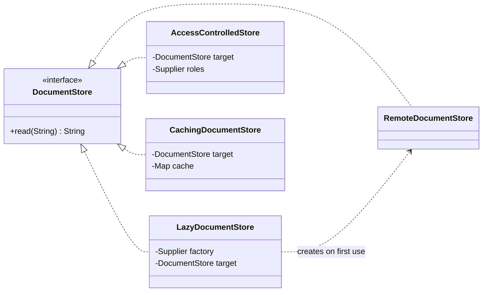

## Simple definition

The **Proxy** pattern puts a **stand-in object** in front of a real object. The proxy implements the same interface, so clients cannot tell the difference, and it decides when and whether to forward each call: creating the real object lazily, checking permissions, caching results or calling across a network.

GoF intent: *"Provide a surrogate or placeholder for another object to control access to it."* It is also known as **Surrogate**.

## The problem

A document store connects to a remote service and loads a search index when it is created, which takes seconds. Many code paths hold a reference to it, but most requests never read a document. HR documents must be readable only by users with the HR role, and the same popular documents are read again and again.

Putting lazy creation, security checks and caching inside the store class mixes four concerns into one, and every client that creates the store pays the start-up cost.

## Real-world analogy

A credit card is a proxy for your bank account. It has the same "interface" as cash for paying, but it controls access (PIN, limits) and defers the actual money movement.

## Kinds of proxy

| Kind | Controls | Example |
|---|---|---|
| **Virtual proxy** | *When* the real object is created | Lazy loading of expensive objects; Hibernate lazy associations |
| **Protection proxy** | *Who* may call | Role checks; Spring Security method security |
| **Remote proxy** | *Where* the object lives | RMI stubs, gRPC and HTTP client stubs |
| **Caching (smart) proxy** | *Whether* the real call is needed | Memoization, `@Cacheable` |
| **Smart reference** | *What else* happens around the call | Reference counting, locking, transactions, logging |

## Structure

- **Subject** (`DocumentStore`) — the shared interface.
- **Real subject** (`RemoteDocumentStore`) — does the real work.
- **Proxy** — holds or creates the real subject and controls access to it.



## Java implementation

The code is in `examples/java/src/hub/patterns/proxy/ProxyDemo.java`.











The remote store is created only at the first read. The second read of the wiki page is answered by the cache. The HR document is refused until the user gains the HR role.

> [!WARNING] The virtual proxy in the example is not thread-safe
> Two threads could both see `target == null` and create two remote stores. For a shared proxy, use the [holder idiom or double-checked locking](/design-patterns/creational/singleton), or a memoizing supplier guarded by a lock.

## Dynamic proxies

Writing a proxy class per interface is tedious. Java can generate them at runtime:

```java
DocumentStore real = new RemoteDocumentStore();
DocumentStore timed = (DocumentStore) Proxy.newProxyInstance(
        DocumentStore.class.getClassLoader(),
        new Class<?>[] {DocumentStore.class},
        (proxy, method, args) -> {
            long start = System.nanoTime();
            try {
                return method.invoke(real, args);
            } finally {
                System.out.printf("%s took %d µs%n", method.getName(), (System.nanoTime() - start) / 1_000);
            }
        });
```

`java.lang.reflect.Proxy` works only for **interfaces**. Libraries such as ByteBuddy (used by Spring and Hibernate) generate **subclass proxies** for classes. See [Reflection API and Dynamic Proxies](/java/fundamentals/reflection-and-dynamic-proxies).

## Proxies in Spring and Hibernate

- **`@Transactional`, `@Cacheable`, `@Async`, `@PreAuthorize`** work because Spring wraps the bean in a proxy that starts a transaction, checks the cache, submits to an executor or checks permissions before calling your method. See [AOP, Advice Types and Proxies](/spring/core/aop-and-proxies).
- **Self-invocation bypasses the proxy:** calling `this.otherTransactionalMethod()` from inside the bean does not go through the proxy, so the annotation has no effect. This is the most common Spring proxy bug.
- **Hibernate lazy loading** returns a virtual proxy for `@ManyToOne(fetch = LAZY)` associations; touching it outside a session raises `LazyInitializationException`. See [Entity Mappings and Fetch Strategies](/spring/data/entity-mappings-and-fetch-strategies).
- **Scoped proxies:** injecting a request-scoped bean into a singleton injects a proxy that finds the current request's instance on each call.

## Proxy versus Decorator

The code is often identical: a class implementing an interface and holding another implementation. The difference is **intent and lifecycle**:

| | Proxy | Decorator |
|---|---|---|
| Purpose | Control access to the real subject | Add behaviour |
| Who creates the real object | Often the proxy itself (virtual, remote) | The client, which passes it in |
| Stacking | Unusual, though possible | The normal way to use it |
| Client awareness | Usually unaware a proxy exists | Chooses which decorators to apply |

See [Adapter vs Decorator vs Proxy vs Facade](/comparisons/adapter-decorator-proxy-facade).

## Advantages and disadvantages

| Advantages | Disadvantages |
|---|---|
| Adds control without changing the real subject or clients | Extra indirection; latency for remote proxies can be hidden from callers |
| Lazy creation saves start-up time and memory | Behaviour depends on going through the proxy (self-invocation pitfalls) |
| Security, caching and remoting are separate, testable concerns | Debugging generated proxies is harder (`$Proxy12`, `$$SpringCGLIB$$`) |

## When to use it

- Expensive objects that are not always needed (virtual).
- Access rules that should be enforced around an object (protection).
- Hiding remote communication behind a local interface (remote).
- Cross-cutting concerns applied per call: transactions, caching, metrics.

## When not to use it

- The interface is changing: use an [Adapter](/design-patterns/structural/adapter).
- Hiding network calls would mislead callers about latency and failure; make remote calls explicit at service boundaries.

## Common mistakes

> [!MISTAKE] Expecting annotations to work on internal calls
> Spring proxies intercept calls that arrive *through the proxy*. A `@Transactional` method called from another method of the same class runs without a transaction.

- **`final` classes or methods** cannot be proxied by subclassing, so annotations on them are silently ignored.
- **Lazy proxies used after the session closes** in Hibernate.
- **Remote proxies without timeouts**, making a network call look like a cheap local call.

## Real-world uses

- `java.lang.reflect.Proxy` and every framework built on it.
- Spring AOP and scoped proxies; Spring Data repository interfaces (the implementation you inject is a proxy).
- Hibernate entity proxies and lazy collections (`PersistentBag`).
- Java RMI stubs; gRPC and OpenFeign client stubs are remote proxies.

## Interview questions and answers

**What is the Proxy pattern?**
A structural pattern that provides a surrogate with the same interface as a real object, to control access to it.

**Name the main kinds of proxy.**
Virtual (lazy creation), protection (access control), remote (location transparency), caching or smart reference (extra work around calls).

**How does Spring implement `@Transactional`?**
By wrapping the bean in a proxy (JDK dynamic proxy for interfaces, CGLIB subclass otherwise) whose interceptor opens and commits or rolls back the transaction around the method call.

**Why does a `@Transactional` method called from the same class not start a transaction?**
The call uses `this`, not the proxy, so the interceptor never runs.

**Proxy versus Decorator?**
Same structure; Proxy controls access and often manages the real object's lifecycle, while Decorator adds behaviour and is composed by the client.

## Summary

- A proxy stands in for a real object and controls access to it.
- Virtual, protection, remote and caching proxies are the common kinds.
- JDK dynamic proxies and bytecode-generated proxies power Spring and Hibernate.
- Remember: only calls that go through the proxy are intercepted.

## Related topics

- [Adapter vs Decorator vs Proxy vs Facade](/comparisons/adapter-decorator-proxy-facade)
- [Decorator Pattern](/design-patterns/structural/decorator)
- [Reflection API and Dynamic Proxies](/java/fundamentals/reflection-and-dynamic-proxies)
- [AOP, Advice Types and Proxies](/spring/core/aop-and-proxies)

## References

- Gamma, Helm, Johnson, Vlissides. *Design Patterns*. Addison-Wesley, 1994. Proxy, p. 207.
- Eric Freeman, Elisabeth Robson. *Head First Design Patterns* (2nd edition). O'Reilly, 2020. Chapter 11 (remote, virtual and protection proxies).
- [`java.lang.reflect.Proxy`](https://docs.oracle.com/en/java/javase/21/docs/api/java.base/java/lang/reflect/Proxy.html), Java SE 21 API.
