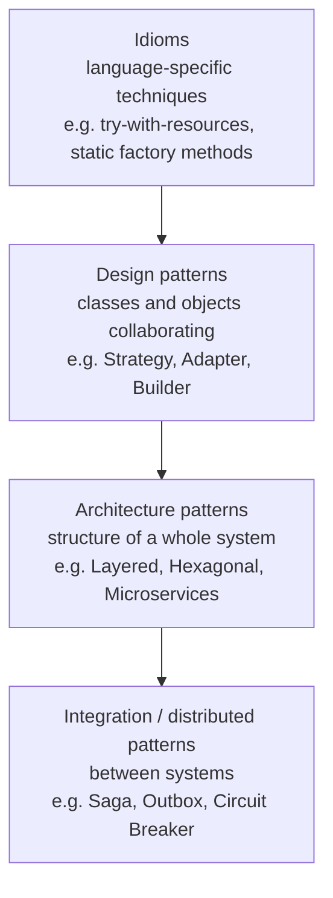

## Simple definition

A **design pattern** is a named, proven solution to a problem that keeps recurring in software design. It is described at the level of roles and relationships, not as finished code.

A pattern is not a library you download. It is closer to a recipe that experienced developers recognise: "when you face *this* situation, arranging objects like *this* tends to work, and here is what it costs."

## The problem patterns solve

Developers keep meeting the same design questions:

- How do I add a new payment method without editing a growing `switch` statement?
- How do I use a third-party SDK whose interface does not match my code?
- How do I build an object with ten optional fields without a constructor that takes ten arguments?

Each question has been answered many times, in many codebases. Without shared names, every team rediscovers the answer and describes it in its own words. Patterns capture these answers once, with their trade-offs, under a name everybody can use.

## Why it matters

1. **Shared vocabulary.** "Wrap the SDK in an Adapter" communicates a whole design in five words during a code review.
2. **Known consequences.** A pattern description includes its costs. You can predict that Visitor makes adding operations easy and adding element types hard, before writing any code.
3. **Faster recognition.** Once you know the patterns, you recognise them in frameworks. `Comparator` is a Strategy. Spring's `@Transactional` works through a Proxy. Java I/O streams are Decorators.
4. **Interviews.** Design and coding interviews often ask you to justify a structure. Patterns give you precise language for that justification.

## Core concept

### Where the idea came from

The term comes from architecture — the buildings kind. Christopher Alexander's *A Pattern Language* (1977) catalogued recurring solutions in towns and buildings, each written as *context → problem → solution*. In 1994, Erich Gamma, Richard Helm, Ralph Johnson and John Vlissides — the "Gang of Four" (GoF) — applied the idea to object-oriented software in *Design Patterns: Elements of Reusable Object-Oriented Software*. Their catalogue of 23 patterns is still the standard reference. This handbook covers all of them; see the [overview of the 23 GoF patterns](/design-patterns/gof-overview).

### The anatomy of a pattern

Every GoF pattern is documented with the same elements. The four that matter most are:

| Element | Question it answers |
|---|---|
| **Name** | What do we call it? |
| **Intent / problem** | When should I consider it? What forces are in tension? |
| **Solution** | Which participants (roles) exist and how do they collaborate? |
| **Consequences** | What do I gain, and what does it cost? |

The solution is described in terms of *roles*, such as "Context", "Strategy" and "ConcreteStrategy", not concrete classes. One codebase may contain the same pattern a dozen times with different class names.

### Two principles behind most patterns

The GoF book states two principles that explain most of its catalogue:

> [!KEY] The two GoF principles
> 1. **Program to an interface, not an implementation.** Clients depend on abstract types, so implementations can vary.
> 2. **Favour object composition over class inheritance.** Behaviour assembled from collaborating objects can change at runtime and avoids deep, fragile hierarchies.

These ideas were later refined into the [SOLID principles](/design-patterns/solid-principles). The Open/Closed and Dependency Inversion principles in particular are what many patterns put into practice.

### Patterns at different levels

"Pattern" is used at several levels of granularity. Keeping them apart avoids a lot of confusion.



- **Idioms** depend on one language. Java's try-with-resources is an idiom for releasing resources.
- **Design patterns** (GoF) organise a handful of classes and objects. They are mostly language-independent within object-oriented languages.
- **Architecture patterns** shape a whole application, for example [Hexagonal Architecture](/hexagonal-architecture/layered-vs-hexagonal).
- **Distributed and integration patterns** coordinate separate processes, for example sagas and circuit breakers, covered in the [microservices section](/microservices).

A pattern is also different from an **algorithm**. An algorithm solves a computational problem, such as sorting a list. A design pattern organises responsibilities. A sorting *algorithm* can be plugged in through the Strategy *pattern*.

## Practical example

Consider shipping costs that depend on the delivery option. A first version often looks like this:

```java
// Every new delivery option means editing this method.
BigDecimal shippingCost(Order order, String option) {
    return switch (option) {
        case "STANDARD" -> new BigDecimal("4.99");
        case "EXPRESS"  -> order.weightKg() > 5 ? new BigDecimal("19.99") : new BigDecimal("12.99");
        case "PICKUP"   -> BigDecimal.ZERO;
        default -> throw new IllegalArgumentException(option);
    };
}
```

For three stable options this is fine. Suppose instead the options multiply, each one gains rules (weight bands, regions, promotions), and different teams own them. Then the method becomes a merge-conflict hotspot, and every change risks breaking the other options. The Strategy pattern gives each option its own class behind a common interface:

```java
interface ShippingCostPolicy {
    BigDecimal costFor(Order order);
}

final class ExpressShipping implements ShippingCostPolicy {
    public BigDecimal costFor(Order order) {
        return order.weightKg() > 5 ? new BigDecimal("19.99") : new BigDecimal("12.99");
    }
}
```

## Implementation walkthrough

1. **Identify what varies.** Here, the cost rule per delivery option.
2. **Name the role.** The interface `ShippingCostPolicy` is the *Strategy*; each option is a *ConcreteStrategy*.
3. **Invert the dependency.** The checkout code receives a `ShippingCostPolicy` instead of deciding with a `switch`.
4. **Choose where selection happens.** Something still has to pick the policy — a map from option to policy, configuration, or a DI container. Patterns move decisions; they rarely remove them.
5. **Check the consequences.** You now have more types. That is worth it only if the variation is real.

The full treatment, with a runnable example, is in the [Strategy pattern](/design-patterns/behavioral/strategy) article.

## Real-world applications

The JDK and common frameworks are full of patterns:

| Where | Pattern | How |
|---|---|---|
| `java.util.Comparator` passed to `List.sort` | Strategy | The sorting algorithm stays fixed; the ordering rule is plugged in. |
| `new BufferedReader(new InputStreamReader(in))` | Decorator | Each wrapper adds behaviour to a stream with the same interface. |
| `Arrays.asList(array)` | Adapter | Presents an array through the `List` interface. |
| `java.util.Iterator` | Iterator | Traverses a collection without exposing its structure. |
| `java.util.AbstractList` | Template Method | Implements iteration and `indexOf` in terms of `get` and `size`, which subclasses supply. |
| `Runnable` submitted to an `ExecutorService` | Command | A request packaged as an object, to be executed later. |
| Spring `@Transactional` | Proxy | A proxy starts and commits the transaction around the real method call. |

## Advantages and disadvantages

| Advantages | Disadvantages |
|---|---|
| Shared vocabulary for design discussions | Extra types and indirection make simple code harder to follow |
| Proven solutions with documented trade-offs | Easy to apply where the problem does not exist (speculative generality) |
| Encourage loose coupling and testability | Some patterns compensate for missing language features and become noise in modern Java |
| Make frameworks easier to understand | Pattern names are sometimes used loosely, which causes confusion |

## When to use patterns — and when not to

Use a pattern when **the problem it solves is present now** or is clearly coming. Signals include duplicated conditionals, classes that change for many unrelated reasons, and code you cannot test without real infrastructure.

Avoid a pattern when:

- The variation is hypothetical ("we might add another database one day").
- A language feature does the job more directly. A lambda is often enough where a one-method Strategy or Command class would add ceremony. Sealed interfaces with pattern matching can replace some uses of Visitor.
- The team does not share the vocabulary, and the pattern would obscure rather than clarify.

> [!TIP] Refactor toward patterns
> A pattern is often best introduced *during refactoring*, once the code shows the problem, rather than designed in up front. Joshua Kerievsky's *Refactoring to Patterns* is built on this idea.

## Alternatives and comparisons

- **Language features.** Since Java 8, lambdas and functional interfaces cover many small Strategy, Command and Observer cases. Records (Java 16) remove boilerplate from value objects. Sealed types and pattern matching for `switch` (Java 21) give type-safe alternatives to some Visitor uses.
- **Frameworks.** A DI container such as Spring applies [Dependency Injection](/spring/core/dependency-injection) for you and builds proxies on your behalf. You still need to understand the patterns to use the framework well.
- **Architecture patterns.** Problems that span a whole system, such as isolating business rules from infrastructure, are solved at the architecture level rather than with a single class-level pattern.

## Common mistakes

> [!MISTAKE] Pattern-driven design
> Starting from "which pattern can I use here?" rather than "what problem do I have?" produces abstract factories with one product, strategies with one implementation, and singletons that make tests share state.

- **Confusing names with intent.** Adapter, Decorator and Proxy share the same class structure: a wrapper that holds a reference to another object. What differs is *why* the wrapper exists. See [Adapter vs Decorator vs Proxy vs Facade](/comparisons/adapter-decorator-proxy-facade).
- **Calling every factory "Factory Method".** A static method that picks a class with a `switch` is a *simple factory*. It is useful, but it is not the GoF Factory Method. See [Factory Method](/design-patterns/creational/factory-method).
- **Copying the UML literally.** The diagrams in pattern books show roles, not mandatory class names or inheritance hierarchies.

## Interview questions and answers

**What is a design pattern?**
A named, reusable solution to a recurring design problem in a given context. It describes participants, their collaborations and the consequences, rather than specific code.

**How is a design pattern different from an algorithm or a library?**
An algorithm solves a computational problem step by step, and a library is reusable code you call. A pattern is a design idea that you implement yourself, in your own classes, to organise responsibilities.

**What are the three GoF categories?**
Creational patterns deal with object creation, structural patterns with composing objects, and behavioral patterns with responsibilities and communication. See the [overview](/design-patterns/gof-overview).

**Are design patterns still relevant with modern Java?**
Yes, but the implementations change. The *problems* are still there: varying behaviour, incompatible interfaces, complex construction. Lambdas, records and sealed types often make the solutions shorter, and some patterns shrink to a single line.

> [!INTERVIEW] Show judgement, not memory
> Interviewers value a candidate who can say when *not* to use a pattern. Pair every pattern you mention with its main cost: "Strategy adds a type per variant, so I'd only introduce it once we have a second real variant."

## Summary

- A design pattern is a named solution to a recurring design problem, documented with its trade-offs.
- The GoF catalogue (1994) defines 23 patterns in three categories: creational, structural and behavioral.
- Most patterns apply two principles: program to interfaces, and favour composition over inheritance.
- Patterns exist at several levels — idioms, design patterns, architecture patterns, distributed-system patterns.
- Use a pattern when its problem is present. Modern Java features often provide lighter-weight solutions.

## Related topics

- [SOLID Principles Explained](/design-patterns/solid-principles)
- [All 23 GoF Patterns: Overview and Classification](/design-patterns/gof-overview)
- [Strategy Pattern](/design-patterns/behavioral/strategy)

## References

- Gamma, Helm, Johnson, Vlissides. *Design Patterns: Elements of Reusable Object-Oriented Software*. Addison-Wesley, 1994.
- Christopher Alexander et al. *A Pattern Language*. Oxford University Press, 1977.
- Joshua Kerievsky. *Refactoring to Patterns*. Addison-Wesley, 2004.
- Joshua Bloch. *Effective Java*, 3rd edition. Addison-Wesley, 2018. Items 1–2 cover static factories and builders.
- [Java SE 21 API documentation](https://docs.oracle.com/en/java/javase/21/docs/api/)
