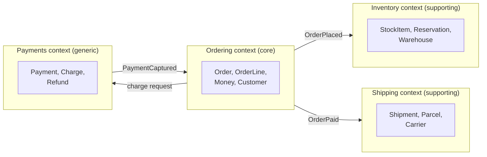
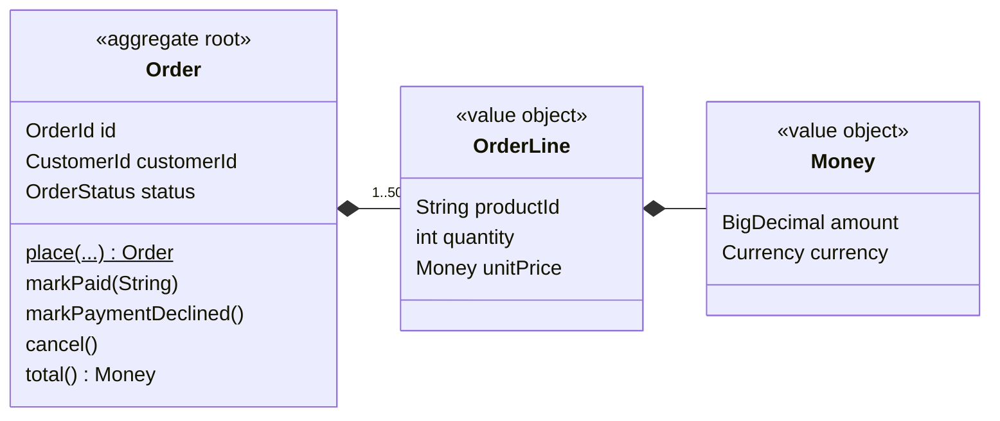

## Simple definition

**Domain-Driven Design (DDD)** is an approach to building software for complex business domains. Its central idea is that the structure and language of the code should match the business it serves, and that developers and domain experts should build that model together.

Eric Evans introduced DDD in *Domain-Driven Design: Tackling Complexity in the Heart of Software* (2003). It has two halves:

| Half | Question | Main concepts |
|---|---|---|
| **Strategic design** | Where are the boundaries between models? | Domain, subdomains, ubiquitous language, bounded contexts, context maps |
| **Tactical design** | How do we model well inside one boundary? | Entities, value objects, aggregates, repositories, domain services, domain events |

Strategic design is usually the more valuable half. A system with clear boundaries and a mediocre internal model is easier to fix than one with an elegant model and no boundaries.

## The problem

A growing retailer has one `Product` class used by every part of the system:

- The **catalogue** needs descriptions, images and categories.
- **Inventory** needs stock levels per warehouse and reorder points.
- **Ordering** needs the price at the moment of purchase.
- **Shipping** needs weight and dimensions.

The class accumulates forty fields. Every team edits it, and every change risks breaking someone else. Worse, the word "product" means subtly different things to each team — a catalogue item, a stock-keeping unit, an order line — and these differences are hidden inside one class. Bugs appear where meanings collide.

DDD addresses this by accepting that **one model cannot serve every purpose**. It draws explicit boundaries, inside which a word has one precise meaning.

## When DDD is worth it

> [!TRADEOFF] DDD has a real cost
> Close collaboration with domain experts, careful modelling and explicit boundaries take time. DDD pays off when the business logic is **complex and central to the business's success**. For a CRUD application, a reporting tool or a thin integration layer, a simple layered design is usually the better choice.

Signs that DDD will pay off:

- The business rules are intricate and change often: pricing, underwriting, scheduling, fulfilment.
- Domain experts and developers misunderstand each other, and bugs come from misunderstood terms.
- Several teams work on one system and keep stepping on each other's models.
- The software is a competitive differentiator, not a commodity.

## Strategic design

### Domain and subdomains

The **domain** is the area of business the software serves — here, online retail. It splits into **subdomains**, each classified by how much it matters competitively:

| Type | Meaning | Retail example | Investment |
|---|---|---|---|
| **Core** | What makes the business different | Ordering and pricing promotions | Best people, careful modelling, DDD |
| **Supporting** | Necessary and specific to the business, but not a differentiator | Inventory, returns handling | Simpler design, adequate quality |
| **Generic** | Solved problems that every business has | Payments, e-mail delivery, identity | Buy or use an off-the-shelf product or service |

### Ubiquitous language

The **ubiquitous language** is the shared vocabulary that developers and domain experts use — in conversation, documentation, *and code*. If the business says "an order is *placed*, then *paid*, and can be *cancelled* before payment", the code says `Order.place(...)`, `markPaid(...)` and `cancel()`, not `createRecord` or `updateStatus(3)`.

When the language changes, the code changes. A term that experts do not recognise in the code is a modelling smell.

### Bounded contexts

A **bounded context** is an explicit boundary — usually a module, a service or a team's codebase — within which a model and its language are consistent. "Product" can mean one thing in the Catalogue context and something else in Shipping, and both are correct *within their context*.



Bounded contexts are covered in depth in [What Is a Bounded Context?](/domain-driven-design/strategic/bounded-context), including context maps and the relationships between contexts.

## Tactical design in one page

Inside one bounded context, tactical patterns help express the model in code. They are **modelling conventions, not GoF design patterns**, although some share names with them (a DDD *Factory* is not the GoF *Factory Method*).

### Entity

An object defined by its **identity**, which stays the same while its attributes change. An order remains the same order when its status moves from pending to paid.

### Value object

An object defined entirely by its **attributes**, with no identity. It is immutable, and two value objects with the same values are equal. Java records are a natural fit:



Value objects absorb validation and behaviour that would otherwise be scattered across services. `Money` refuses negative amounts and mixed currencies; `OrderId` cannot be confused with `CustomerId`.

### Aggregate and aggregate root

An **aggregate** is a cluster of objects that is treated as one unit for changes. Its **root** is the only entry point: outside code holds references to the root only, and every change goes through the root's methods. This lets the root guarantee the aggregate's **invariants** — rules that must always be true.



The `Order` aggregate from the [Hexagonal Architecture example](/hexagonal-architecture/spring-boot-implementation) enforces three invariants: between 1 and 50 lines, a single currency, and only legal status transitions.

```java
public void markPaid(String paymentReference) {
    requireStatus(OrderStatus.PENDING_PAYMENT, "mark as paid");
    this.paymentReference = Objects.requireNonNull(paymentReference);
    this.status = OrderStatus.PAID;
}
```

Aggregate design rules of thumb (from Vaughn Vernon's *Effective Aggregate Design*):

1. Model **true invariants** in consistency boundaries — only what must be consistent *immediately* belongs in one aggregate.
2. Design **small aggregates**.
3. Reference other aggregates **by identity** (`CustomerId`), not by object reference.
4. Use **eventual consistency** between aggregates, typically through domain events.

> [!KEY] One transaction, one aggregate
> A common guideline is to modify only one aggregate per transaction. If a use case seems to need two, either the boundary is wrong, or the second change should happen asynchronously in reaction to an event.

### Repository

A **repository** gives the illusion of an in-memory collection of aggregates: `save(order)`, `findById(id)`. There is one repository per aggregate root — never one per table. In Hexagonal Architecture, the repository interface is an outbound port and its implementation is an adapter.

### Domain service and application service

- A **domain service** holds domain logic that does not belong naturally to any single entity or value object — for example, a pricing calculation that spans an order, a customer's loyalty tier and active promotions. It speaks the ubiquitous language and has no infrastructure dependencies.
- An **application service** orchestrates a use case: it loads aggregates, calls domain methods, saves the results and talks to other systems through ports. It holds no business rules itself. `OrderApplicationService` is an application service.

### Domain event

A **domain event** records something that happened that domain experts care about, named in the past tense: `OrderPlaced`, `PaymentCaptured`. Events let other aggregates and other contexts react without the originating aggregate knowing about them.

```java
public record OrderPlaced(OrderId orderId, CustomerId customerId, Money total, Instant occurredAt) { }
```

### Factory

A DDD **factory** encapsulates complex creation of an aggregate, so that it is valid from the start. It may be a static method such as `Order.place(...)` or a separate class. This is a modelling role, broader than the GoF [Factory Method](/design-patterns/creational/factory-method) pattern.

## Practical example: placing an order

1. **Language.** Domain experts say a customer *places* an order, which is *paid* or *declined*. The code uses those words.
2. **Boundary.** Ordering owns `Order`. It does not reach into Inventory's tables; it publishes `OrderPlaced` and Inventory reserves stock in its own model.
3. **Aggregate.** `Order` enforces line count, single currency and legal status transitions.
4. **Value objects.** `Money`, `OrderLine`, `OrderId` and `CustomerId` carry validation and meaning.
5. **Application service.** `OrderApplicationService` coordinates: create the aggregate, save it, call the `PaymentPort`, record the outcome.
6. **Integration.** Payments is a generic subdomain, so Ordering talks to it through a port and an adapter that translates the provider's model — an Anti-Corruption Layer in miniature.

## Advantages and disadvantages

| Advantages | Disadvantages |
|---|---|
| Code that domain experts can recognise and validate | Requires sustained access to domain experts |
| Explicit boundaries reduce coupling between teams | Learning curve; vocabulary is easy to misuse |
| Invariants enforced in one place, not scattered across services | More classes and mapping than a CRUD design |
| A natural basis for module and service boundaries | Overkill for simple domains |

## Common mistakes

> [!MISTAKE] Tactical patterns without strategic design
> Adding `Entity`, `ValueObject` and `Repository` classes to a codebase with no bounded contexts and no ubiquitous language produces ceremony, not DDD. Start with boundaries and language.

- **Anaemic domain model.** Entities with only getters and setters, and all rules in services. The model then documents nothing and protects nothing.
- **Huge aggregates.** An aggregate that contains a customer and all of their orders causes lock contention and slow loading. Keep aggregates small and reference others by ID.
- **One model for everything.** A shared `Product` class across contexts recreates the original problem.
- **Applying DDD to generic subdomains.** Model your core domain carefully; buy or integrate the generic ones.
- **Confusing DDD with microservices.** Bounded contexts are model boundaries. They *can* become services, but a [modular monolith](/microservices/fundamentals/microservices-vs-modular-monolith) can host several contexts perfectly well.

## Interview questions and answers

**What is Domain-Driven Design?**
An approach to complex business software that aligns code with the business domain through a shared ubiquitous language, explicit bounded contexts, and a rich domain model built in collaboration with domain experts.

**What is the difference between an entity and a value object?**
An entity has an identity that persists while its attributes change. A value object has no identity: it is defined by its values, is immutable, and two instances with equal values are interchangeable.

**What is an aggregate, and why keep aggregates small?**
A cluster of objects changed as one unit through its root, which enforces the invariants. Small aggregates reduce lock contention and loading cost, and make the transactional boundary explicit.

**What is the difference between a domain service and an application service?**
A domain service contains domain logic that does not belong to one entity, and has no infrastructure dependencies. An application service orchestrates a use case — loading, saving, calling ports — and contains no business rules.

**When should you not use DDD?**
When the domain is simple — mostly CRUD — or when the subdomain is generic and better served by an off-the-shelf product.

> [!INTERVIEW] Mention strategic design first
> Many candidates describe only entities and repositories. Starting with subdomains, bounded contexts and ubiquitous language shows you understand where DDD delivers most of its value.

## Summary

- DDD aligns software with a complex business domain through shared language and explicit models.
- Strategic design — subdomains, ubiquitous language, bounded contexts — decides the boundaries.
- Tactical design — entities, value objects, aggregates, events — expresses the model within one boundary.
- Keep aggregates small, reference others by ID, and use events for cross-aggregate consistency.
- Apply DDD where complexity justifies it, usually the core subdomain.

## Related topics

- [What Is a Bounded Context?](/domain-driven-design/strategic/bounded-context)
- [Hexagonal Architecture with Spring Boot](/hexagonal-architecture/spring-boot-implementation) — the `Order` aggregate in a runnable service
- [Microservices versus Modular Monolith](/microservices/fundamentals/microservices-vs-modular-monolith)
- [Factory Method Pattern](/design-patterns/creational/factory-method) — and how it differs from a DDD factory

## References

- Eric Evans. *Domain-Driven Design: Tackling Complexity in the Heart of Software*. Addison-Wesley, 2003.
- Vaughn Vernon. *Implementing Domain-Driven Design*. Addison-Wesley, 2013.
- Vaughn Vernon. "[Effective Aggregate Design](https://www.dddcommunity.org/library/vernon_2011/)", 2011.
- Vlad Khononov. *Learning Domain-Driven Design*. O'Reilly, 2021.
- Eric Evans. "[Domain-Driven Design Reference](https://www.domainlanguage.com/ddd/reference/)", 2015.
