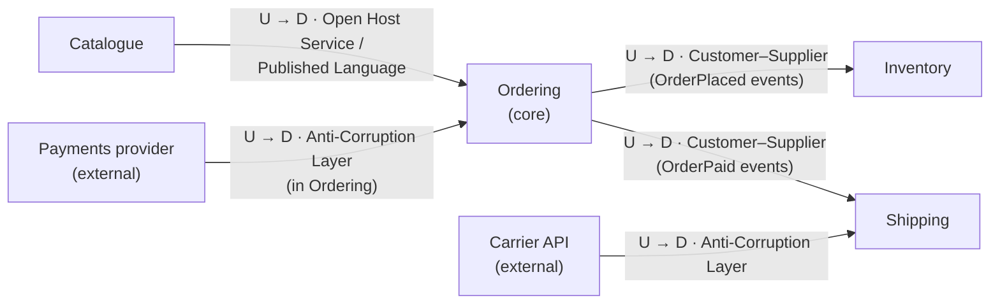

## Simple definition

A **bounded context** is an explicit boundary within which a particular domain model applies, and within which every term in the ubiquitous language has exactly one meaning.

Outside the boundary, the same word may mean something else, and that is acceptable. The boundary makes the difference explicit instead of leaving it hidden in one overloaded class.

## The problem: one word, several meanings

In the retailer from [DDD Fundamentals](/domain-driven-design/fundamentals), the word **"product"** is used by every team:

| Team | What "product" means to them | Attributes they care about |
|---|---|---|
| Catalogue | Something we sell, as shown to customers | Name, description, images, category |
| Inventory | A stock-keeping unit in a warehouse | SKU, quantity on hand, bin location, reorder point |
| Ordering | A line on a customer's order | Product ID, price *at the time of purchase*, quantity |
| Shipping | A physical item to pack and send | Weight, dimensions, hazardous-goods flag |

A single shared `Product` class grows to serve all four. Each team's changes risk breaking the others. Subtle conflicts appear: when the catalogue price changes, should existing orders change? (No — but a shared model makes that bug easy to write.)

The same happens with "customer" (a shopper, a billing account, a delivery recipient), "order" and "account".

## Why it matters

- **Clarity.** Inside a context, terms are precise, and the model can be rich without compromise.
- **Autonomy.** A team can change its model without coordinating with every other team, as long as it honours its published contracts.
- **Boundaries for architecture.** Bounded contexts are the most reliable starting point for module boundaries in a modular monolith and for service boundaries in microservices.
- **Integration made explicit.** Because models differ, integration requires deliberate translation, which is visible and testable.

## Core concept

### A context is a boundary around a model

```mermaid {title="The same real-world thing, modelled differently in each context"}
flowchart TB
    subgraph Catalogue["Catalogue context"]
        C["CatalogueItem<br/>name · description · images"]
    end
    subgraph Inventory["Inventory context"]
        I["StockItem<br/>sku · onHand · reorderPoint"]
    end
    subgraph Ordering["Ordering context"]
        O["OrderLine<br/>productId · unitPrice · quantity"]
    end
    subgraph Shipping["Shipping context"]
        S["ParcelItem<br/>weight · dimensions"]
    end
    ID(("Product ID<br/>shared identifier"))
    ID -.-> C
    ID -.-> I
    ID -.-> O
    ID -.-> S
```

The contexts share an **identifier**, not a model. Each context stores the attributes it needs, in the shape it needs them.

### Subdomain versus bounded context

These two concepts are often confused:

| | Subdomain | Bounded context |
|---|---|---|
| Belongs to | The **problem space** — how the business is divided | The **solution space** — how the software is divided |
| Discovered or designed? | Discovered by analysing the business | Designed by the team |
| Example | "Inventory management" | The `inventory` module or service and its model |

Ideally there is one bounded context per subdomain, but not always. A legacy system may span several subdomains in one context, and a large subdomain may be split into several contexts.

### Finding boundaries

Heuristics that help:

1. **Language changes.** When domain experts use the same word differently, or different words for the same thing, a boundary is near.
2. **Different experts.** The people who know the rules for pricing are not the people who know warehouse operations.
3. **Different rates of change.** Promotions change weekly; tax rules change yearly.
4. **Different consistency needs.** Order placement needs immediate consistency for its own invariants; stock levels across warehouses can be eventually consistent.
5. **Business capabilities.** "Take orders", "manage stock", "ship parcels" are natural units.

Event Storming — a workshop technique created by Alberto Brandolini — is a popular way to discover these boundaries with domain experts.

## Context mapping

A **context map** shows the bounded contexts and the relationships between them. Relationships describe both *technical integration* and *team dynamics*: who depends on whom, and who must adapt.

**Upstream** contexts influence **downstream** contexts. If the upstream changes its model or API, the downstream is affected — not the reverse.



### The relationship patterns

| Pattern | Meaning | When to use it |
|---|---|---|
| **Partnership** | Two teams succeed or fail together and coordinate closely | Tightly linked contexts owned by cooperating teams |
| **Shared Kernel** | Two contexts share a small, explicitly agreed part of the model (and its code) | Small, stable concepts such as `Money`, with joint ownership. Keep it tiny. |
| **Customer–Supplier** | The upstream (supplier) plans its work around the downstream's (customer's) needs | Internal teams where the downstream has a voice in the upstream's priorities |
| **Conformist** | The downstream adopts the upstream model as-is | The upstream will not change for you, and its model is good enough |
| **Anti-Corruption Layer (ACL)** | The downstream builds a translation layer to protect its model | The upstream model is awkward, legacy or external |
| **Open Host Service (OHS)** | The upstream offers a well-defined protocol for any consumer | Many downstream consumers |
| **Published Language** | A documented shared exchange format, such as an event schema or a standard | Often combined with OHS |
| **Separate Ways** | No integration; the contexts solve their needs independently | Integration costs more than duplication |

### The Anti-Corruption Layer

The ACL is the most frequently used defensive pattern. It translates an upstream model into the downstream's own language, so that foreign concepts never leak in. In code, it is built from [Adapters](/design-patterns/structural/adapter), facades and translators.

```java
// Ordering's port, in Ordering's language.
public interface PaymentPort {
    PaymentOutcome charge(OrderId orderId, Money amount);
}

// The ACL: translates the provider's model (minor units, status codes,
// vendor exceptions) into Ordering's model. Nothing vendor-specific escapes.
final class ProviderPaymentAdapter implements PaymentPort {
    public PaymentOutcome charge(OrderId orderId, Money amount) {
        ProviderChargeResponse r = client.createCharge(
                orderId.toString(), toMinorUnits(amount), amount.currency().getCurrencyCode());
        return switch (r.status()) {
            case "succeeded" -> new PaymentOutcome.Approved(r.id());
            case "card_declined", "insufficient_funds" -> new PaymentOutcome.Declined(r.status());
            default -> throw new PaymentProviderException("Unexpected status " + r.status());
        };
    }
}
```

## Bounded contexts, modules, services and teams

A bounded context is a *model* boundary. How it is deployed is a separate decision:

| Implementation | Description | Trade-off |
|---|---|---|
| Package or module in a monolith | Each context is a module with enforced boundaries | Simple operations and local transactions; requires discipline to keep boundaries |
| Separate service | Each context is deployed independently | Independent deployment and scaling; network and consistency costs |
| Several contexts in one service | A service hosts a few small, related contexts | Pragmatic for small teams |

> [!KEY] A context is not automatically a microservice
> One bounded context *per* microservice is a good upper bound — a service should not span several contexts' models. But nothing requires every context to be its own service. Many systems start with contexts as modules in a [modular monolith](/microservices/fundamentals/microservices-vs-modular-monolith) and extract services only when there is a reason.

Conway's Law applies: contexts work best when each is owned by one team. A context owned by three teams tends to fragment; a team owning ten contexts tends to blur their boundaries.

## Integration between contexts

| Style | Example | Coupling |
|---|---|---|
| Synchronous API (REST, gRPC) | Ordering asks Catalogue for the current price | Runtime coupling: Ordering fails if Catalogue is down |
| Asynchronous events | Ordering publishes `OrderPlaced`; Inventory reserves stock | Temporal decoupling; eventual consistency |
| Data replication | Ordering keeps a local copy of prices, updated by `PriceChanged` events | Fast local reads; copies may be briefly stale |

Events crossing a context boundary are **integration events**: part of the published contract, versioned and stable. They are distinct from **domain events** used inside a context, which can change freely with the model.

## Common mistakes

> [!MISTAKE] The shared "common" library of entities
> A `common-model` JAR with `Customer`, `Product` and `Order` used by every service recreates the single shared model, now with distributed deployment on top. Share identifiers and published contracts, not domain classes.

- **Boundaries along technical layers.** "The database context" and "the UI context" are not bounded contexts. Boundaries follow the domain.
- **Contexts that are too small.** One context per entity ("the Address context") produces chatty integration and distributed transactions.
- **A Shared Kernel that keeps growing.** Every addition couples two teams more tightly. Keep it to small, stable value types.
- **Ignoring the context map.** Undocumented relationships make it unclear who must adapt when an upstream changes.
- **Leaking upstream models.** Using a provider's DTOs directly in your domain makes you a Conformist by accident.

## Interview questions and answers

**What is a bounded context?**
An explicit boundary within which a domain model is consistent and each term in the ubiquitous language has one meaning. Different contexts may model the same real-world concept differently.

**How is a bounded context different from a subdomain?**
A subdomain is part of the business problem and is discovered. A bounded context is part of the software solution and is designed. Ideally they align one to one.

**Is a bounded context the same as a microservice?**
No. A bounded context is a model boundary. It can be implemented as a module in a monolith, as one service, or occasionally as several services. A microservice should not span several contexts.

**What is an Anti-Corruption Layer?**
A translation layer that a downstream context builds to protect its model from an upstream model it cannot or should not adopt — such as a legacy system or an external API. It is typically built from adapters and translators.

**How do you find bounded context boundaries?**
Listen for changes in language, look at which experts own which rules, and consider rates of change, consistency requirements and business capabilities. Workshops such as Event Storming help.

> [!INTERVIEW] Use the "product" example
> Explaining how "product" means different things in catalogue, inventory, ordering and shipping is a quick, concrete way to show you understand why bounded contexts exist.

## Summary

- A bounded context is a model boundary within which language is unambiguous.
- Different contexts may model the same concept differently; they share identifiers, not models.
- Context maps document upstream/downstream relationships and integration patterns.
- The Anti-Corruption Layer protects a model from foreign ones.
- Contexts guide module and service boundaries, but a context is not automatically a microservice.

## Related topics

- [Domain-Driven Design Fundamentals](/domain-driven-design/fundamentals)
- [Microservices versus Modular Monolith](/microservices/fundamentals/microservices-vs-modular-monolith)
- [Adapter Pattern](/design-patterns/structural/adapter) — the building block of an ACL
- [Designing an Order Management System](/system-design/case-studies/order-management-system)

## References

- Eric Evans. *Domain-Driven Design*. Addison-Wesley, 2003. Part IV, "Strategic Design".
- Martin Fowler. "[BoundedContext](https://martinfowler.com/bliki/BoundedContext.html)", 2014.
- Vaughn Vernon. *Domain-Driven Design Distilled*. Addison-Wesley, 2016.
- Alberto Brandolini. *Introducing EventStorming*. Leanpub.
- [DDD Crew: Context Mapping](https://github.com/ddd-crew/context-mapping) — reference cards for the relationship patterns.
