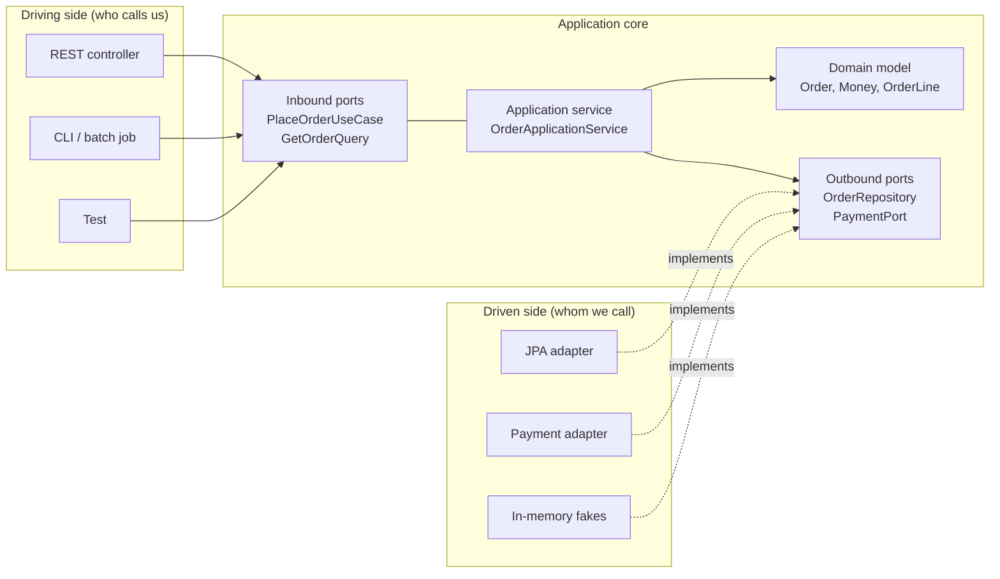

## Simple definition

- **Layered architecture** stacks the code in horizontal layers — typically presentation, business and data access. Each layer calls the layer below it, so dependencies point **down, towards the database**.
- **Hexagonal Architecture**, also called **Ports and Adapters** (Alistair Cockburn, 2005), puts the business logic at the centre. The core defines **ports** — interfaces in its own terms — and technology-specific **adapters** plug into them from outside. All dependencies point **inwards, towards the business logic**.

The difference is one word: *direction*. That single change has large consequences for testing and for changing technology.

## The problem Hexagonal Architecture addresses

In a classic layered Spring application, the business layer depends on the data-access layer:

```java
@Service
public class OrderService {
    private final OrderJpaRepository repository;   // a Spring Data interface
    public Order place(...) {
        OrderEntity entity = new OrderEntity();      // a JPA entity is the business object
        ...
    }
}
```

Over time this produces familiar symptoms:

- **Business rules depend on infrastructure.** The `Order` *is* a JPA entity, so it must have a no-argument constructor and mutable fields, and lazy-loading rules leak into business code.
- **Tests need the infrastructure.** Testing a pricing rule requires a database, or extensive mocking of repository internals.
- **Business logic leaks outwards.** With no clear boundary, rules spread into controllers ("if the status is X, return 409") and into SQL queries.
- **Technology changes ripple.** Replacing the payment provider's SDK or moving from REST to messaging touches the business layer.

Cockburn's stated goal was to let an application be "equally driven by users, programs, automated tests or batch scripts, and to be developed and tested in isolation from its eventual run-time devices and databases".

## Core concept

### Layered architecture

```mermaid {title="Classic layered architecture — dependencies point down"}
flowchart TB
    P["Presentation layer<br/>controllers, views"]
    B["Business layer<br/>services, entities"]
    D["Data access layer<br/>repositories, ORM"]
    DB[("Database")]
    P --> B --> D --> DB
```

The rule is simple: a layer may use only the layer below it (*strict layering*), or any layer below it (*relaxed layering*). The structure is easy to understand and suits many applications. Its weakness is that the most important code — the business rules — depends on the most volatile code: frameworks and storage.

### Hexagonal architecture



The hexagon shape has no special meaning. Cockburn chose it to leave room for several ports, and to break the habit of drawing layers stacked from top to bottom.

### The vocabulary

| Term | Meaning | In the example |
|---|---|---|
| **Application core** | Domain model plus application services. No framework dependencies. | `domain`, `application` packages |
| **Inbound (driving, primary) port** | Interface through which the outside world asks the application to do something | `PlaceOrderUseCase`, `GetOrderQuery` |
| **Inbound adapter** | Translates an external trigger (HTTP, a message, a CLI) into calls on an inbound port | `OrderController` |
| **Outbound (driven, secondary) port** | Interface through which the application asks for something it needs from outside | `OrderRepository`, `PaymentPort` |
| **Outbound adapter** | Implements an outbound port with a concrete technology | `JpaOrderRepositoryAdapter`, `SimulatedPaymentAdapter` |

> [!KEY] Who owns the port?
> The **core** owns every port, and ports are written in the core's language: `PaymentPort.charge(OrderId, Money)`, not `stripeClient.createCharge(Map<String,Object>)`. This is the [Dependency Inversion Principle](/design-patterns/solid-principles#d--dependency-inversion-principle) at architecture scale — the adapter depends on the core, never the reverse.

### Dependency direction

Compare where the arrows point:

| Dependency | Layered | Hexagonal |
|---|---|---|
| Controller → business logic | Yes | Yes (through an inbound port) |
| Business logic → persistence | **Yes** — the service calls the repository implementation | **No** — the service calls a port; the persistence adapter implements it |
| Business logic → external APIs | **Yes** | **No** — through an outbound port |
| Business objects → framework annotations | Often (`@Entity`) | No — mapping happens in adapters |

### Why each port exists

Hexagonal Architecture does not mean "an interface for every class". Each port should have a reason:

- **`PlaceOrderUseCase`** — an inbound port that lets REST, messaging and tests drive the same use case. It also documents the application's capabilities in one place.
- **`GetOrderQuery`** — kept separate from the command port ([Interface Segregation](/design-patterns/solid-principles#i--interface-segregation-principle)), so read-only clients do not depend on write operations.
- **`OrderRepository`** — the core needs storage but must not know about JPA. In tests, a map implements it.
- **`PaymentPort`** — wraps an external provider whose API, failures and credentials should never reach business code. Its contract states that the order ID is an idempotency key.

There is deliberately **no** port for the domain model itself and no interface for `OrderApplicationService`. Neither has a second implementation or a boundary to protect.

## Practical example

The same use case — place an order and charge for it — in each style.

**Layered:**

```java
@Service
public class OrderService {
    private final OrderJpaRepository repository;      // infrastructure type
    private final StripeClient stripe;                 // vendor SDK

    @Transactional
    public OrderEntity place(OrderRequest request) {   // web DTO in the business layer
        OrderEntity order = new OrderEntity(request);
        repository.save(order);
        Charge charge = stripe.charges().create(Map.of("amount", order.totalCents()));
        order.setStatus(charge.getPaid() ? "PAID" : "DECLINED");
        return order;
    }
}
```

**Hexagonal** (from the [runnable example](/hexagonal-architecture/spring-boot-implementation)):



The hexagonal version mentions no web, JPA or vendor types. Every collaborator is a port or a JDK abstraction, so the use case can be tested in milliseconds with hand-written fakes.

## Implementation walkthrough

1. **Start from the use cases.** List what the application must do ("place order", "get order"). These become inbound ports.
2. **Model the domain without frameworks.** `Order` protects its invariants in plain Java.
3. **Name what the core needs from outside.** Storage and payments become outbound ports, phrased in domain terms.
4. **Write the application service.** It orchestrates: translate input, call the domain, call outbound ports.
5. **Write adapters last.** Each adapter translates between a technology and a port. The REST controller maps JSON to commands; the JPA adapter maps aggregates to tables.
6. **Wire everything in one place.** A configuration class is the composition root (see [Dependency Injection](/spring/core/dependency-injection)).
7. **Enforce the direction.** Tools such as ArchUnit can fail the build if `domain` or `application` imports `org.springframework` or an `adapter` package.

## Real-world applications

- Systems with significant business rules that will outlive their frameworks: banking, insurance, logistics, ordering.
- Applications driven by several channels — REST, messaging and batch jobs — that must share use cases.
- Systems whose external providers are likely to change: payment, notification and shipping integrations.
- Codebases where fast, reliable tests of business rules are a priority.

## Advantages and disadvantages

| | Layered | Hexagonal |
|---|---|---|
| Learning curve | Low — familiar to most developers | Moderate — new vocabulary, more types |
| Amount of code | Less | More: ports, separate persistence models, mapping |
| Testing business rules | Needs a database or deep mocks | Plain unit tests with fakes |
| Replacing infrastructure | Touches business code | Write a new adapter |
| Risk of overengineering | Low | Real: ports and mappers with no purpose |
| Framework features (lazy loading, `@Transactional` on entities) | Directly available | Kept at the edges; some convenience is lost |

## When a simpler layered architecture is sufficient

Hexagonal Architecture is not automatically better. Prefer a simple layered design when:

- The application is mostly **CRUD**: data in, data out, with little business logic to protect.
- It is **short-lived** — a prototype, internal tool or migration utility.
- There is **one delivery mechanism** and one database, and no realistic prospect of change.
- The team is small and new to the vocabulary, and the cost of ceremony exceeds its benefit.

> [!TRADEOFF] A pragmatic middle ground
> Many teams use layers but apply dependency inversion only where it pays off: an outbound port in front of an external provider, and a domain model free of persistence annotations. You can move towards full Hexagonal Architecture as business logic grows.

## Comparison with Clean and Onion Architecture

| | Hexagonal (Cockburn, 2005) | Onion (Jeffrey Palermo, 2008) | Clean (Robert C. Martin, 2012) |
|---|---|---|---|
| Core idea | Ports and adapters around an application | Concentric rings: domain model, domain services, application services, infrastructure | Concentric circles: entities, use cases, interface adapters, frameworks |
| Dependency rule | Inwards | Inwards | Inwards ("the Dependency Rule") |
| Emphasis | Symmetry between driving and driven sides; testability | Layers within the core | Use-case classes, input and output boundaries, presenters |
| Prescriptiveness | Low — only ports and adapters | Medium | Higher — named layers and boundary objects |

All three share the same fundamental rule: **source-code dependencies point towards the business logic.** The differences lie mostly in how they divide the core and in naming. In practice, a well-built hexagonal application and a well-built clean-architecture application look very similar.

## Common mistakes

> [!MISTAKE] Ports that mirror the technology
> An outbound port called `JpaOrderPort` with a method `findByCustomerIdAndStatusOrderByPlacedAtDesc` is a JPA repository with an extra name. Ports speak the language of the domain.

- **Interfaces for everything.** A port without a reason — no boundary, no second implementation, no test seam — is ceremony.
- **Framework annotations in the core.** `@Entity`, `@JsonProperty` or `@Transactional` on domain classes reintroduce the coupling you removed.
- **Business logic in adapters.** A controller that checks order status before calling the use case splits the rules across layers.
- **Anaemic core.** If the "domain" consists of getters and setters and all logic sits in services, the hexagon protects very little. See [DDD Fundamentals](/domain-driven-design/fundamentals).
- **Sharing one model across all layers.** Serialising domain objects directly to JSON couples your API contract to your domain model. Use request and response DTOs in the web adapter.

## Interview questions and answers

**What is Hexagonal Architecture?**
An architecture style in which the business core defines ports — interfaces in its own terms — and technology-specific adapters implement or call them. All dependencies point inwards, so the core can be developed and tested without frameworks, databases or networks.

**What is the difference between an inbound and an outbound port?**
An inbound port is how the outside world drives the application, for example a `PlaceOrderUseCase` called by a REST controller. An outbound port is what the application needs from the outside world, for example an `OrderRepository` implemented by a JPA adapter.

**How is Hexagonal different from a layered architecture?**
In a layered architecture, business code depends on the data-access layer. In Hexagonal, the data-access code depends on interfaces owned by the business core. The dependency direction is inverted.

**How does Hexagonal Architecture relate to the Adapter pattern?**
Each outbound adapter is a GoF [Adapter](/design-patterns/structural/adapter): it implements the port the core expects and translates calls to a technology's API.

**When would you not use Hexagonal Architecture?**
For CRUD applications with little business logic, short-lived tools, or teams for whom the extra types and mapping would cost more than the isolation is worth.

**Is Clean Architecture the same as Hexagonal?**
They share the dependency rule. Clean Architecture is more prescriptive about the rings inside the core and about use-case boundary objects. Hexagonal only distinguishes the inside from the outside.

> [!INTERVIEW] Justify every port
> When you draw a hexagonal design in an interview, say *why* each port exists. "PaymentPort isolates the provider's SDK and lets us test declines without a sandbox" is far stronger than drawing interfaces everywhere.

## Summary

- Layered architecture points dependencies at the database; Hexagonal points them at the business logic.
- The core owns its ports; adapters translate between ports and technologies.
- The payoff is fast, isolated tests and replaceable infrastructure. The cost is more types and mapping code.
- Hexagonal, Onion and Clean Architecture share the inward dependency rule.
- Choose a simpler layered design when there is little business logic to protect.

## Related topics

- [Hexagonal Architecture with Spring Boot](/hexagonal-architecture/spring-boot-implementation) — the full runnable example
- [Adapter Pattern](/design-patterns/structural/adapter)
- [SOLID Principles: Dependency Inversion](/design-patterns/solid-principles#d--dependency-inversion-principle)
- [Domain-Driven Design Fundamentals](/domain-driven-design/fundamentals)
- [Introduction to Software Architecture](/software-architecture/introduction)

## References

- Alistair Cockburn. "[Hexagonal Architecture](https://alistair.cockburn.us/hexagonal-architecture/)", 2005.
- Jeffrey Palermo. "[The Onion Architecture: part 1](https://jeffreypalermo.com/2008/07/the-onion-architecture-part-1/)", 2008.
- Robert C. Martin. "[The Clean Architecture](https://blog.cleancoder.com/uncle-bob/2012/08/13/the-clean-architecture.html)", 2012; and *Clean Architecture*, Prentice Hall, 2017.
- Tom Hombergs. *Get Your Hands Dirty on Clean Architecture*, 2nd edition. Packt, 2023.
- Mark Richards and Neal Ford. *Fundamentals of Software Architecture*. O'Reilly. Chapter on the layered architecture style.
