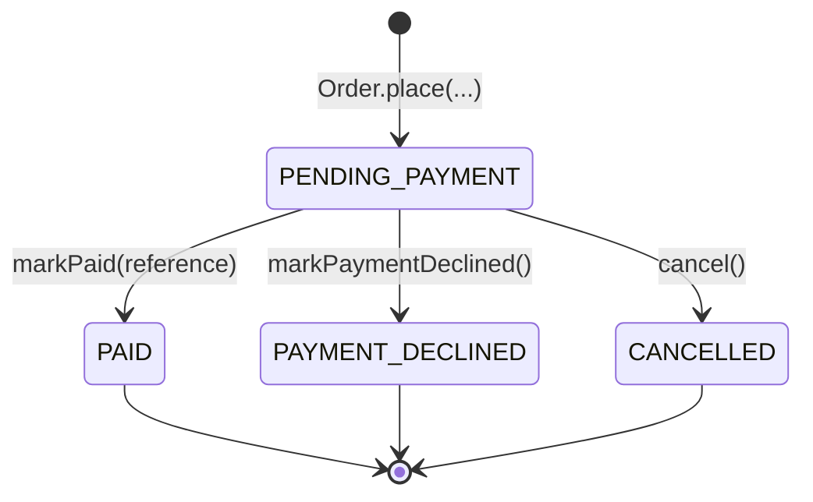
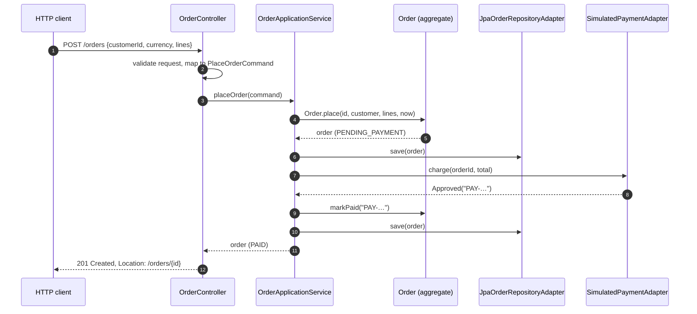

## What you will build

A small order service with two use cases — **place an order** (and charge for it) and **get an order** — structured as Ports and Adapters:

- The **domain model** enforces business rules in plain Java.
- The **application service** orchestrates use cases and talks to the outside world only through **ports**.
- **Adapters** connect the core to HTTP (Spring MVC), a database (Spring Data JPA with H2) and a payment provider (simulated, so the example needs no credentials).
- **Tests** cover each part at the right level. The use-case tests run without Spring and without a database.

The full source is in `examples/spring-hexagonal-orders/`. It targets **Java 21** and **Spring Boot **.

```bash
cd examples/spring-hexagonal-orders
mvn verify            # compiles and runs all 17 tests
mvn spring-boot:run   # starts the service on http://localhost:8080
```

> [!VERSION] Spring Boot 4 module names
> Spring Boot 4 split its auto-configuration into smaller modules. The web starter is `spring-boot-starter-webmvc`, and test slices have their own starters, such as `spring-boot-starter-webmvc-test` and `spring-boot-starter-data-jpa-test`. Their annotations moved packages: for example, `@WebMvcTest` is now in `org.springframework.boot.webmvc.test.autoconfigure`. Code written for Spring Boot 3 needs these imports updated.

## Package structure

```text
com.example.orders
├── domain/                      ← business rules; depends on nothing but the JDK
│   ├── Order.java               (aggregate root)
│   ├── OrderLine.java, Money.java, OrderId.java, CustomerId.java  (value objects)
│   ├── OrderStatus.java
│   └── InvalidOrderException.java
├── application/
│   ├── port/in/                 ← inbound ports: what the app can do
│   │   ├── PlaceOrderUseCase.java
│   │   └── GetOrderQuery.java
│   ├── port/out/                ← outbound ports: what the app needs
│   │   ├── OrderRepository.java
│   │   └── PaymentPort.java
│   └── service/
│       └── OrderApplicationService.java   (implements the inbound ports)
├── adapter/
│   ├── in/web/                  ← driving adapter: HTTP → inbound ports
│   │   ├── OrderController.java, PlaceOrderRequest.java, OrderResponse.java
│   │   └── ApiExceptionHandler.java
│   └── out/
│       ├── persistence/         ← driven adapter: OrderRepository with JPA
│       │   ├── JpaOrderRepositoryAdapter.java, OrderJpaEntity.java
│       │   └── SpringDataOrderRepository.java
│       └── payment/             ← driven adapter: PaymentPort
│           └── SimulatedPaymentAdapter.java
├── config/
│   └── UseCaseConfiguration.java   (composition root for the core)
└── OrdersApplication.java
```

```mermaid {title="Package dependencies — every arrow points towards the core"}
flowchart LR
    web["adapter.in.web"] --> portin["application.port.in"]
    service["application.service"] -. implements .-> portin
    service --> portout["application.port.out"]
    service --> domain["domain"]
    portin --> domain
    portout --> domain
    persistence["adapter.out.persistence"] -. implements .-> portout
    payment["adapter.out.payment"] -. implements .-> portout
    persistence --> domain
    payment --> domain
    web --> domain
    config["config"] --> service
    config --> portout
```

Nothing in `domain` or `application` imports Spring, JPA or Jackson. Only the adapters and `config` know about the framework.

## The domain model

`Order` is an **aggregate root** (see [DDD Fundamentals](/domain-driven-design/fundamentals#tactical-design-in-one-page)). Every state change goes through a method that protects the invariants:



`Money` is a **value object**: immutable, compared by value, and it refuses to add amounts in different currencies.





## Ports

### Inbound ports





The command is a record with plain types. It belongs to the application, not to HTTP — a message listener or a batch job could create it just as easily.

### Outbound ports





`PaymentPort` documents an important contract: the order ID is an **idempotency key**. If the call is retried after a timeout, the provider must not charge twice.

## The application service



The order is saved **before** the payment call and again afterwards. If the process crashes during the payment call, a `PENDING_PAYMENT` order remains as evidence, and a reconciliation job can query the provider with the order ID. This is deliberate: the use case is **not** wrapped in one database transaction, because holding a transaction open across a remote call ties up a database connection for as long as the provider takes to respond.

> [!TRADEOFF] Transactions around remote calls
> Putting `@Transactional` on a method that calls an external service holds a database connection during the network call, and a rollback cannot undo the charge anyway. Record intent, call out, record the outcome, and handle the gap with idempotency and reconciliation. The [order management case study](/system-design/case-studies/order-management-system#failure-handling) develops this further.

## Inbound adapter: the REST controller



The request DTO validates the *shape* of the input with Jakarta Validation; business rules stay in the domain:



Exceptions are translated into RFC 9457 Problem Details. HTTP status codes are web knowledge, so the mapping lives in the adapter:



| Situation | Raised by | HTTP status |
|---|---|---|
| Malformed JSON or failed bean validation | Spring MVC | 400 Bad Request |
| Unknown currency code, malformed ID | JDK (`IllegalArgumentException`) | 400 Bad Request |
| Business rule violated (for example, mixed currencies) | Domain (`InvalidOrderException`) | 422 Unprocessable Content |
| Order not found | Application (`OrderNotFoundException`) | 404 Not Found |

## Outbound adapters

### Persistence

The JPA entity is a separate class, owned by the adapter. JPA's requirements — a no-argument constructor, mutable fields, annotations — never reach the domain model.





The `@Version` field gives **optimistic locking**: if two requests modify the same order concurrently, the second save fails instead of silently overwriting the first.

### Payment



A production adapter would call the provider over HTTP with Spring's `RestClient`, set connection and read timeouts, retry only idempotent failures, and map the provider's responses — exactly as the [Adapter pattern](/design-patterns/structural/adapter) article describes. The application core would not change.

## Wiring

The core classes carry no Spring annotations, so one configuration class turns them into beans:



Spring injects the single `OrderApplicationService` bean wherever a `PlaceOrderUseCase` or a `GetOrderQuery` is required, because the class implements both interfaces.

## Request flow



## Testing strategy

Each kind of test checks one thing and starts only what it needs.

| Test | What runs | What it proves | Relative cost |
|---|---|---|---|
| `OrderTest` | Domain classes only | Invariants and state transitions | Lowest: plain JUnit |
| `OrderApplicationServiceTest` | Application service with hand-written fakes | Use-case orchestration: payment outcomes, save order | Lowest: plain JUnit |
| `OrderControllerTest` (`@WebMvcTest`) | Spring MVC slice, ports mocked | JSON mapping, validation, status codes | Medium: web slice context |
| `JpaOrderRepositoryAdapterTest` (`@DataJpaTest`) | JPA with embedded H2 | Domain ↔ table mapping in both directions | Medium: JPA slice context |
| `OrdersApplicationTests` (`@SpringBootTest`) | Everything | The pieces are wired correctly end to end | Highest: full context |

### Testing a use case without Spring or a database



The payment port is a **lambda**, and the repository is a small class backed by a `HashMap`. The tests need no mocking framework, no application context and no database, and the clock and IDs are fixed so that every assertion is exact. This is the main practical payoff of the hexagonal structure.

### Adapter tests

The web adapter is tested with a Spring MVC slice and mocked inbound ports:



The persistence adapter is tested against a real JPA provider and an embedded database:



> [!TIP] Use the production database engine for adapter tests
> H2 keeps this example self-contained. For a real service, run persistence adapter tests against the same database engine as production — for example, PostgreSQL started by Testcontainers — because SQL dialects and locking behaviour differ.

## Common implementation mistakes

> [!MISTAKE] Reusing the JPA entity as the domain model "to save time"
> It works at first. Then lazy-loading exceptions appear in business code, invariants are bypassed by setters JPA needs, and every schema change touches the domain. If you choose to share the model, do so deliberately and record the trade-off in an ADR.

- **`@Transactional` on the use case around a remote call.** See the trade-off above.
- **Mapping in the wrong place.** JSON mapping belongs in the web adapter and table mapping in the persistence adapter. The application service should not know about either.
- **Testing the core through `@SpringBootTest` only.** Slow tests discourage testing, and failures are hard to locate. Test the core directly.
- **Leaking Spring types into ports.** `Page<Order>` or `ResponseEntity` in a port signature couples the core to Spring.
- **Ports for everything.** This example has four ports, each with a stated reason. It has no interface for the application service implementation or for value objects.

## Interview questions and answers

**How do you structure a Spring Boot application with Hexagonal Architecture?**
Split it into `domain`, `application` (with `port.in`, `port.out` and `service`), `adapter.in` and `adapter.out`, plus a configuration package. Domain and application code are framework-free. Adapters use Spring. A `@Configuration` class creates the application services as beans.

**How do you test a use case without starting Spring?**
Construct the application service directly, passing in-memory fakes or lambdas for the outbound ports and a fixed `Clock`. Assert on the returned domain object and on what the fakes recorded.

**Why keep a separate JPA entity?**
To keep persistence concerns — annotations, no-argument constructors, mutable fields, lazy loading — out of the domain model, and to let the schema and the model evolve independently. The cost is mapping code.

**Where do transactions go in a hexagonal application?**
Usually at the application-service boundary — either with `@Transactional` on a Spring-managed bean, or explicitly through a transaction port. Avoid holding a transaction open across remote calls.

**Which status code would you return when a business rule fails?**
422 Unprocessable Content for a syntactically valid request that violates a business rule; 400 for malformed input; 409 Conflict for concurrency conflicts such as an optimistic-locking failure.

> [!INTERVIEW] Bring numbers
> Saying "nine of our seventeen tests are plain JUnit with no database, and only one test class starts the full context" is a concrete, memorable argument for the architecture.

## Summary

- The domain and application packages are plain Java and own every port.
- Adapters translate HTTP, JPA and provider APIs to and from the core's language.
- One configuration class wires the core into Spring.
- Tests are layered: fast core tests, focused adapter slice tests and one end-to-end test.
- Each port exists for a stated reason; avoid interfaces without one.

## Related topics

- [Layered versus Hexagonal Architecture](/hexagonal-architecture/layered-vs-hexagonal)
- [Domain-Driven Design Fundamentals](/domain-driven-design/fundamentals)
- [Dependency Injection in Java](/spring/core/dependency-injection)
- [Designing an Order Management System](/system-design/case-studies/order-management-system)

## References

- Alistair Cockburn. "[Hexagonal Architecture](https://alistair.cockburn.us/hexagonal-architecture/)", 2005.
- [Spring Boot reference documentation](https://docs.spring.io/spring-boot/reference/) — testing slices and auto-configuration.
- [Spring Boot 4.0 Migration Guide](https://github.com/spring-projects/spring-boot/wiki/Spring-Boot-4.0-Migration-Guide) — modular starters and test annotations.
- [RFC 9457: Problem Details for HTTP APIs](https://www.rfc-editor.org/rfc/rfc9457).
- Tom Hombergs. *Get Your Hands Dirty on Clean Architecture*, 2nd edition. Packt, 2023.
