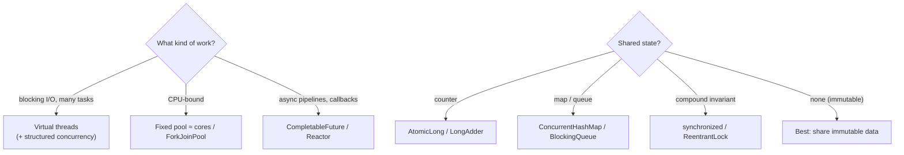

## Simple definition

`java.util.concurrent` provides **higher-level building blocks** for running work in parallel and coordinating threads safely:

- **executors** run tasks
- **futures** represent results that arrive later
- **locks and atomics** protect shared state
- **concurrent collections** are safe to share between threads.

## The problem

Creating raw `Thread`s per task does not scale (platform threads are expensive OS threads). Hand-written `wait`/`notify` code is notoriously buggy. Sharing a plain `HashMap` between threads corrupts it. The concurrency API gives tested abstractions, so you rarely touch low-level primitives.

## Executors: separate tasks from threads

```java
try (ExecutorService pool = Executors.newFixedThreadPool(8)) {        // AutoCloseable since Java 19
    Future<Price> price = pool.submit(() -> pricing.quote(sku));
    Future<Stock> stock = pool.submit(() -> inventory.check(sku));
    return new Offer(price.get(2, SECONDS), stock.get(2, SECONDS));
}   // close() waits for tasks and shuts the pool down
```

| Factory | Behaviour | Use for |
|---|---|---|
| `newFixedThreadPool(n)` | n threads, unbounded queue | CPU-bound work (n ≈ cores) |
| `newCachedThreadPool()` | Grows without limit | Rarely; prefer bounded pools |
| `newScheduledThreadPool(n)` | Delayed and periodic tasks | Timers, polling |
| `newWorkStealingPool()` / `ForkJoinPool` | Work stealing | Recursive divide and conquer, parallel streams |
| `newVirtualThreadPerTaskExecutor()` (21) | One cheap virtual thread per task | **Blocking I/O-bound work** |
| `new ThreadPoolExecutor(...)` | Full control: core and max size, **bounded queue**, rejection policy | Production services |

**Sizing platform-thread pools:**

- CPU-bound: about `cores` (or `cores + 1`).
- I/O-bound: `cores × (1 + wait time / compute time)`, which often means virtual threads instead.
- Always use a **bounded queue** and a **rejection policy** (for example `CallerRunsPolicy`) to get backpressure instead of running out of memory.
- **Name your threads** with a ThreadFactory for readable thread dumps.

## CompletableFuture: composing async work

```java
CompletableFuture<Offer> offer =
    CompletableFuture.supplyAsync(() -> pricing.quote(sku), ioPool)            // run async
        .thenCombine(CompletableFuture.supplyAsync(() -> inventory.check(sku), ioPool),
                     Offer::new)                                              // join two results
        .thenCompose(o -> CompletableFuture.supplyAsync(() -> promo.apply(o), ioPool)) // chain async step
        .orTimeout(2, SECONDS)                                                // fail if too slow
        .exceptionally(ex -> Offer.unavailable(sku));                         // fallback
```

| Method | Purpose |
|---|---|
| `supplyAsync` / `runAsync` | Start async work (**always pass an executor**; the default is the common ForkJoinPool) |
| `thenApply` | Transform the result (like `map`) |
| `thenCompose` | Chain another async call (like `flatMap`) |
| `thenCombine` | Combine two independent futures |
| `allOf` / `anyOf` | Wait for all, or the first |
| `exceptionally` / `handle` / `whenComplete` | Recover, transform or observe errors |
| `orTimeout` / `completeOnTimeout` | Time limits (Java 9+) |

Exceptions inside stages are wrapped in `CompletionException`. `join()` throws unchecked exceptions; `get()` throws the checked `ExecutionException`.

> [!TIP] With Java 21+, consider plain blocking code
> For I/O fan-out, virtual threads with simple blocking calls (or structured concurrency) are often easier to read and debug than long `CompletableFuture` chains. See [virtual threads](/java/advanced/virtual-threads-and-structured-concurrency).

## Locks

| Mechanism | Features | Use when |
|---|---|---|
| `synchronized` | Simple, reentrant, auto-release; no longer pins virtual threads since **Java 24** (JEP 491) | Default for short critical sections |
| `ReentrantLock` | `tryLock(timeout)`, interruptible locking, fairness, multiple `Condition`s | You need timeouts or try-lock |
| `ReentrantReadWriteLock` | Many readers **or** one writer | Read-heavy shared data |
| `StampedLock` | **Optimistic reads** (no locking, then validate); not reentrant | Very read-heavy hot paths, used with care |

```java
private final ReentrantLock lock = new ReentrantLock();
void transfer(Account a, Account b, BigDecimal amt) throws InterruptedException {
    if (lock.tryLock(100, MILLISECONDS)) {
        try { a.debit(amt); b.credit(amt); }
        finally { lock.unlock(); }                        // always in finally
    } else throw new BusyException();
}
```

**Avoid deadlocks:** acquire multiple locks in a **global order**, keep critical sections short, never call unknown code (callbacks, I/O) while holding a lock, and prefer `tryLock` with timeouts.

## Atomics

`AtomicInteger`, `AtomicLong` and `AtomicReference` use hardware **compare-and-set (CAS)**, which is lock-free:

```java
counter.incrementAndGet();
ref.updateAndGet(cfg -> cfg.withLimit(100));                  // retried CAS loop
```

Under high contention, **`LongAdder`** (striped counters) beats `AtomicLong` for counters and metrics. `VarHandle` gives low-level atomic access to fields and array elements.

## Synchronizers

| Class | What it coordinates |
|---|---|
| `CountDownLatch` | Wait until N events happen (one-shot) |
| `CyclicBarrier` | N threads wait for each other, repeatedly |
| `Semaphore` | Limit concurrent access to N permits (for example a connection limit) |
| `Phaser` | Flexible multi-phase barriers |
| `Exchanger` | Two threads swap objects |

## Concurrent collections

| Collection | How it works | Use for |
|---|---|---|
| `ConcurrentHashMap` | CAS on empty bins, a lock per bin otherwise; lock-free reads | Shared caches and registries. Use atomic methods: `computeIfAbsent`, `merge`. |
| `CopyOnWriteArrayList` | Copies the array on every write | Listener lists: many reads, rare writes |
| `ConcurrentLinkedQueue` / `Deque` | Lock-free linked structures | Non-blocking queues |
| `LinkedBlockingQueue`, `ArrayBlockingQueue` | Blocking `put` and `take` | **Producer–consumer** with backpressure |
| `ConcurrentSkipListMap` | Lock-free sorted map | Concurrent sorted data |

```java
// Atomic, race-free "get or create"
Session s = sessions.computeIfAbsent(userId, id -> new Session(id));
// Race-free counting
hits.merge(path, 1L, Long::sum);
```

> [!MISTAKE] Check-then-act on a concurrent map
> `if (!map.containsKey(k)) map.put(k, v)` is a race even on `ConcurrentHashMap`. Use `putIfAbsent` or `computeIfAbsent`.

## How it fits together



## Common mistakes

> [!MISTAKE] Unbounded queues and pools
> They hide overload until the JVM runs out of memory. Bound them and choose a rejection policy.

> [!MISTAKE] Blocking inside the common ForkJoinPool
> `supplyAsync` without an executor uses the shared common pool. Blocking I/O there starves parallel streams and other tasks.

> [!MISTAKE] Forgetting to shut down executors
> Non-daemon threads keep the JVM alive and leak. Use try-with-resources (Java 19+) or framework-managed executors.

## Quick check

**Why use an ExecutorService instead of `new Thread()`?**
It reuses threads, bounds concurrency, queues work, returns futures and centralises shutdown and error handling.

**`thenApply` vs `thenCompose`?**
`thenApply` transforms the result synchronously (map). `thenCompose` chains another asynchronous step that returns a CompletableFuture (flatMap).

**When choose ReentrantLock over synchronized?**
When you need `tryLock` with a timeout, interruptible locking, fairness or multiple conditions.

**Why is LongAdder faster than AtomicLong under contention?**
It spreads updates across several cells, so threads rarely compete for the same CAS, and sums the cells when read.

**How do you avoid deadlocks?**
Acquire locks in a consistent global order, hold them briefly, avoid calling external code while holding them, and use timeouts.

**What is the safe way to "get or create" in a ConcurrentHashMap?**
`computeIfAbsent`, which performs the check and the insert atomically.

## Summary

- Submit tasks to executors; bound pools and queues; name threads.
- Compose async work with CompletableFuture, always with an explicit executor and error handling.
- Prefer immutability, then atomics and concurrent collections, then locks.
- For blocking I/O on Java 21+, virtual threads usually beat complex async code.

## References

- Brian Goetz et al., *Java Concurrency in Practice* (Addison-Wesley), still the foundational text.
- Oracle, [`java.util.concurrent` package summary](https://docs.oracle.com/en/java/javase/21/docs/api/java.base/java/util/concurrent/package-summary.html).
- OpenJDK, [JEP 491: Synchronize Virtual Threads without Pinning](https://openjdk.org/jeps/491).
