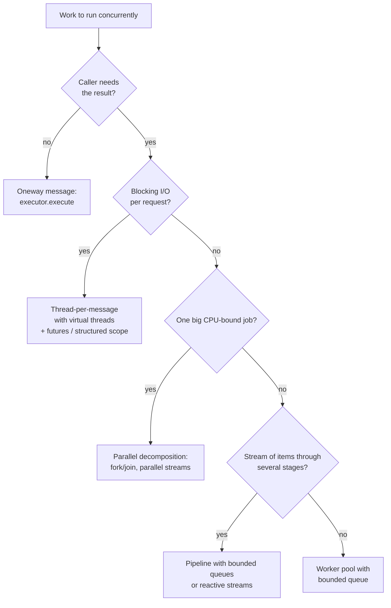

## Simple definition

Once objects are safe to share (see [Designing concurrent objects](/java/advanced/concurrent-object-design)), the next question is **how work gets onto threads** and how results and failures come back. Doug Lea's *Concurrent Programming in Java* catalogues the recurring answers. Most now have direct support in `java.util.concurrent`, so this page names each pattern, explains the forces behind it, and shows the modern API.

| Pattern | Problem it solves | Modern Java |
|---|---|---|
| Oneway message | Caller does not need to wait for the work | `executor.execute(task)` |
| Thread-per-message | Each request handled concurrently | `Executors.newVirtualThreadPerTaskExecutor()` |
| Worker threads | Bound the number of threads; reuse them | `ThreadPoolExecutor` |
| Completion callback | Be told when work finishes | `CompletableFuture.whenComplete` |
| Future | Start work now, collect the result later | `Future`, `CompletableFuture` |
| Cancellation | Stop work that is no longer needed | `Future.cancel(true)`, interruption, `StructuredTaskScope` |
| Push-flow pipeline | Stages connected by queues | `BlockingQueue` stages, `Flow`, Reactor |
| Parallel decomposition | Split a big job across cores | `ForkJoinPool`, parallel streams, `CyclicBarrier` |
| Readers-writers | Many readers, occasional writers | `ReentrantReadWriteLock`, `StampedLock` |

## Oneway messages

A **oneway message** is a request whose caller does not wait for a result: logging an event, sending a notification, updating a cache. Turning it into a task object and handing it to another thread is the [Command](/design-patterns/behavioral/command) pattern.

Design questions Lea raises for oneway messages:

- **Ordering:** must messages be processed in the order sent? (Use a single-threaded executor or a per-key queue.)
- **Failure:** who learns that it failed? (Nobody, unless you add a callback or log.)
- **Flow control:** what if messages arrive faster than they are processed? (Bounded queues and a rejection policy.)

## Thread-per-message

Start a new thread for each request. Simple, and concurrency matches demand, but with platform threads each one costs about 1 MB of stack and an OS thread, so unbounded load exhausts memory.

**Virtual threads** (Java 21) make thread-per-message practical again for I/O-bound work: they are cheap enough to create one per request.

```java
try (var executor = Executors.newVirtualThreadPerTaskExecutor()) {
    for (Request r : requests) {
        executor.submit(() -> handle(r));          // one virtual thread per message
    }
}                                                  // close() waits for all tasks
```

You still need to bound *downstream* resources (database connections, rate-limited APIs) with semaphores or pools. See [Virtual Threads and Structured Concurrency](/java/advanced/virtual-threads-and-structured-concurrency).

## Worker threads and thread pools

A fixed set of **worker threads** takes tasks from a **channel** (a queue). Threads are reused, and the queue absorbs bursts. This is `ThreadPoolExecutor`:

```java
ThreadPoolExecutor pool = new ThreadPoolExecutor(
        8, 16,                                   // core and maximum threads
        30, TimeUnit.SECONDS,                    // idle time before extra threads die
        new ArrayBlockingQueue<>(500),           // bounded channel
        Thread.ofPlatform().name("report-", 0).factory(),
        new ThreadPoolExecutor.CallerRunsPolicy());   // back-pressure when full
```

| Choice | Options and trade-offs |
|---|---|
| Channel | Bounded queue (back-pressure) vs unbounded (`newFixedThreadPool`: memory risk) vs `SynchronousQueue` (direct hand-off) |
| Saturation policy | Abort (exception), caller-runs (slows the producer), discard, discard-oldest |
| Pool size | CPU-bound ≈ number of cores; I/O-bound larger, or use virtual threads |
| Isolation | Separate pools per dependency (bulkheads) so one slow dependency cannot take all workers |

The **event loop** (Swing's event dispatch thread, Netty's I/O threads) is a worker-thread design with exactly one worker, which also guarantees ordering and confinement.

## Completion callbacks

Instead of blocking for a result, the caller passes code to run when the work completes — the [Observer](/design-patterns/behavioral/observer) pattern applied to one task.

```java
CompletableFuture
        .supplyAsync(() -> pricing.quote(cart), pool)
        .thenApply(Quote::withTax)
        .whenComplete((quote, error) -> {
            if (error != null) log.warn("quote failed", error);
            else ui.show(quote);
        });
```

Watch which thread runs the callback (the completing thread or the caller, depending on timing; use the `*Async` variants with an executor to control it), and make sure failures reach someone.

## Futures and joins

A **future** represents a result that will exist later. Start several independent pieces of work, then collect them:

```java
CompletableFuture<Customer> customer = CompletableFuture.supplyAsync(() -> crm.find(id), pool);
CompletableFuture<List<Order>> orders = CompletableFuture.supplyAsync(() -> orderRepo.byCustomer(id), pool);

Dashboard dashboard = customer.thenCombine(orders, Dashboard::new)
        .orTimeout(2, TimeUnit.SECONDS)
        .join();
```

`Thread.join()` is the primitive form: wait for a thread to finish. With Java 21+ preview **structured concurrency**, subtasks forked in a scope are joined, and failures and cancellation propagate, as a unit. See [Virtual Threads and Structured Concurrency](/java/advanced/virtual-threads-and-structured-concurrency).

## Cancellation

Work is cancelled when a user gives up, a timeout fires, or a sibling task fails. Lea's key point: **cancellation must be cooperative**. Java has no safe way to kill a thread (`Thread.stop` is removed); instead, a thread is *asked* to stop through **interruption**, and the task must check and respond.

```java
public void run() {
    try {
        while (!Thread.currentThread().isInterrupted()) {
            Batch b = queue.take();             // blocking calls throw InterruptedException
            process(b);
        }
    } catch (InterruptedException e) {
        Thread.currentThread().interrupt();     // preserve the status for the owner
    } finally {
        releaseResources();                     // leave shared state consistent
    }
}
```

- `Future.cancel(true)` interrupts the running task; `ExecutorService.shutdownNow()` interrupts all.
- Long CPU loops must check `isInterrupted()` periodically.
- Blocking socket I/O is not always interruptible; close the socket, or use timeouts.
- **Multiphase cancellation:** ask politely (interrupt), wait a bounded time, then escalate (close resources, abandon the thread), as `shutdown()` → `awaitTermination()` → `shutdownNow()` does.

## Push-flow pipelines

A **flow system** connects stages with channels: each stage takes input, transforms it, and pushes output to the next stage. Each stage can run on its own thread, and the queues between them smooth out speed differences.

```mermaid {title="A push-flow pipeline with bounded queues between stages"}
flowchart LR
    S[Source<br/>read files] -->|BlockingQueue| P[Parse]
    P -->|BlockingQueue| E[Enrich<br/>2 workers]
    E -->|BlockingQueue| W[Write<br/>batch to DB]
```

Lea's guidance for flow systems:

- **Exclusive ownership:** a message belongs to one stage at a time. After a stage passes an object on, it must not touch it again. Ownership transfer removes the need to lock the message itself.
- **Bounded channels** give back-pressure: a slow writer makes the queues fill up and slows the source.
- **Stage shapes:** linear stages, joiners (two inputs), splitters (two outputs), and their configuration should be separate from the stage logic.

Modern equivalents: `java.util.concurrent.Flow` (Reactive Streams with explicit demand), Project Reactor, Kafka Streams, and at system scale, the [stream processing](/data-systems/stream-processing) architectures.

## Parallel decomposition

To make one large computation faster, split it across cores:

- **Fork/join:** recursively split a task until pieces are small, compute them in parallel, and combine results. `ForkJoinPool` uses work stealing to keep all cores busy. Parallel streams are built on it.
- **Barriers:** in iterative algorithms (simulations, matrix computations), each worker computes its part of a step, then all wait at a `CyclicBarrier` before the next step.

```java
long total = LongStream.rangeClosed(1, 50_000_000)
        .parallel()                                // fork/join under the hood
        .filter(n -> n % 3 == 0)
        .sum();
```

Parallelism helps only for CPU-bound work on large inputs with independent elements. For small inputs or blocking I/O, it is slower than a simple loop.

## Readers and writers

When reads vastly outnumber writes and reads take long enough to matter, let many readers in at once but give writers exclusive access. Lea implements the policy with **before/after** methods (a Template Method around the read or write) and discusses the policy choices: do waiting writers block new readers (writer preference, avoids writer starvation) or not?

```java
private final ReentrantReadWriteLock rw = new ReentrantReadWriteLock();

public Price lookup(String sku) {
    rw.readLock().lock();
    try { return prices.get(sku); } finally { rw.readLock().unlock(); }
}

public void reload(Map<String, Price> fresh) {
    rw.writeLock().lock();
    try { prices.clear(); prices.putAll(fresh); } finally { rw.writeLock().unlock(); }
}
```

Often simpler: keep the data in an immutable map and **replace the reference atomically** (`volatile` field or `AtomicReference`). Readers then need no lock at all. `StampedLock` adds optimistic reads for very hot read paths.

## Choosing a design



## Common mistakes

> [!MISTAKE] Unbounded queues
> `Executors.newFixedThreadPool(n)` uses an unbounded queue. Under sustained overload it grows until the JVM runs out of memory, and latency grows without limit. Use a bounded queue and an explicit rejection policy.

- **Losing exceptions** in `execute()`d tasks or futures nobody reads.
- **Blocking inside a `ForkJoinPool`** (including the common pool used by parallel streams and default `CompletableFuture` async methods).
- **Ignoring interruption**, so shutdown hangs.
- **Sharing a message after handing it to the next pipeline stage.**
- **One pool for everything**, so a slow dependency starves unrelated work.

## Quick check

**What is the difference between thread-per-message and worker threads?**
Thread-per-message creates a thread for every request; worker threads reuse a bounded set of threads that take tasks from a queue.

**Why is cancellation in Java cooperative?**
Threads cannot be safely killed; they are interrupted and must check the flag or handle `InterruptedException` to stop cleanly.

**What does exclusive ownership mean in a pipeline?**
A message is owned by one stage at a time; after passing it on, the sender no longer touches it, so the message needs no locking.

**When does a parallel stream help?**
For large, CPU-bound computations over independent elements; not for small inputs or blocking I/O.

**What is a simpler alternative to a read-write lock for read-mostly data?**
An immutable snapshot replaced atomically through a `volatile` or `AtomicReference` field.

## Summary

- Choose how work reaches threads: oneway messages, thread-per-message, or worker pools.
- Get results with callbacks, futures or structured scopes; never lose failures.
- Cancellation is cooperative: honour interruption and clean up.
- Pipelines need ownership transfer and bounded channels; parallel decomposition suits CPU-bound work.

## Related topics

- [Designing Concurrent Objects](/java/advanced/concurrent-object-design)
- [State-Dependent Actions](/java/advanced/state-dependent-actions)
- [Virtual Threads, Structured Concurrency and Scoped Values](/java/advanced/virtual-threads-and-structured-concurrency)
- [The Java Concurrency API](/java/advanced/concurrency-api)

## References

- Doug Lea. *Concurrent Programming in Java: Design Principles and Patterns* (2nd edition). Addison-Wesley, 1999. Chapter 4: Creating Threads (oneway messages, services in threads, parallel decomposition, active objects) and the concurrent application architectures (flow, parallel, layered).
- Brian Goetz et al. *Java Concurrency in Practice*. Addison-Wesley, 2006. Chapters 6–8.
- [JEP 444: Virtual Threads](https://openjdk.org/jeps/444) (Java 21).
