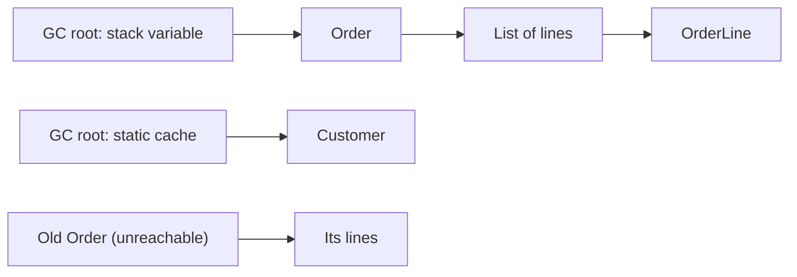
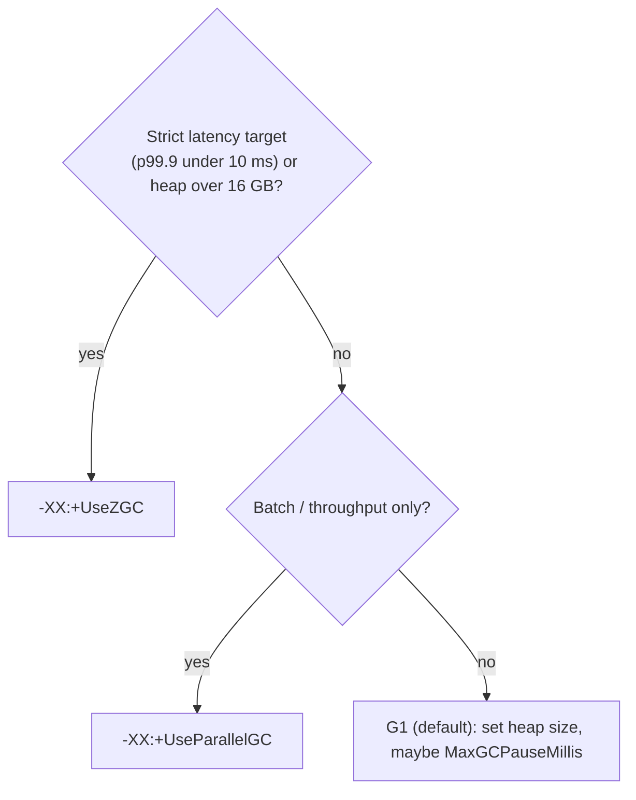

## Simple definition

**Garbage collection (GC)** automatically frees heap memory used by objects that the program **can no longer reach**. The JVM ships several collectors that trade **pause time**, **throughput** and **memory overhead** differently.

## The problem

Manual memory management causes leaks and use-after-free bugs. Automatic GC removes those but costs CPU and sometimes **pauses** the application. The right collector and heap size can turn 2-second pauses into sub-millisecond ones, or double throughput.

## Reachability

An object is **live** if it can be reached from a **GC root**:

- local variables and parameters on thread stacks
- static fields of loaded classes
- JNI references
- active monitors.

Everything else is garbage, including cycles. Java does not use reference counting.



## Generational collection

The **weak generational hypothesis** says most objects die young: request DTOs, iterators, temporary strings.

| Region | Contents | Collected by |
|---|---|---|
| **Young generation** (Eden + 2 survivor spaces) | New objects | Frequent, fast **minor GCs**: copy live objects, discard the rest |
| **Old generation** | Objects that survived several minor GCs (tenured) | Less frequent **major / mixed** collections |

Basic phases: **mark** live objects, **sweep** dead ones, **compact** to avoid fragmentation. **Copying** collectors evacuate live objects to a new area, which compacts as a side effect.

## The collectors

| Collector | Pauses | Throughput | Heap sizes | Use for |
|---|---|---|---|---|
| **Serial** | Stop-the-world, single thread | OK on small heaps | < ~100 MB | Tiny containers, CLI tools |
| **Parallel** | Stop-the-world, multi-threaded | **Highest** | Any | Batch jobs where pauses do not matter |
| **G1** (default) | Mostly concurrent marking; region-based evacuation with a **pause-time goal** (default 200 ms) | Good | Medium to large | **General-purpose server default** |
| **ZGC** (generational since JDK 21, the only mode since JDK 23) | **Sub-millisecond** pauses, independent of heap size | Slightly lower | Up to multi-terabyte | Latency-sensitive services, large heaps |
| **Shenandoah** (generational mode in recent JDKs) | Very low pauses, concurrent compaction | Slightly lower | Medium to large | Low-latency alternative (OpenJDK builds that include it) |

- **G1** splits the heap into equal **regions**. It collects the regions with the most garbage first ("garbage first") and adapts young-generation size to meet `-XX:MaxGCPauseMillis`.
- **ZGC** uses **coloured pointers** and **load barriers** to relocate objects **concurrently** while the application runs.

> [!VERSION] Recent changes
> - **JDK 21:** generational ZGC.
> - **JDK 23:** generational is ZGC's default and then only mode.
> - **JDK 24:** compact object headers as an experimental option (8-byte headers instead of 12 or more, saving memory).
> - **JDK 25:** compact object headers became a product feature (JEP 519).
> - **JDK 27:** G1 is the default collector in **all** environments, including small machines where Serial used to be chosen (JEP 523).

## Choosing and sizing



**Containers:** the JVM is container-aware. Set heap as a **percentage of the container memory limit**:

```bash
JAVA_TOOL_OPTIONS="-XX:MaxRAMPercentage=75 -XX:+UseG1GC -Xlog:gc*:file=/logs/gc.log:time,uptime:filecount=5,filesize=10m"
```

Leave about 25% for metaspace, thread stacks, direct buffers, the code cache and the GC's own structures, or the container gets OOM-killed even though the heap looks fine.

**Tuning order:**

1. Measure with GC logs, JFR and metrics (`jvm.gc.pause` in Micrometer).
2. Right-size the heap.
3. Pick the collector.
4. Only then touch advanced flags.
5. Most problems are **allocation rate** or **leaks** in the code, not GC flags.

## Memory leaks in a garbage-collected language

A "leak" in Java is an object that is **still reachable but no longer needed**:

- static collections and caches without bounds or eviction (use Caffeine with a maximum size)
- listeners and callbacks never unregistered
- `ThreadLocal`s not removed in thread pools
- ClassLoader leaks on redeploys
- large sessions or unbounded queues.

**Diagnose** with a heap dump (`jcmd <pid> GC.heap_dump`) analysed in Eclipse MAT ("dominator tree", "leak suspects"), and with JFR allocation profiling (`jdk.ObjectAllocationSample`).

## Reference types

| Type | Collected when | Use |
|---|---|---|
| Strong | Never while reachable | Normal references |
| `SoftReference` | Under memory pressure | Rarely; prefer a real cache |
| `WeakReference` | At the next GC once only weakly reachable | Canonicalising maps, `WeakHashMap` |
| `PhantomReference` / `Cleaner` | After finalisation, for cleanup | Releasing native resources (`finalize()` is deprecated for removal) |

## Common mistakes

> [!MISTAKE] Heap = container memory
> `-Xmx` equal to the container limit leaves no room for native memory, and the kernel kills the process. Use `MaxRAMPercentage` around 70–80%.

> [!MISTAKE] Calling `System.gc()`
> It forces full collections and is usually ignored by good collectors' design goals. Remove it.

> [!MISTAKE] Tuning flags before measuring
> Copying flags from blogs often makes things worse. Start from defaults plus logs.

## Quick check

**When is an object eligible for GC?**
When it is no longer reachable from any GC root (stacks, statics, JNI references), even if it is part of a cycle.

**Why are heaps generational?**
Most objects die young, so collecting the young generation often and cheaply reclaims most garbage with little work.

**G1 vs ZGC?**
G1 is the balanced default with a pause-time goal. ZGC does almost all work concurrently, giving sub-millisecond pauses on any heap size, at some throughput cost.

**How should heap be sized in containers?**
As a percentage of the container limit (`MaxRAMPercentage`, around 75%), leaving headroom for native memory.

**What is a Java memory leak?**
Objects that are still reachable, for example from a static cache or an unremoved listener, but no longer needed.

## Summary

- GC frees unreachable objects; generations make that cheap for short-lived data.
- G1 is the default; ZGC is for low latency and huge heaps; Parallel is for throughput.
- Size heaps relative to container limits; measure with GC logs and JFR before tuning.
- Leaks are reachable garbage. Find them with heap dumps.

## References

- Oracle, [HotSpot Virtual Machine Garbage Collection Tuning Guide](https://docs.oracle.com/en/java/javase/21/gctuning/).
- OpenJDK, [JEP 439: Generational ZGC](https://openjdk.org/jeps/439), [JEP 519: Compact Object Headers](https://openjdk.org/jeps/519), [JEP 523: Make G1 the Default GC in All Environments](https://openjdk.org/jeps/523).
- [Eclipse Memory Analyzer (MAT)](https://eclipse.dev/mat/).
