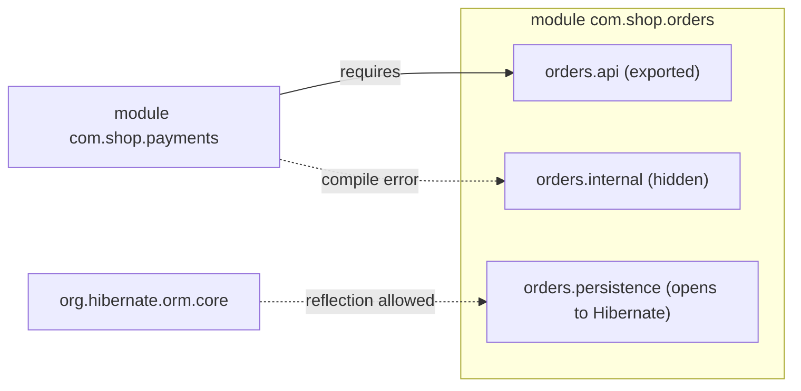

## Simple definition

The **Java Platform Module System (JPMS)**, introduced in Java 9 (Project Jigsaw), groups packages into **modules** with explicit **dependencies** (`requires`) and an explicit **public API** (`exports`). Everything else is **strongly encapsulated**: other modules cannot use it, even through reflection.

## The problem

On the classpath:

- every `public` class is visible to everyone, so "internal" packages become someone's dependency
- missing JARs are discovered only at runtime (`NoClassDefFoundError`)
- duplicate classes on the classpath cause "JAR hell"
- the JDK itself was a monolith that applications reached into (`sun.misc.*`).

## module-info.java

```java
module com.shop.orders {
    requires java.sql;                          // dependency
    requires transitive com.shop.common;        // consumers of orders also get common
    requires static com.github.spotbugs.annotations; // compile-time only

    exports com.shop.orders.api;                // public API
    exports com.shop.orders.spi to com.shop.payments; // qualified export

    opens com.shop.orders.persistence to org.hibernate.orm.core; // deep reflection allowed
    uses com.shop.orders.spi.PricingRule;       // consumes a service
    provides com.shop.orders.spi.PricingRule with com.shop.orders.internal.DefaultPricing;
}
```

| Directive | Meaning |
|---|---|
| `requires` | This module needs another. Checked at startup ("reliable configuration"). |
| `requires transitive` | Re-export a dependency to your consumers (implied readability) |
| `requires static` | Needed at compile time, optional at runtime |
| `exports` | Public types in the package are accessible to other modules |
| `opens` | Allows **deep reflection** (private members) at runtime: frameworks, serialisation |
| `uses` / `provides … with` | `ServiceLoader`-based plug-ins |



## Module path vs classpath

| | Module path | Classpath |
|---|---|---|
| Unit | Named modules | JARs merged into the **unnamed module** |
| Encapsulation | Strong | None (all public types visible) |
| Missing dependency | Fails at startup | Fails when first used |
| Split packages | Not allowed | Allowed (and dangerous) |

- **Automatic modules:** a plain JAR on the module path becomes a module named from its `Automatic-Module-Name` manifest entry or its file name. It exports everything and reads everything, which is a bridge for migration.
- **The unnamed module:** everything on the classpath. It can read all modules but cannot be required by named modules.

## Strong encapsulation of the JDK

Since **JDK 16 (JEP 396) and 17 (JEP 403)**, internal JDK packages are strongly encapsulated. Old libraries using deep reflection need `--add-opens java.base/java.lang=ALL-UNNAMED` until they are upgraded. Treat that flag as **technical debt**.

## jlink: custom runtimes

```bash
jlink --add-modules com.shop.orders,java.sql --strip-debug --no-header-files \
      --no-man-pages --compress zip-6 --output build/runtime
```

This produces a trimmed runtime containing only the needed JDK modules, giving **smaller container images** and a smaller attack surface. Use `jdeps --print-module-deps app.jar` to discover which JDK modules you need, even for classpath applications.

## Module import declarations (Java 25)

**JEP 511** (final in Java 25) lets you import all packages exported by a module:

```java
import module java.base;      // List, Map, Stream, Path… without individual imports
```

This is convenient for scripts, teaching and prototypes. In large codebases, explicit imports keep dependencies clearer.

## JPMS in the real world

- **Libraries** benefit most: publish a `module-info` (or at least `Automatic-Module-Name`) so users can modularise.
- **Spring Boot applications** usually run on the **classpath**. Spring supports modules, but full modularisation with reflection-heavy frameworks (`opens` for Hibernate, Jackson and Spring) adds friction for limited gain.
- For **architectural modularity inside an application**, many teams use **Spring Modulith** or ArchUnit rules. They verify module boundaries in tests and document them, without JPMS's runtime constraints. See [modular monolith](/microservices/fundamentals/microservices-vs-modular-monolith).

| Need | Tool |
|---|---|
| Enforce a library's public API | JPMS `exports` |
| Smaller runtime image | `jlink` / `jdeps` |
| Enforce boundaries inside a Spring app | Spring Modulith, ArchUnit |
| Plug-ins | `ServiceLoader` with `uses`/`provides` |

## Common mistakes

> [!MISTAKE] Split packages
> The same package in two modules fails on the module path. Merge or rename the packages.

> [!MISTAKE] `--add-opens` everywhere
> It silences encapsulation errors but keeps fragile reflective dependencies. Upgrade libraries instead.

> [!MISTAKE] Exporting everything
> Exporting internal packages defeats the purpose. Export only the API packages.

## Quick check

**`exports` vs `opens`?**
`exports` gives compile-time and runtime access to public types. `opens` gives runtime deep-reflection access (including private members) for frameworks.

**What is an automatic module?**
A plain JAR placed on the module path. It gets a module name, exports all its packages and reads all other modules, which is a migration bridge.

**What does `requires transitive` do?**
Modules that read yours also read that dependency, because it is part of your API.

**What is jlink for?**
Building a custom, minimal Java runtime that contains only the modules an application needs.

**What does `import module java.base;` do (Java 25)?**
It imports all packages exported by the `java.base` module.

## Summary

- Modules declare dependencies and public APIs; everything else is strongly encapsulated.
- The module path gives reliable configuration; the classpath remains the norm for many apps.
- jlink builds lean runtimes; JDK internals are closed by default.
- Inside Spring apps, Spring Modulith or ArchUnit often enforces boundaries more practically.

## References

- OpenJDK, [JEP 261: Module System](https://openjdk.org/jeps/261), [JEP 403](https://openjdk.org/jeps/403), [JEP 511: Module Import Declarations](https://openjdk.org/jeps/511).
- Oracle, [jlink](https://docs.oracle.com/en/java/javase/21/docs/specs/man/jlink.html) and [jdeps](https://docs.oracle.com/en/java/javase/21/docs/specs/man/jdeps.html).
- [Spring Modulith reference](https://docs.spring.io/spring-modulith/reference/).
