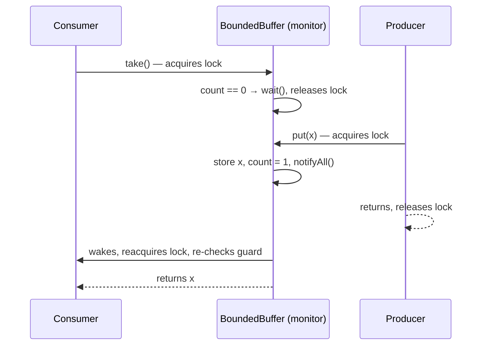

## Simple definition

A **state-dependent action** is an operation that only makes sense when an object is in a certain state: you cannot take an item from an empty queue, withdraw from an empty account, or start an engine that is already running. In a single-threaded program, the wrong state is an error. In a concurrent program, the state might become right **if you wait**, because another thread may change it.

Doug Lea lists the possible **policies** for such a request:

| Policy | What the method does | Example |
|---|---|---|
| **Balking** | Refuses immediately: throws, or returns a status | `Optional`-returning `poll()`, `IllegalStateException` |
| **Guarded suspension** | Waits until the state is right | `BlockingQueue.take()` |
| **Timeout** | Waits up to a limit, then gives up | `BlockingQueue.poll(1, SECONDS)` |
| **Optimistic retry** | Tries, and retries on conflict | CAS loops |
| **Inaction** | Ignores the request | Calling `start()` on a started service that tolerates it |

Choosing the policy is part of designing the interface; the JDK's `Queue` versus `BlockingQueue` methods show all of them side by side.

## Balking

Balk when waiting would be pointless or harmful: the state will not change soon, or the caller should decide what to do.

```java
public final class Engine {
    private boolean running;

    public synchronized boolean start() {
        if (running) {
            return false;                  // balk: already running
        }
        running = true;
        return true;
    }
}
```

The check and the state change must be in the same synchronized block, or two threads could both start the engine.

## Guarded suspension with wait/notify

Guarded suspension blocks the caller until a **guard** (a condition on the state) is true. Java's built-in mechanism is the monitor: every object has a lock and a **wait set**.

```java
public final class BoundedBuffer<T> {
    private final Object[] items;
    private int putIndex, takeIndex, count;

    public BoundedBuffer(int capacity) { items = new Object[capacity]; }

    public synchronized void put(T item) throws InterruptedException {
        while (count == items.length) {     // guard: not full
            wait();                          // releases the lock while waiting
        }
        items[putIndex] = item;
        putIndex = (putIndex + 1) % items.length;
        count++;
        notifyAll();                         // state changed: wake waiters to re-check
    }

    @SuppressWarnings("unchecked")
    public synchronized T take() throws InterruptedException {
        while (count == 0) {                 // guard: not empty
            wait();
        }
        T item = (T) items[takeIndex];
        items[takeIndex] = null;
        takeIndex = (takeIndex + 1) % items.length;
        count--;
        notifyAll();
        return item;
    }
}
```

The rules, each preventing a real bug:

1. **Always wait in a `while` loop**, never an `if`. A thread can wake up spuriously, or another thread can grab the item between the notify and the moment the waiter reacquires the lock.
2. **Hold the lock** when calling `wait`, `notify` and `notifyAll` (otherwise `IllegalMonitorStateException`), and change the state under the same lock.
3. **Prefer `notifyAll()`.** With one wait set shared by producers and consumers, `notify()` may wake the wrong kind of waiter, and the signal is lost. `notify()` is safe only when all waiters wait for the same condition and any one of them can proceed.
4. **Never wait while holding another object's lock** — that causes nested monitor lockout (see [Designing concurrent objects](/java/advanced/concurrent-object-design)).



## Explicit conditions with Lock and Condition

`java.util.concurrent.locks.Condition` gives a lock **several** wait sets, so producers and consumers wait separately and `signal()` wakes exactly the right kind of thread:

```java
private final ReentrantLock lock = new ReentrantLock();
private final Condition notFull = lock.newCondition();
private final Condition notEmpty = lock.newCondition();

public void put(T item) throws InterruptedException {
    lock.lock();
    try {
        while (count == items.length) notFull.await();
        enqueue(item);
        notEmpty.signal();                 // wake one consumer, not a producer
    } finally {
        lock.unlock();
    }
}
```

`Condition` also offers `await(time, unit)`, `awaitNanos` and `awaitUninterruptibly`. This is how `ArrayBlockingQueue` is implemented.

## Timeouts

Waiting forever is rarely acceptable in a server: a lost producer becomes a stuck consumer thread. Bound every wait and decide what happens on expiry.

```java
public T take(Duration timeout) throws InterruptedException, TimeoutException {
    long remaining = timeout.toNanos();
    lock.lock();
    try {
        while (count == 0) {
            if (remaining <= 0) throw new TimeoutException("buffer empty for " + timeout);
            remaining = notEmpty.awaitNanos(remaining);   // returns the time still left
        }
        return dequeue();
    } finally {
        lock.unlock();
    }
}
```

Recompute the remaining time after each wakeup; restarting the full timeout on every spurious wakeup can wait forever.

## Interruption

`wait`, `await`, `sleep`, `join` and blocking queue operations throw `InterruptedException` when another thread calls `interrupt()`. Interruption is Java's **cooperative cancellation** signal. Handle it deliberately:

- **Propagate it** (declare `throws InterruptedException`) — the best option for library code.
- Or **restore the flag** and return: `Thread.currentThread().interrupt();`.
- **Never swallow it** with an empty `catch`; the thread's owner loses the ability to stop it.

See [Cancellation](/java/advanced/concurrency-design-patterns#cancellation).

## The inheritance anomaly

Lea points out that guarded methods are hard to extend. Suppose a subclass of `BoundedBuffer` adds `takeTwo()`. Its guard (`count >= 2`) is different, so the parent's notifications may need to change too, and overriding one method can silently break the waiting logic of another. Mitigations:

- Make guarded classes `final` and extend by composition.
- Centralise state tracking: compute a logical state after each change and notify once, in one place, so new guards only need to be added there.
- Use library synchronizers instead of hand-written monitors.

## Use the library first

Hand-written `wait`/`notify` is now rarely necessary. `java.util.concurrent` provides tested implementations of the common guarded objects:

| Need | Use |
|---|---|
| Producer/consumer hand-off | `ArrayBlockingQueue`, `LinkedBlockingQueue`, `SynchronousQueue` |
| Wait until N events have happened | `CountDownLatch` |
| Threads wait for each other at a point, repeatedly | `CyclicBarrier`, `Phaser` |
| Limit concurrent access to N permits | `Semaphore` |
| Wait for a result computed elsewhere | `Future`, `CompletableFuture` |
| Wait for any state change on a custom object | `ReentrantLock` + `Condition` |

```java
BlockingQueue<Order> queue = new ArrayBlockingQueue<>(1_000);
queue.put(order);                                         // guarded suspension
Order next = queue.poll(500, TimeUnit.MILLISECONDS);      // timeout; null on expiry
boolean accepted = queue.offer(order);                    // balking
```

## Common mistakes

> [!MISTAKE] if instead of while around wait()
> `if (count == 0) wait();` returns from `wait` and proceeds even when the buffer is still empty (spurious wakeup, or another consumer won the race). Always re-check the guard in a loop.

- **`notify()` with heterogeneous waiters**, losing the wake-up.
- **Changing state without notifying**, so waiters sleep forever.
- **Waiting without a timeout** in request-handling threads.
- **Swallowing `InterruptedException`.**
- **Polling with `Thread.sleep` in a loop** (busy-waiting) instead of blocking on a condition: wastes CPU and adds latency.

## Quick check

**What is the difference between balking and guarded suspension?**
Balking refuses immediately when the state is wrong; guarded suspension waits until the state becomes right.

**Why must `wait()` be called in a loop?**
Because of spurious wakeups and because the condition can change again between the notification and reacquiring the lock.

**When is `notify()` safe instead of `notifyAll()`?**
Only when every waiter waits for the same condition and any single waiter can make progress.

**What advantage does `Condition` have over `wait/notify`?**
Several wait sets per lock, so different conditions are signalled separately, plus timed and uninterruptible waits.

**How should library code handle `InterruptedException`?**
Propagate it, or restore the interrupt flag with `Thread.currentThread().interrupt()` before returning.

## Summary

- State-dependent requests need an explicit policy: balk, wait, wait with timeout, or retry.
- Guarded suspension: wait in a loop, under the lock, and signal every state change.
- Prefer `Condition` for multiple conditions and always bound waits in servers.
- Use `BlockingQueue`, latches, barriers and semaphores before writing your own monitor.

## Related topics

- [Designing Concurrent Objects](/java/advanced/concurrent-object-design)
- [Concurrency Design Patterns](/java/advanced/concurrency-design-patterns)
- [The Java Concurrency API](/java/advanced/concurrency-api)
- [State Pattern](/design-patterns/behavioral/state)

## References

- Doug Lea. *Concurrent Programming in Java: Design Principles and Patterns* (2nd edition). Addison-Wesley, 1999. Chapter 3: State Dependence (balking, guarded methods, timeouts, the inheritance anomaly).
- Brian Goetz et al. *Java Concurrency in Practice*. Addison-Wesley, 2006. Chapter 14: Building custom synchronizers.
- [`java.util.concurrent.locks.Condition`](https://docs.oracle.com/en/java/javase/21/docs/api/java.base/java/util/concurrent/locks/Condition.html), Java SE 21 API.
